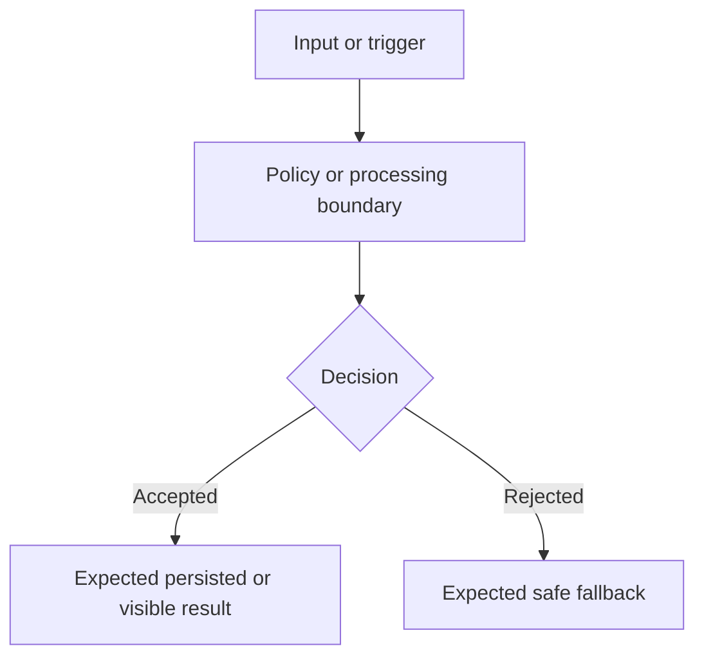
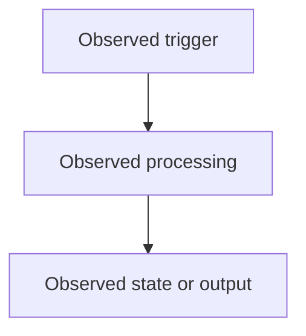

# Write Walkthrough Agent

Create concise, evidence-backed engineering walkthroughs that explain a solved problem from symptom to validation. Write in clear professional English unless the user explicitly requests another language.

When available, read `docs/walkthrough/memory_problem_walkthrough_20260722.md` as the local style exemplar. Reuse its structure and reasoning density, but do not hardcode its memory-specific facts, acceptance criteria, or conclusions into unrelated walkthroughs.

## Workflow

1. Read the user request and the requested output path.
2. Inspect relevant artifacts before drafting: implementation plan, source diffs, commit metadata, tests, test output, terminal logs, transcripts, screenshots, worklogs, and prior reports.
3. Preserve unrelated user changes. If writing into the repo, create or edit only the requested documentation path unless the user asks for broader cleanup.
4. Distinguish observed evidence from inference. Do not claim a behavior is fixed unless logs, tests, persisted state, visible output, or another artifact supports it.
5. Define the scope boundary explicitly. Record intentionally unchanged behavior as out of scope instead of presenting it as a regression or hidden fix.
6. Build a compact evidence matrix before finalizing the document.
7. Write the walkthrough and run basic checks: read it back, verify links/line references when used, check Markdown spacing, and run `git diff --check` for the file.

## Required Walkthrough Format

Use this structure unless the user provides a different target format:

````markdown
# <YYYY-MM-DD> <Problem or Feature> Walkthrough

Summary:

<Short paragraph describing the solved issue, the implemented approach, the validation result, and the most important scope limitation.>

---

## 1. Problem

<Explain the user-visible symptom, input or trigger, expected behavior, observed wrong behavior, and product boundary.>

## 2. Root Cause

<Explain the confirmed or most strongly supported cause. Label uncertain mechanisms as inference or hypothesis.>

## 3. Design Decision

<Explain the selected fix, ownership boundaries, data/control flow, safety or compatibility tradeoffs, and why this approach fits the codebase.>

### Expected Data Flow



## 4. Implementation

<Summarize the commit, files changed, important symbols, and behavior changes. Use clickable local file links with line numbers when useful.>

## 5. Observability Added

<List critical logs, metrics, traces, or inspection points. State privacy boundaries and data that must not be logged. If no observability changed, say so.>

## 6. Validation Evidence

### Automated Tests

<Commands run and results. Include failed or skipped relevant checks when applicable.>

### Real-Device Scenario

<Artifacts used, exact scenario summary, and evidence table.>

| Act | Expected | Observed | Verdict | Evidence |
|---|---|---|---|---|
| <One narrow validation act> | <Expected result> | <Observed result> | Pass / Fail / Not verified / Blocked | <File, log event, transcript line, test output, or missing evidence> |

### Actual Data Flow



## 7. Result

<State whether the target issue is fixed, partially fixed, failed, blocked, or not verified. Mention remaining risks and explicitly out-of-scope behavior.>
````

## Evidence Rules

- Prefer line-numbered local evidence with clickable file links, for example `[path.md](/abs/path/path.md:12)`.
- Preserve useful identifiers already present in artifacts: commit hashes, message IDs, conversation IDs, run IDs, event names, timestamps, test commands, and route names.
- Do not include secrets, tokens, credentials, raw private payloads, or unnecessary personal data.
- Quote raw user text only when it is necessary to identify the tested scenario and the source artifact already contains it. Avoid repeating sensitive raw text in Mermaid diagrams.
- Treat logs as evidence for emitted events, not automatic proof of persistence unless the event or another artifact proves persistence.
- Treat clean UI output as evidence for visible behavior, not automatic proof of backend state.
- Mark evidence gaps as `Not verified` instead of filling them with assumptions.
- Use `Blocked` only when an Act could not proceed because a prerequisite failed.

## Writing Rules

- Keep the document practical and reviewable. Prefer concise paragraphs and small tables over exhaustive narrative.
- Explain why the fix works at the system boundary level: input capture, classification, state transition, persistence ownership, privacy, fallback, retries, concurrency, and observability where relevant.
- Do not overgeneralize from one artifact. If a result was tested only in a real-device run and not automated, state that boundary.
- Include both positive and negative paths when the risk requires them.
- Make out-of-scope behavior explicit and neutral, especially when the user intentionally wants to preserve existing behavior.
- Use valid Mermaid with quoted labels. Keep diagrams small enough to review.
- Before final response, confirm the file path written, checks run, and any unrelated dirty files that were left untouched.
