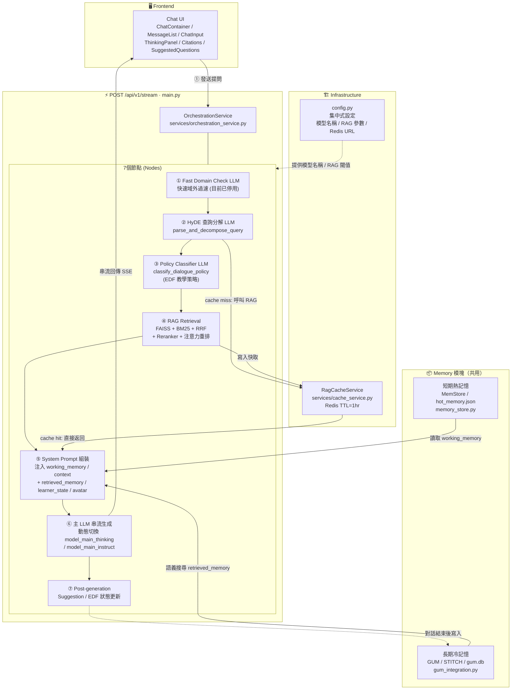
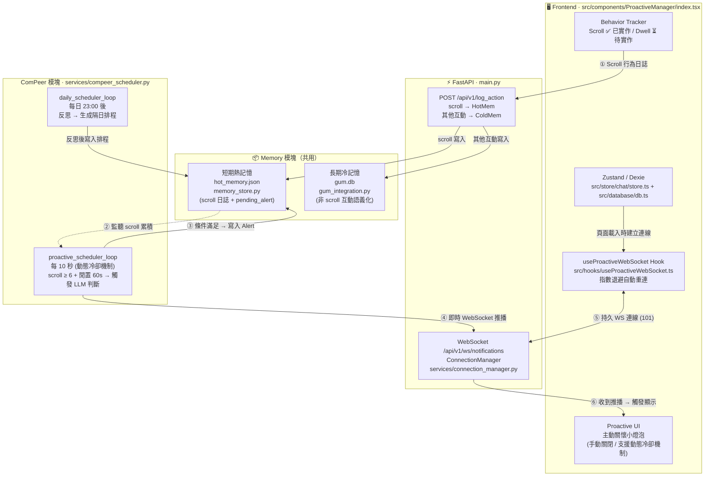
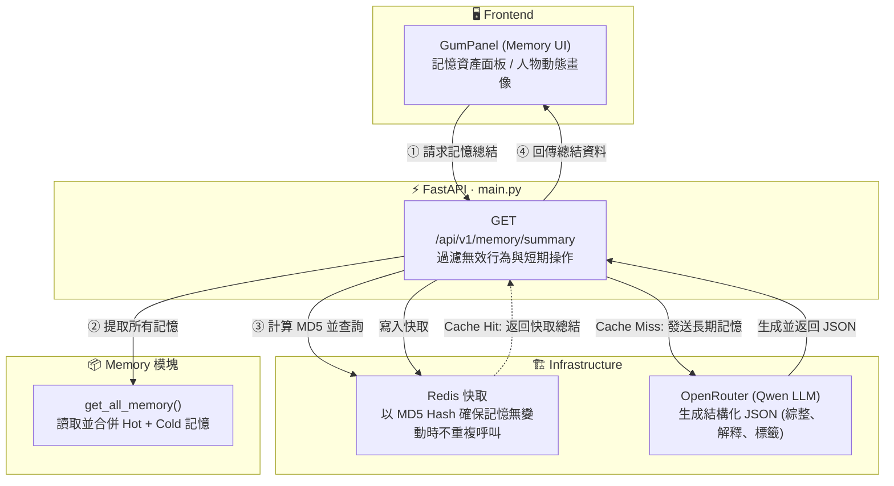

# AREQA: An **A**daptive **R**AG-based **E**ducational **QA** System over Closed-domain Knowledge Bases.

---

發音非常像英文的 "Eureka"（我找到了！），這是一個與「發現知識、學習頓悟」完美契合的發音。而且它唸起來像是一個溫雅的字，帶有陪伴與引導感。

---

## 當前系統架構圖

> **最後更新**：2026-07-04（深度優化 Perplexity Search API 整合、記憶與主動關懷模組）

### 路徑 A：對話生成路徑 (Chat Path)
> 實際端點：`POST /api/v1/stream`



---

### 路徑 B：主動關懷路徑 (ComPeer Proactive Path)



---

### 路徑 C：記憶檢視與綜整路徑 (Memory Visualization Path)



---

## 核心系統模組

### 1. 知識檢索與網路搜尋 (RAG & Web Search)
- **混合檢索機制 (Hybrid Retrieval)**: 整合 `FAISS` 向量檢索與 `BM25` 關鍵字檢索，並透過倒數排名融合 (`RRF`) 與重排模型 (`Reranker`) 獲取最相關的資料段落。
- **注意力重排序 (Lost in the Middle Reordering)**: 將最高關聯度的文獻置於首尾，優化 LLM 長上下文注意機制。
- **Perplexity 聯網檢索**: 整合 **Perplexity Search API (`/search` 端點)** 進行純網頁內容检索，回傳包含網頁標題 (`title`)、來源網址 (`url`) 與文字精確段落 (`snippet`) 的結構化資料。
- **文獻渲染與防閃爍機制**: 
  - 前端以美觀的卡片網格展示所有引用的文獻來源，支援網站圖標 (`favicon`) 顯示以及右上角一鍵跳轉至原始網頁的功能。
  - 前端實裝 Vercel 的 `remend` 自癒 Markdown 解析與 React 的 `useDeferredValue` 機制，確保串流 (Streaming) 過程中語法崩潰時畫面絕不閃爍。
  - 行內引用標籤設計為極具質感的金色圓角方塊 (Golden Citation Chips)，精確對齊文字高度，並具備優雅的 Hover 狀態，點擊後可精確彈出對應的文獻 Modal。

### 2. 教育認知與 EDF 教學策略模組
- **學習者狀態判定 (EDF - Evidence-Decision-Feedback)**: 系統實時追蹤使用者的對話歷史，分析並分類目前的學習狀態：
  - `NOT_STARTED`: 尚未正式開始學習，引導為主。
  - `STARTING`: 初學階段，系統會**動態限制表達難度**，禁止使用未解釋的艱澀名詞。
  - `TINKERING`: 摸索建構概念，輔以實例引導。
  - `RUN_REPEAT`: 盲目重複陷入瓶頸。
  - `GIVING_UP`: 挫折感過重，需要教學鷹架與情緒安撫。
  - `MASTERY`: 已掌握知識，觸發學術辯論與魔鬼代言人策略。
- **英靈附體對話模式 (Active Avatar)**: 偵測使用者提及的哲學家或歷史人物（如蘇格拉底、柏拉圖、房龍），自動召喚並以第一人稱切換語意語境與使用者對話。

### 3. 主動關懷與信箱系統 (ComPeer & Mailbox)
- **遙測與行為追蹤 (Action Telemetry)**: 追蹤使用者的滾動（Scroll）等行為。當檢測到頻繁滾動且閒置時，判定為面臨學習挫折，主動透過 WebSocket 送出關懷彈窗。
- **信箱系統 (Mailbox)**: 召喚的歷史人物（Avatar）會主動發送富含教育啟發意義的信件至使用者的本地信箱。使用者可手動回信，人物會在一段時間後寫信回覆。
- **冷卻與排程機制**: 根據學習者狀態實施動態冷卻機制，防範過度打擾。每日 23:00 後，GUM 模組會反思當日學習日誌，規劃隔日的主動關懷排程。

### 4. 記憶管理與可視化 (GUM Memory UI)
- **長期記憶綜整 (LLM Summary)**: 系統具備專屬的記憶面板 (`GumPanel`)，可調用 `GET /api/v1/memory/summary` 讀取並分析冷記憶 (`gum.db`) 內的長期互動行為與學習軌跡。
- **動態人物畫像**: 透過大型語言模型（預設使用 Qwen）動態生成結構化的使用者畫像，包含「一句話認識使用者」、深度行為解釋以及專屬的興趣標籤 (`hashtags`)。
- **快取最佳化 (Redis Caching)**: 針對長期記憶字串進行 MD5 雜湊，並結合 Redis 進行結果快取，當記憶無變動時可實現毫秒級回應，大幅降低 LLM 呼叫延遲與成本。
- **記憶資產檢視 (Asset Modals)**: 前端實裝高質感的彈出式視窗，讓使用者能直觀預覽並探索系統為其建構的記憶脈絡與歷史紀錄。

---

## 🛠️ 建置與運行環境

AREQA 分為 Python 後端與 Next.js 前端，兩端均支援並推薦使用環境變數設定。

### 1. 環境變數配置
複製根目錄下的環境變數範例：
```bash
cp .env.example .env
```
主要變數說明：
- `OPENROUTER_API_KEY`: 呼叫 LLM 與 Embedding 服務的 API 密鑰。
- `PERPLEXITY_API_KEY`: Perplexity 網路搜尋服務的 API 密鑰。
- `HF_TOKEN` / `HF_ENDPOINT_URL`: RAG 本地 Hugging Face 端點設定。

### 2. 後端運行步驟 (Python 3.9+)
後端使用 FastAPI 提供高效非同步 SSE 串流服務，並使用 Redis 進行 RAG 快取。
```bash
cd backend
# 建立並啟用虛擬環境 (以 venv 為例)
python -m venv .venv
source .venv/bin/activate
# 安裝依賴
pip install -r requirements.txt
# 啟動 Redis 服務 (預設 redis://localhost:6379)
# 啟動 FastAPI 後端伺服器
python -m uvicorn main:app --host 0.0.0.0 --port 8000 --reload
```

### 3. 前端運行步驟 (Node.js v18+)
前端基於 Next.js App Router 與 Ant Design 建立，數據持久化使用 IndexedDB (Dexie)。
```bash
cd frontend
# 安裝前端依賴
npm install
# 啟動開發伺服器
npm run dev
```

---

## 🧪 測試

- **後端測試**: 包含檢索節點、SSE 串流等單元與整合測試：
  ```bash
  pytest tests/backend/ -v
  ```
- **前端測試**: 使用 Vitest 進行 UI Store 等單元測試：
  ```bash
  cd frontend
  npm run test
  ```