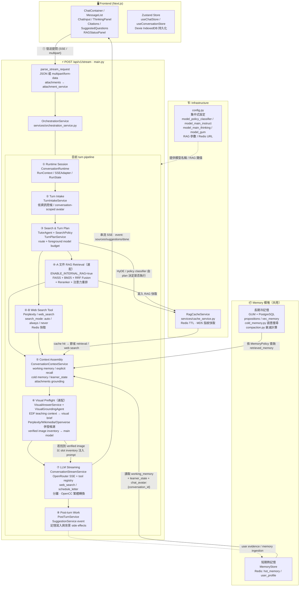
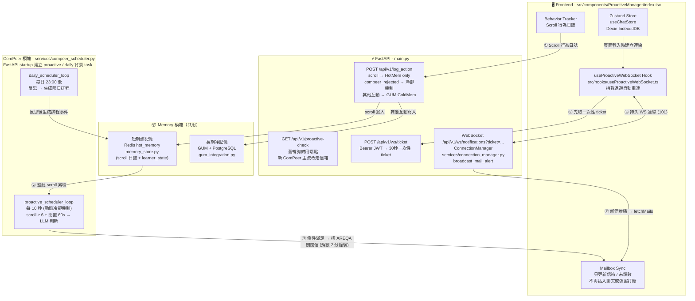
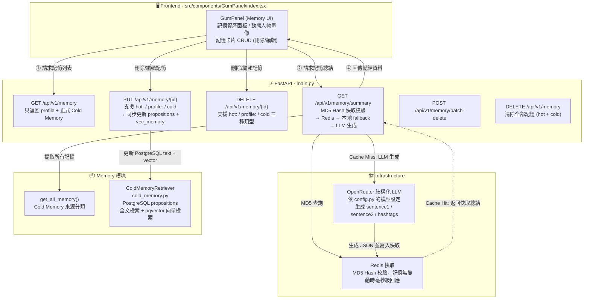

# AREQA: **A**daptive **R**AG-based **E**ducational **QA** System
「AREQA：懂你所學，伴你所讀」

---

發音非常像英文的 "Eureka"（我找到了！），這是一個與「發現知識、學習頓悟」完美契合的發音。而且它唸起來像是一個溫雅的字，帶有陪伴與引導感。

---

## 當前系統架構圖

> **最後更新**：2026-08-27（依目前 GitHub Codespace、frontend / backend 實際代碼與腳本校正）

> 更新這份文件時，請以目前工作區中的 `frontend/`、`backend/`、`docs/deployment/render.example.yaml`、`frontend/package.json`、`backend/requirements.txt` 與 `backend/main.py` 的實際 route 為準。

---

## Codespace 快速開始

目前 Codespace 由 `.devcontainer/devcontainer.json` 建立（容器名稱 `AREQR Dev`），基底是 `mcr.microsoft.com/devcontainers/base:ubuntu`，並透過 devcontainer features 安裝：

- Node.js 20（目前工作區驗證為 `v20.20.2`，npm `10.8.2`；Render 前端設定為 Node `20.11.0`）
- Python 3.11（目前 `backend/.venv/bin/python` 為 `3.11.15`；Render 後端設定為 Python `3.10.12`）
- Git LFS
- VS Code Python / Pylance / Codex extension

`postCreateCommand` 會執行 `.devcontainer/setup.sh`，負責：

- `git lfs install --skip-smudge` 與 `git lfs pull`
- 安裝 Antigravity CLI (`agy`)
- 安裝 Drift (`drift`, `driftdetect-mcp`)
- 安裝 Codex CLI (`codex`)
- 建立 `backend/.venv`，優先用 `uv pip install` 安裝 `backend/requirements.txt`（無 `uv` 時才 fallback 到 pip）
- 安裝 `frontend/node_modules`
- 在 shell 啟動時自動啟用 `backend/.venv`

若 Codespace 重建後需要重新安裝依賴，直接重新執行：

```bash
bash .devcontainer/setup.sh
```

`postAttachCommand` 會執行 `.devcontainer/on-attach.sh`，負責檢查 `agy` / `drift` / `codex`，必要時初始化 `.drift`，並嘗試啟動 Redis。注意：目前這個 Codespace 映像沒有可用的 `redis-server` service，因此 `on-attach.sh` 會顯示 Redis 啟動失敗；若功能需要 Redis，請設定外部 `REDIS_URL`，或在 Codespace 中自行安裝並啟動 Redis。

### 啟動完整開發服務

從專案根目錄執行：

```bash
npm run dev
```

這會同時啟動：

- FastAPI backend: `0.0.0.0:8000`
- Next.js frontend: `0.0.0.0:3000`

Codespaces 會將 port 3000 與 8000 轉發到瀏覽器可開啟的 URL。主要使用前端 port 3000；FastAPI Swagger UI 在 backend port 8000 的 `/docs`。

若根目錄 `node_modules` 不存在，先執行：

```bash
npm install
```

若前端依賴不存在或 lockfile 更新，執行：

```bash
npm ci --prefix frontend
```

若後端虛擬環境不存在或套件過期，執行：

```bash
python3.11 -m venv backend/.venv
python3.11 -m pip install --user --upgrade uv
uv pip install --python backend/.venv/bin/python --upgrade pip setuptools wheel
uv pip install --python backend/.venv/bin/python -r backend/requirements.txt
```

若部署環境沒有 `uv`，仍可使用 `./backend/.venv/bin/pip install -r backend/requirements.txt`；requirements 檔仍是後端依賴來源。

### 常用指令

```bash
# 同時啟動 backend + frontend
npm run dev

# 只啟動 backend
./backend/.venv/bin/python -m uvicorn main:app --app-dir backend --host 0.0.0.0 --port 8000 --reload

# 只啟動 frontend
npm run dev --prefix frontend

# 前端 production build
npm run build

# 測試
npm run test:frontend
npm run test:backend
npm run test:all

# 前端 lint / typecheck 報告
npm run lint:report
npm run typecheck:report
npm run check:report:strict

# 直接執行前端 lint / typecheck
npm run lint --prefix frontend
npm run typecheck --prefix frontend

# Drift 重新掃描
drift scan backend frontend --force
```

前端也提供以下測試指令：

```bash
npm test --prefix frontend
npm run test:watch --prefix frontend
npm run test:coverage --prefix frontend
npm run test:smoke --prefix frontend
```

### Codespace 環境變數

目前程式會從專案根目錄 `.env` 載入後端設定；前端 `predev` / `prebuild` 會自動把根目錄 `.env.local` 或 `.env` 複製到 `frontend/.env.local`。請不要把真實金鑰提交到 Git。

完整聊天與記憶功能通常需要：

- `OPENROUTER_API_KEY`: 主 LLM、標題生成、GUM、記憶總結、建議問題、embedding / retrieval，以及預設 OpenRouter web search 相關流程。
- `NEXT_PUBLIC_SUPABASE_URL` / `NEXT_PUBLIC_SUPABASE_ANON_KEY`: 前端 Supabase client 與後端 JWKS 驗證來源。
- `SUPABASE_SERVICE_ROLE_KEY`: 後端專用，用於把 PDF 附件渲染出的圖上傳到 private Supabase Storage bucket 並產生 signed URL；不可暴露到前端。
- `JWT_SECRET`: Supabase HS 系列 JWT 驗證；若 JWT 演算法不是 HS 系列，後端會改走 Supabase JWKS。
- `REDIS_URL`: hot memory、user profile、working memory、mailbox cache、RAG cache、visual answer cache 與 WS ticket。預設為 `redis://localhost:6379`，但目前 Codespace 沒有可用的本機 Redis service。
- `DATABASE_URL`: PostgreSQL / pgvector，供 GUM、cold memory、agent jobs 使用。
- `PERPLEXITY_API_KEY`: 選配 Perplexity web search fallback 與 visual image search；未設定時相關 provider 會 fail-soft，不阻斷主回答。
- `TAVILY_API_KEY`: 選配 visual image provider；未設定時 Tavily 圖片查詢會 fail-soft 並交給下一個 provider。
- `SERPAPI_API_KEY`: 選配 SerpAPI Google Images provider；未設定時 SerpAPI 圖片查詢會 fail-soft，不阻斷主回答。
- `HF_TOKEN`: Hugging Face 相關整合使用的 token（目前可選）。

選配：

- `GUM_DATABASE_URL`: GUM 專用資料庫 URL，優先於 `DATABASE_URL`。
- `MAILBOX_DATABASE_URL`: mailbox 專用資料庫 URL，優先於 `DATABASE_URL`；失敗時回退到 Redis。
- `NEXT_PUBLIC_BACKEND_URL`: 前端直連 FastAPI 的 base URL，預設使用 `http://localhost:8000` 或 `http://127.0.0.1:8000`。
- `ENABLE_INTERNAL_RAG=true`: 啟用本地文件 RAG，需另備 `data/rag/faiss_index/` 與 `data/rag/bm25_index/`。
- `ENABLE_VISUAL_PREFLIGHT=true`: 主模型輸出前先嘗試搜尋可用圖片，預設開啟。
- `ENABLE_VISUAL_PREFLIGHT_PARALLEL_PROVIDERS=true`: preflight 圖片搜尋併發查詢 Perplexity / Wikimedia / Openverse，預設開啟。
- `PERPLEXITY_VISUAL_SEARCH_TIMEOUT_SECONDS`: Perplexity image search 單次 timeout，預設 `4.5` 秒。
- `VISUAL_PREFLIGHT_TIMEOUT_SECONDS`: 整體圖片 preflight timeout，預設 `6.0` 秒。
- `VISUAL_GROUNDING_TIMEOUT_SECONDS` / `VISUAL_UNDERSTANDING_TIMEOUT_SECONDS`: 圖片 grounding 與理解模型 timeout，預設分別為 `1.5` / `4.0` 秒。
- `ENABLE_VISUAL_UNDERSTANDING`: 啟用輸出圖片的理解驗證，預設開啟。
- `ENABLE_PDF_PAPER_AUTO_EXPLAIN`: PDF attachment 搭配泛用「幫我看/解釋這篇」請求時，自動套用論文導讀結構，預設開啟。
- `ENABLE_PDF_ATTACHMENT_IMAGE_STORAGE`: 啟用 PDF 圖片持久化，預設開啟；需搭配 `SUPABASE_SERVICE_ROLE_KEY` 與已建立的 Storage bucket。
- `PDF_ATTACHMENT_IMAGE_STORAGE_BUCKET`: PDF 圖片持久化 bucket，預設 `areqa-pdf-visuals`。建議設為 private bucket，後端會回傳 signed URL。
- `PDF_ATTACHMENT_IMAGE_SIGNED_URL_TTL_SECONDS`: PDF 圖片 signed URL 有效秒數，預設 `2592000`（30 天）。
- `ENABLE_TAVILY_VISUAL_SEARCH` / `ENABLE_SERPAPI_VISUAL_SEARCH`: 控制備援圖片 provider，預設開啟。
- `ENABLE_MAILBOX_FEATURE` / `ENABLE_COMPEER_FEATURE` / `ENABLE_COMPEER_TELEMETRY`: 控制瀏覽器可見的 Mailbox、ComPeer 與遙測功能；目前預設皆為關閉，後端 `/api/v1/features` 會以安全的布林值提供前端。
- `ENABLE_MAILBOX_SENDING` / `ENABLE_COMPEER_AUTO_PROACTIVE`: 分別控制寄信與自動主動關懷；目前預設關閉。
- `ENABLE_SHARE_LINK_DEBUG_LOGS`: 控制分享連結診斷 log，預設開啟；log 僅接受白名單欄位。
- `NEXT_PUBLIC_CHAT_API_ENDPOINT`: 前端聊天代理端點，預設 `/api/chat`。
- `NEXT_PUBLIC_API_TIMEOUT` / `NEXT_PUBLIC_MAX_MESSAGE_LENGTH` / `NEXT_PUBLIC_PARSER_MAX_BUFFER`: 前端請求 timeout、訊息長度與串流 parser buffer 上限，預設分別為 `30000`、`10000`、`102400`。
- `WEB_SEARCH_PROVIDER` / `MODEL_WEB_SEARCH` / `OPENROUTER_WEB_SEARCH_ENGINE` / `OPENROUTER_WEB_SEARCH_MAX_TOOL_CALLS`: 一般網路搜尋 provider、OpenRouter 搜尋模型、搜尋引擎與 server-tool 呼叫上限；預設分別為 `openrouter`、`google/gemini-3.8-flash`、`exa`、`2`。
- `WEB_SEARCH_MAX_RESULTS` / `WEB_SEARCH_CONTEXT_SIZE` / `ENABLE_WEB_QUERY_REWRITE`: 網路搜尋結果數、上下文大小與 query rewrite 控制；預設為 `15`、`high`、開啟。
- `FOREGROUND_MODEL_CALL_BUDGET_GENERAL` / `FOREGROUND_MODEL_CALL_BUDGET_LEARNING`: 一般聊天與學習路徑的前景模型呼叫預算，預設為 `2` / `3`。
- `COMPEER_DELIVERY_DELAY_SECONDS` / `COMPEER_COOLDOWN_OVERRIDE_SECONDS` / `COMPEER_PROACTIVE_MAIL_MIN_INTERVAL_SECONDS` / `COMPEER_DAILY_PROACTIVE_LIMIT`: ComPeer 投遞延遲、開發冷卻覆寫、主動信最短間隔與每日上限。
- `ENABLE_VISUAL_ANSWER_DEBUG_LOGS=true`: 輸出隱私安全的 visual answer 診斷 log；不記錄 raw prompt、圖片 URL、使用者原文或金鑰。

---

### 📁 專案檔案架構

#### Backend (`/backend`)

```
backend/
├── main.py                         # FastAPI 應用主入口，所有 API 端點定義
├── config.py                       # 集中式設定 (模型名稱 / RAG 參數 / Redis URL)
├── auth.py                         # Supabase JWT 驗證與 current_user 依賴
├── job_store.py                    # 背景工作佇列 / agent job worker
├── redis_client.py                 # Redis 連線封裝
├── memory_gate.py                  # 使用者訊息記憶資格與低資訊訊息分類
├── gum_integration.py              # GUM 長期記憶框架整合層
│                                   #   TextObserver / init_gum_instance
│                                   #   push_observation / query_cold_memory_for_context
│                                   #   delayed_reply_writer (信箱 Avatar 延遲回信)
│                                   #   ObservationQueueWorker (debounce 批次處理)
│                                   #   async_evaluate_and_update_state (EDF 狀態更新)
├── memory_store.py                 # 短期熱記憶管理
│                                   #   MemoryStore (Redis: hot_memory + user_profile + working_memory)
│                                   #   learner_state / current_strategy / chat_avatar:{conversation_id}
│                                   #   current_focus_conversation_id (working memory 作用域)
├── cold_memory.py                  # 長期冷記憶檢索
│                                   #   ColdMemoryRetriever (PostgreSQL + pgvector)
│                                   #   propositions 全文檢索 + vec_memory 向量檢索 + RRF 融合
├── compaction.py                   # GUM 記憶壓縮與衰減算法
│                                   #   calculate_activation_score (Activation Score)
│                                   #   STITCH 歸檔：符合來源條件的熱記憶 → 結構化冷記憶
├── mailbox_store.py                # 信箱訊息持久化
│                                   #   MailboxStore (Redis mailbox + delayed queue)
│                                   #   add_mail / get_all_mails / mark_as_read
├── core/                           # SSE / event / runtime / budget / state 公用核心
├── policies/                       # capability / memory / search policy
├── tools/                          # memory_query / delayed_mail / web_search registry
├── agents/                         # agent runtime 與 tutor agent
│
├── services/
│   ├── orchestration_service.py    # 串流總編排器 (turn plan / context / retrieval / stream)
│   ├── turn_plan_service.py        # 前景路由與模型呼叫預算規劃
│   ├── turn_intake_service.py      # 角色扮演入口、停止角色扮演與 turn intake
│   ├── conversation_context_service.py
│   │                               # working memory / long-term memory / EDF context 組裝
│   ├── conversation_stream_service.py
│   │                               # OpenRouter SSE 串流、tool calls、public output filter
│   ├── post_turn_service.py        # 回答後建議問題與背景 side effects
│   ├── query_policy_service.py     # HyDE 查詢拆解與 dialogue policy classifier
│   ├── attachment_service.py       # multipart 附件驗證、文字/圖片內容抽取
│   ├── visual_answer_service.py    # 圖文回答 preflight、provider 查詢、候選評分與 image blocks
│   ├── visual_grounding_agent.py   # 圖片意圖規劃與候選圖 grounding 檢查
│   ├── visual_understanding_agent.py# 輸出圖片內容理解與驗證
│   ├── output_image_service.py     # 輸出圖片的處理與理解流程
│   ├── memory_ingestion_service.py # user evidence → candidate/profile/cold memory 政策
│   ├── memory_extraction_agent.py  # 結構化記憶候選抽取
│   ├── hot_memory_service.py       # typed hot memory entries 與 provenance helper
│   ├── memory_semantic_analyzer.py # 選配 OpenRouter 語意候選分析
│   ├── explicit_memory_cache.py    # explicit recall memory 的 in-process TTL cache
│   ├── response_boundary_validator.py
│   │                               # 串流回答邊界檢查，避免模型代替使用者自述
│   ├── memory_retrieval_trace.py   # memory retrieval timing / diagnostic trace
│   ├── turn_latency_trace.py       # turn latency、model/tool call 計數與慢查診斷
│   ├── cache_service.py            # Redis RAG 快取服務 (RagCacheService)
│   ├── connection_manager.py       # WebSocket 連線管理 (ConnectionManager)
│   │                               #   broadcast_mail_alert
│   └── compeer_scheduler.py        # ComPeer 主動關懷排程
│                                   #   proactive_scheduler_loop / daily_scheduler_loop
│                                   #   FastAPI startup 目前會建立背景 task
│
└── data/                           # 運行時資料目錄 (git 忽略)
    └── gum_data/
        ├── {safe_user_id}/         # GUM 本地運行時資料目錄
        └── ...                     # 其他 GUM / RAG 運行時資料

# 補充：
# - hot memory、user profile、working memory、behavior signals、mailbox、delayed mail、visual cache 主要存於 Redis
# - GUM / cold memory 的正式資料層優先使用 GUM_DATABASE_URL 或 DATABASE_URL 指向的 PostgreSQL
# - 本地 data/gum_data 主要是 GUM 運行時資料目錄，不再是主資料庫說明
```

#### Shared Python Services (`/src/main/python/services`)

`backend/main.py` 會將 `src/main/python` 加入 `sys.path`，因此以下服務也是後端實際運行路徑的一部分：

```
src/main/python/services/
├── rag_service.py                  # 選配本地文件 RAG：FAISS + BM25 + RRF + context sanitizer
├── bm25_search.py                  # BM25 sparse retrieval
├── router_service.py               # OpenRouter query domain/router service
└── suggestion_service.py           # 回答後推薦問題生成
```

#### Frontend (`/frontend/src`)

```
frontend/src/
├── app/                            # Next.js 16.0.7 App Router
│   ├── layout.tsx                  # 根佈局 (全局字體 / Provider)
│   ├── page.tsx                    # 首頁入口
│   ├── globals.css                 # 全局樣式 (ChenYuluoyan 字體 / 暗色主題)
│   └── api/                        # Next.js API Routes (代理層)
│       ├── chat/                   # 代理 POST /api/v1/stream
│       ├── title/                  # 代理 POST /api/v1/generate-title
│       └── share/                  # 分享連結建立與公開內容讀取
│
├── components/                     # UI 元件 (每個元件含 index.tsx + styles.ts)
│   ├── ChatContainer/              # 主對話容器 (整合所有子元件)
│   ├── MessageList/                # 訊息列表渲染 (助手 / 使用者)
│   ├── ChatInput/                  # 輸入框 + 工具列 (RAG/Web/Think 切換)
│   ├── Auth/                       # Supabase 驗證 / 登入 UI
│   ├── ThinkingPanel/              # CoT <think> 區塊摺疊渲染
│   ├── Citations/                  # 文獻引用卡片 + Modal (Golden Citation Chips)
│   ├── SuggestedQuestions/         # 推薦問題卡片
│   ├── RAGStatusPanel/             # RAG 檢索狀態即時顯示
│   ├── ConversationList/           # 對話歷史側欄列表
│   ├── GumPanel/                   # 記憶資產面板 (查看 / 刪除 / 編輯)
│   ├── MailboxPanel/               # 信箱系統 (收信 / 發信 / 已讀)
│   ├── ProactiveManager/           # 行為遙測 + 信箱通知同步
│   ├── PwaInstallPrompt/           # PWA 安裝提示
│   ├── TextSelectionToolbar/       # 文字選取快捷工具列
│   ├── ErrorBoundary/              # 錯誤邊界元件
│   └── index.ts                    # Barrel export
│
├── store/                          # Zustand 狀態管理
│   ├── auth/                       # Supabase session / auth state
│   ├── chat/                       # 對話狀態
│   │   ├── store.ts                # useChatStore (串流 / 思考 / Citations)
│   │   ├── selectors.ts            # 選擇器 (isStreaming / thinkingContent...)
│   │   └── types.ts                # ChatState / DisplayMessage / ThinkingState
│   ├── conversation/               # 對話列表狀態
│   │   ├── store.ts                # useConversationStore (CRUD / 標題生成)
│   │   └── types.ts                # ConversationState / ConversationActions
│   ├── gum/
│   │   └── index.ts                # useGumStore (記憶列表 / 總結 / CRUD)
│   ├── mailbox/
│   │   └── index.ts                # useMailboxStore (信件列表 / 未讀數)
│   ├── features/
│   │   └── index.ts                # 後端 runtime feature flags
│   └── index.ts                    # 統一 Barrel export
│
├── services/                       # API 呼叫層
│   ├── chat/
│   │   └── index.ts                # 串流聊天 / 標題生成 / 記憶 / 信箱 API 呼叫
│   ├── chat-stream/                # SSE 串流解析服務
│   ├── database/                   # 前端資料庫操作封裝
│   └── syncService.ts              # Supabase / 本地資料同步
│
├── database/                       # Dexie (IndexedDB) 持久化層
│   ├── db.ts                       # Dexie 資料庫初始化
│   ├── schema.ts                   # 資料表 Schema (conversations / messages)
│   └── repositories/
│       ├── conversationRepo.ts     # 對話 CRUD
│       └── messageRepo.ts          # 訊息 CRUD
│
├── hooks/                          # 自訂 React Hooks
│   ├── useProactiveWebSocket.ts    # WS 連線 + 指數退避自動重連
│   └── useTextSelection.ts         # 文字選取偵測
│
├── config/
│   ├── api.ts                      # API endpoint、timeout 與輸入限制
│   └── features.ts                 # runtime feature flag 型別
├── contexts/
│   └── UserPreferencesContext.tsx  # 主題、語言與使用者偏好
├── lib/
│   └── supabase.ts                 # Supabase client 初始化
│
├── utils/                          # 工具函式
│   ├── streamingParser.ts          # SSE 事件解析
│   ├── sanitizer.ts                # 輸出清理 / XSS 防護
│   ├── rateLimit.ts                # 前端速率限制
│   ├── validation.ts               # 輸入驗證
│   ├── exportChat.ts               # 對話匯出功能
│   ├── logger.ts                   # 前端日誌工具
│   ├── error.ts                    # 錯誤處理工具
│   └── id.ts                       # ID 生成工具
│
└── types/
    ├── env.d.ts                    # 環境變數型別宣告
    └── panel.ts                    # Panel 相關型別
```

---

### 整體技術棧概覽

```
┌─────────────────────────────────────────────────────────────┐
│  Frontend  (Next.js 16.0.7 · React 19.2.0 · Zustand ·      │
│             Dexie · Ant Design · Supabase Auth)            │
│  Port 3000                                                   │
└─────────────────────────┬───────────────────────────────────┘
                          │  HTTP SSE / WebSocket
┌─────────────────────────▼───────────────────────────────────┐
│  Backend  (FastAPI · Python 3.11 in Codespace)                │
│  Port 8000                                                   │
│  ┌──────────────┬──────────────┬─────────────┬───────────┐  │
│  │Orchestration │  GUM / Memory │  Visual    │ ComPeer   │  │
│  │RAG/Web/Image │  cold/hot     │  Answers   │ Scheduler │  │
│  └──────────────┴──────────────┴─────────────┴───────────┘  │
└──────────┬──────────────────────────────────────────────────┘
           │
    ┌──────┴───────────────┐
    │  External Services   │
    │  OpenRouter (LLM)    │
    │  Perplexity Search   │
    │  Wikimedia/Openverse │
    │  Supabase Auth/JWKS  │
    │  Redis Cache         │
    │  PostgreSQL / pgvector│
    │  FAISS + BM25 (選配) │
    └──────────────────────┘
```

---

### 路徑 A：對話生成路徑 (Chat Path)
> 實際端點鏈：`POST /api/chat` → `frontend/src/app/api/chat/route.ts` → `POST /api/v1/stream`



---

### 路徑 B：主動關懷路徑 (ComPeer · startup 建立背景排程，功能旗標控制是否啟用)



---

### 路徑 C：信箱系統路徑 (Mailbox Path)


---

### 路徑 D：記憶檢視與綜整路徑 (Memory Visualization Path)



---

## 核心系統模組

### 1. 知識檢索與網路搜尋 (RAG & Web Search)

- **文件 RAG（選配）**: `src/main/python/services/rag_service.py` 在 `ENABLE_INTERNAL_RAG=true` 時載入本地 `data/rag/faiss_index/` 與 `data/rag/bm25_index/`，整合 `FAISS` 向量檢索與 `BM25` 關鍵字檢索，透過倒數排名融合 (`RRF`) 與 API 重排模型 (`Reranker`) 取得最相關段落。
- **使用者冷記憶檢索**: `backend/cold_memory.py` 使用 `DATABASE_URL` 連到 PostgreSQL，從 `propositions` 做全文檢索、從選配 `vec_memory` 做 pgvector 向量檢索，再以 RRF 融合結果。
- **注意力重排序 (Lost in the Middle Reordering)**: 將最高關聯度文獻置首尾，優化 LLM 長上下文注意力。
- **Perplexity 聯網檢索**: 整合 Perplexity Search / Sonar 類搜尋能力，動態決定 `max_results`，並以對話 ID + 問題的 MD5 雜湊進行 Redis 快取（TTL 24 小時）。
- **HyDE 查詢分解**: 使用 LLM 將使用者問題拆解為 `exact_entity` / `abstract_concept` 兩類子查詢，提升混合檢索的召回率。
- **Search Mode 與 Agent Routing**: `/api/v1/stream` 支援 `search_mode: auto | always | never`。`SearchPolicy` 與 `TutorAgent` 會在 rollout 設定允許時決定是否進行外部搜尋；`TurnPlanService` 再把 search decision 轉成前景執行計畫與模型呼叫預算。
- **Tool Registry**: `ConversationStreamService` 透過 `ToolRegistry` 管理前景工具，目前包含 `web_search` 與 `schedule_letter`。外部工具呼叫會受到 `ToolBudgetTracker` 約束。
- **附件 Grounding**: `/api/v1/stream` 可接收 JSON 或 `multipart/form-data`。附件由 `attachment_service.py` 驗證總大小、類型與內容，文字/圖片/PDF 內容會作為 request-scoped grounding 注入當輪上下文，不寫入長期記憶。
- **PDF 論文自動導讀**: `query_policy_service.py` 的 EDF policy classifier 會在 PDF attachment 搭配空白或泛用請求時，判斷是否自動注入論文解說結構（研究動機與目標、研究方法、實驗過程與結果、研究結論、局限與延伸）；翻譯、指定頁面、只看某段等明確任務會走 targeted attachment QA，不覆蓋使用者意圖。此功能由 `ENABLE_PDF_PAPER_AUTO_EXPLAIN` 控制。
- **文獻渲染與防閃爍**: 前端以卡片網格展示引用文獻，支援 favicon、一鍵跳轉。使用 `remend` 自癒 Markdown 解析與 `useDeferredValue`，確保串流過程畫面不閃爍。行內引用為金色圓角標籤（Golden Citation Chips），點擊彈出對應 Modal。

### 2. 圖文回答與視覺 Grounding (Visual Answers)

- **Visual Preflight**: `visual_answer_service.py` 會在主模型開始輸出前嘗試準備 verified image inventory。此流程受 `ENABLE_VISUAL_PREFLIGHT` 與 `VISUAL_PREFLIGHT_TIMEOUT_SECONDS` 控制，預設 fail-soft；找不到圖不會阻斷主回答。
- **Visual Planning Agent**: `visual_grounding_agent.py` 依使用者問題、EDF response policy 與 turn route 產生 `VisualBrief`，包含 `visual_type`、搜尋 query、caption goal 與 reject rules。若 agent timeout，會以 EDF metadata 產生 bounded fallback brief。
- **併發圖片 Provider**: preflight 預設併發查詢 Perplexity image search、Wikimedia 與 Openverse；若仍找不到 verified image，會依序嘗試 Tavily 與 SerpAPI。設定由 `ENABLE_VISUAL_PREFLIGHT_PARALLEL_PROVIDERS`、`ENABLE_PERPLEXITY_VISUAL_SEARCH`、`ENABLE_TAVILY_VISUAL_SEARCH`、`ENABLE_SERPAPI_VISUAL_SEARCH` 與各 provider timeout 控制。
- **候選圖驗證**: 圖片候選會先經尺寸、授權、placeholder、domain 與 metadata 評分，再由 visual grounding agent 檢查候選是否符合要求的 visual type，避免「文字說是地圖，實際顯示文件掃描或照片」。
- **Visual Cache**: visual cache 使用 Redis，cache key 會包含 visual brief 與版本號，避免不同 teaching context 共用錯誤圖片；negative cache 用來降低重複查詢成本。
- **PDF Attachment Visuals**: `pdf_visual_extraction_service.py` 會把 PDF 中可能含圖表的頁面渲染成當輪可用的 PNG，`output_image_service.py` 先交給 vision understanding 確認可解讀，再由 `attachment_image_storage_service.py` 上傳至 Supabase Storage 並回傳 signed URL。若 Storage 未設定或上傳失敗，系統仍可在當輪顯示暫存圖，但前端不會把 data URI 寫入 durable store。
- **隱私安全 Log**: visual debug log 只記錄 provider、candidate_count、reason code、visual_type、timeout 與 source domain；不記錄 raw query、raw prompt、使用者原文、圖片 URL 或 API key。

### 3. 教育認知與 EDF 教學策略模組

- **學習者狀態判定 (EDF)**: 系統追蹤對話歷史，即時分析學習狀態：
  - `NOT_STARTED` / `STARTING` / `TINKERING` / `RUN_REPEAT` / `GIVING_UP` / `MASTERY` / `CHITCHAT`
- **動態 System Prompt 組裝**: 依學習狀態動態調整表達難度限制（如 STARTING 禁用艱澀術語）。
- **明確角色扮演模式 (Conversation-scoped Chat Avatar)**: 只有使用者明確要求「請你扮演 X 跟我對話」時，系統才在當前 `conversation_id` 內切換第一人稱角色語境；「請 X 寫信」只會排信，不會污染一般聊天人格。
- **Turn Planning**: `TurnPlanService` 會依低資訊問候、附件、有無 RAG、search decision、敏感記憶政策等因素產生 `STATIC_GREETING`、`GENERAL_CHAT`、`LEARNING_HELP`、`EXPLICIT_MEMORY_RECALL`、`SENSITIVE_NO_RECALL`、`WEB_REQUIRED`、`ATTACHMENT_GROUNDED`、`RAG_EXPLICIT` 等 route。
- **Policy Classifier**: LLM 判定 `PROBE_UNDERSTANDING` / `SUGGEST_ACTION` / `PUSH_LIMIT` / `NORMAL`，但是否前景執行由 turn plan 與設定旗標控制，避免一般聊天無限制增加模型呼叫。
- **回答邊界保護**: `response_boundary_validator.py` 與 public output filter 會在串流輸出階段檢查模型是否越界代替使用者自述，降低記憶污染與角色污染風險。

### 4. 記憶管理系統 (GUM + MemoryStore)

- **短期熱記憶 (Hot Memory)**: `memory_store.py` 目前主要透過 Redis 管理 hot memory、user profile 與 working memory，儲存即時對話脈絡、學習狀態、待推播警示等。`current_focus` 與每筆 `recent_learning_points` 都綁定 `conversation_id`；主聊天路徑只注入目前 conversation 的暫時脈絡，legacy unscoped points 不會進入新對話。
- **長期冷記憶 (Cold Memory / GUM)**: `gum_integration.py` 整合 GUM 框架，為每位使用者建立獨立 GUM instance。資料庫優先使用 `GUM_DATABASE_URL`，未設定時使用 `DATABASE_URL`；目前 cold memory 主路徑是 PostgreSQL 的 `propositions` 與選配 `vec_memory`。Observation 正常以 17 筆批次處理，閒置 reflection 或 `POST /api/v1/memory/flush` 也能處理未滿批次的 pending observations。
- **記憶來源與保留政策**: 候選記憶保留原始使用者訊息作為 evidence，不把模型回答當成使用者事實。穩定偏好、背景與目標可自動保留；敏感或明顯負面能力判斷會拒絕自動升級；短期內容可附帶 30 天期限。模型抽取仍是候選產生器，最終是否寫入由 `backend/memory_gate.py` 的確定性政策再次判定。
- **Memory Ingestion Service**: `memory_ingestion_service.py` 將 user evidence 轉成候選、profile 或 cold memory 操作，並保留 provenance；`memory_semantic_analyzer.py` 可在設定啟用時做語意候選分析，預設仍受 deterministic policy 約束。
- **Explicit Recall Cache**: `explicit_memory_cache.py` 為明確記憶召回提供短 TTL in-process cache，減少同一 conversation 內重複查詢長期記憶的成本。
- **Hot Memory compact / STITCH**: 目前只有來源為 `user_message` 或 `verified_user_evidence` 的 hot item 才能進入 compact。寫入 PostgreSQL 前保留使用者原文，STITCH tags 只作為 metadata；只有 `insert_memory` 成功後才刪除 hot item，避免寫入失敗造成資料遺失。這不是把所有 hot memory 無條件轉成 cold memory。
- **記憶頁資料範圍**: `GET /api/v1/memory` 與 `GumPanel` 只顯示 Redis user profile 中的明確記憶，以及被標記為正式 `cold_memory` 的 PostgreSQL propositions。候選記憶、learning state、一般 hot/working memory 與既有 `legacy_unverified` propositions 不會顯示在記憶頁；既有 legacy 資料目前不會被自動清除。
- **敏感脈絡保護**: 健康、心理、家庭與財務類問題預設不自動檢索跨對話 episodic memory，避免弱相關舊內容主導目前回答；durable user profile 仍可供一般個人化使用。
- **記憶壓縮 (STITCH)**: `compaction.py` 實作 GUM 衰減計算（Activation Score）；`gum_integration.py` 只會將通過來源驗證的 user evidence 歸檔為結構化長期記憶，STITCH 標籤保留在 metadata，不取代使用者原文。
- **ObservationQueueWorker**: 去抖動 (3s debounce) 批次處理觀察訊息，防止高頻寫入。
- **低資訊問候短路**: `你好`、`hi`、`在嗎` 這類低資訊訊息會直接回固定寒暄，不會進入 long-term memory retrieval，也不會擴寫上一輪任務脈絡。

### 5. 主動關懷與信箱系統 (ComPeer & Mailbox)

- **行為遙測**: `POST /api/v1/log_action` 接收前端 scroll、互動等行為，scroll 純寫熱記憶，其他有意義互動推送至 GUM。
- **ComPeer Scheduler**: `compeer_scheduler.py` 包含 proactive + daily 兩個排程迴圈；觸發時不再彈出角色扮演視窗，而是排一封延遲送達的 AREQA 關懷信，預設延遲為 120 秒，可由 `COMPEER_DELIVERY_DELAY_SECONDS` 設定。
- **信箱系統 (Mailbox)**: `mailbox_store.py` 目前以 Redis 管理 mailbox 與 delayed mail queue，支援 Avatar 延遲回信與 AREQA 主動關懷信，並透過 WebSocket 推播新信通知。
- **Runtime feature flags**: `ENABLE_MAILBOX_FEATURE`、`ENABLE_COMPEER_FEATURE` 與 `ENABLE_COMPEER_TELEMETRY` 預設關閉；前端會先讀取 `GET /api/v1/features`，在功能未啟用時 fail closed。
- **ComPeer 投遞狀態**: 排程時只建立 delayed task；mailbox worker claim 並成功寫入信箱後，才更新 `last_compeer_message`。worker 會記錄 start、claim、delivery success 與 failure/retry；目前 worker 由 FastAPI startup 建立，仍屬應用程式內背景 task。
- **WebSocket 推播**: `ConnectionManager` (`services/connection_manager.py`) 管理持久連線，目前主動關懷 UX 只依賴 `broadcast_mail_alert` 更新信箱。
- **冷卻機制**: `compeer_rejected` 動作觸發 30 分鐘動態冷卻，防止過度打擾。

### 6. 記憶可視化面板 (GumPanel)

- **GumPanel** (`src/components/GumPanel/index.tsx`): 記憶資產面板，只呈現正式 Cold Memory 與 user profile 記憶，可查看、刪除、編輯並支援批次刪除；候選核准/拒絕不再是主要使用者流程。
- **動態人物畫像**: 調用 `GET /api/v1/memory/summary`，透過 OpenRouter 上配置的結構化模型生成 `sentence1 / sentence2 / hashtags`。
- **Redis + 本地雙層快取**: MD5 Hash 校驗確保記憶無變動時毫秒級回應。

### 7. 模型與服務配置

- **集中式預設模型**: `backend/config.py` 定義 policy / HyDE / GUM / ZPD、主回答、suggestion、embedding、記憶語意分析與 visual understanding 模型；目前 policy / HyDE / GUM / ZPD 使用 `google/gemini-3.1-flash-lite`，主回答 instruct / thinking 使用 `google/gemini-3.7-flash`。
- **專用模型例外**: 部分服務有專用模型設定，例如 suggestion 使用 `google/gemini-2.5-flash-lite`，`router_service.py` 使用 `qwen/qwen3-vl-8b-instruct`，`cold_memory.py` 的 embedding 預設使用 `openai/text-embedding-3-small`。
- **OpenRouter 統一出口**: 主 LLM、標題生成、GUM、推薦問題、embedding 與部分檢索相關流程共用 `OPENROUTER_API_KEY`。
- **Visual Search 例外**: Perplexity image search 使用 `PERPLEXITY_API_KEY` 與 `perplexity_visual_search_model`，目前預設模型為 `sonar`；Tavily 與 SerpAPI 分別使用 `TAVILY_API_KEY`、`SERPAPI_API_KEY` 作為選配圖片 provider。

### 8. 前端元件架構

| 元件 | 路徑 | 功能 |
|------|------|------|
| `ChatContainer` | `src/components/ChatContainer/` | 主對話容器 |
| `MessageList` | `src/components/MessageList/` | 訊息列表渲染 |
| `ChatInput` | `src/components/ChatInput/` | 輸入框與工具列 |
| `ThinkingPanel` | `src/components/ThinkingPanel/` | CoT `<think>` 區塊渲染 |
| `Citations` | `src/components/Citations/` | 文獻引用卡片 + Modal |
| `SuggestedQuestions` | `src/components/SuggestedQuestions/` | 推薦問題 |
| `RAGStatusPanel` | `src/components/RAGStatusPanel/` | RAG 檢索狀態顯示 |
| `GumPanel` | `src/components/GumPanel/` | 記憶面板 |
| `MailboxPanel` | `src/components/MailboxPanel/` | 信箱系統 |
| `ProactiveManager` | `src/components/ProactiveManager/` | 行為遙測與信箱通知同步 |
| `PwaInstallPrompt` | `src/components/PwaInstallPrompt/` | PWA 安裝提示 |
| `UserPreferencesContext` | `src/contexts/UserPreferencesContext.tsx` | 語言、主題與使用者偏好 |
| `ConversationList` | `src/components/ConversationList/` | 對話列表側欄 |
| `TextSelectionToolbar` | `src/components/TextSelectionToolbar/` | 文字選取快捷工具列 |
| `ErrorBoundary` | `src/components/ErrorBoundary/` | 錯誤邊界 |

---

## 後端 API 端點總覽

| 方法 | 端點 | 說明 |
|------|------|------|
| `POST` | `/api/v1/stream` | 主串流對話 (SSE)，支援 JSON 與 multipart attachments |
| `POST` | `/api/v1/generate-title` | 對話標題生成 (SSE) |
| `GET` | `/api/v1/features` | 回傳前端可見的 Mailbox / ComPeer runtime flags |
| `GET` | `/api/v1/retrieve` | RAG 純查詢 (Debug/Citation) |
| `GET` | `/api/v1/memory` | 讀取長期記憶列表 |
| `GET` | `/api/v1/memory/summary` | 記憶總結 (LLM 人物畫像) |
| `GET` | `/api/v1/memory/debug` | 記憶分層與 pending observation 診斷 |
| `POST` | `/api/v1/memory/flush` | 處理未滿批次的 observations 並執行 reflection |
| `POST` | `/api/v1/memory/candidates/{memory_id}/confirm` | 核准記憶候選 |
| `POST` | `/api/v1/memory/candidates/{memory_id}/reject` | 拒絕記憶候選 |
| `DELETE` | `/api/v1/memory` | 清除所有記憶 |
| `DELETE` | `/api/v1/memory/working` | 只清除 working memory |
| `DELETE` | `/api/v1/memory/{id}` | 刪除單筆記憶 |
| `PUT` | `/api/v1/memory/{id}` | 編輯單筆記憶 |
| `POST` | `/api/v1/memory/batch-delete` | 批次刪除記憶 |
| `POST` | `/api/v1/log_action` | 行為遙測日誌 |
| `POST` | `/api/v1/share/debug-log` | 分享連結診斷 log（白名單欄位） |
| `GET` | `/api/v1/proactive-check` | 主動關懷輪詢備用端點 |
| `GET` | `/api/v1/mailbox` | 讀取信箱 |
| `POST` | `/api/v1/mailbox/send` | 發送信件 |
| `POST` | `/api/v1/mailbox/read/{mail_id}` | 標記信件已讀 |
| `POST` | `/api/v1/ws/ticket` | 產生 30 秒一次性 WebSocket ticket |
| `WS` | `/api/v1/ws/notifications?ticket=...` | 持久 WebSocket 通知推播 |

> 多數後端端點透過 `Depends(get_current_user)` 驗證 Supabase JWT，呼叫時需帶 `Authorization: Bearer <token>`；`/api/v1/ws/notifications` 則先以 Bearer token 呼叫 `/api/v1/ws/ticket`，再用 ticket 建立 WebSocket。

> `/api/v1/stream` 使用 `get_optional_current_user`。未登入請求可進行 ephemeral guest chat，但會使用 `guest:{uuid}` 作為當輪 user id，不應依賴持久個人化記憶。

> `/api/v1/stream` 的 multipart 請求可附帶 `attachments`；後端限制單次請求總大小為 30MB，並由 `attachment_service.py` 做類型與內容驗證。

> 已知相容性問題：前端 `useGumStore.fetchSuggestions()` 目前仍會請求 `/api/v1/suggestions`，但後端 `main.py` 尚未提供這個 route；現有建議問題主要透過 `/api/v1/stream` 的 `event: suggestions` 與 `event: done` SSE 事件傳回。若要移除這個 legacy request，需同步調整 `frontend/src/store/gum/index.ts`。

---

## 🛠️ 建置與運行環境

AREQA 分為 FastAPI 後端與 Next.js 前端。Codespace 的完整啟動方式請優先看本文件開頭的「Codespace 快速開始」；本節保留較細的 runtime 說明。

### 1. 環境變數配置

目前程式會從專案根目錄的 `.env` 載入後端設定；前端 `predev` / `prebuild` 會自動把根目錄 `.env.local` 或 `.env` 複製到 `frontend/.env.local`。主要變數請見「Codespace 環境變數」。

前端聊天請求的實際路徑：
```text
Chat UI → API_CONFIG.chatEndpoint (/api/chat)
       → frontend/src/app/api/chat/route.ts
       → ${NEXT_PUBLIC_BACKEND_URL}/api/v1/stream
```

標題生成請求的實際路徑：
```text
Conversation Store → /api/title
                  → frontend/src/app/api/title/route.ts
                  → ${NEXT_PUBLIC_BACKEND_URL}/api/v1/generate-title
```

記憶、信箱與 WebSocket 相關功能不經 `/api/chat`，會依 `NEXT_PUBLIC_BACKEND_URL` 直接呼叫 FastAPI。WebSocket 連線流程為：先以 Bearer token 呼叫 `/api/v1/ws/ticket` 取得 30 秒一次性 ticket，再連 `/api/v1/ws/notifications?ticket=...`。

### 2. 後端運行步驟 (Codespace Python 3.11)

後端使用 FastAPI 提供非同步 SSE 串流服務，並使用 Redis / PostgreSQL 作為記憶、信箱與快取資料層。`backend/requirements.txt` 已包含後端執行與測試所需的主要依賴；Codespace 與 Render 會優先用 `uv pip install` 加速 Python dependency 安裝。

在 Codespace 中，`setup.sh` 會建立 `backend/.venv`；只啟動後端時可執行：

```bash
./backend/.venv/bin/python -m uvicorn main:app --app-dir backend --host 0.0.0.0 --port 8000 --reload
```

> 後端受保護端點需要 Supabase Bearer token 與 `JWT_SECRET`。若只測試服務啟動，FastAPI 可啟動；但 chat、memory、mailbox、proactive、WebSocket ticket 等 API 都會進入認證流程。

> 本地文件 RAG 是選配。若要啟用，需設定 `ENABLE_INTERNAL_RAG=true`，並準備 `data/rag/faiss_index/chunks*.index`、`data/rag/faiss_index/index_metadata*.json` 與 `data/rag/bm25_index/`。這與 GUM / PostgreSQL cold memory 是不同路徑。

### 3. 前端運行步驟 (Node.js v20+)

前端基於 Next.js 16.0.7 App Router 建立，`predev` 腳本會自動從根目錄複製 `.env` 或 `.env.local` 至 `frontend/.env.local`。

```bash
npm run dev --prefix frontend
```

Next.js 開發伺服器預設監聽 `0.0.0.0:3000`。聊天與標題生成預設走 Next.js API Route 代理；記憶、信箱與 WebSocket 相關功能會依 `NEXT_PUBLIC_BACKEND_URL` 直接呼叫 FastAPI。

從專案根目錄執行 `npm run dev` 會同時啟動後端 Uvicorn 與前端 Next.js；這是目前最接近完整 Codespace 工作流的啟動方式。

### 4. Render 部署

`docs/deployment/render.example.yaml` 保留 Render 部署參考，但專案根目錄刻意不放 `render.yaml`，避免 Render Blueprint 在連接分支時自動建立重複的 `areqa-backend` / `areqa-frontend` 服務。

範例檔定義兩個 web service：

- `areqa-backend`: root directory `backend`，build 時先安裝 `uv`，再用 `uv pip install --python "${VIRTUAL_ENV:-/opt/render/project/src/.venv}/bin/python" -r requirements-render.txt` 明確安裝到 Render 啟動用的 `.venv`；start command 也使用同一個 `.venv/bin/python -m uvicorn` 啟動。
- `areqa-frontend`: root directory `frontend`，執行 `npm install && npm run build`，再以 `npm run start` 啟動。

Render 後端需要在 Dashboard 設定 `HF_TOKEN`、`OPENROUTER_API_KEY`、`JWT_SECRET`、`REDIS_URL`、`DATABASE_URL`、Supabase 與 Perplexity 相關 secrets；前端使用 `NEXT_PUBLIC_BACKEND_URL` 指向後端服務。範例檔的 `MODEL_ZPD_QUERY`、ComPeer dev controls 與 Node/Python 版本是部署設定，不會覆蓋 Codespace 的本地開發版本。

---

## 🧪 測試

- **全部測試**:
  ```bash
  npm run test:all
  ```
- **後端測試**:
  ```bash
  npm run test:backend
  ```
- **前端測試**:
  ```bash
  npm run test:frontend
  ```
- **前端 lint / typecheck**:
  ```bash
  npm run lint:report
  npm run typecheck:report
  ```
- **手動 API 驗證**: FastAPI Swagger UI 可透過後端 `/docs` 檢查與測試端點。
- **測試覆蓋範圍**:
  - `tests/backend` 主要覆蓋 GUM、memory、ComPeer、Perplexity、visual answers、visual grounding、RAG pipeline、SSE 與 runtime contract。
  - `tests/frontend` 主要覆蓋 auth / sync / websocket / mailbox / selection / store / chat 與 integration 行為。
- **測試注意事項**:
  - 前端 `Supabase Auth UI`、`fake-indexeddb` 與部分 WebSocket 行為在測試環境中使用本地 mocks，以避免 jsdom 與外部登入流量造成不穩定。
  - `syncService` 在有資料變更時會延遲觸發 reload，測試需等待該延遲行為。
  - `tests/backend/test_rag_pipeline.py` 使用 synthetic fixture 驗證 RAG pipeline 的融合與過濾邏輯，不依賴大型離線 FAISS / BM25 產物；若要在實際服務啟用本地 RAG，仍需準備對應索引檔。
- **目前 Codespace 輕量驗證 (2026-08-27)**:
  - Node.js `v20.20.2`、npm `10.8.2`、`backend/.venv/bin/python` `3.11.15`。
  - 根目錄與前端 npm scripts 已確認存在。
  - 目前 Codespace 沒有可用的本機 Redis service；`service redis-server status` 會回報 `redis-server: unrecognized service`，需要 Redis 功能時請設定外部 `REDIS_URL` 或自行安裝 Redis。
  - 本次 README 更新為文件與程式碼同步校正，未重跑完整 `npm run test:all`、前端 build 或後端 pytest；上述指令仍是目前建議的完整驗證入口。
- **人工回歸驗證建議**:
  1. `DELETE /api/v1/memory/working`
  2. 新 conversation 只送 `你好`，確認回覆是固定寒暄，且不會帶出 README / React / 文言文脈絡
  3. 同一 conversation 再送 React/useEffect 類問題，確認可以正常延續同一主題
  4. 換新 conversation 再送 `你好`，確認不會繼承前一輪主題
  5. 在 conversation A 談家庭、工作與跑步後，於 conversation B 詢問血壓，確認回答不會自行延續 A 的內容
  6. 對測試帳號呼叫 `POST /api/v1/memory/flush`，再以 `GET /api/v1/memory` 確認低於 17 輪的有效對話也能形成長期 propositions
  7. 以 `GET /api/v1/memory/debug` 檢查 `pending_observation_count` 是否在成功 flush 後下降

> 目前限制：ComPeer worker 是 FastAPI startup 建立的應用程式內背景 task，尚未拆成獨立 worker；既有 `legacy_unverified` cold propositions 目前只會被記憶頁排除，不會自動清理。完整測試使用本地 mocks/fixtures，不等同正式外部服務回歸測試。
