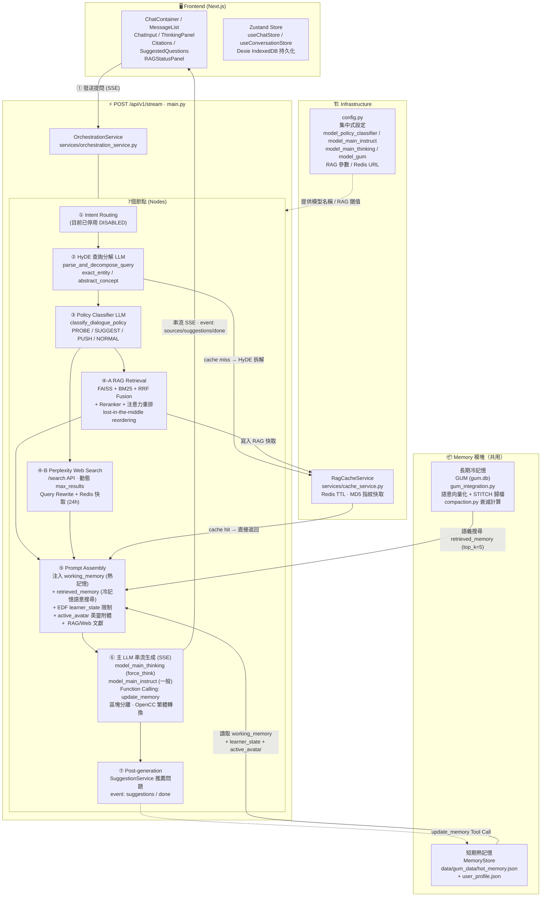
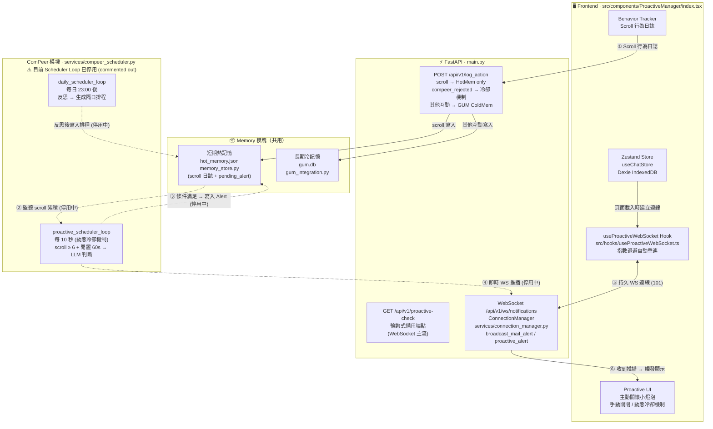
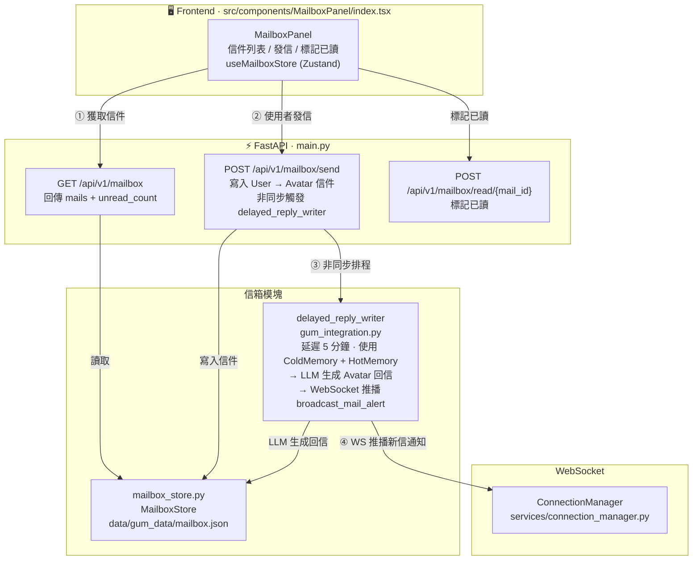
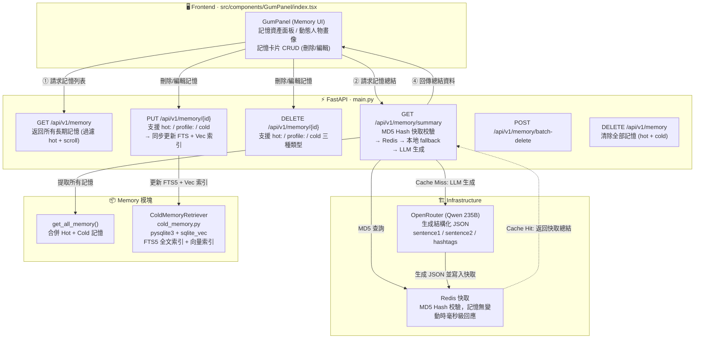

# AREQA: **A**daptive **R**AG-based **E**ducational **QA** System
「AREQA：懂你所學，伴你所讀」

---

發音非常像英文的 "Eureka"（我找到了！），這是一個與「發現知識、學習頓悟」完美契合的發音。而且它唸起來像是一個溫雅的字，帶有陪伴與引導感。

---

## 當前系統架構圖

> **最後更新**：2026-07-06（重新對齊實際程式碼架構，更新模型清單、節點說明、前端元件與 API 端點）

> 可以請 Claude 模型使用以下prompt 更新架構 :
請你閱讀/frontend與 /backend代碼 所有代碼 然後更新README.md 的架構圖及其說明 此readme不合當前的架構了 
  你可以使用 drift mcp 來查看當前兩資料夾的內容與系統架構 :
  backend , frontend

---

### 📁 專案檔案架構

#### Backend (`/backend`)

```
backend/
├── main.py                         # FastAPI 應用主入口，所有 API 端點定義
├── config.py                       # 集中式設定 (模型名稱 / RAG 參數 / Redis URL)
├── gum_integration.py              # GUM 長期記憶框架整合層
│                                   #   TextObserver / init_gum_instance
│                                   #   push_observation / query_cold_memory_for_context
│                                   #   delayed_reply_writer (信箱 Avatar 延遲回信)
│                                   #   ObservationQueueWorker (debounce 批次處理)
│                                   #   async_evaluate_and_update_state (EDF 狀態更新)
├── memory_store.py                 # 短期熱記憶管理
│                                   #   MemoryStore (hot_memory.json + user_profile.json)
│                                   #   learner_state / active_avatar / pending_alert
├── cold_memory.py                  # 長期冷記憶檢索
│                                   #   ColdMemoryRetriever (pysqlite3 + sqlite_vec)
│                                   #   FTS5 全文索引 + 向量語意索引 雙軌檢索
├── compaction.py                   # GUM 記憶壓縮與衰減算法
│                                   #   calculate_activation_score (Activation Score)
│                                   #   STITCH 歸檔：熱記憶 → 結構化冷記憶
├── mailbox_store.py                # 信箱訊息持久化
│                                   #   MailboxStore (mailbox.json)
│                                   #   add_mail / get_all_mails / mark_as_read
│
├── services/
│   ├── orchestration_service.py    # 7 節點串流編排器 (OrchestrationService)
│   │                               #   Node 1: Intent Routing (停用)
│   │                               #   Node 2: HyDE 查詢分解
│   │                               #   Node 3: Policy Classifier (EDF)
│   │                               #   Node 4A: RAG Retrieval (FAISS+BM25+RRF)
│   │                               #   Node 4B: Perplexity Web Search
│   │                               #   Node 5: Prompt Assembly (記憶注入)
│   │                               #   Node 6: LLM 串流生成 + Function Calling
│   │                               #   Node 7: Post-generation (Suggestions)
│   ├── cache_service.py            # Redis RAG 快取服務 (RagCacheService)
│   ├── connection_manager.py       # WebSocket 連線管理 (ConnectionManager)
│   │                               #   broadcast_mail_alert / proactive_alert
│   └── compeer_scheduler.py        # ComPeer 主動關懷排程 (⚠️ 目前已停用)
│                                   #   proactive_scheduler_loop
│                                   #   daily_scheduler_loop
│
└── data/                           # 運行時資料目錄 (git 忽略)
    └── gum_data/
        ├── gum.db                  # SQLite 長期冷記憶資料庫 (sqlite_vec 向量索引)
        ├── hot_memory.json         # 短期熱記憶 (對話脈絡 / learner_state)
        ├── user_profile.json       # 使用者偏好畫像 (Function Calling 寫入)
        └── mailbox.json            # 信箱訊息存儲
```

#### Frontend (`/frontend/src`)

```
frontend/src/
├── app/                            # Next.js 14 App Router
│   ├── layout.tsx                  # 根佈局 (全局字體 / Provider)
│   ├── page.tsx                    # 首頁入口
│   ├── globals.css                 # 全局樣式 (ChenYuluoyan 字體 / 暗色主題)
│   └── api/                        # Next.js API Routes (代理層)
│       ├── chat/                   # 代理 POST /api/v1/stream
│       └── title/                  # 代理 POST /api/v1/generate-title
│
├── components/                     # UI 元件 (每個元件含 index.tsx + styles.ts)
│   ├── ChatContainer/              # 主對話容器 (整合所有子元件)
│   ├── MessageList/                # 訊息列表渲染 (助手 / 使用者)
│   ├── ChatInput/                  # 輸入框 + 工具列 (RAG/Web/Think 切換)
│   ├── ThinkingPanel/              # CoT <think> 區塊摺疊渲染
│   ├── Citations/                  # 文獻引用卡片 + Modal (Golden Citation Chips)
│   ├── SuggestedQuestions/         # 推薦問題卡片
│   ├── RAGStatusPanel/             # RAG 檢索狀態即時顯示
│   ├── ConversationList/           # 對話歷史側欄列表
│   ├── GumPanel/                   # 記憶資產面板 (查看 / 刪除 / 編輯)
│   ├── MailboxPanel/               # 信箱系統 (收信 / 發信 / 已讀)
│   ├── ProactiveManager/           # 主動關懷彈窗管理
│   ├── TextSelectionToolbar/       # 文字選取快捷工具列
│   ├── ErrorBoundary/              # 錯誤邊界元件
│   └── index.ts                    # Barrel export
│
├── store/                          # Zustand 狀態管理
│   ├── chat/                       # 對話狀態
│   │   ├── store.ts                # useChatStore (串流 / 思考 / Citations)
│   │   ├── selectors.ts            # 選擇器 (isStreaming / thinkingContent...)
│   │   └── types.ts                # ChatState / DisplayMessage / ThinkingState
│   ├── conversation/               # 對話列表狀態
│   │   ├── store.ts                # useConversationStore (CRUD / 標題生成)
│   │   └── types.ts                # ConversationState / ConversationActions
│   ├── gum/
│   │   └── index.ts                # useGumStore (記憶列表 / 總結 / CRUD)
│   ├── mailbox/
│   │   └── index.ts                # useMailboxStore (信件列表 / 未讀數)
│   └── index.ts                    # 統一 Barrel export
│
├── services/                       # API 呼叫層
│   ├── chat/
│   │   └── index.ts                # 串流聊天 / 標題生成 / 記憶 / 信箱 API 呼叫
│   ├── chat-stream/                # SSE 串流解析服務
│   └── database/                   # 前端資料庫操作封裝
│
├── database/                       # Dexie (IndexedDB) 持久化層
│   ├── db.ts                       # Dexie 資料庫初始化
│   ├── schema.ts                   # 資料表 Schema (conversations / messages)
│   └── repositories/
│       ├── conversationRepo.ts     # 對話 CRUD
│       └── messageRepo.ts          # 訊息 CRUD
│
├── hooks/                          # 自訂 React Hooks
│   ├── useProactiveWebSocket.ts    # WS 連線 + 指數退避自動重連
│   └── useTextSelection.ts         # 文字選取偵測
│
├── config/
│   └── api.ts                      # API Base URL 設定
│
├── utils/                          # 工具函式
│   ├── streamingParser.ts          # SSE 事件解析
│   ├── sanitizer.ts                # 輸出清理 / XSS 防護
│   ├── rateLimit.ts                # 前端速率限制
│   ├── validation.ts               # 輸入驗證
│   ├── exportChat.ts               # 對話匯出功能
│   ├── logger.ts                   # 前端日誌工具
│   ├── error.ts                    # 錯誤處理工具
│   └── id.ts                       # ID 生成工具
│
└── types/
    ├── env.d.ts                    # 環境變數型別宣告
    └── panel.ts                    # Panel 相關型別
```

---

### 整體技術棧概覽

```
┌─────────────────────────────────────────────────────────────┐
│  Frontend  (Next.js 14 App Router · TypeScript · Zustand)   │
│  Port 3000                                                   │
└─────────────────────────┬───────────────────────────────────┘
                          │  HTTP SSE / WebSocket
┌─────────────────────────▼───────────────────────────────────┐
│  Backend  (FastAPI · Python 3.9+)                            │
│  Port 8000                                                   │
│  ┌──────────────┬──────────────┬─────────────┬───────────┐  │
│  │OrchestrarionS│  GUM / Memory │  Mailbox   │ ComPeer   │  │
│  │  RAG / Web   │  cold/hot    │  Store      │ Scheduler │  │
│  └──────────────┴──────────────┴─────────────┴───────────┘  │
└──────────┬──────────────────────────────────────────────────┘
           │
    ┌──────┴───────────────┐
    │  External Services   │
    │  OpenRouter (LLM)    │
    │  Perplexity Search   │
    │  Redis Cache         │
    │  FAISS + BM25 (本地) │
    └──────────────────────┘
```

---

### 路徑 A：對話生成路徑 (Chat Path)
> 實際端點：`POST /api/v1/stream`



---

### 路徑 B：主動關懷路徑 (ComPeer · 目前 Scheduler 已停用，架構保留)



---

### 路徑 C：信箱系統路徑 (Mailbox Path)



---

### 路徑 D：記憶檢視與綜整路徑 (Memory Visualization Path)



---

## 核心系統模組

### 1. 知識檢索與網路搜尋 (RAG & Web Search)

- **混合檢索機制 (Hybrid Retrieval)**: 整合 `FAISS` 向量檢索與 `BM25` 關鍵字檢索，透過倒數排名融合 (`RRF`) 與 API 重排模型 (`Reranker`) 取得最相關段落。
- **注意力重排序 (Lost in the Middle Reordering)**: 將最高關聯度文獻置首尾，優化 LLM 長上下文注意力。
- **Perplexity 聯網檢索**: 整合 Perplexity Search API (`/search` 端點)，動態決定 `max_results (3~20)`，並以對話 ID + 問題的 MD5 雜湊進行 Redis 快取（TTL 24小時）。
- **HyDE 查詢分解**: 使用 LLM 將使用者問題拆解為 `exact_entity` / `abstract_concept` 兩類子查詢，提升混合檢索的召回率。
- **文獻渲染與防閃爍**: 前端以卡片網格展示引用文獻，支援 favicon、一鍵跳轉。使用 `remend` 自癒 Markdown 解析與 `useDeferredValue`，確保串流過程畫面不閃爍。行內引用為金色圓角標籤（Golden Citation Chips），點擊彈出對應 Modal。

### 2. 教育認知與 EDF 教學策略模組

- **學習者狀態判定 (EDF)**: 系統追蹤對話歷史，即時分析學習狀態：
  - `NOT_STARTED` / `STARTING` / `TINKERING` / `RUN_REPEAT` / `GIVING_UP` / `MASTERY` / `CHITCHAT`
- **動態 System Prompt 組裝**: 依學習狀態動態調整表達難度限制（如 STARTING 禁用艱澀術語）。
- **英靈附體對話模式 (Active Avatar)**: 偵測使用者提及的歷史人物（蘇格拉底、柏拉圖等），系統切換至第一人稱語境。
- **Policy Classifier**: LLM 判定 `PROBE_UNDERSTANDING` / `SUGGEST_ACTION` / `PUSH_LIMIT` / `NORMAL`，動態調整 `max_tokens`。
- **Function Calling (update_memory)**: LLM 可在回答後呼叫 `update_memory` Tool，自動將使用者偏好資訊寫入 `user_profile.json`。

### 3. 記憶管理系統 (GUM + MemoryStore)

- **短期熱記憶 (Hot Memory)**: `memory_store.py` 管理 `hot_memory.json` 與 `user_profile.json`，儲存即時對話脈絡、學習狀態、待推播警示等。
- **長期冷記憶 (Cold Memory / GUM)**: `gum_integration.py` 整合 GUM 框架，將對話觀察非同步語意化，存入 `gum.db`（SQLite）。`cold_memory.py` 提供 FTS5 全文索引與 `sqlite_vec` 向量索引雙重檢索。
- **記憶壓縮 (STITCH)**: `compaction.py` 實作 GUM 衰減計算（Activation Score），定期將熱記憶歸檔並精煉為結構化長期記憶。
- **ObservationQueueWorker**: 去抖動 (3s debounce) 批次處理觀察訊息，防止高頻寫入。

### 4. 主動關懷與信箱系統 (ComPeer & Mailbox)

- **行為遙測**: `POST /api/v1/log_action` 接收前端 scroll、互動等行為，scroll 純寫熱記憶，其他有意義互動推送至 GUM。
- **ComPeer Scheduler**: `compeer_scheduler.py` 包含 proactive + daily 兩個排程迴圈（目前已停用，架構保留）。
- **信箱系統 (Mailbox)**: `mailbox_store.py` 管理 `mailbox.json`，支援 Avatar 延遲回信（5分鐘後 LLM 生成），透過 WebSocket 推播新信通知。
- **WebSocket 推播**: `ConnectionManager` (`services/connection_manager.py`) 管理持久連線，提供 `broadcast_mail_alert` 與 `broadcast_proactive_alert`。
- **冷卻機制**: `compeer_rejected` 動作觸發 30 分鐘動態冷卻，防止過度打擾。

### 5. 記憶可視化面板 (GumPanel)

- **GumPanel** (`src/components/GumPanel/index.tsx`): 記憶資產面板，可查看、刪除、編輯熱/冷記憶，支援批次刪除。
- **動態人物畫像**: 調用 `GET /api/v1/memory/summary`，透過 Qwen 235B 生成 `sentence1 / sentence2 / hashtags` 結構。
- **Redis + 本地雙層快取**: MD5 Hash 校驗確保記憶無變動時毫秒級回應。

### 6. 前端元件架構

| 元件 | 路徑 | 功能 |
|------|------|------|
| `ChatContainer` | `src/components/ChatContainer/` | 主對話容器 |
| `MessageList` | `src/components/MessageList/` | 訊息列表渲染 |
| `ChatInput` | `src/components/ChatInput/` | 輸入框與工具列 |
| `ThinkingPanel` | `src/components/ThinkingPanel/` | CoT `<think>` 區塊渲染 |
| `Citations` | `src/components/Citations/` | 文獻引用卡片 + Modal |
| `SuggestedQuestions` | `src/components/SuggestedQuestions/` | 推薦問題 |
| `RAGStatusPanel` | `src/components/RAGStatusPanel/` | RAG 檢索狀態顯示 |
| `GumPanel` | `src/components/GumPanel/` | 記憶面板 |
| `MailboxPanel` | `src/components/MailboxPanel/` | 信箱系統 |
| `ProactiveManager` | `src/components/ProactiveManager/` | 主動關懷彈窗 |
| `ConversationList` | `src/components/ConversationList/` | 對話列表側欄 |
| `TextSelectionToolbar` | `src/components/TextSelectionToolbar/` | 文字選取快捷工具列 |
| `ErrorBoundary` | `src/components/ErrorBoundary/` | 錯誤邊界 |

---

## 後端 API 端點總覽

| 方法 | 端點 | 說明 |
|------|------|------|
| `POST` | `/api/v1/stream` | 主串流對話 (SSE) |
| `POST` | `/api/v1/generate-title` | 對話標題生成 (SSE) |
| `GET` | `/api/v1/retrieve` | RAG 純查詢 (Debug/Citation) |
| `GET` | `/api/v1/memory` | 讀取長期記憶列表 |
| `GET` | `/api/v1/memory/summary` | 記憶總結 (LLM 人物畫像) |
| `DELETE` | `/api/v1/memory` | 清除所有記憶 |
| `DELETE` | `/api/v1/memory/{id}` | 刪除單筆記憶 |
| `PUT` | `/api/v1/memory/{id}` | 編輯單筆記憶 |
| `POST` | `/api/v1/memory/batch-delete` | 批次刪除記憶 |
| `POST` | `/api/v1/log_action` | 行為遙測日誌 |
| `GET` | `/api/v1/proactive-check` | 主動關懷輪詢備用端點 |
| `GET` | `/api/v1/mailbox` | 讀取信箱 |
| `POST` | `/api/v1/mailbox/send` | 發送信件 |
| `POST` | `/api/v1/mailbox/read/{id}` | 標記信件已讀 |
| `WS` | `/api/v1/ws/notifications` | 持久 WebSocket 通知推播 |

---

## 🛠️ 建置與運行環境

AREQA 分為 Python 後端與 Next.js 前端，兩端均支援並推薦使用環境變數設定。

### 1. 環境變數配置

複製根目錄下的環境變數範例：
```bash
cp .env.example .env
```
主要變數說明：
- `OPENROUTER_API_KEY`: 呼叫 LLM（Gemini / Qwen）與 Embedding 服務的 API 密鑰。
- `PERPLEXITY_API_KEY`: Perplexity 網路搜尋服務的 API 密鑰。
- `HF_TOKEN` / `HF_ENDPOINT_URL`: RAG 本地 Hugging Face 端點設定。
- `REDIS_URL`: Redis 連線位址（預設 `redis://localhost:6379`）。

### 2. 後端運行步驟 (Python 3.9+)

後端使用 FastAPI 提供高效非同步 SSE 串流服務，並使用 Redis 進行 RAG 快取。
```bash
cd backend
pip install -r requirements.txt
# 啟動 Redis 服務 (預設 redis://localhost:6379)
python -m uvicorn main:app --host 0.0.0.0 --port 8000 --reload
```

### 3. 前端運行步驟 (Node.js v18+)

前端基於 Next.js 14 App Router 建立，`predev` 腳本會自動從根目錄複製 `.env` 至 `frontend/.env.local`。
```bash
cd frontend
npm install
npm run dev
```

---

## 🧪 測試

- **後端測試**: 透過 FastAPI Swagger UI (`/docs`) 進行手動驗證。
- **前端測試**: 使用 Vitest 進行 UI Store 等單元測試：
  ```bash
  cd frontend
  npm run test
  ```
- **型別檢查**:
  ```bash
  cd frontend
  npm run typecheck
  ```