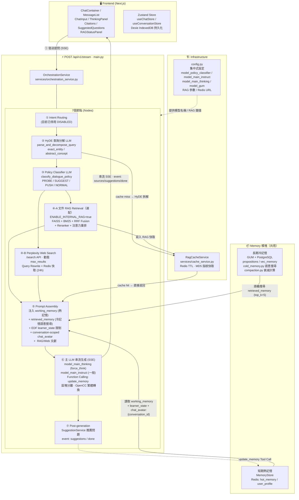
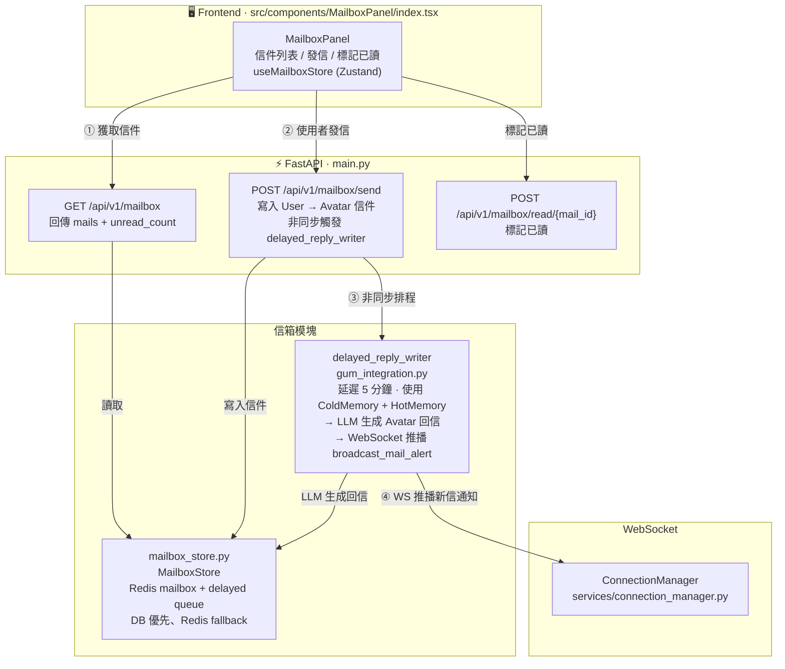

# AREQA: **A**daptive **R**AG-based **E**ducational **QA** System
「AREQA：懂你所學，伴你所讀」

---

發音非常像英文的 "Eureka"（我找到了！），這是一個與「發現知識、學習頓悟」完美契合的發音。而且它唸起來像是一個溫雅的字，帶有陪伴與引導感。

---

## 當前系統架構圖

> **最後更新**：2026-07-12（依目前 frontend / backend 實際代碼、Drift MCP 分析結果與現行 routes / scripts 校正）

> 更新這份文件時，請以目前工作區中的 `frontend/`、`backend/`、`render.yaml`、`frontend/package.json`、`backend/requirements.txt` 與 `backend/main.py` 的實際 route 為準。

---

### 📁 專案檔案架構

#### Backend (`/backend`)

```
backend/
├── main.py                         # FastAPI 應用主入口，所有 API 端點定義
├── config.py                       # 集中式設定 (模型名稱 / RAG 參數 / Redis URL)
├── auth.py                         # Supabase JWT 驗證與 current_user 依賴
├── job_store.py                    # 背景工作佇列 / agent job worker
├── redis_client.py                 # Redis 連線封裝
├── gum_integration.py              # GUM 長期記憶框架整合層
│                                   #   TextObserver / init_gum_instance
│                                   #   push_observation / query_cold_memory_for_context
│                                   #   delayed_reply_writer (信箱 Avatar 延遲回信)
│                                   #   ObservationQueueWorker (debounce 批次處理)
│                                   #   async_evaluate_and_update_state (EDF 狀態更新)
├── memory_store.py                 # 短期熱記憶管理
│                                   #   MemoryStore (Redis: hot_memory + user_profile + working_memory)
│                                   #   learner_state / current_strategy / chat_avatar:{conversation_id}
│                                   #   current_focus_conversation_id (working memory 作用域)
├── cold_memory.py                  # 長期冷記憶檢索
│                                   #   ColdMemoryRetriever (PostgreSQL + pgvector)
│                                   #   propositions 全文檢索 + vec_memory 向量檢索 + RRF 融合
├── compaction.py                   # GUM 記憶壓縮與衰減算法
│                                   #   calculate_activation_score (Activation Score)
│                                   #   STITCH 歸檔：熱記憶 → 結構化冷記憶
├── mailbox_store.py                # 信箱訊息持久化
│                                   #   MailboxStore (Redis mailbox + delayed queue)
│                                   #   add_mail / get_all_mails / mark_as_read
├── core/                           # SSE / event / runtime / budget / state 公用核心
├── policies/                       # capability / memory / search policy
├── tools/                          # memory_query / delayed_mail / web_search registry
├── agents/                         # agent runtime 與 tutor agent
│
├── services/
│   ├── orchestration_service.py    # 7 節點串流編排器 (OrchestrationService)
│   │                               #   Node 1: Intent Routing (停用)
│   │                               #   Node 2: HyDE 查詢分解
│   │                               #   Node 3: Policy Classifier (EDF)
│   │                               #   Node 4A: RAG Retrieval (FAISS+BM25+RRF)
│   │                               #   Node 4B: Perplexity Web Search
│   │                               #   Node 5: Prompt Assembly (記憶注入)
│   │                               #   Node 6: LLM 串流生成 + Function Calling
│   │                               #   Node 7: Post-generation (Suggestions)
│   ├── cache_service.py            # Redis RAG 快取服務 (RagCacheService)
│   ├── connection_manager.py       # WebSocket 連線管理 (ConnectionManager)
│   │                               #   broadcast_mail_alert
│   └── compeer_scheduler.py        # ComPeer 主動關懷排程
│                                   #   proactive_scheduler_loop / daily_scheduler_loop
│                                   #   FastAPI startup 目前會建立背景 task
│
└── data/                           # 運行時資料目錄 (git 忽略)
    └── gum_data/
        ├── {safe_user_id}/         # GUM 本地運行時資料目錄
        └── ...                     # 其他 GUM / RAG 運行時資料

# 補充：
# - hot memory、user profile、working memory、behavior signals、mailbox、delayed mail 主要存於 Redis
# - GUM / cold memory 的正式資料層優先使用 GUM_DATABASE_URL 或 DATABASE_URL 指向的 PostgreSQL
# - 本地 data/gum_data 主要是 GUM 運行時資料目錄，不再是主資料庫說明
```

#### Shared Python Services (`/src/main/python/services`)

`backend/main.py` 會將 `src/main/python` 加入 `sys.path`，因此以下服務也是後端實際運行路徑的一部分：

```
src/main/python/services/
├── rag_service.py                  # 選配本地文件 RAG：FAISS + BM25 + RRF + context sanitizer
├── bm25_search.py                  # BM25 sparse retrieval
├── router_service.py               # OpenRouter query domain/router service
└── suggestion_service.py           # 回答後推薦問題生成
```

#### Frontend (`/frontend/src`)

```
frontend/src/
├── app/                            # Next.js 16.0.7 App Router
│   ├── layout.tsx                  # 根佈局 (全局字體 / Provider)
│   ├── page.tsx                    # 首頁入口
│   ├── globals.css                 # 全局樣式 (ChenYuluoyan 字體 / 暗色主題)
│   └── api/                        # Next.js API Routes (代理層)
│       ├── chat/                   # 代理 POST /api/v1/stream
│       └── title/                  # 代理 POST /api/v1/generate-title
│
├── components/                     # UI 元件 (每個元件含 index.tsx + styles.ts)
│   ├── ChatContainer/              # 主對話容器 (整合所有子元件)
│   ├── MessageList/                # 訊息列表渲染 (助手 / 使用者)
│   ├── ChatInput/                  # 輸入框 + 工具列 (RAG/Web/Think 切換)
│   ├── Auth/                       # Supabase 驗證 / 登入 UI
│   ├── ThinkingPanel/              # CoT <think> 區塊摺疊渲染
│   ├── Citations/                  # 文獻引用卡片 + Modal (Golden Citation Chips)
│   ├── SuggestedQuestions/         # 推薦問題卡片
│   ├── RAGStatusPanel/             # RAG 檢索狀態即時顯示
│   ├── ConversationList/           # 對話歷史側欄列表
│   ├── GumPanel/                   # 記憶資產面板 (查看 / 刪除 / 編輯)
│   ├── MailboxPanel/               # 信箱系統 (收信 / 發信 / 已讀)
│   ├── ProactiveManager/           # 行為遙測 + 信箱通知同步
│   ├── TextSelectionToolbar/       # 文字選取快捷工具列
│   ├── ErrorBoundary/              # 錯誤邊界元件
│   └── index.ts                    # Barrel export
│
├── store/                          # Zustand 狀態管理
│   ├── chat/                       # 對話狀態
│   │   ├── store.ts                # useChatStore (串流 / 思考 / Citations)
│   │   ├── selectors.ts            # 選擇器 (isStreaming / thinkingContent...)
│   │   └── types.ts                # ChatState / DisplayMessage / ThinkingState
│   ├── conversation/               # 對話列表狀態
│   │   ├── store.ts                # useConversationStore (CRUD / 標題生成)
│   │   └── types.ts                # ConversationState / ConversationActions
│   ├── gum/
│   │   └── index.ts                # useGumStore (記憶列表 / 總結 / CRUD)
│   ├── mailbox/
│   │   └── index.ts                # useMailboxStore (信件列表 / 未讀數)
│   └── index.ts                    # 統一 Barrel export
│
├── services/                       # API 呼叫層
│   ├── chat/
│   │   └── index.ts                # 串流聊天 / 標題生成 / 記憶 / 信箱 API 呼叫
│   ├── chat-stream/                # SSE 串流解析服務
│   ├── database/                   # 前端資料庫操作封裝
│   └── syncService.ts              # Supabase / 本地資料同步
│
├── database/                       # Dexie (IndexedDB) 持久化層
│   ├── db.ts                       # Dexie 資料庫初始化
│   ├── schema.ts                   # 資料表 Schema (conversations / messages)
│   └── repositories/
│       ├── conversationRepo.ts     # 對話 CRUD
│       └── messageRepo.ts          # 訊息 CRUD
│
├── hooks/                          # 自訂 React Hooks
│   ├── useProactiveWebSocket.ts    # WS 連線 + 指數退避自動重連
│   └── useTextSelection.ts         # 文字選取偵測
│
├── config/
│   └── api.ts                      # API Base URL 設定
├── lib/
│   └── supabase.ts                 # Supabase client 初始化
│
├── utils/                          # 工具函式
│   ├── streamingParser.ts          # SSE 事件解析
│   ├── sanitizer.ts                # 輸出清理 / XSS 防護
│   ├── rateLimit.ts                # 前端速率限制
│   ├── validation.ts               # 輸入驗證
│   ├── exportChat.ts               # 對話匯出功能
│   ├── logger.ts                   # 前端日誌工具
│   ├── error.ts                    # 錯誤處理工具
│   └── id.ts                       # ID 生成工具
│
└── types/
    ├── env.d.ts                    # 環境變數型別宣告
    └── panel.ts                    # Panel 相關型別
```

---

### 整體技術棧概覽

```
┌─────────────────────────────────────────────────────────────┐
│  Frontend  (Next.js 16.0.7 · React 19.2.0 · Zustand ·      │
│             Dexie · Ant Design · Supabase Auth)            │
│  Port 3000                                                   │
└─────────────────────────┬───────────────────────────────────┘
                          │  HTTP SSE / WebSocket
┌─────────────────────────▼───────────────────────────────────┐
│  Backend  (FastAPI · Python 3.10.12+)                        │
│  Port 8000                                                   │
│  ┌──────────────┬──────────────┬─────────────┬───────────┐  │
│  │Orchestration │  GUM / Memory │  Mailbox   │ ComPeer   │  │
│  │  RAG / Web   │  cold/hot    │  Store      │ Scheduler │  │
│  └──────────────┴──────────────┴─────────────┴───────────┘  │
└──────────┬──────────────────────────────────────────────────┘
           │
    ┌──────┴───────────────┐
    │  External Services   │
    │  OpenRouter (LLM)    │
    │  Perplexity Search   │
    │  Supabase Auth/JWKS  │
    │  Redis Cache         │
    │  PostgreSQL / pgvector│
    │  FAISS + BM25 (選配) │
    └──────────────────────┘
```

---

### 路徑 A：對話生成路徑 (Chat Path)
> 實際端點鏈：`POST /api/chat` → `frontend/src/app/api/chat/route.ts` → `POST /api/v1/stream`



---

### 路徑 B：主動關懷路徑 (ComPeer · startup 會啟動背景排程)


---

### 路徑 C：信箱系統路徑 (Mailbox Path)



---

### 路徑 D：記憶檢視與綜整路徑 (Memory Visualization Path)


---

## 核心系統模組

### 1. 知識檢索與網路搜尋 (RAG & Web Search)

- **文件 RAG（選配）**: `src/main/python/services/rag_service.py` 在 `ENABLE_INTERNAL_RAG=true` 時載入本地 `data/rag/faiss_index/` 與 `data/rag/bm25_index/`，整合 `FAISS` 向量檢索與 `BM25` 關鍵字檢索，透過倒數排名融合 (`RRF`) 與 API 重排模型 (`Reranker`) 取得最相關段落。
- **使用者冷記憶檢索**: `backend/cold_memory.py` 使用 `DATABASE_URL` 連到 PostgreSQL，從 `propositions` 做全文檢索、從選配 `vec_memory` 做 pgvector 向量檢索，再以 RRF 融合結果。
- **注意力重排序 (Lost in the Middle Reordering)**: 將最高關聯度文獻置首尾，優化 LLM 長上下文注意力。
- **Perplexity 聯網檢索**: 整合 Perplexity Search API (`/search` 端點)，動態決定 `max_results (3~20)`，並以對話 ID + 問題的 MD5 雜湊進行 Redis 快取（TTL 24小時）。
- **HyDE 查詢分解**: 使用 LLM 將使用者問題拆解為 `exact_entity` / `abstract_concept` 兩類子查詢，提升混合檢索的召回率。
- **文獻渲染與防閃爍**: 前端以卡片網格展示引用文獻，支援 favicon、一鍵跳轉。使用 `remend` 自癒 Markdown 解析與 `useDeferredValue`，確保串流過程畫面不閃爍。行內引用為金色圓角標籤（Golden Citation Chips），點擊彈出對應 Modal。

### 2. 教育認知與 EDF 教學策略模組

- **學習者狀態判定 (EDF)**: 系統追蹤對話歷史，即時分析學習狀態：
  - `NOT_STARTED` / `STARTING` / `TINKERING` / `RUN_REPEAT` / `GIVING_UP` / `MASTERY` / `CHITCHAT`
- **動態 System Prompt 組裝**: 依學習狀態動態調整表達難度限制（如 STARTING 禁用艱澀術語）。
- **明確角色扮演模式 (Conversation-scoped Chat Avatar)**: 只有使用者明確要求「請你扮演 X 跟我對話」時，系統才在當前 `conversation_id` 內切換第一人稱角色語境；「請 X 寫信」只會排信，不會污染一般聊天人格。
- **Policy Classifier**: LLM 判定 `PROBE_UNDERSTANDING` / `SUGGEST_ACTION` / `PUSH_LIMIT` / `NORMAL`，動態調整 `max_tokens`。
- **Function Calling (update_memory)**: LLM 可在回答後呼叫 `update_memory` Tool，自動將使用者偏好資訊寫入 Redis 中的 user profile。

### 3. 記憶管理系統 (GUM + MemoryStore)

- **短期熱記憶 (Hot Memory)**: `memory_store.py` 目前主要透過 Redis 管理 hot memory、user profile 與 working memory，儲存即時對話脈絡、學習狀態、待推播警示等。`current_focus` 與每筆 `recent_learning_points` 都綁定 `conversation_id`；主聊天路徑只注入目前 conversation 的暫時脈絡，legacy unscoped points 不會進入新對話。
- **長期冷記憶 (Cold Memory / GUM)**: `gum_integration.py` 整合 GUM 框架，為每位使用者建立獨立 GUM instance。資料庫優先使用 `GUM_DATABASE_URL`，未設定時使用 `DATABASE_URL`；目前 cold memory 主路徑是 PostgreSQL 的 `propositions` 與選配 `vec_memory`。Observation 正常以 17 筆批次處理，閒置 reflection 或 `POST /api/v1/memory/flush` 也能處理未滿批次的 pending observations。
- **敏感脈絡保護**: 健康、心理、家庭與財務類問題預設不自動檢索跨對話 episodic memory，避免弱相關舊內容主導目前回答；durable user profile 仍可供一般個人化使用。
- **記憶壓縮 (STITCH)**: `compaction.py` 實作 GUM 衰減計算（Activation Score），定期將熱記憶歸檔並精煉為結構化長期記憶。
- **ObservationQueueWorker**: 去抖動 (3s debounce) 批次處理觀察訊息，防止高頻寫入。
- **低資訊問候短路**: `你好`、`hi`、`在嗎` 這類低資訊訊息會直接回固定寒暄，不會進入 long-term memory retrieval，也不會擴寫上一輪任務脈絡。

### 4. 主動關懷與信箱系統 (ComPeer & Mailbox)

- **行為遙測**: `POST /api/v1/log_action` 接收前端 scroll、互動等行為，scroll 純寫熱記憶，其他有意義互動推送至 GUM。
- **ComPeer Scheduler**: `compeer_scheduler.py` 包含 proactive + daily 兩個排程迴圈；觸發時不再彈出角色扮演視窗，而是排一封 5 分鐘後送達的 AREQA 關懷信。
- **信箱系統 (Mailbox)**: `mailbox_store.py` 目前以 Redis 管理 mailbox 與 delayed mail queue，支援 Avatar 延遲回信與 AREQA 主動關懷信，並透過 WebSocket 推播新信通知。
- **WebSocket 推播**: `ConnectionManager` (`services/connection_manager.py`) 管理持久連線，目前主動關懷 UX 只依賴 `broadcast_mail_alert` 更新信箱。
- **冷卻機制**: `compeer_rejected` 動作觸發 30 分鐘動態冷卻，防止過度打擾。

### 5. 記憶可視化面板 (GumPanel)

- **GumPanel** (`src/components/GumPanel/index.tsx`): 記憶資產面板，可查看、刪除、編輯熱/冷記憶，支援批次刪除。
- **動態人物畫像**: 調用 `GET /api/v1/memory/summary`，透過 OpenRouter 上配置的結構化模型生成 `sentence1 / sentence2 / hashtags`。
- **Redis + 本地雙層快取**: MD5 Hash 校驗確保記憶無變動時毫秒級回應。

### 6. 模型與服務配置

- **集中式預設模型**: `backend/config.py` 定義 `model_policy_classifier`、`model_hyde_decomposer`、`model_main_instruct`、`model_main_thinking`、`model_gum`、`model_zpd_query`，目前預設為 `google/gemini-3.1-flash-lite`。
- **專用模型例外**: 部分服務有專用模型設定，例如 memory summary 使用 `qwen/qwen3-235b-a22b-2507`，`router_service.py` 使用 `qwen/qwen3-vl-8b-instruct`，`cold_memory.py` 的 embedding 使用 `qwen/qwen3-embedding-8b`。
- **OpenRouter 統一出口**: 主 LLM、標題生成、GUM、推薦問題、embedding 與部分檢索相關流程共用 `OPENROUTER_API_KEY`。

### 7. 前端元件架構

| 元件 | 路徑 | 功能 |
|------|------|------|
| `ChatContainer` | `src/components/ChatContainer/` | 主對話容器 |
| `MessageList` | `src/components/MessageList/` | 訊息列表渲染 |
| `ChatInput` | `src/components/ChatInput/` | 輸入框與工具列 |
| `ThinkingPanel` | `src/components/ThinkingPanel/` | CoT `<think>` 區塊渲染 |
| `Citations` | `src/components/Citations/` | 文獻引用卡片 + Modal |
| `SuggestedQuestions` | `src/components/SuggestedQuestions/` | 推薦問題 |
| `RAGStatusPanel` | `src/components/RAGStatusPanel/` | RAG 檢索狀態顯示 |
| `GumPanel` | `src/components/GumPanel/` | 記憶面板 |
| `MailboxPanel` | `src/components/MailboxPanel/` | 信箱系統 |
| `ProactiveManager` | `src/components/ProactiveManager/` | 行為遙測與信箱通知同步 |
| `ConversationList` | `src/components/ConversationList/` | 對話列表側欄 |
| `TextSelectionToolbar` | `src/components/TextSelectionToolbar/` | 文字選取快捷工具列 |
| `ErrorBoundary` | `src/components/ErrorBoundary/` | 錯誤邊界 |

---

## 後端 API 端點總覽

| 方法 | 端點 | 說明 |
|------|------|------|
| `POST` | `/api/v1/stream` | 主串流對話 (SSE) |
| `POST` | `/api/v1/generate-title` | 對話標題生成 (SSE) |
| `GET` | `/api/v1/retrieve` | RAG 純查詢 (Debug/Citation) |
| `GET` | `/api/v1/memory` | 讀取長期記憶列表 |
| `GET` | `/api/v1/memory/summary` | 記憶總結 (LLM 人物畫像) |
| `GET` | `/api/v1/memory/debug` | 記憶分層與 pending observation 診斷 |
| `POST` | `/api/v1/memory/flush` | 處理未滿批次的 observations 並執行 reflection |
| `DELETE` | `/api/v1/memory` | 清除所有記憶 |
| `DELETE` | `/api/v1/memory/working` | 只清除 working memory |
| `DELETE` | `/api/v1/memory/{id}` | 刪除單筆記憶 |
| `PUT` | `/api/v1/memory/{id}` | 編輯單筆記憶 |
| `POST` | `/api/v1/memory/batch-delete` | 批次刪除記憶 |
| `POST` | `/api/v1/log_action` | 行為遙測日誌 |
| `GET` | `/api/v1/proactive-check` | 主動關懷輪詢備用端點 |
| `GET` | `/api/v1/mailbox` | 讀取信箱 |
| `POST` | `/api/v1/mailbox/send` | 發送信件 |
| `POST` | `/api/v1/mailbox/read/{mail_id}` | 標記信件已讀 |
| `POST` | `/api/v1/ws/ticket` | 產生 30 秒一次性 WebSocket ticket |
| `WS` | `/api/v1/ws/notifications?ticket=...` | 持久 WebSocket 通知推播 |

> 多數後端端點透過 `Depends(get_current_user)` 驗證 Supabase JWT，呼叫時需帶 `Authorization: Bearer <token>`；`/api/v1/ws/notifications` 則先以 Bearer token 呼叫 `/api/v1/ws/ticket`，再用 ticket 建立 WebSocket。

> 補充：前端 `useGumStore.fetchSuggestions()` 目前仍會請求 `/api/v1/suggestions`，但後端 `main.py` 尚未提供這個 route；現有建議問題主要透過 `/api/v1/stream` 的 `event: suggestions` 與 `event: done` SSE 事件傳回。

---

## 🛠️ 建置與運行環境

AREQA 分為 Python 後端與 Next.js 前端，兩端均支援並推薦使用環境變數設定。

### 1. 環境變數配置

目前程式會從專案根目錄的 `.env` 或 `.env.local` 載入設定；前端 `predev` / `prebuild` 會自動把根目錄 `.env.local` 或 `.env` 複製到 `frontend/.env.local`。

主要變數說明：
- `OPENROUTER_API_KEY`: 呼叫主 LLM、標題生成、記憶總結、GUM、agent job worker、建議問題與部分檢索相關流程的密鑰。
- `PERPLEXITY_API_KEY`: Perplexity 網路搜尋服務的 API 密鑰；未設定時 web search 會回退到一般對話。
- `REDIS_URL`: Redis 連線位址（預設 `redis://localhost:6379`），用於 hot memory、user profile、working memory、mailbox cache、RAG cache 與 WS ticket。
- `JWT_SECRET`: 後端驗證 Supabase JWT 所需密鑰；若缺少會使 `get_current_user` 直接回 500。若 JWT 演算法不是 HS 系列，後端會改走 Supabase JWKS。
- `NEXT_PUBLIC_SUPABASE_URL` / `NEXT_PUBLIC_SUPABASE_ANON_KEY`: 前端 Supabase client 使用，後端 JWKS 來源也依賴 `NEXT_PUBLIC_SUPABASE_URL`。
- `NEXT_PUBLIC_BACKEND_URL`: 前端直連 FastAPI 的 base URL；本地預設 `http://localhost:8000` 或 `http://127.0.0.1:8000`。
- `NEXT_PUBLIC_CHAT_API_ENDPOINT`: 前端 chat service endpoint，預設 `/api/chat`，由 Next.js BFF 代理到 FastAPI。
- `NEXT_PUBLIC_API_TIMEOUT` / `NEXT_PUBLIC_MAX_MESSAGE_LENGTH` / `NEXT_PUBLIC_PARSER_MAX_BUFFER`: 前端 API timeout、訊息長度與 SSE parser buffer 設定。
- `ENABLE_INTERNAL_RAG`: 設為 `true` 才會載入本地文件 RAG 的 FAISS/BM25 index；否則 `/api/v1/retrieve` 會回傳 internal RAG disabled。這不控制 GUM/cold memory 是否啟用。
- `DATABASE_URL`: PostgreSQL 連線位址，供 GUM / cold memory / agent jobs 使用；cold memory 依賴 `propositions`，並可使用 `vec_memory` + pgvector 做向量檢索。
- `GUM_DATABASE_URL`: GUM 專用資料庫 URL；若設定，優先於 `DATABASE_URL`。
- `MAILBOX_DATABASE_URL`: mailbox 專用資料庫 URL；若設定，優先於 `DATABASE_URL`。若資料表不存在或連線失敗，mailbox 會回退到 Redis。
- `HF_TOKEN` / `HF_ENDPOINT_URL` / `HF_REPO_ID`: Hugging Face 或外部 embedding / reranking 端點相關設定。

前端聊天請求的實際路徑：
```text
Chat UI → API_CONFIG.chatEndpoint (/api/chat)
       → frontend/src/app/api/chat/route.ts
       → ${NEXT_PUBLIC_BACKEND_URL}/api/v1/stream
```

標題生成請求的實際路徑：
```text
Conversation Store → /api/title
                  → frontend/src/app/api/title/route.ts
                  → ${NEXT_PUBLIC_BACKEND_URL}/api/v1/generate-title
```

記憶、信箱與 WebSocket 相關功能不經 `/api/chat`，會依 `NEXT_PUBLIC_BACKEND_URL` 直接呼叫 FastAPI。WebSocket 連線流程為：先以 Bearer token 呼叫 `/api/v1/ws/ticket` 取得 30 秒一次性 ticket，再連 `/api/v1/ws/notifications?ticket=...`。

### 2. 後端運行步驟 (Python 3.10.12+)

後端使用 FastAPI 提供高效非同步 SSE 串流服務，並使用 Redis 進行 RAG 快取。`backend/requirements.txt` 已包含後端執行與測試所需的主要依賴，包含 `aiosqlite`、`respx`、`faiss-cpu`、`jieba` 等。
```bash
cd backend
pip install -r requirements.txt
# 啟動 Redis 服務 (預設 redis://localhost:6379)
python -m uvicorn main:app --host 0.0.0.0 --port 8000 --reload
```

> 後端受保護端點需要 Supabase Bearer token 與 `JWT_SECRET`。若只測試服務啟動，FastAPI 可啟動；但 chat、memory、mailbox、proactive、WebSocket ticket 等 API 都會進入認證流程。

> 本地文件 RAG 是選配。若要啟用，需設定 `ENABLE_INTERNAL_RAG=true`，並準備 `data/rag/faiss_index/chunks*.index`、`data/rag/faiss_index/index_metadata*.json` 與 `data/rag/bm25_index/`。這與 GUM / PostgreSQL cold memory 是不同路徑；若索引不存在，系統會降級為非本地 RAG 路徑。

### 3. 前端運行步驟 (Node.js v20+)

前端基於 Next.js 16.0.7 App Router 建立，`predev` 腳本會自動從根目錄複製 `.env` 或 `.env.local` 至 `frontend/.env.local`。
```bash
cd frontend
npm install
npm run dev
```

Next.js 開發伺服器預設監聽 `0.0.0.0:3000`。聊天與標題生成預設走 Next.js API Route 代理；記憶、信箱與 WebSocket 相關功能會依 `NEXT_PUBLIC_BACKEND_URL` 直接呼叫 FastAPI。

從專案根目錄執行 `npm run dev` 會同時啟動後端 Uvicorn 與前端 Next.js；這是目前最接近完整本地工作流的啟動方式。

---

## 🧪 測試

- **全部測試**:
  ```bash
  npm run test:all
  ```
- **後端測試**:
  ```bash
  npm run test:backend
  ```
- **前端測試**:
  ```bash
  npm run test:frontend
  ```
- **前端 lint / typecheck**:
  ```bash
  npm run lint:report
  npm run typecheck:report
  ```
- **手動 API 驗證**: FastAPI Swagger UI 可透過後端 `/docs` 檢查與測試端點。
- **測試覆蓋範圍**:
  - `tests/backend` 主要覆蓋 GUM、memory、ComPeer、Perplexity、RAG pipeline、SSE 與 runtime contract。
  - `tests/frontend` 主要覆蓋 auth / sync / websocket / mailbox / selection / store / chat 與 integration 行為。
- **測試注意事項**:
  - 前端 `Supabase Auth UI`、`fake-indexeddb` 與部分 WebSocket 行為在測試環境中使用本地 mocks，以避免 jsdom 與外部登入流量造成不穩定。
  - `syncService` 在有資料變更時會延遲觸發 reload，測試需等待該延遲行為。
  - `tests/backend/test_rag_pipeline.py` 使用 synthetic fixture 驗證 RAG pipeline 的融合與過濾邏輯，不依賴大型離線 FAISS / BM25 產物；若要在實際服務啟用本地 RAG，仍需準備對應索引檔。
- **人工回歸驗證建議**:
  1. `DELETE /api/v1/memory/working`
  2. 新 conversation 只送 `你好`，確認回覆是固定寒暄，且不會帶出 README / React / 文言文脈絡
  3. 同一 conversation 再送 React/useEffect 類問題，確認可以正常延續同一主題
  4. 換新 conversation 再送 `你好`，確認不會繼承前一輪主題
  5. 在 conversation A 談家庭、工作與跑步後，於 conversation B 詢問血壓，確認回答不會自行延續 A 的內容
  6. 對測試帳號呼叫 `POST /api/v1/memory/flush`，再以 `GET /api/v1/memory` 確認低於 17 輪的有效對話也能形成長期 propositions
  7. 以 `GET /api/v1/memory/debug` 檢查 `pending_observation_count` 是否在成功 flush 後下降
