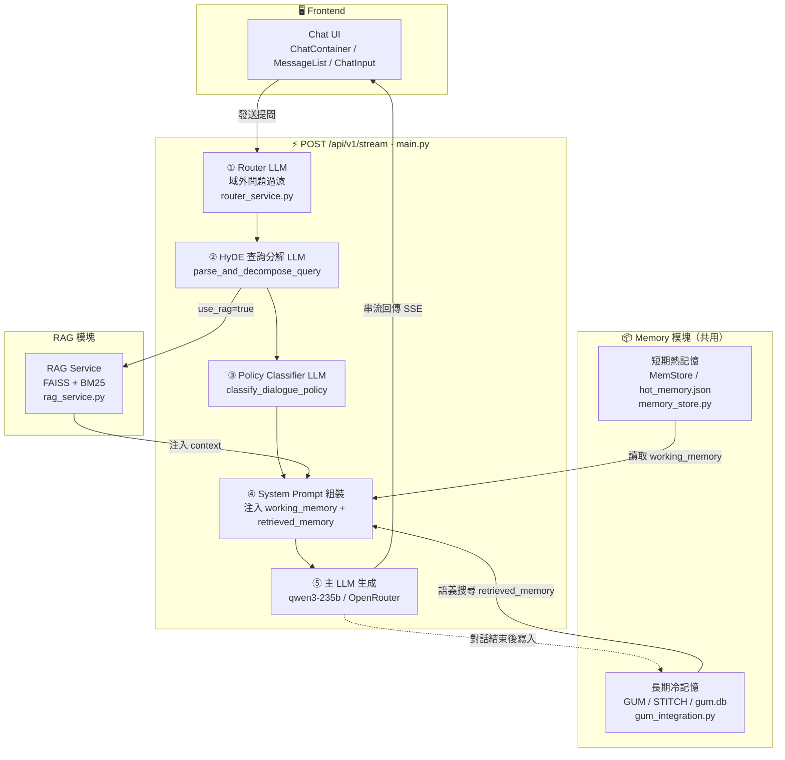
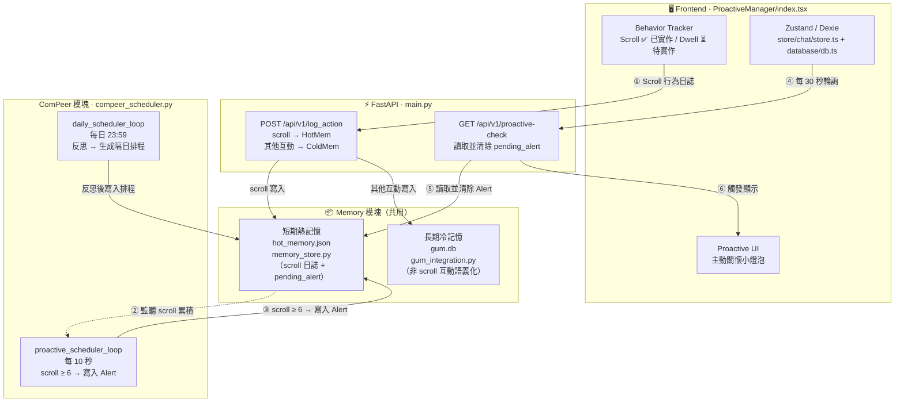

# AREQA: An **A**daptive **R**AG-based **E**ducational **QA** System over Closed-domain Knowledge Bases.

---

發音非常像英文的 "Eureka"（我找到了！），這是一個與「發現知識、學習頓悟」完美契合的發音。而且它唸起來像是一個溫雅的女生名字，帶有前面提到的陪伴感。

---

## 當前系統架構圖

### 路徑 A：對話生成路徑 (Chat Path)
> 實際端點：`POST /api/v1/stream`

---

### 路徑 B：主動關懷路徑 (ComPeer Proactive Path)

