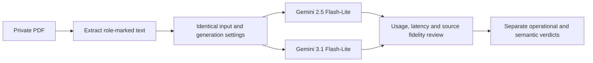
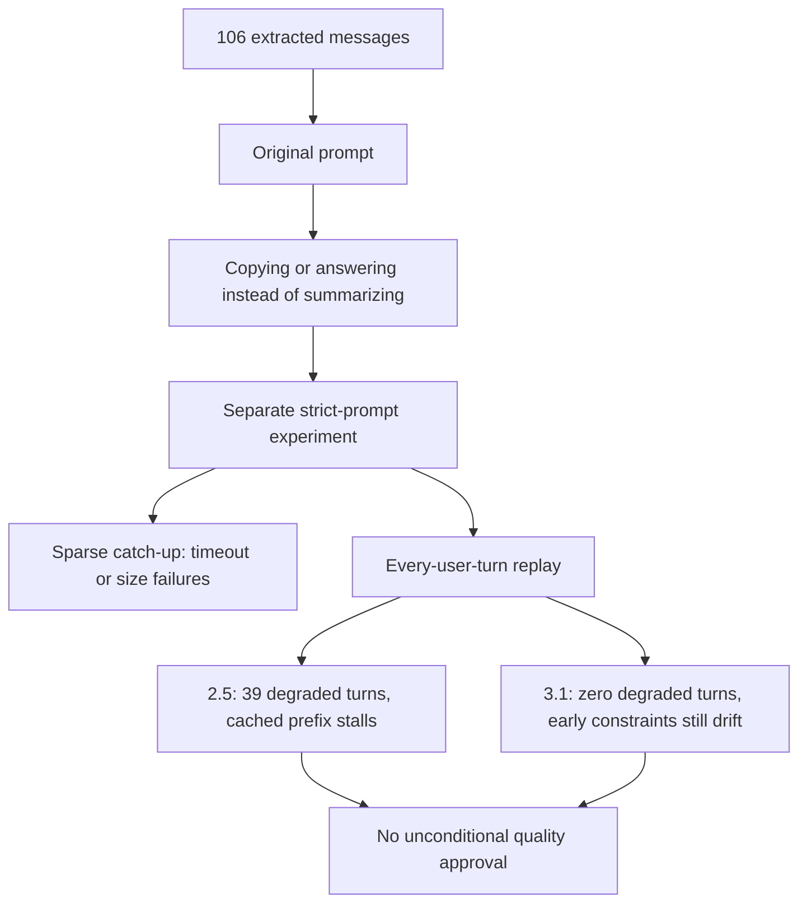

# 2026-11-08 Flash-Lite Conversation Compaction Experiment

Summary:

The requested default is now independently configured as
`google/gemini-2.5-flash-lite`; main-answer and GUM model choices are unchanged.
Real OpenRouter calls compared 2.5 with 3.1 using the supplied 119-page PDF.
The PDF yielded 106 messages (56 user, 50 assistant), including six identical final
user submissions. Those duplicates were retained, not counted as six new choices.

**Overall verdict: implementation and experiment completed, but neither model
receives an unconditional semantic-fidelity pass.** With the stricter prompt and
every-user-turn replay, 2.5 degraded on 39/56 turns versus 0/56 for 3.1. Reported
summary costs were $0.02764698 and $0.054327 respectively. However, 3.1's final
rolling summary dropped an explicit earlier two-indicator constraint. Operational
success is not proof that important state survived. Do not interpret this default
change as production-quality approval for 2.5.

## 1. Expected Results and Improvements over the Previous Experiment

The research question was whether a cheaper independent summarizer could replace
3.1 while preserving the user's evolving research goal, constraints, uncertainty
and distinction between user choices and assistant suggestions. Previous checks
used mocked clients; this experiment adds real generation, provider usage/cost,
and source-grounded manual review.

Controls and rubric are in [protocol.md](protocol.md). The rubric was authored
during the investigation, not independently preregistered. Review is by the same
investigator, not blinded or independent. The PDF is a conversation source, not a
fact-checked international-politics reference. Exact transcript/summary text and
credentials are not committed.

Both models used temperature 0.1 and max_tokens 1536, without a thinking override.
All completed calls reported zero reasoning tokens. Provider routing was the
OpenRouter default, not pinned. No automatic retry was enabled in the experiment.

### Expected Data Flow (Mermaid)

## 2. Actual Results

### Act 01: Extraction and model configuration — Pass

Text extraction produced 106 messages from 119 pages, preserving role order and
all repeated submissions. The whole single-pass prompt was approximately 76,500
provider input tokens. There was no OCR or manual repair of line breaks.

`MODEL_CONVERSATION_SUMMARY` now defaults to 2.5 Flash-Lite and the stream service
passes it only to the history selector. A regression test checks that the main
answer still uses `model_main_instruct`. `model_gum` is not changed.

### Act 02: Original prompt, complete single-pass summaries — Fail

Three paired trials used the original production instruction, alternating order.
2.5 copied the beginning of the serialized transcript and all three outputs ended
with `finish_reason=length`. 3.1 finished all three calls but answered the latest
research question with new proposal advice, rather than summarizing dialogue
state. These are prompt-contract failures, not proof that every small model is
unsuitable for compaction.

### Act 03: Stricter prompt, complete single-pass summaries — Fail strict fidelity

A separate diagnostic variant requests English state notes, at most 450 words,
fixed sections, no answering/proposal writing, and explicit provenance separation.
This stricter instruction is retained in production. The output cap, timeout and
size guard were not relaxed.

| Model | Completed without token truncation | Latest goal preserved | Main issue |
| --- | ---: | ---: | --- |
| 2.5 | 1/3 | 0/3 | Wrong earlier question labelled as latest; two outputs truncated |
| 3.1 | 3/3 | 3/3 | Suggested process tracing promoted to user choice; two outputs falsely claim a selected framework was rejected/superseded |

The one untruncated 2.5 output still claimed that no research question had been
chosen. Thus `stop` alone cannot validate semantic correctness. 3.1's correct
latest topic also does not excuse contradictions about prior choices. Detailed
ratings are in [quality-review.json](quality-review.json).

### Act 04: Sparse catch-up replay — Operational failures for both models

Four checkpoints (25, 51, 77, 106) simulate catching up after a large history gap.
Cache is cold per model and then reused. This is **not** every-turn conversation
replay. Each foreground compaction has the same total 20-second timeout.

| Prompt | Model | Degraded checkpoints | Provider attempts | Cancelled calls | Reported cost |
| --- | --- | ---: | ---: | ---: | ---: |
| Original | 2.5 | 3/4 | 7 | 0 | $0.00531484 |
| Original | 3.1 | 4/4 | 14 | 4 | $0.02272750 |
| Strict | 2.5 | 2/4 | 12 | 0 | $0.00772831 |
| Strict | 3.1 | 3/4 | 18 | 3 | $0.02360425 |

2.5 failures included truncated or oversized summaries. Some strict outputs were
6,295/6,264 bytes, exceeding the current `1536 * 4` summary-size guard. Rejecting
those summaries preserves the prior cached prefix, so later calls can repeatedly
attempt the same unaccepted source. 3.1 mostly timed out while processing multiple
batches; this does not imply its individual summaries were all bad.

### Act 05: Every-user-turn replay — 3.1 operational pass; 2.5 fail

The final run uses the strict prompt and all 56 actual user turns, starting with
empty per-model process cache. No main-answer generation is included. Here the
models normally only have to summarize newly aged history, rather than process a
large backlog in one foreground request.

| Metric | 2.5 Flash-Lite | 3.1 Flash-Lite |
| --- | ---: | ---: |
| User turns replayed | 56 | 56 |
| Turns with degradation notice | 39 | 0 |
| Summary provider calls | 51 | 41 |
| Actual input tokens, summed | 157,956 | 99,522 |
| Actual output tokens, summed | 55,332 | 19,631 |
| Cached input tokens, summed | 114,238 | 0 |
| Provider call time, summed | 171.514 s | 193.035 s |
| Reported summary cost | $0.02764698 | $0.05432700 |
| Final summarized prefix | Through message 32 | Through message 94 |

The observed 3.1 cost is about 1.97 times 2.5, not a universal price ratio. It
processed roughly 37% fewer input tokens and generated roughly 65% fewer output
tokens, but did not receive the input-cache savings observed for 2.5. Provider
cache hits and failed retries materially affect the comparison. Times are summed
summary call durations, not full answer latency or a throughput benchmark.

2.5 retained a stale but source-compatible summary through message 32 and failed
to incorporate much of the later old history. Recent originals still contained
the latest research topic, so degradation is not equivalent to losing the stored
chat. 3.1 successfully incorporated the prefix through message 94, but its final
summary focused on the newest framework alternatives and omitted earlier
explicit indicators and application context. The final recent messages preserve
the selected strategy and final topic; that does not restore all early constraints.
Neither model passes an unconditional information-retention gate.

### Costs, evidence and actual flow

Reported cost across all three experiment runs totals **$0.21772422**. Seven
cancelled requests in the sparse tests returned no usage; they may have incurred
additional provider charges. This is reported usage, not a verified account invoice.
No downstream answer costs or savings were measured.

Raw outputs are local under `temp/compaction-comparison*-2026-11-08/`. Shareable
metadata contains no transcript or summary body:

- [Baseline metrics](baseline-metrics.json)
- [Strict-prompt metrics](strict-metrics.json)
- [Every-turn metrics](turns-metrics.json)

## 3. Hypotheses About the Causes

**Confirmed:** the original instruction was insufficient for these outputs.
Explicitly prohibiting answering and transcript copying changed behavior, but did
not solve every semantic error.

**Confirmed:** 2.5's longer outputs hit token/size guards. The same prior prefix
was then retried rather than advanced. A successful API response is not the same
as an accepted production summary. Terminal logs now include safe rejection reason
codes, selected model, elapsed time, actual input/output usage and cache status.

**Strongly supported:** the total 20-second timeout dominates sparse catch-up for
3.1. It completed every-user-turn replay without degradation under the same limit.
The operational result depends on workload cadence, not only model identity.

**Strongly supported:** repeated free-form summary rewriting loses durable facts.
The final 3.1 summary omitted a previously explicit indicator constraint while
successfully covering the full old prefix. Root cause attribution between model
capacity and prompt/state design requires further controlled interventions.

**Unverified:** 2.5's general suitability across other chat domains, long-term
compaction drift, production concurrency effects and downstream answer correctness.
A single transcript cannot establish a universal model ranking.

## 4. Solutions

The requested independent default is implemented, along with the stricter summary
instruction and safe debug metadata. Unit/integration tests assert independent
model routing, role extraction, cache isolation and privacy-safe logs.

Before treating 2.5 as production-approved, prioritize these follow-ups:

1. Preserve explicit user constraints/decisions in versioned structured fields,
   outside unconstrained summary prose; keep source IDs and user/assistant origin.
   Test that later summaries cannot silently replace them with suggestions.
2. Calibrate summary output size against actual context headroom. The byte guard
   and a 450-word request are different controls; changing either needs a new
   labelled experiment, not silently discarding the failing baseline.
3. Prevent repeated paid attempts on a known incompatible prefix/model/prompt
   combination. Define bounded retry/backoff or a measurable fallback policy.
4. Use a resumable background catch-up path or persistent valid summary versions
   for large history gaps. Simply changing to 3.1 did not fix the sparse workload.
5. Add downstream source-grounded recall questions and repeated transcript suites
   before choosing a final production default. Use 3.1 as a comparison/fallback
   candidate, not as an assumed guarantee of correctness.

These follow-ups are recommendations, not changes claimed as completed here.

## 5. Conclusion

The model setting and real-provider comparison are complete. 2.5 is cheaper in
this experiment but fails the current operational/retention requirements for this
PDF. 3.1 is operationally stronger during continuous replay, yet still loses
important early information. The evidence does not justify saying either model
is fully reliable merely because its API calls succeed.

Validation: **18 focused backend tests passed**, covering history, streaming
routing, transport and PDF parser behavior. No frontend code changed in this task.
No production deployment, full browser test, full backend suite, independent
review or downstream answer-quality test was performed. The private source PDF,
root `.env`, extracted transcript and complete model outputs remain unstaged.
