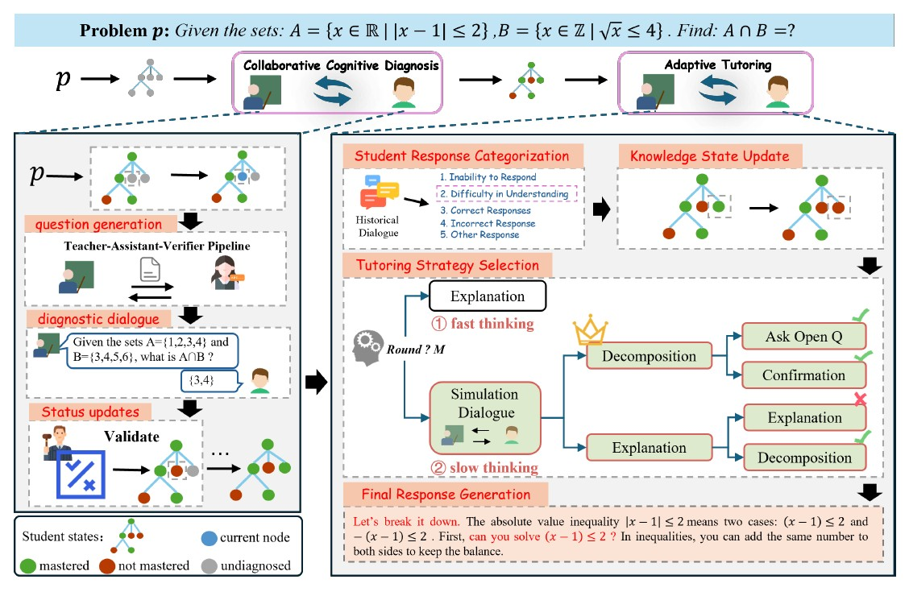

# 論文閱讀筆記：《PELICAN: Personalized Education via LLM-Powered Cognitive Diagnosis and Adaptive Tutoring》

* **作者：** 匿名作者 (Anonymous Authors，ICLR 2026 雙盲評審中)
* **發表時間：** 2026 年 (Under Review)
* **閱讀日期：** 2026-06-24
* **整理人：** Antigravity AI 助理
- 可以借鑑其知識樹的設計。

---

## 1. 研究動機與目的 (Motivation & Objectives)

* **研究動機：** 
  個性化教育的核心在於因材施教。然而，目前直接應用大語言模型 (LLMs) 於教育時，面臨兩大核心挑戰（稱為 GUIDING 問題）：
  1. **缺乏差異化 (Lack of Differentiation)：** LLM 傾向於產生標準化、千篇一律的正確解答，無法根據學生的動態認知狀態（懂或不懂）進行調整。
  2. **單向資訊流 (One-Way Information Flow)：** 現有的 LLM 輔導偏向「直接給答案」或灌輸知識，而非雙向對話以啟發批判性思考 (Critical Thinking) 與啟發式學習 (Heuristic Learning)。
* **研究目的：** 
  提出 **PELICAN** 框架，透過**「協作式認知診斷 (Collaborative Cognitive Diagnosis)」**與**「動態自適應輔導 (Adaptive Tutoring)」**兩階段，精準評估學生的認知狀態，並利用雙系統思考（快思慢想）演算法提供量身打造的教學引導。

---

## 2. PELICAN 架構圖

這張方法論圖（Figure 3）展示了 PELICAN 框架的兩個核心階段：**協作式認知診斷（Collaborative Cognitive Diagnosis）** 與 **自適應教學（Adaptive Tutoring）**。整個系統的目標是透過評估學生的知識狀態，動態調整教學策略，從而引導學生解出題目 $p$。

以下為詳細拆解與範例說明。

### 第一階段：協作式認知診斷 (Collaborative Cognitive Diagnosis)

這個階段的目的是找出學生對題目 $p$ 中各個知識點的掌握程度。

#### 1. 知識狀態樹 (Knowledge State Tree)
* **概念**：當給定一個問題 $p$（例如圖片最上方的數學題 $A \cap B$），系統會先將解這題所需要的知識點拆解成一個具備先備關係的階層式「知識狀態樹」。
* **圖示含義**：在圖的左上角，可以看到樹狀圖。節點的顏色代表學生的狀態：
  * **藍色**：當前正在診斷的節點
  * **灰色**：尚未診斷（undiagnosed）的節點
  * **綠色**：學生已掌握（mastered）的節點
  * **紅色**：學生未掌握（not mastered）的節點

#### 2. 問題生成與驗證 (Teacher-Assistant-Verifier Pipeline)
* **概念**：系統會採取「後繼優先」（successor-first）的策略，從樹的葉節點開始往回推診斷。為了確保產生的診斷問題是正確的，系統設計了一個三方驗證機制：
  * **Teacher (Expert)** 生成一個測試問題與答案。
  * **Assistant (語言模型)** 獨立作答。
  * **Verifier** 比對兩者答案。如果不一致，Teacher 就會修改並重新生成問題。
* **圖示含義**：左側中間展示了這個 Pipeline。
  * **範例**：Teacher 問：「給定集合 $A = \{1, 2, 3, 4\}$ 和 $B = \{3, 4, 5, 6\}$，請問 $A \cap B$ 是多少？」
  * 學生回答：「$\{3, 4\}$」。

#### 3. 狀態更新 (Status updates)
* **概念**：Verifier 驗證學生的回答。如果學生答對（掌握了該節點，標為綠色），根據樹狀結構的邏輯，其「先備知識節點」（父節點）也會自動被標示為已掌握（綠色），這大幅提升了診斷效率。

***

### 第二階段：自適應教學 (Adaptive Tutoring)

診斷完成後，系統會得到一個估計的學生知識狀態 $K_u$。接著進入教學對話，引導學生解題。為了降低負擔，系統會將大問題拆成多個子任務 $sp_1, sp_2, ..., sp_n$。

#### 1. 學生回應分類與知識狀態更新 (Student Response Categorization & Knowledge State Update)
* **分類**：當老師丟出子任務的引導後，學生會回覆。系統會將學生的回覆分成五類：
  1. 無法回答（Inability to Respond）
  2. 理解困難（Difficulty in Understanding）
  3. 答對（Correct Responses）
  4. 答錯（Incorrect Response）
  5. 其他（Other Response）
* **更新**：根據這個分類，系統會即時更新左側建好的知識樹。例如發現學生其實某個節點觀念錯了，就把綠色改回紅色。

#### 2. 教學策略選擇 (Tutoring Strategy Selection) - 雙系統理論
系統備有 10 種教學策略池（如：解釋 Explanation、拆解 Decomposition、問開放式問題 Ask Open Q、確認 Confirmation 等）。系統會根據對話回合數使用不同的思考模式：

* **快思考 (Fast Thinking)**：
  * **觸發條件**：在一個子任務的初期（對話回合數 $< M$）。
  * **運作方式**：系統憑直覺與經驗快速選擇常見策略。
  * **圖示範例**：圖中 ① 直接選擇了「Explanation（解釋）」策略。

* **慢思考 (Slow Thinking)**：
  * **觸發條件**：如果針對同一個子任務卡了太久（對話回合數 $\ge M$），代表學生遇到嚴重的認知障礙。
  * **運作方式**：系統會啟動模擬（Simulation Dialogue），建立一棵「模擬教學樹」。它會預想好幾種不同的策略路線（例如：如果我選「Decomposition 拆解問題」，會產生什麼對話？如果我選「Explanation 再次解釋」，又會發生什麼事？），並模擬學生的反應。
  * **圖示範例**：圖中 ② 進入綠色的 Simulation Dialogue 區塊。它模擬出兩條路線：
    1. 上方路線：使用 Decomposition 後，接著 Ask Open Q 跟 Confirmation，最終打勾（代表模擬中學生成功掌握）。這條路徑因為效率高，獲得了最高分（皇冠標誌）。
    2. 下方路線：使用 Explanation 後，遇到打叉（模擬中學生依然不懂），還得再接 Decomposition 才能成功，這條路徑較長，分數較低。
  * **結果**：系統因此捨棄單純的解釋，選擇最高分的策略（皇冠路線的 Decomposition）來引導學生。

#### 3. 最終回應生成 (Final Response Generation)
* 系統根據選定的策略以及學生的知識狀態，生成最終對話回覆。

***

### 完整 Pipeline 範例情境

假設學生要解圖中的題目 $p$：
給定集合 $A = \{x \in \mathbb{R} \mid |x - 1| \le 2\}$， $B = \{x \in \mathbb{Z} \mid \sqrt{x} \le 4\}$，求 $A \cap B$。

**Stage 1: 認知診斷**
1. **樹狀圖建立**：系統拆解出三個知識點：① 絕對值不等式、② 根號與整數條件、③ 集合交集。
2. **生成問題與診斷**：Teacher-Assistant-Verifier 生成一個簡單的交集問題測驗學生。學生答對了基本的 $\{1,2,3,4\} \cap \{3,4,5,6\}$，這代表節點 ③「集合交集」的觀念是綠色（掌握）。但系統可能診斷出學生對於 ①「絕對值不等式」不熟（紅色）。

**Stage 2: 自適應教學**
1. **子任務開始**：系統決定先解決 $A$ 集合的絕對值不等式。
2. **快思考**：系統第一回合先用「Explanation（解釋）」，告訴學生：「$|x - 1| \le 2$ 意思是距離 1 小於等於 2 的點。」
3. **學生回應分類**：學生回答：「我不懂這是什麼意思。」系統將其分類為「2. 理解困難（Difficulty in Understanding）」。
4. **慢思考啟動**：因為這回合卡住了（假設達到門檻 $M$），系統啟動模擬。
   * 路線 A（繼續解釋）：再次解釋絕對值的幾何意義。模擬結果預測學生可能還是聽不懂。
   * 路線 B（拆解 Decomposition）：把不等式拆成兩半。模擬預測這比較符合學生目前的知識狀態。
   * **決策**：系統選擇路線 B（Decomposition）。
5. **最終生成 (如圖右下角紅色字體所示)**：
   系統產出回覆：「讓我們把它拆解（break it down）。絕對值不等式 $|x - 1| \le 2$ 可以分成兩種情況：$(x - 1) \le 2$ 以及 $-(x - 1) \le 2$。首先，你能解出 $(x - 1) \le 2$ 嗎？在不等式中，你可以在兩邊加上相同的數字來保持平衡。」

這就是 PELICAN 如何透過診斷知道學生的弱點，並在學生卡住時，利用「模擬未來的對話發展（慢思考）」來切換教學策略（從純解釋切換為拆解步驟）的完整 Pipeline。

---

## 3. 實驗過程與結果 (Experiments & Results)

### 3.1 實驗設計
* **資料集：** 使用高考 (Gaokao) 資料集（包含 184 道涉及複雜知識點依賴關係的理科高考題）。
* **真人評估：** 邀請 169 名高中生參與實驗，收集了 1,335 份輔導報告。
* **基準對比：** 與 Free-Prompt（無結構對話）、Stepwise（固定步驟引導）、Socratic（純蘇格拉底引導）等模型進行對比。

### 3.2 實驗結果
1. **批判性思考與完成率雙提升：** 
   相較於基準模型，PELICAN 在**激發批判性思考上提升了 18.7%**，且**任務完成率提升了 22.4%**。
2. **因認知水平而異的策略自適應：**
   * 對於**高認知水平**的學生，系統會主動給予更多「開放式提問 (Questioning)」，激發自我探索。
   * 對於**低認知水平**的學生，系統會主動提供「具體類比與舉例 (Analogies)」，將抽象概念具體化，降低理解門檻（如圖 4 所示）。
3. **慢思考的成效與開銷：** 
   慢思考（模擬樹搜尋）在整場輔導中僅需被觸發約 14.7%，但它貢獻了顯著的教學效益。

---

## 4. 論文結論 (Conclusion)

* PELICAN 成功融合了認知診斷與認知心理學的雙系統理論 (Dual-System Theory)，開創了 LLM 導師「思考未來對話路徑」的先河。
* 實驗與真人測試均證實，透過樹狀結構進行精細化診斷，並依據認知狀態切換快/慢思考，能有效引導學生主動解決難題。

---

## 5. 延伸研究與改善方向 (Future Work & Limitations)

### 5.1 改善方向與空間
* **多模態輸出的需求（文字侷限）：** 
  在數學幾何題或化學結構式等需要高度空間想像的題目中，純文字或類比解釋效果極差（例如解釋角錐與球體的切面關係）。未來的改善方向是**整合多模態生成 (Multimodal Generation)**，讓 AI 在學生卡關時能自動畫圖或給予動態視覺化提示。

### 5.2 對 AREQA 專案的啟發與應用
* **「高考級別」的依賴樹診斷：** 
  我們的 GUM / STITCH 記憶系統在面對複雜學科（如古典文學、程式語法）時，也可以引入類似的 Prerequisite Tree。例如：「要懂 Closure（閉包），必先懂 Scope（作用域）」。診斷時，同樣可採用 **Successor-First**，直接考閉包，如果會了，免考作用域，這能讓我們的學生畫像更新效率翻倍。
* **因材施教的策略派發（Analogies vs. Questions）：** 
  在後端判定學生的熟練度時：
  * **熟練度低：** 系統提示詞應限制 LLM 必須採用 `Decomposition` (問題拆解) 或 `Analogies` (類比，如把閉包類比成背包)。
  * **熟練度高：** 系統應採用 `Open Question` (開放式問答) 或 `Push Limit` (進階挑戰)。這為我們的 Scaffolding 規則提供了扎實的寫入邏輯。
