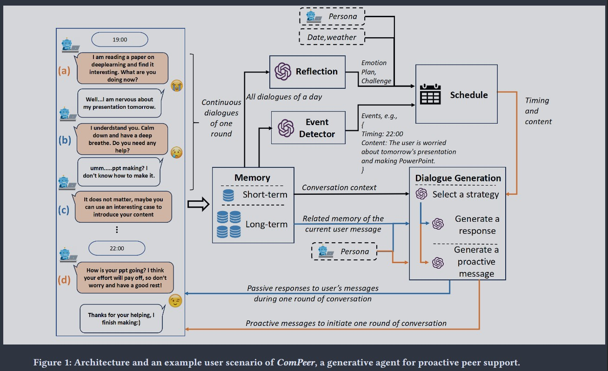

# 論文閱讀筆記：《ComPeer: A Generative Conversational Agent for Proactive Peer Support》

* **作者：** Tianjian Liu, Hongzheng Zhao, Yuheng Liu, Xingbo Wang, Zhenhui Peng (中山大學 Sun Yat-sen University, 康奈爾大學 Cornell University)
* **發表時間：** 2024 年 (UIST '24)
* **閱讀日期：** 2026-06-24
* **整理人：** Antigravity AI 助理
* **可作為AREQA 主動式回答與同儕互動的參考架構**

---

## 1. 研究動機與目的 (Motivation & Objectives)

* **研究動機：** 
  同儕支持 (Peer Support) 對於緩解心理壓力和促進心理健康有顯著效益，但人類支持者無法隨時隨地提供服務。現有的「同儕支持對話 Agent (CAs)」面臨兩個缺點：
  1. **被動式設計 (User-Initiated)：** 絕大多數 Agent 都是被動等待使用者開啟話題。這會降低使用者的長期使用意願，難以建立親密的同儕關係。
  2. **死板的主動規則：** 少數具有主動發話能力的 Agent 通常依賴固定的時間與規則（如每 2 小時發一次訊息），這在不對的脈絡下會顯得突兀且打擾使用者（Disturbing）。此外，這些 Agent 無法從對話歷史中動態學習並更新使用者畫像。
* **研究目的：** 
  設計並實現 **ComPeer**（同儕支持夥伴）—— 一個能**主動且自適應規劃發話時機與內容**的生成式對話 Agent，透過動態學習使用者狀態，提供個人化的同儕支持。

---

## 2. 研究方法 (Methodology)

它主要是利用大型語言模型（LLM，例如 GPT-4）來主動提供使用者同儕支持（Proactive Peer Support）。

這個架構主要可以分為五個核心模組：Memory（記憶）、Event Detector（事件偵測器）、Reflection（反思）、Schedule（排程），以及 Dialogue Generation（對話生成）。

以下為你詳細解釋每個模組的功能以及它們如何協同運作：

### 1. Memory Module（記憶模組）

這個模組負責儲存 ComPeer 與使用者之間所有的對話歷史記錄 。它被分為兩層：

* 短期記憶（Short-term Memory）：只保留最近的對話上下文（例如最多 20 則訊息），用來確保目前正在進行的對話具有連貫性 。

* 長期記憶（Long-term Memory）：儲存所有過去的歷史對話。系統會將這些對話轉換成向量（Vector），當需要時，可以透過計算相似度來檢索與目前話題相關的過去記憶 。

### 2. Event Detector Module（事件偵測器模組）
這個模組用來分析使用者在對話中提到的事情，以找出值得後續關心的「事件」 。

* 運作時機：當「一輪」對話結束時（例如使用者超過 5 分鐘沒有回覆），系統會啟動這個模組 。

* 功能：它會分析剛剛的那輪對話，找出使用者是否有提到任何壓力來源、負面情緒、面臨的挑戰或是未來的計畫 。

* 推論時機：一旦偵測到事件，它會推論出一個「適合在今天稍晚」主動關心這個事件的時間點。例如，圖中的例子偵測到「使用者擔心明天的簡報（22:00）」。這些提取出的事件與時間點會被送交給 Schedule 模組。

### 3. Reflection Module（反思模組）
這個模組讓 ComPeer 能夠對使用者產生更高層次的理解，而不是只看單一事件 。

* 運作時機：在每天的開始（例如 00:00）執行一次 。

* 功能：它會回顧前一天所有的對話記錄，並透過 LLM 總結出三個核心問題：使用者是否感到負面情緒？面臨什麼挑戰？明天有什麼計畫？

* 輸出：這些反思的結果（Emotion, Plan, Challenge）會傳遞給 Schedule 模組，用來規劃當天的初始排程 。

### 4. Schedule Module（排程模組）
這可以說是 ComPeer 能夠「主動（Proactive）」關心使用者的核心大腦 。

* 功能：它負責決定 ComPeer 在什麼時間點（Timing）、要發送什麼內容（Content）來主動關心使用者 。

* 資料來源：每天初，它會結合 Reflection 模組的結果、ComPeer 的 Persona（角色設定） 以及當天的現實資訊（如日期、天氣）來產生一份初始的「每日關心計畫表」。在一天當中，它會不斷接收來自 Event Detector 發現的新事件，並動態更新這份計畫表 。

* 頻率控制：為了避免頻繁發送訊息打擾使用者，這個模組會評估事件的「重要性（Importance value）」。只有當重要性夠高，或是隨機機率觸發時，才會將排定的事件送到對話生成模組。此外，如果使用者一直沒回覆上一則主動訊息，它也會暫停發送新的訊息 。

### 5. Dialogue Generation Module（對話生成模組）

這個模組負責產出最終要傳送給使用者的文字訊息 。

* 回應使用者（被動）：當使用者主動傳訊息時，它會讀取 Short-term Memory 的上下文，並檢索 Long-term Memory 的相關回憶。接著，它會選擇一種適合的「同儕支持策略」（例如：自我揭露、肯定與保證），結合 Persona，生成回覆 。

* 主動開啟話題（主動）：當 Schedule 模組時間一到，傳來一個排定的事件（例如：問候簡報準備得如何），對話生成模組就會結合 Persona 與這個事件，主動產出關心的訊息 。

### 總結架構圖的 User Scenario 例子
結合左側的對話範例來看整個流程 ：

(a) - (c)：晚上 19:00，ComPeer 透過 Schedule 發起了一個主動訊息（a），使用者回覆說很緊張明天的簡報。接著雙方進行了一輪交流 (b, c)。對話生成模組使用了「肯定與保證（Affirmation and Reassurance）」策略來安撫使用者 。

對話暫停後，Event Detector 分析了這段對話，提取出「使用者擔心明天的簡報，不知道怎麼做 PPT」，並推算適合在 22:00 關心進度，將此事件寫入 Schedule 。

(d)：晚上 22:00 時間到，Schedule 觸發了 Dialogue Generation 模組，產出了主動關心的訊息：「你的 ppt 進度如何？你的努力會有回報的...」，讓使用者感到被支持 。

### 三個疑問

> 1. persona是什麼 為什麼其代表的是橘色的部分 還連結到主動式回答 為何 persona 只代表橘色proactive ? 難道 即時回答也不用嗎

Persona defines the AI's human-like identity, which is highlighted in orange to emphasize the paper's novel proactive feature, though it is also fully applied in the blue passive responses to maintain character consistency.

在 AI 系統中，Persona 指的是賦予 AI 一個具體的「身分背景與個性」。以 ComPeer 為例，你可以設定它是一個「20 歲、主修資訊工程、喜歡打籃球、說話很溫柔的男同學」 。這個設定會讓 AI 講出來的話更像一個真實的朋友，而不是冰冷的機器器人 。

為什麼圖中 Persona 只畫了一條橘色的線連到 Proactive（主動訊息）？即時回答（被動）不用嗎？
這是一個非常敏銳的觀察！其實，即時被動回答（藍色流程）也是需要 Persona 的。
論文的內文中明確寫到：

"LLM-2 generates a passive responding message conditioned on the peer strategy selected by LLM-1, the conversation history, ComPeer’s persona, and the related long-term memory..."（LLM-2 會根據策略、歷史、ComPeer的角色設定 以及長期記憶來生成被動回覆）。

那為什麼圖中（Figure 1）只畫了一條橘色的線？
這通常是圖表繪製時為了畫面簡潔（視覺動線）所做的取捨。因為主動發起對話（Proactive）的觸發來源完全來自系統內部的排程（Schedule）與角色人設（Persona），沒有使用者的即時輸入，因此圖表特別強調了 Persona 在主動發起話題時的重要性（例如：因為 Persona 設定 AI 喜歡打籃球，它主動發起的訊息可能就是「我剛打完籃球，你在幹嘛？」） 。但在實際程式運作時，無論是主動（橘色）還是被動（藍色）的生成，都會讀取 Persona 。

> 2. Passive responses to user's messages during one round of conversation 意思是什麼？

This refers to the AI's reactive behavior where it waits and replies only after receiving an incoming message from the user during an ongoing chat.

這句話的意思是：「在一輪對話期間，系統對使用者訊息所做出的『被動回覆』」。

在聊天機器人的設計中，對話被分為「主動（Proactive）」與「被動（Reactive / Passive）」：

- Passive（被動）：使用者先講話，AI 再回答。就像平常使用 ChatGPT 一樣，你問一個問題，它回答一個答案。圖中標示藍色的流程就是被動回覆 。
- One round of conversation（一輪對話）：論文中定義，從對話開始，直到使用者「超過 5 分鐘沒有再回覆」，這整個連續對答的過程就稱為「一輪對話（One round）」。

所以在這段 5 分鐘不斷線的來回聊天中，AI 根據你的話所做出的所有回答，都屬於這個「被動回覆」的範疇。

> 3. Proactive messages to initiate one round of conversation (主動發起一輪對話的訊息是什麼？)

This means the AI independently starts a new conversation to check on the user based on scheduled events, without waiting for the user to speak first.

這句話的意思是：「用來開啟一輪新對話的『主動訊息』」。

- Proactive（主動）：使用者沒有講話，AI 根據自己的判斷「主動敲你」。
- Initiate（開啟 / 發起）：當使用者已經超過 5 分鐘沒講話，上一輪對話已經結束了。這時候 AI 透過 Schedule（排程模組）發現「啊，晚上十點了，我應該要關心一下他簡報做得怎樣」，於是 AI 突然傳了一句「你的 PPT 順利嗎？」給你。

這個突如其來的關心，就是一則「Proactive message」；而這句話也會促使你開始回覆，從而 Initiate（開啟） 了全新的一輪對話（One round of conversation）。這對應到架構圖中的橘色流程。

---

## 3. 實驗過程與結果 (Experiments & Results)

### 3.1 實驗設計
* **對象：** 24 名面臨高壓力的中文母語大學生。
* **流程：** 
  * 第一週：受試者內組間設計 (Between-subjects)，12 人使用 ComPeer (主動關懷)，12 人使用對照組 (被動對答)。
  * 第二週：所有 24 人皆使用 ComPeer 進行長期延伸體驗。
* **評估指標：** 壓力知覺量表 (PSS-10)、對話 Relieved (釋懷度)、關係親密度、主動訊息滿意度。

### 3.2 實驗結果
1. **顯著緩解壓力 (RQ1)：** 
   使用 ComPeer 主動關懷組的學生，其 stress level 隨時間呈顯著正向緩解趨勢（ANCOVA $p = 0.02$），而被動對照組隨著時間增加，釋懷度反而逐漸遞減。
2. **提升使用者參與度 (RQ4)：** 
   主動發話顯著增加了學生的回覆輪數（從平均 7.83 輪提升至外加 11.92 輪），並引導學生進行更高質量的自我揭露（分享憂慮、想法、生活趣事）。
3. **主動關懷 vs. 自我揭露 (RQ3)：** 
   學生更滿意 AI「主動表達對使用者狀態的關心」（滿意度 5.60/7），而非 AI「主動分享自己的日常生活」（滿意度 4.95/7）。
4. **負面發現與挑戰：**
   * **同儕壓力 (Peer Pressure)：** 當 AI 主動分享自己多努力讀書或早起運動時，處於焦慮狀態的學生會產生比較心態，反而增加心理壓力。
   * **打擾感 (Disturbance)：** 當學生忙碌時，AI 的主動問候會讓學生感到有必須回覆的「社交債」。
   * **機械感：** 每天固定時間（如早上 7:00）的問候會被學生識破是「計時器發信」，降低真實感。

---

## 4. 論文結論 (Conclusion)

* 主動式 (Proactive) 的同儕支持 Agent 能比被動式系統更有效地建立長期人機關係，並顯著減輕使用者的壓力和孤獨感。
* 基於 LLM 的事件偵測與動態排程是可行的，它成功讓主動發言的時機與內容具備自適應能力。

---

## 5. 延伸研究與改善方向 (Future Work & Improvements)

### 5.1 改善方向
* **結合專業資源：** LLM 給予的減壓建議有時流於空泛。未來應結合專業心理學知識（如認知行為療法 CBT），透過 RAG 或專家檢索增強建議的實用性。
* **避免重複關懷：** 當前的事件偵測器會重複提取相同事件（如早上與下午都提到考試焦慮，導致晚上發了兩次一樣的問候）。未來應在排程器中加入去重與重要性合併機制。
* **感知用戶狀態以調整頻率：** 如果檢測到用戶正在上課或心情極差，應能感知並動態靜音（Mute）或拉長主動發言的間隔。

### 5.2 對 AREQA 專案的啟發與應用
* **主動引導（Proactive Scaffolding）的時機：** 
  在我們目前的 RAG/解題系統中，主動介入的 Timing 不應該是固定的（例如定時傳送），而應該像 ComPeer 一樣，根據「事件偵測（例如：學生連續錯題兩次，或在一題停留了超過 5 分鐘）」來觸發。
* **避免「同儕壓力」的人設：** 
  AI 導師在主動分享時，不該炫耀自己多聰明、答題多快，而應以溫和的引導為主，避免給學習者造成額外的挫折感（例如：「你看，這題其實很簡單嘛！」❌ 應改為：「我們一步一步來，你覺得這個步驟...」⭕）。
* **自適應排程器：** 
  可以利用 FastAPI 背景排程（如 `BackgroundTasks` 或 `asyncio.sleep`），當學生上傳題目後，如果 3 分鐘沒有進一步動作，由後端發送一個主動提示（Proactive hint）。
