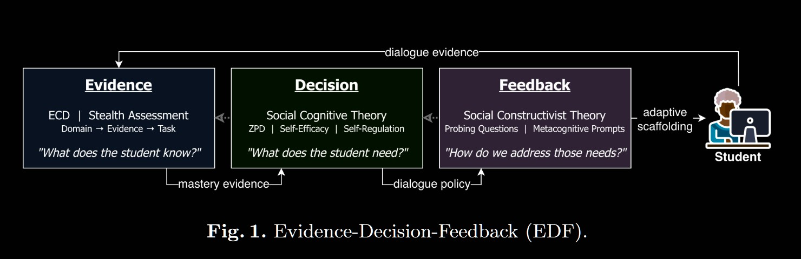
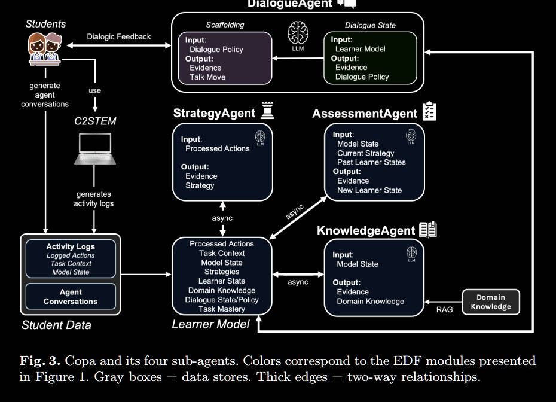

# 論文閱讀筆記：《Evidence-Decision-Feedback: Theory-Driven Adaptive Scaffolding for LLM Agents》

* **作者：** Clayton Cohn, Siyuan Guo, Surya Rayala, et al. (范德堡大學 Vanderbilt University)
* **發表時間：** 2026 年
* **閱讀日期：** 2026-06-24
* **整理人：** Antigravity AI 助理
* **備註:** EDF可以借鑒作為主要的系統學習輔助架構

---

## 1. 研究動機與目的 (Motivation & Objectives)

* **研究動機：** 
  雖然大語言模型 (LLM) 作為教學代理 (Pedagogical Agents) 擁有極高的對話潛力，但目前大多數系統都採用「一體適用 (one-size-fits-all)」的回答策略。這容易導致學生**過度依賴 (Overreliance)** AI，只追求快速完成任務而忽略了概念的深度理解，甚至產生「認知卸載 (Cognitive Offloading)」現象。
* **研究目的：** 
  提出一個結合傳統智慧教學系統 (ITS) 與 Agent 行為的理論驅動框架 —— **EDF (Evidence-Decision-Feedback)**，旨在實現**「自適應鷹架消退 (Adaptive Scaffolding Fading)」**，在不提供直接答案的前提下，引導學生自主建構知識。

---

## 2. 研究方法 (Methodology)



EDF 框架由三個半自主的模組與多 Agent 架構組成：

- Evidence（證據）模組：除了收集點擊或滑動等基本數據外，它的核心功能是持續分析這些數據來更新「學習者模型」，去推斷「學生目前懂了什麼（What does the student know?）」 。

- Decision（決策）模組：如你所說，負責學習決策。它會判斷「學生現在需要什麼（What does the student need?）」，並決定下一步的教學意圖（例如：提升自信心或給予引導） 。

- Feedback（回饋）模組：負責將決策轉化為實際的對話或提示，決定「如何滿足學生的需求（How do we address those needs?）」，給予學生最適合的引導 。

其中：

- evidence agent 到 decision agent 的 `mastery evidence` 意思是 : 關於學生對特定知識或技能的「掌握程度報告」。當 Evidence 模組收集並分析學生的作答或行為數據後，會評估學生目前具備的知識狀態 。這份評估結果會作為 mastery evidence 傳遞給 Decision 模組，讓決策模組清楚知道學生的程度落在哪裡，以便做出正確的教學判斷 。 
- decision agent 到 feedback agent 的 `diologue policy` 意思是：Dialogue policy 指的是系統決定採用的「教學意圖」或「對話策略」。當 Decision 模組接收到學生的掌握程度後，會根據教育理論（如近側發展區間 ZPD）決定下一步該用什麼方式幫助學生 。這個策略通常是一個高層次的指令，例如「不要直接給答案，而是使用提問來引導思考」。這條 dialogue policy 會傳給 Feedback 模組，作為生成具體文字回饋的依據 。

### Pipeline 流程範例

假設學生正在學習分數加法，遇到題目「1/2 + 1/3」時卡住了，並且輸入了錯誤答案「2/5」：

- Evidence 模組：收集到學生輸入的錯誤答案（也就是圖中的 dialogue evidence）。模組分析後推斷出學生「不了解通分，直接將分子與分母相加」。這個「學生不懂通分」的狀態就會作為 mastery evidence 傳送給下一個模組 。

- Decision 模組：接收到 mastery evidence 後，分析學生的學習需求。模組判斷此時不該直接告訴學生正確答案，而是需要引導他們釐清分數概念。因此，它制定了一條 dialogue policy：「使用探究性問題引導學生發現不同分母不能直接相加」，並傳送給 Feedback 模組 。

- Feedback 模組：收到對話策略後，將其轉化為具體的適應性支持（adaptive scaffolding）對話。它可能會生成這樣的文字：「我發現你把分子跟分母都加起來了喔！不過想想看，一半的披薩和三分之一的披薩切片大小一樣嗎？我們能直接把它們加在一起嗎？」最後將這段回饋呈現給學生 。

然後學生再將其回饋回傳給 Evidence 模組，形成一個循環。


### 它是怎麼做出來的？

這篇論文所提出的「Evidence-Decision-Feedback (EDF)」框架，其實並不是指一段傳統寫死的程式碼（例如 C++ 或 Python 寫好的規則模組），而是一個建立在大型語言模型（LLM）之上的理論與提示工程（Prompt Engineering）架構。

這個 EDF 框架被具體實作在一個名為 Copa 的 AI 輔導系統中。

這三個 Agent 實際上是透過大型語言模型（論文中使用的是 GPT-4 或更先進的版本如 GPT-5 ），加上特定的角色設定（Persona）與思維鏈提示（Chain-of-Thought Prompting, CoT）來運作的：

1. 模組被拆分成「子代理 (Sub-agents)」：
在 Copa 系統中，作者將 EDF 框架的模組具體化為四個子代理 ：

- StrategyAgent 與 AssessmentAgent、KnowledgeAgent（這三個構成 Evidence 模組）：它們會讀取學生在電腦上的操作日誌（點擊、程式碼修改等），並利用 RAG（檢索增強生成）技術比對專家知識，推斷出學生目前的狀態（例如：是在盲目嘗試，還是有邏輯地解題）。

- DialogueAgent（這一個負責 Decision 和 Feedback 模組）：它接收前面傳來的學生狀態，決定要用什麼策略回應，然後生成對話回覆給學生 。

2. 使用思維鏈（CoT）與提示工程：
作者沒有寫死「如果發生 A，就執行 B」的程式碼，而是利用名為 CoTAL 的提示工程方法，要求 LLM 在給出回饋前，必須先在後台「自言自語」寫下它的推論過程 。例如，LLM 必須先輸出：「因為學生輸入了這段錯誤的程式碼，顯示他不懂 X 概念（Evidence） $\rightarrow$ 我現在應該要引導他思考 X（Decision） $\rightarrow$ 所以我要問他這個問題（Feedback）」 。這種做法確保了流程的可解釋性 。

3. 同步與非同步的 LLM 呼叫：
為了讓系統順暢，負責分析日誌、需要大量推理的 Evidence 代理是在背景非同步運行的；而負責跟學生對話的 DialogueAgent 則是同步運行的，以確保低延遲的互動體驗 。

關於原始碼的取得，根據目前的文獻與開源社群紀錄，這篇名為《Evidence-Decision-Feedback: Theory-Driven Adaptive Scaffolding for LLM Agents》的論文（約於 2026 年初發表），目前尚未直接公開其 Copa 系統的完整開源程式碼庫 。

### EPF Copa 系統架構圖



四個疑問 :

#### 1. Student Data 與 Learner Model 的連接是什麼意思？

This connection represents the continuous process of analyzing raw student log data to infer meaningful learning behaviors and update the student's dynamic profile.

這個連接代表了「從原始數據萃取出有意義的學習狀態」的過程。

- Student Data（學生資料） 是非常原始、雜亂的紀錄，例如「點擊了按鈕 A」、「輸入了程式碼 B」、或是「對 AI 說了一句話」。這些原始資料 LLM 很難直接看懂。

- 架構圖中下方的三個藍色代理（StrategyAgent、AssessmentAgent、KnowledgeAgent），負責在背景（非同步）不斷讀取這些 Student Data 。

- 它們會分析這些原始日誌，翻譯成具有語意意義的內容（例如把 set_blk1234_vel_4 翻譯成「將速度設定為 4 m/s」），並推斷出學生的認知行為 。

- 分析完的結果會寫入並更新 Learner Model。這就是這個箭頭的意義：把冰冷的數據（Data）變成有教育意義的學生檔案（Model） 。

#### 2. Learner Model 是什麼意思 ?

The Learner Model serves as a continuously updated digital representation of the student (e.g. json file), capturing their current cognitive state, learning strategies, and levels of task mastery.

Learner Model 就像是 AI 系統為這位學生建立的「動態數位檔案」或「病歷表」 。它不是一個死板的分數，而是一個持續更新的資料庫，儲存了系統對學生目前狀態的理解 。這個模型包含了：
- 學生當下的狀態（Model State、Learner State，例如：正在摸索、正在除錯）
- 解題策略（Strategies，例如：是有系統的嘗試，還是盲目亂弄）
- 任務掌握度（Task Mastery）與領域知識掌握情況

可以把 Learner Model 想像成一個動態更新的 JSON、資料庫檔案或結構化的文檔。它裡面儲存的資料可能長這樣：

```json
{
  "student_id": "A123",
  "task_mastery": "40%", 
  "current_strategy": "TINKERING (系統性試錯)",
  "learner_state": "DEBUGGING (正在除錯)",
  "misconceptions": ["不懂分母不能直接相加"]
}
```

這個檔案的功用是作為一個「白板」或「共享記憶」，讓那四個 Agent（大腦）可以隨時把他們觀察到的學生狀況寫上去，並且在要跟學生講話前，先來讀取這個檔案，以確保給出的建議符合學生的現況 。

#### 3. Learner Model 和 Dialogue Agent 的連接是什麼意思？

This connection allows the DialogueAgent to retrieve the student's current learning status from the model to determine the most appropriate pedagogical strategy and generate personalized feedback.

這個連接代表了「根據學生的現況來決定如何回應」的過程。

- DialogueAgent（對話代理） 負責直接跟學生聊天（這包含了Decision 和 Feedback 模組） 。
- 當學生對 AI 發問時，DialogueAgent 不能隨便回答。它必須先去讀取 Learner Model（箭頭方向從 Learner Model 指向 DialogueAgent 的 Input），了解這個學生目前的程度、卡在哪個盲點，以及他剛才用了什麼解題策略 。
- 讀取完 Learner Model 後，DialogueAgent 會結合學生剛剛說的話（Dialogue State），決定一個「對話策略（Dialogue Policy）」，例如決定要「探究學生的理解（PROBE_UNDERSTANDING）」或是「給予具體建議（SUGGEST_ACTION）」 。
- 最後，它會把這個策略轉化為實際的文字回覆（Talk Move），傳送給學生 。

#### 4. 各 Output 的 Evidence 是什麼意思 ?

Evidence is the structured output generated by sub-agents from raw activity logs to update the Learner Model with actionable cognitive insights to guide the Agent's tutoring decisions.

學生在系統上會產生很多原始資料（Data），例如「點擊了 A 按鈕」、「輸入了 3 秒鐘」、「刪除了兩行程式碼」。對決策代理（DialogueAgent）來說，這些資料太碎了，它不知道這代表什麼意思 。

因此，架構圖下方的三個代理（StrategyAgent、AssessmentAgent、KnowledgeAgent）會把這些原始動作進行「翻譯與推論」 。它們推論出來的結果（Output），就是 Evidence（證據）。

這裡的 Evidence 不是法庭上的實體證據，而是對學生學習狀況的具體陳述或標籤。例如：
- 能力證據：系統觀察到學生連續答對兩題分數加法，於是輸出一個 evidence 標籤：「已掌握同分母加法」 。
- 行為證據：系統觀察到學生程式碼一直報錯但還是不停按執行，於是輸出一個 evidence 標籤：「正在盲目試錯 (Tinkering)」 。
- 盲點證據：系統比對了學生的程式碼與標準答案，發現變數沒有初始化，於是輸出一個 evidence 標籤：「缺乏變數初始化的概念」 。

這三個代理「觀察」學生的操作，並附帶推論理由（這稱為思維鏈 CoT，確保推論是有依據的），然後將這份 Evidence（診斷證明） 寫入 Learner Model 檔案中 。接著，負責聊天的對話代理就會拿著這份「證明」，決定接下來要怎麼教這個學生 。

#### 其餘疑問

> **Question 1:** learner model 是一種 hot memory 而不是 cold memory ? (存在database的)

論文中並沒有直接使用「hot memory（熱記憶）」或「cold memory（冷記憶）」這兩個專有名詞。但從系統架構的運作方式來看，它更接近於一種「Hot Memory」（或結合了兩者特性的混合體）。在 EDF 框架中，Learner Model 是一個「持續更新（continuously updated）」的動態檔案 。

架構圖顯示，它會即時接收三個 Evidence 代理傳來的最新狀態（例如學生剛才輸入了什麼程式碼、現在是不是卡住了） 。當對話代理（DialogueAgent）要回答學生時，它必須讀取這個包含了「當下對話狀態（Dialogue State）」與「最新模型狀態（Model State）」的 Learner Model，以做出即時反應 。

因此，雖然它的基底可能存放在資料庫中，但就其高頻率更新與作為即時決策依據的特性來說，它的運作模式完全是「Hot Memory（工作記憶）」的概念。

> **Question 2:** Dialogue Policy 具體是怎麼寫的？

在論文的 Section 4（Copa 系統介紹）中，明確指出了 DialogueAgent 會根據學生狀態，決定出具體的對話策略 。論文列舉了三種主要的 Policy 範例：

- PROBE_UNDERSTANDING（探究理解）：
當學生想要直接討答案，或者展現出概念錯誤（Misconception）時，代理會選擇這個策略，目的是先用提問來確認學生的知識盲點 。

- SUGGEST_ACTION（建議行動）：
當學生需要具體引導時，代理會選擇這個策略，給予學生在 C2STEM 系統中下一步該怎麼做的具體建議 。

- PUSH_LIMIT（挑戰極限）：
當學生已經有一定掌握度時，代理會選擇這個策略，推動學生去延伸思考或加深理解 。

具體Prompt 參考 `misc\EDF\AIED26_Supplementary_Materials`

---

## 3. 實驗過程與結果 (Experiments & Results)

### 3.1 實驗設計
* **對象：** 美國某高中 33 對學生小組 (Dyads，共 66 人)，年齡 15-16 歲。
* **時間：** 進行為期 6 週、每週 2 小時的物理運動學課程。
* **評估任務：** 1D 卡車模擬、2D 無人機單包裹投放、2D 無人機雙包裹投放。
* **底層模型：** 經評估比較了 Gemini、Claude 與 GPT 系列，最終選用 GPT-5。

### 3.2 實驗結果
1. **鷹架適應與消退 (RQ1 - Scaffolding Adaptivity)：** 
   > RQ1：AI 的輔助會隨著學生的掌握度改變嗎？（適應性）

   隨著學生的熟練度 (Mastery) 增加，Copa 顯著減少了 `PROBE_UNDERSTANDING` (探查理解) 的頻率 ($\rho = -0.34$)，並轉而增加 `SUGGEST_ACTION` ($\rho = 0.33$) 與 `PUSH_LIMIT` ($\rho = 0.42$)。這證明**鷹架會隨著學生進步而自動消退**。
2. **理解與熟練度的一致性 (RQ2 - Understanding-Mastery Alignment)：** 
   > RQ2：學生的系統任務進度，等於他們真的懂了嗎？

   學生能正確向 AI 解釋程式碼的機率，與他們在系統中的任務得分呈顯著正相關 ($\rho = 0.40$)，表示學生是真的理解概念，而非投機過關。
3. **自主性提升與依賴降低 (RQ3 - Student Reliance)：** 
   > RQ3：學生會不會過度依賴 AI？

   隨著任務熟練，學生主動呼叫/求助 AI 的頻率顯著下降 ($\rho = -0.26$)，顯示其自主學習與自我調整 (Self-regulation) 的能力獲得提升。
4. **決策的可解釋性 (RQ4 - Interpretability)：** 
   > RQ4：AI 的決策過程是可以解釋的嗎？

   透過 Chain-of-Thought (CoT) 輸出，證明了「輸入數據 ➡️ 證據模型 ➡️ 決策策略 ➡️ 回饋生成」的鏈條具有高度的語義一致性（Grounding Recall 達 0.43，Decision Alignment 達 0.64）。

---

## 4. 論文結論 (Conclusion)

* EDF 框架證明了 LLM 教學代理可以不落入「直接給答案」的套路。透過模組化設計與學習理論引導，AI 能夠在開放式探索環境中，以動態、自適應且**具備高可解釋性**的方式提供鷹架支持。
* 實驗結果支持：當學生能力提升時，系統會逐步退居幕後 (Fading)，成功引導學生進行自主的知識建構。

---

## 5. 延伸研究與改善方向 (Future Work & Limitations)

### 5.1 限制與改善空間
* **輔助悖論 (Helpfulness Paradox)：** 
  問卷調查顯示，部分學生因為「AI 不直接給答案」而感到挫折 (Frustrated)。這揭示了教學設計的兩難：**AI 必須夠熱心以贏得學生信任，但又必須保持克制以避免學生放棄思考**。未來的系統需要在「情感同理安慰」與「強硬教學原則」之間取得更好的動態平衡。
* **缺乏長期追蹤：** 
  本研究僅評估了系統內的操作行為，缺乏 AB 測試 (RCT) 來驗證學生在離開 AI 後，是否能獨立遷移這些物理知識。
* **特徵局限性：** 
  目前的學習者模型僅關注任務得分與對話，未來應加入情緒特徵、自我調整能力 (SRL) 等多模態特徵。

### 5.2 對 AREQA 專案的啟發與應用
* **拍照解題場景下的 ZPD 決策：** 
  當學生拍攝並上傳題目時，後端的決策模組應比對 GUM 記憶，若學生處於低熟練度，語義回饋應偏向「引導式提問（對應 `PROBE_UNDERSTANDING`）」；當學生熟練時，應改為「延伸發問（對應 `PUSH_LIMIT`）」。
* **多輪語音中斷作為動態 Evidence：** 
  語音中斷 (Voice Interruption) 可以看作是學生即時的「口語化表達 (Verbalization)」，這正是評估其 dialogue state 的黃金數據，可立即用來改寫當下的 Scaffolding 決策。
