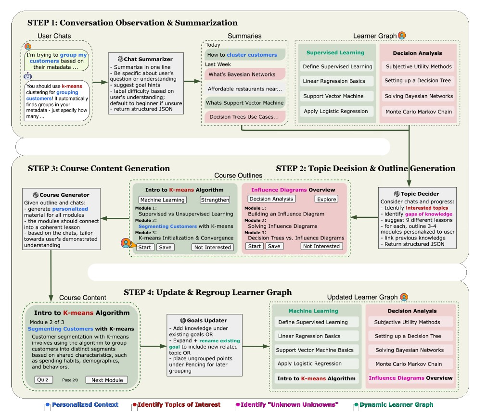

# 論文閱讀筆記：《LOOM: Personalized Learning Informed by Daily LLM Conversations Toward Long-Term Mastery via a Dynamic Learner Memory Graph》

* **作者：** Justin Cui, Kevin Pu, Tovi Grossman (多倫多大學 University of Toronto)
* **發表時間：** 2026 年 (AAAI 2026 Workshop on PerFM)
* **閱讀日期：** 2026-06-24
* **整理人：** Antigravity AI 助理
- 借鑑其記憶圖譜的設計，但不用生成微型課程大綱。

---

## 1. 研究動機與目的 (Motivation & Objectives)

* **研究動機：** 
  大語言模型 (LLMs) 在個性化學習中扮演越來越重要的角色。然而，現有系統在「連續性（長期計畫）」與「主動彈性（因應當下興趣）」之間存在難以調和的拉扯：
  1. **目標導向導師系統 (Tutor Systems)：** 雖然能維護長期的學習進度，但通常假設學生有明確的學習目標（如「我要學 Python」），且僅限於在專用輔導視窗內更新進度，無法捕捉學生日常的真實需求。
  2. **偶發性學習系統 (Incidental Learning)：** 能在日常中靈活提供即時的內容（如在聊天間隙背單字），但無法將這些零碎的學習微步 (Micro-steps) 整合進長期的知識體系中。
  3. **未知中的未知 (Unknown Unknowns)：** 學生常常感覺自己有某些知識盲區，但因為不了解該領域，無法具體說出自己「不知道什麼」，導致難以主動搜尋。
* **研究目的：** 
  提出 **LOOM**，一個基於 **LLM 的代理管線**。它通過**觀察使用者日常的 LLM 閒聊/工作對話**，自動推論其潛在的學習需求與知識盲區，構建一個**動態學習者記憶圖譜 (Dynamic Learner Memory Graph)**，並自動為其量身生成結構化的微型課程，將日常對話轉化為系統化的長期學習路徑。

---

## 2. 研究方法 (Methodology)

LOOM 系統旨在將日常與大型語言模型的對話，轉化為具有延續性且個人化的學習軌跡。該系統的核心架構為一個包含四個階段的動態管線（Pipeline），並以「學習者記憶圖譜（Learner Memory Graph）」作為運作的基礎來追蹤使用者的知識狀態 。 

以下為 LOOM 系統管線的四個階段詳細說明與範例：

### 1. 對話觀察與摘要
此階段系統會持續監控並分析使用者近期與 LLM 的對話，從中擷取具體的學習訊號與主題 。系統會判斷使用者的先備知識程度，並過濾出近 10 天內的活躍對話，確保推薦內容符合使用者當下的需求 。 
**範例：** 假設使用者向 LLM 詢問如何將客戶資料分群，系統的摘要代理人會將該對話總結為「如何將客戶分群（How to cluster customers）」，並將其標記在「監督式學習」的主題傘下，同時依據對話內容評估使用者的難易度等級 。

### 2. 主題決定與大綱提案
系統會結合第一階段的摘要與學習者記憶圖譜，主動推薦相關的學習主題並生成課程大綱 。推薦模式分為兩種：「強化模式（Strengthen mode）」針對已討論過的主題進行深化；「探索模式（Explore mode）」則會引入與既有知識相鄰的新概念（即「未知的未知」） 。 
**範例：** 基於使用者先前詢問的客戶分群問題，系統會產出「K-means 演算法」的課程大綱（強化模式） 。同時，若系統發現「影響圖（Influence Diagram）」是決策分析領域中相鄰的概念，便會主動推薦該主題的大綱（探索模式） 。 

### 3. 課程內容生成
當使用者選擇了某個提案大綱後，內容生成代理人會提取使用者先前的對話原句與語氣，生成客製化的微型課程 。每個課程包含 3 到 4 個模組，內容會從核心概念循序漸進到應用，並附有小測驗以診斷學習者的理解程度 。
**範例：** 系統會擷取使用者當初詢問客戶分群時的實際對話內容，將其融入 K-means 演算法的課程文字中，讓學習者感到內容是專為他量身打造的 。 

### 4. 進度追蹤與學習者圖譜更新
系統會根據使用者實際完成的課程模組或自我回報的精熟度，持續更新學習者記憶圖譜 。重組代理人（Regrouping agent）會動態調整目標分類，例如將相關課程合併至現有目標、重新命名目標或建立新的目標分類 。 
**範例：** 當使用者完成了「K-means 演算法」與「影響圖」的課程後，系統會將記憶圖譜中原本的「監督式學習」目標重新命名為涵蓋更廣的「機器學習」，以反映使用者新增的知識；同時也將影響圖課程歸類更新至決策分析的目標下 。

### 為何需要課程大綱?

根據 LOOM 系統的研究設計，產出「課程大綱（Course Outline）」在系統架構中扮演了非常關鍵的橋樑角色。以下是該系統需要產出課程大綱的幾個主要原因：

1. 彌合學習連貫性與主動性
傳統的對話機器人雖然能即時回答使用者的提問，但往往缺乏長期的學習規劃；而傳統的學習系統雖然有結構，卻難以適應使用者日常對話中突發的學習需求 。LOOM 透過觀察日常對話，主動推斷學習需求並產出大綱，成功在「回答單一問題（主動性）」與「建立長期學習軌跡（連貫性）」之間取得平衡 。

2. 將零散對話結構化為有意義的學習軌跡
使用者在日常工作或學習時所提出的問題通常是零散的。系統透過整合先前的對話摘要與學習者的「記憶圖譜（Memory Graph）」，將這些碎片化的學習訊號轉化為具有 3 到 4 個模組的結構化課程大綱 。這樣的設計讓學習者能清楚了解課程目標、將回答的問題以及預估的學習時間，使其不再只是被動接收資訊，而是進入一段有規劃的迷你課程 。

3. 發掘「未知的未知」並促進學習探索
課程大綱的生成機制包含兩種模式：「強化模式」與「探索模式」 。透過大綱，系統不僅能針對使用者已經討論過的主題進行深化（強化），更能主動推薦與既有知識相鄰的新概念（探索） 。藉由提案大綱的方式，系統能以結構化的形式向使用者揭示他們潛在的「未知領域」，同時讓使用者保有選擇是否要進行深入學習的控制權 。

4. 確保內容生成的準確性與一致性
在生成完整課程內容之前先產出大綱，能提供明確的指引，幫助後續的內容生成代理人（Content Generation Agent）更有邏輯地運作 。大綱能確保後續生成的內容會從核心概念循序漸進到應用層面，不僅減少了大型語言模型生成內容時的冗餘或偏題，也提升了整體教學的連貫性 。
---

## 3. 實驗過程與結果 (Experiments & Results)

### 3.1 實驗設計
* **設計：** 10 名受試者進行為期 2 天的形成性研究 (Formative Study)。
* **過程：** 
  * 受試者在日常工作/學習中正常使用 LLM（每人需建立 10-15 個新對話）。
  * LOOM 背景監視並自動生成個性化課程方案。
  * 受試者閱讀課程、進行測驗，並在最後填寫 Likert 10 點量表問卷與開放式回饋。

### 3.2 實驗結果
* **高度正向回饋：** 學生在「實用性 (Q1)」、「與先前對話的連貫性 (Q7)」以及「持續學習動機 (Q9)」上給予極高評價。學生反映「*小測驗與進度圖讓我覺得自己真的在學習，而不是像以前一樣只是一問一答。*」
* **成功挖掘盲區：** 系統成功幫學生找出了他們原先不知道的知識缺口 (Gap Identification)。
* **有待改善之處：**
  1. **課程深度不一：** 純 LLM 生成的課程偶爾會有 factual 錯誤或深度不足。
  2. **過度泛化：** 因為圖譜更新完全依賴 LLM 推論，有時學生只在聊天中提到一次某概念，系統就判定他「已掌握」，導致圖譜不準確。

---

## 4. 論文結論 (Conclusion)

* LOOM 證實了「日常對話 ➡️ 個人化課程」的管道是可行的。它打破了傳統 ITS 必須強制學生進入「學習模式」的限制，在不干擾日常使用的前提下，實現了長期的知識建構與追蹤。
* 動態學習者記憶圖譜（Learner Memory Graph）提供了一個可視化、可解釋的架構，解決了長文本 context 碎片化的問題。

---

## 5. 延伸研究與改善方向 (Future Work & Limitations)

### 5.1 改善方向
* **混合主動性控制 (Mixed-Initiative Control) 🌟：**
  目前的記憶圖譜是單向由 AI 推論並呈現的，學生只能被動接受。未來應將圖譜做成**「可手動編輯的視覺化畫板」**。學生可以自己拖曳節點、新增目標（如「我想開始學資料倫理」）、合併分類，讓圖譜成為學生與 AI 共同決策的「共享工作空間 (Shared Workspace)」。
* **引入非 LLM 的硬性數據 (Hardening the Graph)：**
  為了防止 LLM 猜測錯誤，未來的進度更新應引入硬性指標：使用者發問該主題的頻率、測驗分數、以及學生的「自我宣告（我懂了 / 我還是很困惑）」，提高圖譜的信賴度。

### 5.2 對 AREQA 專案的啟發與應用
* **「認知軌跡」轉化為「個人化導師」的基石：**
  LOOM 證實了 GUM 這樣的記憶圖譜不只是拿來做 RAG，它還可以作為 **「動態課表生成器」**。
  在我們的 AREQA 網頁版中，當學生在 Classical Literature (紅樓夢) 問了幾次林黛玉的判詞後，系統應主動將其標記在 GUM 中，並在前端 UI 的「個人畫像面板」或「GUM Panel」中，主動推薦一個微型小單元：「*讀懂林黛玉與薛寶釵的判詞對稱性*」，並附帶 3 個檢測題，這就是極致的 **Proactive UX**。
