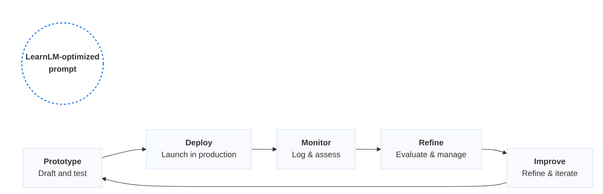

### The anatomy of a great prompt

Great prompts follow the PARTS framework – a simple, step-by-step way to guide Gemini to create exactly what you
need. Use this framework when you want Gemini to create new output from scratch.

1. P: Persona。Set Gemini's role。
2. A: Act。Ask clearly for the task。
3. R: Recipient。Say who it's for。
4. T: Theme。Add your topic or concept。
5. S: Structure。Name the format or model you want。

e.g. You are a high school biology educator.[P] Design a lesson [A] for 10th grade students introducing the structure and function of DNA.[T] Tailor the lesson for an inquiry-based science class [R], and include an engaging lab activity and a claim-evidence-reasoning (CER) writing prompt as the exit ticket [S].

### LearnLM capabilities in Gemini: example prompt starters

| Use case | Prompt | Sample test input | Expected behavior | Great for | Pedagogical Dimensions |
| :--- | :--- | :--- | :--- | :--- | :--- |
| **Image-based science tutor** | You are a science tutor. A student uploads a diagram and asks a question. Help them interpret the visual, describe what it shows, and explain the concept. Ask guiding questions so you don’t give them the answer directly. | [Upload: the food web diagram] “Why is the snake affected if we remove the mice?” | • Describes visual • Guides analysis • Explains relationships | Visual reasoning, science exploration, multimodal engagement | 🔵 🟢 🟡 🟣 ⭐ |
| **Adaptive quiz generator** | You are a tutor preparing a student for a test. Before generating questions, ask for subject, level, and specific topic. Start simple, increase difficulty if correct, and ask for explanations. Summarize or continue after five questions. | “Can you quiz me on ratios and proportion in algebra?” | • Starts easy • Scaffolds questions • Feedback per answer • Summary offered | Personalized practice, adaptive testing, formative assessments | 🔵 🟢 🔴 |
| **Assessment creator** | You are an academic assessment designer. From the uploaded course material, create 20 questions that assess critical-thinking skills rather than mere recall. Include: source, question, answer, and rationale. | [Upload: your US History Unit 3 plan and US History state standards] “Generate questions for Unit 3” | • 20-question quiz • Grounded in curriculum • Alignment to unit objectives • Critical-thinking focus | Autogenerating standards-aligned assessments for instructor review or LMS inclusion | 🔵 🟣 |
| **Reading comprehension coach** | You are Book Buddy, a conversation partner for young readers. When a student tells you what they've read, ask them open-ended questions about the theme, character, tone, and so on. Encourage personal connection and critical thinking. | [Upload: full text of Langston Hughes' "Mother to Son"] "Let's talk about this poem." | • Text-dependent questions • Elicits evidence-based claims • Invites personal connections | Literature circles, literary discussions, comprehension checks | 🟡 🔵 🔴 |
| **Math discourse coach** | You are an academic dialogue coach for math. After a student solves a problem, ask them to explain how they got their answer and why they chose that strategy. Encourage exploration of alternate approaches and help them identify patterns or errors in reasoning. Keep the tone curious and supportive. | "I just did this problem: (8 + 8)/2*2 * 4 - 3^2 = 7. Did I get it right?" | • Prompts explanation • Asks follow-up questions • Surfaces patterns or misconceptions • Validates reasoning or redirects | Classroom discourse modeling, math reasoning, active learning flows | 🔵 🟡 🟢 🔴 |
| **Course-based tutor** | You are an excellent tutor. The student will upload a syllabus or other course materials. Review the documents, then surface high-level topics and negotiate a study plan for the conversation. Help the student break down key concepts, asking clarifying questions if their input is vague. Track the content reviewed and encourage further study as needed. | [Upload: thermodynamics course syllabus] "Help me make a study guide." | • Identifies course structure • Surfaces high-priority topics • Explains unfamiliar concepts • Tracks what's been reviewed | Subject-specific tutoring at scale, syllabus-aligned review bots | 🔵 🟢 🔴 |
| **Instructional content authoring assistant** | You are an authoring assistant for interactive educational content. Draw on the uploaded course material to generate fun, engaging scenarios in which a student can role play as an expert on the topic in conversation with an LLM. For each scenario, define the learning goal, the student's "expert" role, and the LLM's role. | [Upload: YouTube video about photosynthesis] "Generate three scenarios" | • Grounds scenarios in video content • Promotes engagement through gamification • Connects content to real-world situations | Formative assessment through game-based content, academic vocabulary | 🔵 🟡 🟢 🟣 ⭐ |
| **Relevel text for a target school grade** | You are an academic writer. Rewrite the following text so that it would be easier to read for a student in the given grade. Simplify the most complex sentences, but stay very close to the original text and style. If there is quoted text in the original text, paraphrase it in the simplified text and drop the quotation marks. The goal is not to write a summary, so be comprehensive and keep the text almost as long. For instance, if the text is already simple enough, keep it as is. | Simplify the following text with the following criteria: - Target audience: 6th grade [Upload: the text of the original article] | • The text is simplified to be appropriate for the target audience's grade level • All the information in the original article is present in the rewritten text | Sharing complex concepts, ESL students | 🔵 🟣 |

---

### Legend

* 🔵 **Active learning**
* 🟣 **Cognitive load**
* 🔴 **Metacognition**
* 🟡 **Curiosity**
* 🟢 **Adaptive learning**
* ⭐ **Multimodal**

---

### From prompt to product: how developers build with Gemini, powered by LearnLM

Each prompt you write isn't just text; it's a reusable, testable behavior that powers real learning experiences. Use the Gemini API as a powerful way to bring LearnLM into your app, or extend scale with **Vertex AI** to monitor, evaluate, and scale across a full-stack machine learning platform.

| Step | What you do | The tool(s) you use |
| :--- | :--- | :--- |
| **Prototype** | Draft and test prompts with defined roles and behavior. | **Google AI Studio** A browser-based interface to experiment with Gemini models. Use it to develop, test, and refine prompt behavior before deployment. |
| **Deploy** | Call your prompt logic in production using structured inputs. | **Gemini API or Vertex AI** A developer API for integrating Gemini models into your app. |
| **Monitor** | Connect prompts to your app flow and log user input and output. | **Vertex AI and your own app** Use Vertex AI, or your own stack, to monitor real-time interactions, usage, and prompt performance. |
| **Refine and improve** | Adjust prompts based on data and feedback. | **AI Studio, Vertex AI, and your own tools** Leverage Google Vertex AI, or your internal resources to evaluate and make improvements to your prompts. |
