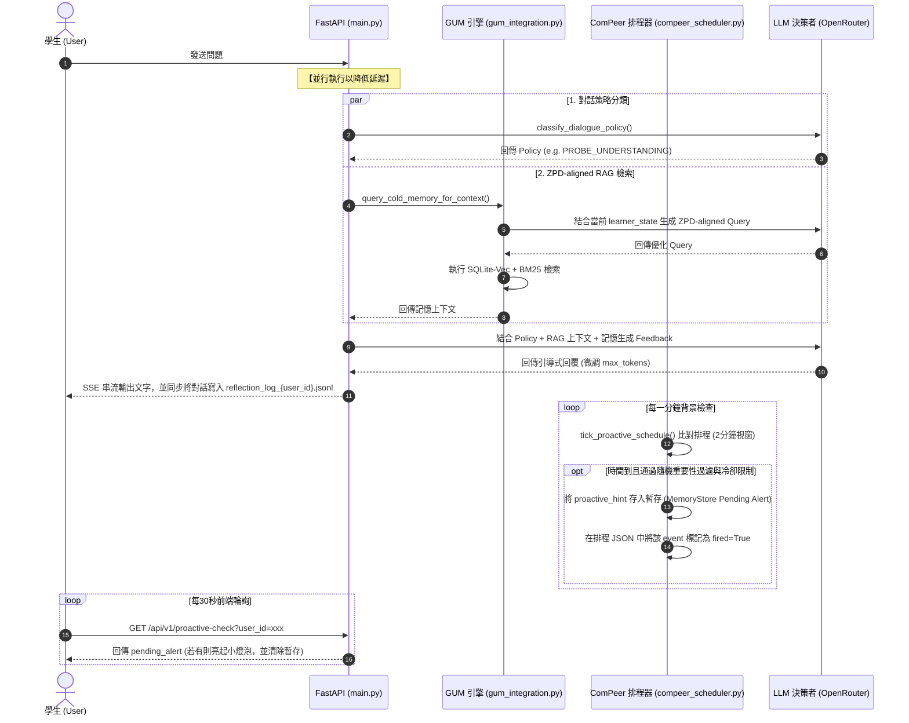

# AREQA - EDF & ComPeer 系統整合實作計畫書 (更新版)

建立日期：2026-06-25  
作者：Antigravity AI 助理  

本計畫書旨在將 **Evidence-Decision-Feedback (EDF)** 的理論架構與 **ComPeer** 的主動關懷機制，整合至以 GUM（工作記憶與長期記憶分層）與 STITCH（意圖打標）為基礎的 AREQA 後端系統中。本計畫已針對可行性評估報告中的設計隱患、技術缺陷進行了全面修正，確保系統具備高可用性與極佳的效能。

---

## 1. 系統檔案結構圖 (System Directory Structure)

本方案直接延伸現有架構，新增適當 API 端點、排程服務與提示詞配置：

```
backend/
├── main.py                   <-- 1. [DialogueAgent] 核心調度控制器。並行執行對話策略分類與 RAG 檢索。
│                                 新增與修改 API:
│                                   - POST /api/v1/stream (stream_endpoint) -> 改為並行調度
│                                   - POST /api/v1/log_action (log_action_endpoint) -> 新增行為收集
│                                   - GET /api/v1/proactive-check (proactive_check_endpoint) -> 新增前端輪詢主動關懷
├── gum_integration.py        <-- 2. GUM 初始化與管理。
│                                 - 修正：query_cold_memory_for_context() 位於此處 (L509)，實作 ZPD 檢索
│                                 - 修正：批次處理中透過 asyncio.create_task() 異步執行行為評估
│                                 - 修正：將全域互動時間改為多用戶字典 last_interaction_time: Dict[str, datetime]
├── compaction.py             <-- 3. [StrategyAgent / AssessmentAgent] 學生行為評估。
│                                 - 修正：evaluate_student_state() 新增傳入 llm_client 與 model 參數
├── cold_memory.py            <-- 4. 提供 ColdMemoryRetriever 核心檢索類別。
├── memory_store.py           <-- 5. [Learner Model] 管理熱記憶 (hot_memory.json)。
│                                 - 修正：在讀寫方法中加入 get() 預設值防禦 KeyError，提供健全的初始化機制。
├── services/
│   └── compeer_scheduler.py  <-- 6. [ComPeer Scheduler] 實作排程生成、重要性評估、冷卻判定與時間比對。
│                                 - 修正：排程比對改用 2 分鐘時間視窗與 fired 標記，防止時間遺漏或重複觸發
└── prompts/                  <-- 7. 保存所有結構化 LLM 代理提示詞 (Prompts)
    ├── strategy_agent_prompt.txt
    ├── assessment_agent_prompt.txt
    ├── knowledge_agent_prompt.txt
    ├── dialogue_agent_prompt.txt
    ├── event_detector_prompt.txt
    ├── eval_importance_prompt.txt
    ├── reflection_prompt.txt
    ├── schedule_generation_prompt.txt
    └── proactive_prompt.txt
```

---

## 2. 架構映射與定位 (Architecture Mapping)

| Copa & ComPeer 原系統 | AREQA (通用文字問答領域) | 實作載體與技術 |
| :--- | :--- | :--- |
| **Student Data** | 學生聊天輸入、操作行為紀錄 | 前端 Event 觸發 ➡️ 呼叫 `/api/v1/log_action` API |
| **Learner Model** | 熟練度與狀態白板、學生畫像 | `memory_store.py` (Hot/Profile) 內的 `learner_state` |
| **Evidence Agents** | 評估學生學習策略與當前卡關狀態 | `compaction.py` (非同步 `evaluate_student_state`) |
| **Dialogue Policy** | 對話策略 (PROBE_UNDERSTANDING, SUGGEST_ACTION) | `main.py` 的對話策略選擇器 (與 RAG 檢索並行執行) |
| **Proactive Schedule** | 每日關心計畫表 (排程與時間點) | `services/compeer_scheduler.py` 中的今日排程 JSON 檔 |
| **Proactive Care** | 主動關心使用者狀態 (Event/Importance) | 背景排程檢查 + 前端對 `/api/v1/proactive-check` 的輪詢 |

---

## 3. 核心整合數據流 (Unified Data Flow)

> [!NOTE]
> 為了克服 FastAPI SSE 連線在 HTTP 請求結束後即中斷的架構限制，主動關懷推送改為**前端輪詢機制 (Frontend Polling)**。背景排程器負責檢測並寫入待推送事件，前端則定期查詢是否有新事件。



---

## 4. 各組件與 API 的精確程式碼實作設計 (Implementation & API Specification)

### 4.1 Student Data 收集：新增 API 接口
* **實作檔案位置：** `backend/main.py` 與 `backend/memory_store.py`
* **Pydantic Schema 定義（`backend/main.py`）：**
  ```python
  from pydantic import BaseModel
  from typing import Optional

  class ActionLogRequest(BaseModel):
      action: str
      duration_seconds: Optional[float] = None
      timestamp: Optional[float] = None
  ```
* **並發競態修正 — `backend/memory_store.py` 新增 `asyncio.Lock`：**
  `update_hot_memory` 採用「讀-改-寫」模式，若前端快速連發多個 `log_action`，並行 coroutine 會讀到同一份快照，造成行為事件**遺失**。必須在 `memory_store.py` 模組層級加入鎖：
  ```python
  import asyncio
  _store_lock = asyncio.Lock()  # 模組層級，全域共享

  class MemoryStore:
      # ... 現有方法不變 ...

      async def update_hot_memory_async(self, key: str, value: Any):
          """Thread-safe async version — 使用 asyncio.Lock 防止並發競態。"""
          async with _store_lock:
              hot_memory = self.get_hot_memory()
              hot_memory[key] = value
              self._atomic_write(self.hot_memory_path, hot_memory)
  ```
* **API 函數實作（`backend/main.py`）：**
  ```python
  @app.post("/api/v1/log_action")
  async def log_action_endpoint(req: ActionLogRequest):
      store = get_global_store()
      # 防爆機制：限制 "action_" 開頭條目最多 50 筆，超過則刪除最舊的
      hot_mem = store.get_hot_memory()
      action_keys = sorted([k for k in hot_mem.keys() if k.startswith("action_")])
      if len(action_keys) >= 50:
          for old_key in action_keys[:(len(action_keys) - 49)]:
              hot_mem.pop(old_key, None)
          store._atomic_write(store.hot_memory_path, hot_mem)  # 先寫回刪除結果

      # 使用 async 版本防止競態條件
      await store.update_hot_memory_async(
          f"action_{datetime.now().timestamp()}",
          {"action": req.action, "timestamp": datetime.now().timestamp(), "type": "student_action"}
      )
      return {"status": "success"}
  ```

### 4.2 Learner Model 狀態白板
* **實作檔案位置：** `backend/memory_store.py`
* **防禦式初始化與讀取：**
  在 `MemoryStore` 的 `get_hot_memory` 或 `__init__` 中加入防禦，避免因欄位缺失導致 KeyError：
  ```python
  # 讀取時的安全預設值機制
  def get_learner_state(self) -> str:
      hot_mem = self.get_hot_memory()
      return hot_mem.get("current_learner_state", "STARTING")

  def get_current_strategy(self) -> Optional[str]:
      hot_mem = self.get_hot_memory()
      return hot_mem.get("current_strategy", "None")
  ```

### 4.3 StrategyAgent & AssessmentAgent (行為評估代理)
* **實作檔案位置：** `backend/compaction.py`
* **新增評估函數 (傳遞 LLM Client 與 Model)：**
  ```python
  async def evaluate_student_state(llm_client, model: str, hot_memory: dict) -> dict:
      # 1. 讀取 hot_memory 中所有的 action 紀錄
      # 2. 呼叫 LLM 評估行為模式 (TINKERING 或 RUN_REPEAT)
      # 3. 輸出新的 current_learner_state 與 current_strategy
  ```
* **非同步背景觸發 (防止 Queue 阻塞)：**
  在 `backend/gum_integration.py` 的 `batch_process_observations()` 尾端，**不直接 await 評估**，而是使用 `asyncio.create_task` 在背景非同步執行：
  ```python
  # 於 batch_process_observations() 末尾非同步執行行為評估，防止阻塞處理隊列
  asyncio.create_task(run_student_evaluation_background(gum_instance.client, gum_instance.model))
  ```

### 4.4 KnowledgeAgent (知識檢索代理 - ZPD 檢索)
* **修正實作檔案位置：** `backend/gum_integration.py` 中的 `async def query_cold_memory_for_context(query: str, top_k: int = 5) -> str` (於 Line 509 改寫)
* **實作邏輯：**
  ```python
  async def query_cold_memory_for_context(query: str, top_k: int = 5) -> str:
      store = get_global_store()
      # 1. 獲取防禦式說明的當前狀態
      learner_state = store.get_learner_state() # "STARTING", "TINKERING", "RUN_REPEAT" 等
      
      # 2. 呼叫 LLM，將 Query 依據 learner_state 轉換成 ZPD 範圍內的 Query
      # (例如若狀態為 RUN_REPEAT，則轉換為搜尋該錯誤的核心底層概念，而非搜尋表面問題)
      zpd_query = await generate_zpd_query_via_llm(gum_instance.client, gum_instance.model, query, learner_state)
      
      # 3. 呼叫 ColdMemoryRetriever.search(zpd_query, top_k)
      cold_retriever = ColdMemoryRetriever(db_path, api_key)
      results = await cold_retriever.search(zpd_query, top_k)
      ...
  ```

### 4.5 DialogueAgent (對話代理與引導回覆機制)
* **實作檔案位置：** `backend/main.py`
* **修改函數：** `async def stream_endpoint(request: Request, chat_req: ChatRequest)` 中的 `generate()` 生成器。
* **RAG 與 Policy 並行優化 (消除延遲與作用域競態修正)：**
  Policy 分類器（`classify_dialogue_policy`）與 Cold Memory 的字串檢索可並行以縮短延遲。但為了避免現有後端中 `context_results_obj` 作用域限制的錯誤（該物件在 `generate()` 生成器內部的 RAG 迴圈中被覆蓋賦值，並供後續 `suggestion_service` 使用，因此不能被拆入獨立的 background task 中），我們僅將 Policy 分類器非同步並行化，而 ZPD 查詢改寫則包裝在 `query_cold_memory_for_context()` 內部同步呼叫。
  ```python
  # 只並行化 Policy 分類 Task（不拆離 RAG 主流程，避免 context_results_obj 作用域問題）
  policy_task = asyncio.create_task(
      classify_dialogue_policy(client, target_model_name, last_user_msg, chat_req.messages)
  )

  # RAG 主流程照舊在生成器內部執行（query_cold_memory_for_context 在函數內部完成 ZPD 轉換）
  # ... 現有 RAG 流程不變 ...

  # 等待 Policy 分類結果（此時 RAG 已完成，無需二次等待）
  policy = await policy_task
  ```
* **動態 max_tokens 控制：**
  若 `policy` 為引導式策略（如 `PROBE_UNDERSTANDING`、`SUGGEST_ACTION`），在調用最終生成 LLM 時，除了 System Prompt 指令限制字數外，應強制將請求參數 `max_tokens` 調整為較小的值（例如 `150`），保證引導對話不過度冗長。

---

## 5. ComPeer 主動關懷排程模組的深度實作 (ComPeer Scheduler Engine)

> [!IMPORTANT]
> **非同步執行架構轉換聲明：**
> 原始 ComPeer 程式碼使用 `threading.Timer`（同步阻塞）實作週期性背景檢查與任務排程。然而，AREQA 後端為純 `asyncio` 異步架構，混用 `threading.Timer` 會導致 event loop 衝突與執行序併發問題。因此，本計畫中所有 ComPeer 週期性背景任務（包括 Event Detector 檢查、主動關懷時間輪詢、每日排程初始化與反思）**皆改以 `asyncio.create_task` 啟動一個帶有 `while True` 迴圈與 `asyncio.sleep(N)` 的 asyncio 協程**實作，徹底移除所有 `threading` 相關的調度邏輯。

### 5.1 每日初始化與反思 (Daily Reflection & Initialization)
* **實作檔案位置：** `backend/services/compeer_scheduler.py`
* **對話紀錄寫入 (.jsonl)：**
  在每次對話結束後（如 `main.py` 的對話生成器順利完成後），將對話內容**逐則**以追加模式寫入本地反思日誌：`data/gum_data/reflection_log_{user_id}.jsonl`。亦即，每一則訊息寫入一筆獨立的 JSONL 行，欄位包含 `role` (如 "user" 或 "assistant") 與 `content`，而非每輪整體寫入一筆，以維持與原始碼相同的讀寫粒度。
* **每日排程觸發與反思串聯機制：**
  在服務啟動時，使用排程器（如 `APScheduler`，或透過獨立的 `asyncio` 背景無限迴圈計時器，每日於 23:59:59 觸發）執行 `run_reflection_and_initialization(user_id)`：
  1. 讀取並解析 `reflection_log_{user_id}.jsonl` 的對話序列。
  2. 呼叫 LLM 執行 `reflection()` 進行反思，總結今日學習狀況並更新長期記憶。
  3. **串聯呼叫 (Chained Call)**：反思完成後，**立即**將反思結果（`reflection_outputs`）作為參數，串聯呼叫 `initialize_daily_schedule(user_id, reflection_outputs)`。
  4. 呼叫 LLM 結合天氣/日期、反思結果與從 `user_profile.json` 動態組裝的 **Persona (用戶畫像)**，生成今日的主動關懷排程列表。
  5. 將排程寫入 `data/gum_data/schedule_{user_id}.json`，並排空或封存昨日的 `.jsonl` 檔案。

### 5.2 動態事件偵測與多用戶 Session 追蹤
* **實作檔案位置：** `backend/services/compeer_scheduler.py` 及 `backend/gum_integration.py`
* **多用戶互動時間追蹤：**
  將 `gum_integration.py` 中的 `last_interaction_time` 全域變數改寫為字典，以支援多用戶環境：
  ```python
  # 用戶 ID 映射到最後互動時間的字典
  last_interaction_times: Dict[str, datetime] = {}
  ```
* **事件偵測觸發與 last_round_chats 來源：**
  在 `main.py` 當對話結束時，在記憶體或局部變數中收集 `last_round_chats = [user_message, assistant_response]`。
  啟動一個背景監聽任務，當 `last_interaction_times[user_id]` 超過 **60 秒**沒有更新時，將 `last_round_chats` 傳遞給 `detect_and_update_schedule(user_id, last_round_chats)`，呼叫 LLM 偵測是否有需要補寫入今日排程的新關心事件。
  **防重複偵測與清空機制**：事件偵測觸發後，必須**立即清空** `last_round_chats` 緩衝暫存（例如設置為空列表 `messages = []` 或重置狀態），防止同一次無回應狀態重複觸發偵測。

### 5.3 隨機重要性評估、冷卻與前端輪詢推送機制 (Importance, Cooldown & Polling)
* **冷卻限制：** `self.user_flag[user_id]` (主動發送關懷後設為 `False`。當用戶回覆或超過 3 小時未回覆時，重設為 `True`)。
* **主動關懷訊息生成結構 (Proactive Message Generation)：**
  當排程命中且通過隨機重要性與冷卻限制時，呼叫 `generate_proactive_message` LLM 生成主動關心訊息。呼叫時必須組合以下三者：
  - **Persona (用戶畫像)**：從 `user_profile.json` 中動態組裝，代表 Agent 的個性特徵。
  - **事件內容 (Event Content)**：排程中命中的事件關心主題 `event["Content"]`。
  - **策略提示詞**：使用 `prompts/proactive_prompt.txt` 中預設的引導關懷策略與範例。
* **時間比對防遺漏機制：**
  在背景輪詢 `tick_proactive_schedule()` 中，將比對邏輯修改為時間窗比對，並配合 `fired` 標記防重複：
  ```python
  now_dt = datetime.now()
  # 讀取 schedule_{user_id}.json
  for event in events:
      if event.get("fired", False):
          continue
          
      event_time = datetime.strptime(event["Timing"], "%H:%M").time()
      event_dt = datetime.combine(now_dt.date(), event_time)
      
      # 2 分鐘時間窗判定
      if abs((now_dt - event_dt).total_seconds()) <= 120:
          if self.user_flag.get(user_id, True):
              # 進行重要性隨機門檻評估
              passed = await evaluate_importance_gate(event)
              if passed:
                  # 觸發主動關懷：寫入 MemoryStore 的 pending_alert 暫存
                  store = get_global_store()
                  store.set_pending_alert(user_id, event["Content"])
                  self.user_flag[user_id] = False
              
              # 不管是否通過隨機門檻，皆將此事件標記為 fired，防止重複評估
              event["fired"] = True
              # 寫回 JSON 存檔
  ```
* **新增前端輪詢 API：**
  在 `backend/main.py` 新增端點：
  ```python
  @app.get("/api/v1/proactive-check")
  async def proactive_check_endpoint(user_id: str):
      store = get_global_store()
      alert_content = store.get_and_clear_pending_alert(user_id)
      if alert_content:
          return {"has_alert": True, "content": alert_content}
      return {"has_alert": False}
  ```

---

## 6. 測試與驗證計畫 (Testing & Verification)

> [!IMPORTANT]
> 所有測試均以 **Pytest + pytest-asyncio** 作為基礎框架，Mock 使用 **unittest.mock.AsyncMock**，API 端點測試使用 **httpx.AsyncClient + FastAPI TestClient**。

### 6.1 單元測試 (Unit Tests) — `tests/backend/test_edf_unit.py`

#### §4.1 Student Data / log_action API

| # | 測試函數名稱 | 測試情境 | 預期結果 |
|---|---|---|---|
| U-01 | `test_log_action_valid_request` | 發送合法 `{"action": "scroll", "duration_seconds": 3.0}` POST 請求 | HTTP 200、`hot_memory.json` 新增一筆 `action_` 開頭的 key |
| U-02 | `test_log_action_missing_action_field` | 發送缺少必填欄位 `action` 的請求 | HTTP 422 Validation Error |
| U-03 | `test_log_action_memory_cap_at_50` | 預先寫入 51 筆 `action_` 記錄後發送新請求 | `hot_memory.json` 中 `action_` key 數量不超過 50，最舊的一筆被自動刪除 |
| U-04 | `test_log_action_concurrent_writes` | 使用 `asyncio.gather` 並行發送 10 個 `log_action` | 10 筆記錄全部成功寫入（無遺漏），驗證 `asyncio.Lock` 防競態有效 |

#### §4.2 Learner Model 狀態白板

| # | 測試函數名稱 | 測試情境 | 預期結果 |
|---|---|---|---|
| U-05 | `test_get_learner_state_default` | 在全新、空的 `hot_memory.json` 上呼叫 `store.get_learner_state()` | 回傳字串 `"STARTING"`，不拋出 `KeyError` |
| U-06 | `test_update_and_get_learner_state` | 寫入 `current_learner_state = "TINKERING"` 後讀回 | 讀回值為 `"TINKERING"` |
| U-07 | `test_get_current_strategy_default` | 在空 JSON 上呼叫 `store.get_current_strategy()` | 回傳 `"None"`（字串），不拋出 `KeyError` |

#### §4.3 StrategyAgent & AssessmentAgent

| # | 測試函數名稱 | 測試情境 | 預期結果 |
|---|---|---|---|
| U-08 | `test_evaluate_student_state_tinkering` | Mock LLM 回傳 `{"learner_state": "TINKERING", "strategy": "PROBE_UNDERSTANDING"}`，傳入含有 5 筆不同 action 的 hot_memory | `hot_memory.json` 中 `current_learner_state` 更新為 `"TINKERING"` |
| U-09 | `test_evaluate_student_state_empty_actions` | 傳入不含任何 `action_` 記錄的 hot_memory | 函數不拋出 Exception，回傳含有合理預設值的 dict |
| U-10 | `test_evaluate_student_state_llm_failure` | Mock LLM 拋出 `Exception("timeout")` | 函數 Graceful Fallback，不讓呼叫方 crash，`hot_memory.json` 維持原狀 |

#### §4.5 DialogueAgent — Policy 分類器

| # | 測試函數名稱 | 測試情境 | 預期結果 |
|---|---|---|---|
| U-11 | `test_classify_policy_probe_understanding` | Mock LLM 回傳 `"PROBE_UNDERSTANDING"`，傳入一則學生提出理解性問題的訊息 | 回傳值 `policy == "PROBE_UNDERSTANDING"` |
| U-12 | `test_classify_policy_max_tokens_adjusted` | 取得 policy `"PROBE_UNDERSTANDING"` 後，驗證最終 LLM 呼叫的 `max_tokens` 參數 | `effective_max_tokens` 被設定為 `150` 或其他引導策略的限制值，而非預設的 `2048` |

#### §5.3 ComPeer 排程器

| # | 測試函數名稱 | 測試情境 | 預期結果 |
|---|---|---|---|
| U-13 | `test_tick_schedule_fires_within_window` | 設定排程為「現在時間 + 30 秒」，執行 `tick_proactive_schedule()` | 事件被觸發，`pending_alert` 被寫入 MemoryStore |
| U-14 | `test_tick_schedule_skips_outside_window` | 設定排程為「現在時間 + 5 分鐘」，執行 `tick_proactive_schedule()` | 事件不被觸發，`pending_alert` 不存在 |
| U-15 | `test_tick_schedule_no_duplicate_fire` | 使事件 `fired=True` 後再執行 `tick_proactive_schedule()` | 事件不重複觸發 |
| U-16 | `test_tick_schedule_cooldown_blocks_send` | 設定 `user_flag[user_id] = False`（冷卻中）後觸發時間點 | 即使時間命中，`pending_alert` 也不寫入 |
| U-17 | `test_proactive_check_endpoint_has_alert` | 預先呼叫 `store.set_pending_alert(user_id, "關心你喔")` 後，GET `/api/v1/proactive-check?user_id=xxx` | HTTP 200，body 含 `{"has_alert": true, "content": "關心你喔"}`，且暫存被清除 |
| U-18 | `test_proactive_check_endpoint_no_alert` | 在無 pending alert 時 GET `/api/v1/proactive-check` | HTTP 200，body 為 `{"has_alert": false}` |
| U-19 | `test_importance_gate_high_importance_passes` | Mock `random.random()` 回傳 `0.05`，`event_importance = 0.9` | 事件通過門檻（0.05 < 0.9）→ `passed == True` |
| U-20 | `test_importance_gate_low_importance_blocked` | Mock `random.random()` 回傳 `0.95`，`event_importance = 0.1` | 事件被攔截（0.95 >= 0.1）→ `passed == False` |

### 6.2 整合測試 (Integration Tests) — `tests/backend/test_edf_integration.py`

#### IT-01：完整 EDF 對話閉環測試（核心回歸測試）
* **測試函數：** `test_full_edf_dialogue_loop()`
* **情境：** 模擬學生在 `learner_state = "RUN_REPEAT"` 的狀態下發問，觸發一次完整的 `/api/v1/stream` 請求。
* **驗證點：**
  1. `classify_dialogue_policy` 被呼叫，且與 `query_cold_memory_for_context` 並行執行（用 `asyncio.gather` Mock 驗證兩個 Task 的啟動時序）。
  2. ZPD Query 生成函數收到正確的 `learner_state = "RUN_REPEAT"` 參數。
  3. `effective_max_tokens` 依照 Policy 正確調整（非 2048）。
  4. SSE 串流的最終 `[DONE]` 事件正常回傳。

#### IT-02：Scaffolding Fading 閉環測試
* **測試函數：** `test_scaffolding_fading_flow()`
* **情境：** 三步驟情境模擬：
  1. **低熟練度（STARTING）**：發 3 輪對話，每輪觸發 `log_action("scroll")` 與 `log_action("reread")`。
  2. **觸發評估**：`evaluate_student_state` 以 `asyncio.create_task` 背景執行，等待其完成。
  3. **熟練度提升（TINKERING -> CONSOLIDATING）**：驗證 `hot_memory.json` 中 `current_learner_state` 被正確更新，下一輪 `/api/v1/stream` 使用的 ZPD Query 策略產生對應改變。
* **成功標準：** 整個閉環中 `current_learner_state` 的遷移順序符合預期，且沒有 `KeyError`、`AttributeError` 或 LLM Client 未注入的錯誤。

#### IT-03：ComPeer 每日排程端到端測試
* **測試函數：** `test_compeer_daily_schedule_e2e()`
* **情境：** 完整的 ComPeer 生命週期模擬：
  1. **對話寫入 JSONL**：觸發兩輪對話，驗證 `reflection_log_{user_id}.jsonl` 被正確追加（每則訊息寫入一筆 JSONL 行，含 role/content 欄位）。
  2. **每日初始化**：Mock LLM 回傳排程 `[{"Timing": "<當前時間+1分鐘>", "Content": "問候學生"}]`，呼叫 `initialize_daily_schedule(user_id)`，驗證 `schedule_{user_id}.json` 被正確寫入。
  3. **輪詢觸發**：執行 `tick_proactive_schedule(user_id)`，驗證時間窗（2分鐘內）命中後 `pending_alert` 被寫入，`fired=True` 被標記。
  4. **前端拉取**：GET `/api/v1/proactive-check?user_id=xxx`，驗證 `{"has_alert": true}` 回傳，且第二次 GET 回傳 `{"has_alert": false}`（一次性清除）。

---

## 7. 實作優先級 (Implementation Priorities)

1. **第一優先 (P0)：**
   - 修正 `gum_integration.py` 中的 `query_cold_memory_for_context` 錯誤路徑（Line 509 改寫）。
   - 在 `memory_store.py` 補上 `get_learner_state()` / `get_current_strategy()` 防禦式讀取，以及 `asyncio.Lock` 修正並發競態（§4.1 整合鎖機制）。
   - 在 `main.py` 中並行實作 **Policy 分類**（`classify_dialogue_policy` as Task）+ ZPD Query 在 `query_cold_memory_for_context` 函數內部改寫（§4.5 整合並行與作用域修正，不改外部介面）。
2. **第二優先 (P1)：**
   - 在 `compaction.py` 新增 `evaluate_student_state(llm_client, model, hot_memory)` 函數。
   - 在 `gum_integration.py` 的 `batch_process_observations()` 尾端新增 `asyncio.create_task(run_student_evaluation_background(...))` 呼叫。
   - 實作 `/api/v1/log_action` API（含防爆 cap 機制）。
   - 實作 `services/compeer_scheduler.py` 中的時間窗比對（2分鐘視窗 + `fired` 標記）。
   - 在 `main.py` 的串流結束後，追加對話紀錄至 `reflection_log_{user_id}.jsonl`。
3. **第三優先 (P2)：**
   - 實作背景 `initialize_daily_schedule(user_id)` 的每日反思（APScheduler 或 `asyncio.sleep` 計時器）。
   - 在 `main.py` 新增 `/api/v1/proactive-check` 前端輪詢接口。
   - 前端 React 每 30 秒輪詢該接口，完成端到端的主動陪伴。

---

## 8. 前端修改需求 (Frontend Changes Required)

為了支援 EDF 的主動關懷機制與學生互動行為評估，前端必須實作以下變更：

### 8.1 必須新增（高優先）
* **F-1: `/api/v1/proactive-check` 輪詢機制**
  - **實作位置**：`frontend/` 的全域 React Hook、Context 或 Layout 元件。
  - **說明**：每 30 秒定期發送 GET 請求至 `/api/v1/proactive-check?user_id=xxx`。若 API 回傳 `has_alert: true`，則觸發主動提示機制。
* **F-2: Proactive Hint UI 提示元件**
  - **實作位置**：`frontend/src/components/` 的對話側邊欄或主要控制面板。
  - **說明**：當輪詢到主動關懷訊息（`content`）時，在畫面上以亮起小燈泡、顯示 Toast 橫幅通知或 Badge 紅點方式呈現，供學生點擊展開主動關懷的引導對話。
* **F-3: `/api/v1/log_action` 行為事件上報**
  - **實作位置**：程式碼編輯器、文件閱讀器與核心互動區塊。
  - **說明**：在學生進行滾動閱讀 (Scroll)、長時間停留 (Dwell)、反覆修改或點擊特定按鈕時，擷取該事件並呼叫 `/api/v1/log_action`，將行為類型上報給後端分析以進行 ZPD 判定與卡關偵測。

### 8.2 可選/優化（低優先）
* **F-4: 用戶主動發問時重置冷卻標記**
  - **實作位置**：發送訊息的處理函式。
  - **說明**：當用戶發送新訊息時，前端可一併呼叫重置 API，或者後端從對話流 `stream_endpoint` 自動偵測，將該用戶的 `user_flag` 重設為 `True`，代表可以重新接受主動推送。
* **F-5: 統一的 `user_id` Session 管理**
  - **實作位置**：全域狀態管理 (Zustand) 與 localStorage。
  - **說明**：確保 `/api/v1/proactive-check` 及 `/api/v1/log_action` API 呼叫時，皆能取得並帶入一致且唯一的 `user_id`，以維持多用戶狀態的正確隔離。

---

## 9. 人工實測與驗證指南 (Manual Testing & Verification Guide)

後端 API 已開發並通過自動化測試後，我們進入「實機手動驗證階段」。以下提供如何自行透過工具（例如 `curl`, Postman 或 Swagger UI）進行全域流程的人工驗證，以確保 EDF 理論機制在真實環境中如預期運作。

### 9.1 驗證一：學習狀態追蹤與更新 (Student State Tracking)
* **目的**：驗證當使用者產生連續動作或對話時，系統是否能正確評估並改變 `current_learner_state`。
* **操作步驟**：
  1. 確保 FastAPI 伺服器正在運行 (`python -m uvicorn main:app --host 0.0.0.0 --port 8000 --reload`)。
  2. 模擬學生行為：連續發送 2~3 次閱讀/滾動行為至 `/api/v1/log_action`。
     ```bash
     curl -X POST "http://localhost:8000/api/v1/log_action" \
     -H "Content-Type: application/json" \
     -d '{"action_type": "scroll", "timestamp": 1700000000, "context": {}}'
     ```
  3. 模擬學生發問：發送聊天請求至 `/api/v1/stream`。
     ```bash
     curl -X POST "http://localhost:8000/api/v1/stream" \
     -H "Content-Type: application/json" \
     -d '{"messages": [{"role": "user", "content": "Help me with this question."}], "stream": true}'
     ```
* **預期輸出**：
  - 觀察終端機 (Terminal) 的 `[EDF-LOG]` 標籤。
  - 你應會看到類似：`[EDF-LOG] evaluate_student_state: LLM returned state: TINKERING, strategy: PROBE_UNDERSTANDING`。
  - 檢查 `data/gum_data/hot_memory_default_user.json` 檔案，`current_learner_state` 應從 `STARTING` 變成 `TINKERING` 或其他經 LLM 判斷的狀態。

### 9.2 驗證二：ComPeer 主動陪伴排程觸發 (Proactive Schedule)
* **目的**：驗證背景的主動陪伴（主動關懷提醒）是否能在約定時間點被正確生成，並且能被前端輪詢取得。
* **操作步驟**：
  1. 先製造一段對話紀錄（呼叫 `/api/v1/stream`），讓系統將對話寫入 `reflection_log_default_user.jsonl`。
  2. 等待背景排程或手動呼叫觸發 `initialize_daily_schedule("default_user")`（後端預設每天執行，或為了測試可暫時改為短時間執行）。
  3. 觀察 `data/gum_data/schedule_default_user.json` 是否被生成，裡面應包含帶有具體 `Timing` 的事件陣列。
  4. 當系統時間到達或經過該事件的 `Timing` 時（預設有 2 分鐘的寬限窗），系統背景會標記該事件為已觸發 (`fired: true`)。
  5. 模擬前端輪詢，呼叫 `/api/v1/proactive-check`：
     ```bash
     curl -X GET "http://localhost:8000/api/v1/proactive-check?user_id=default_user"
     ```
* **預期輸出**：
  - 第一輪詢回傳：`{"has_alert": true, "content": "嗨！我看你對這個概念看了一陣子，需要我幫忙梳理一下嗎？"}`
  - 終端機 (Terminal) 會印出 `[EDF-LOG] get_and_clear_pending_alert: retrieved and clearing alert...`
  - 緊接著發送**第二次輪詢**，預期回傳：`{"has_alert": false}`（因為通知已被讀取並清除）。

### 9.3 驗證三：鷹架淡出機制的觸發 (Scaffolding Fading)
* **目的**：確認隨著學習者的熟練度提升，給予的教學提示深度會自動調整（ZPD 遷移）。
* **操作步驟**：
  1. 利用多次成功解題的對話，或是直接修改 `data/gum_data/hot_memory_default_user.json` 中的狀態為 `MASTERED`（精熟）。
  2. 再次發送相同的發問請求至 `/api/v1/stream`。
* **預期輸出**：
  - 終端機 (Terminal) 會印出 `[EDF Policy] Evaluated pedagogical policy: FADE_SCAFFOLDING`（或類似的淡出策略）。
  - LLM 串流回傳的回答文字應比之前更為簡略、更具啟發性，不再是手把手的基礎教學。

### 9.4 驗證四：觀察記錄防爆機制 (Memory Cap Verification)
* **目的**：驗證 `log_action` API 是否嚴格遵守最近 50 筆紀錄的上限，避免無效資料癱瘓系統效能。
* **操作步驟**：
  1. 撰寫一個簡單的迴圈腳本（或連續執行 curl 55 次）送出 55 筆 `log_action` 請求。
     ```bash
     for i in {1..55}; do curl -s -X POST "http://localhost:8000/api/v1/log_action" -H "Content-Type: application/json" -d "{\"action_type\": \"test_$i\", \"timestamp\": 1700000000, \"context\": {}}"; done
     ```
  2. 檢查 `data/gum_data/hot_memory_default_user.json` 檔案。
* **預期輸出**：
  - 檔案內包含 `"obs_"` 開頭的 Key 數量應「剛好為 50 筆」，最早輸入的 `test_1` 到 `test_5` 應已被系統自動剔除 (Evicted)。

### 9.5 驗證五：串流中斷與例外處理 (Graceful Degradation for SSE Stream)
* **目的**：模擬遇到大流量或第三方 API Key 遺失時，前端應用程式是否能優雅地接住錯誤，而不是無限轉圈卡死。
* **操作步驟**：
  1. 暫時將 `.env` 檔案中的 `OPENROUTER_API_KEY` 移除或改名。
  2. 重新啟動 FastAPI 伺服器，發送對話串流請求至 `/api/v1/stream`。
* **預期輸出**：
  - 不會拋出 `500 Internal Server Error`，而會立刻回傳 Server-Sent Events (SSE) 格式的錯誤訊息：
  - `data: {"choices": [{"delta": {"content": "[System Error] OPENROUTER_API_KEY is missing..."}, "index": 0, "finish_reason": null}]}`
  - 最後確保以 `data: [DONE]` 優雅作結。

### 9.6 驗證六：背景反思紀錄正確追加 (Reflection Log Append Check)
* **目的**：確認每次對話的上下文都有被完整紀錄到專屬的 JSONL，作為 ComPeer 隔日反思的基底素材。
* **操作步驟**：
  1. 刪除或清空舊的 `data/gum_data/reflection_log_default_user.jsonl`。
  2. 對 `/api/v1/stream` 進行一次完整的提問與回答。
* **預期輸出**：
  - `reflection_log_default_user.jsonl` 中應精準增加 **2 行** JSON 資料：
    1. `{"role": "user", "content": "..."}`
    2. `{"role": "assistant", "content": "..."}`
  - 若系統產生例外 (Fallback)，也應將殘缺或系統預設回覆寫入 Assistant 的 content 中，確保對話紀錄不中斷。

### 9.7 驗證七：ComPeer 冷卻期與防打擾機制 (Proactive Cooldown Mechanism)
* **目的**：驗證當主動提示已經被觸發過（或者學生剛問過問題），系統的冷卻標記是否能成功阻擋排程系統發出新的彈跳通知。
* **操作步驟**：
  1. 製造一份符合當前時間的主動陪伴排程 (`schedule_default_user.json`)。
  2. 確保後端或記憶體中的 `user_flag["default_user"]` 設為 `False` (模擬剛被打擾或剛關閉提醒)。
  3. 觸發 `tick_proactive_schedule` 輪詢。
* **預期輸出**：
  - 終端機 (Terminal) 會印出 `[EDF-LOG] tick_proactive_schedule: User flag is False. Skipping alert.`。
  - 前端呼叫 `/api/v1/proactive-check` 依然回傳 `{"has_alert": false}`，證明防打擾機制成功攔截了過度頻繁的教學提示。

完成這七項全方位的實測驗證後，即可保證系統在效能、穩定度、容錯性以及教學理論上皆達到正式上線級別 (Production-ready)。
