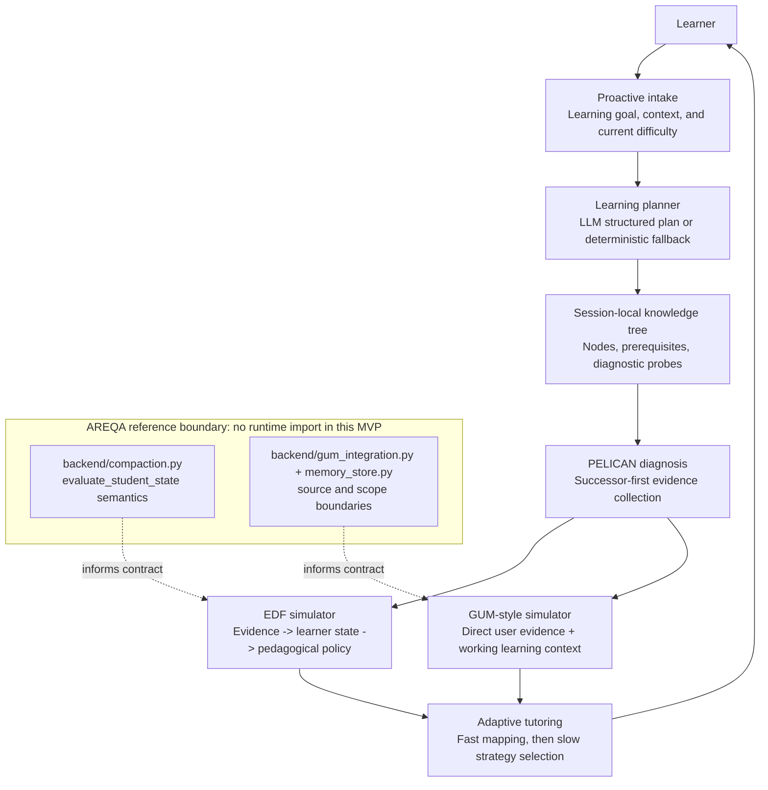

# PELICAN AREQA Learning Engine Sandbox Integration Plan

## Objective and Current Understanding

This plan turns `misc/PELICAN_mvp` into an isolated learning-engine experiment sandbox. Its default experience will begin with an AI-led learning intake, generate a session-local knowledge tree, diagnose the learner with PELICAN's successor-first strategy, and use an AREQA-inspired EDF snapshot plus a GUM-inspired learning-memory simulator to choose tutoring moves. The phase order first establishes safe persisted contracts, then adds the learning control loop, then exposes it through the MVP API/UI, and finally hardens the experiment with regression coverage and operator documentation.

The confirmed codebase boundary is strict: production AREQA remains unchanged. `backend/compaction.py` and `backend/gum_integration.py` are reference implementations for state semantics and privacy boundaries only; they are not imports or runtime dependencies of the MVP. The MVP currently uses `CURRICULUMS`, a JSON `StateStore`, `PelicanEngine`, a FastAPI adapter, and a static browser UI. The existing CNN and Chinese-history curricula remain explicit fixtures and offline fallbacks, but they must no longer be the default learning path.



## Scope and Non-Goals

- In scope: `misc/PELICAN_mvp`, its data schema, API, static UI, tests, and README.
- Out of scope: changes to `backend/`, `frontend/`, Redis, PostgreSQL, GUM persistence, authentication, SSE, and the main AREQA chat-mode toggle.
- The experimental UI may make its learning-engine state visible. It must not claim that the MVP writes to AREQA's production GUM or learner profile.
- No learner assertion inferred by EDF or the planner may be stored as user-authored memory. The local simulator stores direct user responses as evidence and clearly labels system inference separately.

### Phase 1: Persisted Learning-Session Contract and Compatibility Boundary

#### Problem

`SessionState` defaults to `curriculum_id="cnn"`, and `StateStore` resolves every session through the static `CURRICULUMS` map. Consequently, neither a learner goal nor an AI-generated knowledge tree can survive a page refresh. Existing JSON state files and tests also assume static curricula, so replacing this contract without a compatibility path would corrupt or strand existing MVP sessions.

#### Assumptions

- `misc/PELICAN_mvp/data/*.json` is experimental local state, not a production migration target.
- Existing `cnn` and `chinese_history` sessions must remain readable and runnable when explicitly selected by a test or developer.
- A newly created session without an explicit fixture curriculum starts in `onboarding`; it has no generated tree until the learner replies.
- The precise learner-state vocabulary can remain compatible with AREQA's current strings such as `STARTING`, `TINKERING`, and `MASTERY`, but the simulator must tolerate unknown values rather than rejecting persisted experimental data.

#### Solution

Introduce a serializable, session-owned learning-plan contract rather than mutating the global `CURRICULUMS` registry. `SessionState` will distinguish `generated` plans from `fixture` curricula and persist an immutable-in-session plan snapshot. It will also own an EDF snapshot and a local learning-memory snapshot. `StateStore` will validate and hydrate either plan type, preserve legacy fixture records, and atomically reset a session to onboarding by default.

#### Implementation

> Context: Add Google-style docstrings to every new or materially changed public module, class, and function. Document the persistence compatibility contract, the ownership of generated-plan snapshots, the source boundary between direct evidence and inference, and atomic-write failure semantics. Add inline comments only at legacy migration and state-transition decisions where the reason is not obvious. Use the standard Python `logging` abstraction, never `print`; document stable structured event names and safe fields. Logs must exclude learner answers, prompts, expected answers, model outputs, credentials, and tokens.

Modify `misc/PELICAN_mvp/pelican_mvp/models.py` to add explicit dataclasses/enums for the learning-plan source, onboarding metadata, plan nodes/diagnostics/task steps, EDF snapshot, and local memory entries. Extend `SessionState.to_dict()` and `from_dict()` with backwards-compatible defaults. The serialized contract must identify schema version, phase, plan source, plan snapshot, learner goal summary, EDF snapshot, memory snapshot, and existing node evidence.

Modify `misc/PELICAN_mvp/pelican_mvp/state_store.py` so `new_state()` creates an onboarding state when no `curriculum_id` is requested, while an explicit fixture ID remains supported. Add schema validation, node reconciliation against the persisted generated plan or fixture curriculum, and a safe legacy normalization path. Keep the existing temporary-file atomic persistence behavior where applicable; malformed or incompatible records must raise `StateStoreError` rather than silently selecting CNN.

Add `misc/PELICAN_mvp/pelican_mvp/observability.py` as the MVP-local logging boundary. It will emit stable events such as `pelican_session_created`, `pelican_state_loaded`, `pelican_state_normalized`, and `pelican_state_rejected`, with safe metadata only: learner ID hash/token, phase, plan source, node count, schema version, and reason code. It must not create a dependency on AREQA backend logging.

#### Expected File Tree After Phase 1

This tree is not cumulative; it shows only Phase 1 changes.

```text
misc/PELICAN_mvp/
├── pelican_mvp/
│   ├── models.py                         [modified]
│   ├── observability.py                  [new]
│   └── state_store.py                    [modified]
└── tests/
    ├── test_models.py                    [modified]
    └── test_state_store.py               [modified]
```

#### Work List

1. [x] Modify `misc/PELICAN_mvp/pelican_mvp/models.py` in `SessionState`, `to_dict()`, and `from_dict()`.
   - [x] Add proposed `PlanSource`, `LearningPlanSnapshot`, `EdfSnapshot`, and `LearningMemorySnapshot` serialization contracts.
   - [x] Add an `onboarding` phase and make a generated plan optional until intake completes.
   - [x] Preserve the existing `KnowledgeStatus`, `Evidence`, `NodeState`, and legacy `TurnRecord` fields needed by current fixture tests.
2. [x] Create `misc/PELICAN_mvp/pelican_mvp/observability.py`.
   - [x] Add proposed `get_logger()` and safe structured-event helpers with no raw learner content fields.
3. [x] Modify `misc/PELICAN_mvp/pelican_mvp/state_store.py` in `load_or_create()`, `new_state()`, `save()`, and `reset()`.
   - [x] Resolve plan nodes from a persisted generated snapshot before falling back to an explicit `CURRICULUMS` fixture.
   - [x] Normalize legacy static records without changing their curriculum choice.
   - [x] Reject malformed generated plans with `StateStoreError` and a safe reason code.
4. [x] Extend `misc/PELICAN_mvp/tests/test_models.py` with round-trip cases for onboarding, generated-plan, and legacy session payloads.
5. [x] Extend `misc/PELICAN_mvp/tests/test_state_store.py` with persisted generated-plan reconciliation, explicit fixture compatibility, reset-to-onboarding, invalid-plan rejection, and safe-log capture assertions.

#### Test Plan

Run focused pytest coverage for model serialization and JSON persistence. Tests must construct state payloads directly rather than call an LLM. Assert that a legacy CNN JSON payload still resolves CNN nodes, a new no-curriculum state is `onboarding`, generated snapshots survive reload, stale nodes are reconciled, and malformed snapshots fail closed. Use `caplog` to verify event names and safe metadata only, including absence of the test learner response string.

Commands:

```bash
cd misc/PELICAN_mvp
python -m pytest tests/test_models.py tests/test_state_store.py -q
```

#### Expected Output / Result

New default sessions persist as an empty onboarding shell. A completed intake can later attach a session-local plan without modifying `CURRICULUMS`. Existing fixture sessions continue to load, and invalid persisted generated plans are rejected with a controlled API-visible error in a later phase rather than being silently replaced.

#### Testing Script

##### Act 01: Create a Default Learning Session

Create a `StateStore` state without a curriculum ID.

Pass condition: the persisted session has `phase="onboarding"`, `plan_source="generated"`, and no selected knowledge node.

##### Act 02: Reload a Generated Plan Snapshot

Persist a minimal valid generated-plan snapshot with two prerequisite-linked nodes, then load the same learner ID.

Pass condition: both node states are present and the plan source remains `generated` after reload.

##### Act 03: Preserve a Legacy Fixture Session

Load a legacy payload containing `curriculum_id="cnn"` and no new fields.

Pass condition: its CNN node state remains available and it does not enter onboarding.

##### Act 04: Reject an Invalid Snapshot

Persist a generated plan whose diagnostic refers to a missing node.

Pass condition: loading raises `StateStoreError` and produces the safe rejection event without logging raw payload content.

#### Gate to Enter the Next Phase

Run the focused command above and retain its passing output. Run `python -m pytest tests/test_curriculum.py tests/test_diagnosis.py -q` to prove fixture contracts remain intact. Run `git diff --check`. All tests must pass; a serialization, compatibility, or logging-safety failure blocks Phase 2 and must be fixed without weakening assertions.

#### Phase Commit

Create one commit after the gate passes:

```text
feat(pelican): add persisted dynamic learning-session contract
```

Stage only `misc/PELICAN_mvp/pelican_mvp/models.py`, `observability.py`, `state_store.py`, `tests/test_models.py`, and `tests/test_state_store.py`. First inspect `git status --short` and preserve unrelated worktree files. Use `git add` with explicit paths, `git diff --cached --check`, and `git diff --cached --stat`; commit once; then confirm with `git show --stat --oneline --summary HEAD`. Do not use a broad stage command or proceed when the phase gate fails.

#### Phase 1 Implementation Status

Completed on 2026-07-19 in commit `fe9646e feat(pelican): add persisted dynamic learning-session contract`.

Verification evidence retained from the phase gate:

```bash
cd misc/PELICAN_mvp
python -m pytest tests/test_models.py tests/test_state_store.py -q
# 16 passed

python -m pytest tests/test_curriculum.py tests/test_diagnosis.py -q
# 5 passed

git diff --check
# passed with no whitespace errors
```

The implementation follows the Phase 1 boundary: it updates only the MVP persisted-session contract, compatibility loading, safe local observability, and Phase 1 tests. Production AREQA `backend/` and `frontend/` remain untouched. Existing unrelated worktree changes were preserved and not staged into the Phase 1 commit.

### Phase 2: AI-Led Intake, Dynamic Knowledge Tree, and Learning Strategy Loop

#### Problem

`PelicanEngine.start()` immediately asks a diagnostic question from a fixed curriculum, and `respond()` only dispatches between diagnosis and tutoring. Although the current engine implements successor-first diagnosis and fast/slow strategy selection, it cannot form a plan from the learner's own goal, cannot evaluate an EDF learner snapshot, and has no separate memory boundary for direct learning evidence.

#### Assumptions

- The initial learner response is free-form and may describe a topic, a real question, a learning goal, current difficulty, or any combination of these.
- LLM availability remains optional. The rule/offline path must generate a valid, predictable three-to-five-node plan from the learner's stated topic without network access.
- An LLM-generated plan is accepted only after local schema and graph validation. On failure, it is discarded and the deterministic fallback is used.
- EDF state is a teaching-decision snapshot, not a mastery assertion or a memory-writing authority. It is recalculated after material learner turns and must retain a safe reason code / evidence count.

#### Solution

Add three MVP-local components: a planner that creates a validated `LearningPlanSnapshot`, an EDF simulator that maps direct evidence and session progress to a learner-state/policy snapshot, and a local GUM-style memory simulator that maintains a short working learning context plus evidence ledger. Integrate them into `PelicanEngine` as an explicit state machine: `onboarding -> planning -> diagnosis -> tutoring -> completed`. Existing fixture curriculum behavior remains available for deterministic regression tests, but the default engine route uses the generated plan.

#### Implementation

> Context: Add Google-style docstrings to every new or materially changed public module, class, and function. Document the LLM-validation/fallback boundary, generated graph invariants (unique IDs, existing prerequisites, acyclic graph, valid diagnostic ownership), the distinction between direct evidence and EDF inference, and phase-transition failure semantics. Add rationale-focused inline comments only at fallback, successor-first selection, and policy-resolution branches. Emit safe structured logs through `observability.py`: `pelican_intake_received`, `pelican_plan_generated`, `pelican_plan_fallback`, `pelican_diagnosis_updated`, `pelican_edf_evaluated`, `pelican_memory_updated`, and `pelican_phase_transition`; include only learner token, phase, plan source, node count, category, strategy, state label, evidence count, and reason code.

Create `misc/PELICAN_mvp/pelican_mvp/planner.py` with a public planner interface that turns intake text into a plan. The LLM path added to `LlmAdapter` must request a strict structured plan response and provide no authority to save state itself. The local validator must reject duplicate IDs, unknown/self prerequisites, cycles, missing diagnostics, or empty task steps. The deterministic fallback must use neutral, topic-derived labels and generic diagnostic/task templates, never static CNN answer aliases.

Create `misc/PELICAN_mvp/pelican_mvp/edf_simulator.py`. Its `evaluate()` contract consumes only session metadata, categories, direct evidence counts, current node status, retry rounds, and completion status; it produces an `EdfSnapshot` containing learner state, pedagogical strategy/policy, proactive eligibility, confidence, evidence count, and safe reason code. It must provide a deterministic policy mapping compatible with AREQA's current semantics: early/uncertain -> probe, repeated difficulty -> simplify/decompose, demonstrated progress -> confirm/suggest action, and sustained mastery -> challenge/fade. It must not import `backend.compaction`.

Create `misc/PELICAN_mvp/pelican_mvp/learning_memory.py`. It records direct user responses as evidence entries and keeps a bounded session-local working context derived from already persisted direct evidence. It may store an EDF snapshot as system metadata, but it must never transform that snapshot into a user-profile fact. Bound the evidence ledger and working context with documented deterministic eviction.

Modify `misc/PELICAN_mvp/pelican_mvp/llm.py` to add a validated structured-plan request. Preserve existing diagnostic/classification/tutoring methods and the `LlmUnavailable` fallback contract. Modify `misc/PELICAN_mvp/pelican_mvp/engine.py` so `start()` returns the proactive intake prompt for new sessions, `_handle_onboarding()` plans and persists before presenting the first successor-first diagnostic, and diagnosis/tutoring update EDF and memory after recording direct learner evidence. The engine's curriculum lookup must resolve a generated session plan or an explicit fixture through a single internal resolver. Update `tree_state()` and `TurnOutcome` only as needed to expose phase, plan source, and a non-sensitive decision summary.

#### Expected File Tree After Phase 2

This tree is not cumulative; it shows only Phase 2 changes.

```text
misc/PELICAN_mvp/
├── pelican_mvp/
│   ├── edf_simulator.py              [new]
│   ├── engine.py                     [modified]
│   ├── learning_memory.py            [new]
│   ├── llm.py                        [modified]
│   ├── planner.py                    [new]
│   └── tutoring.py                   [modified]
└── tests/
    ├── test_edf_simulator.py         [new]
    ├── test_engine.py                [modified]
    ├── test_learning_memory.py       [new]
    ├── test_llm.py                   [modified]
    ├── test_planner.py               [new]
    └── test_tutoring.py              [modified]
```

#### Work List

1. [ ] Create `misc/PELICAN_mvp/pelican_mvp/planner.py`.
   - [ ] Add proposed `LearningPlanner.create_plan()` and `validate_learning_plan()` for LLM and deterministic sources.
   - [ ] Add topic sanitization and a deterministic fallback plan generator that does not depend on `curriculum.py` fixtures.
2. [ ] Modify `misc/PELICAN_mvp/pelican_mvp/llm.py` in `LlmAdapter`.
   - [ ] Add proposed `generate_learning_plan()` with strict structured parsing and `LlmUnavailable`/validation fallback behavior.
3. [ ] Create `misc/PELICAN_mvp/pelican_mvp/edf_simulator.py`.
   - [ ] Add proposed `EdfSimulator.evaluate()` and its deterministic learner-state and policy mapping.
4. [ ] Create `misc/PELICAN_mvp/pelican_mvp/learning_memory.py`.
   - [ ] Add proposed `LearningMemorySimulator.record_direct_evidence()` and bounded `working_context()`.
   - [ ] Prevent EDF-derived or planner-derived claims from being written as direct learner evidence.
5. [ ] Modify `misc/PELICAN_mvp/pelican_mvp/engine.py` in `start()`, `respond()`, `reset()`, `_handle_diagnostic()`, `_handle_tutoring()`, `_record()`, and the proposed `_handle_onboarding()` / `_refresh_learning_context()` helpers.
   - [ ] Implement the full onboarding/planning/diagnosis/tutoring/completed transition table.
   - [ ] Use successor-first logic against generated plans without changing `diagnosis.py` fixture behavior unless a plan-agnostic interface is required.
   - [ ] Evaluate EDF and update local memory after every accepted learner response; attach only safe summaries to the response.
6. [ ] Modify `misc/PELICAN_mvp/pelican_mvp/tutoring.py` in `select_strategy()` and/or a proposed policy resolver.
   - [ ] Resolve conflicts so an EDF policy constrains candidate strategies while existing fast/slow strategy logic remains observable.
7. [ ] Create `misc/PELICAN_mvp/tests/test_planner.py` covering validated LLM-shaped plans, deterministic fallback, invalid graph rejection, and no-static-fixture default dependency.
8. [ ] Create `misc/PELICAN_mvp/tests/test_edf_simulator.py` for early uncertainty, repeated failure, direct correct evidence, sustained mastery, and unknown-state tolerance.
9. [ ] Create `misc/PELICAN_mvp/tests/test_learning_memory.py` for direct-evidence-only storage, bounded eviction, and EDF inference non-promotion.
10. [ ] Extend `misc/PELICAN_mvp/tests/test_engine.py`, `test_llm.py`, and `test_tutoring.py` with the default intake path, LLM-unavailable fallback, generated successor-first routing, phase persistence, strategy trace, and fixture regression cases.

#### Test Plan

Unit-test plan validation and EDF logic with deterministic in-memory state. Mock `LlmAdapter` for valid and invalid structured responses; assert invalid output selects the fallback and is never persisted. Engine tests must execute a complete generated-plan path from initial intake through diagnosis and tutoring, and assert direct learner text appears only in evidence ledger data. Preserve old CNN/chinese-history test flows by invoking their explicit fixture IDs. Capture logs to assert stable event names and absence of raw learner response data.

Commands:

```bash
cd misc/PELICAN_mvp
python -m pytest tests/test_planner.py tests/test_edf_simulator.py tests/test_learning_memory.py tests/test_engine.py tests/test_llm.py tests/test_tutoring.py -q
python -m pytest tests/test_curriculum.py tests/test_diagnosis.py tests/test_chinese_history.py -q
```

#### Expected Output / Result

A new learner is asked what they want to learn before any diagnostic question. Their response creates a validated session-local tree, after which PELICAN asks a successor-first diagnostic. Each response updates node evidence, an EDF teaching snapshot, and bounded direct-evidence memory; it never promotes an inferred state into learner memory. When the LLM is absent or produces invalid JSON, the session still proceeds through a deterministic generated plan.

#### Testing Script

##### Act 01: Begin an AI-Led Learning Session

Start a new learner without `curriculum_id`.

Pass condition: the first message asks for the learner's topic, goal, or current difficulty and the phase is `onboarding`.

##### Act 02: Create a Dynamic Knowledge Tree Offline

Reply: `I want to understand why binary search needs sorted data; I get confused about the boundaries.` while LLM mode is unavailable.

Pass condition: a generated, prerequisite-linked knowledge tree is persisted and the next prompt diagnoses a leaf/successor node rather than showing a CNN prompt.

##### Act 03: Respond With Difficulty

Answer the diagnostic with an inability/difficulty response twice.

Pass condition: direct evidence is recorded, EDF moves toward a support-oriented state/policy, and the selected tutoring strategy becomes simplification or decomposition after the configured slow-thinking threshold.

##### Act 04: Demonstrate Mastery

Give direct correct evidence for the current task step and continue until a later node is reached.

Pass condition: the relevant node becomes `mastered`, EDF records progress or mastery, and tutoring shifts toward confirmation or a less intrusive next move.

##### Act 05: Verify Inference Is Not Memory

Inspect the local learning-memory snapshot after an EDF result labels the learner `TINKERING`.

Pass condition: the memory evidence ledger contains the learner response and category but not an asserted user fact such as `the learner is TINKERING`.

#### Gate to Enter the Next Phase

Run both focused command groups above and retain their output. Run `python -m pytest -q` from `misc/PELICAN_mvp` to prove the old fixture flow and new dynamic flow coexist. Run `git diff --check`. Any graph-validation, fallback, source-boundary, or regression failure blocks Phase 3.

#### Phase Commit

Create one commit after the gate passes:

```text
feat(pelican): add dynamic learning strategy engine
```

Stage only Phase 2 paths and the Phase 2 hunks in `engine.py`, `llm.py`, and `tutoring.py`; do not stage Phase 1 or unrelated edits again. Inspect `git status --short`, use explicit `git add` paths/hunks, run `git diff --cached --check` and `git diff --cached --stat`, commit once, and confirm with `git show --stat --oneline --summary HEAD`.

### Phase 3: MVP API Contract and Learning-Mode Experiment UI

#### Problem

The current FastAPI API exposes `curriculum_id` as the principal user choice and serializes only message, mode, current node, tree, and state changes. The static UI always loads a curriculum selector. It therefore cannot make the learning intake, generated-plan status, EDF decision, or local evidence boundary visible to an experiment participant.

#### Assumptions

- This phase modifies only the MVP FastAPI service and static files; it does not add a mode control to AREQA's Next.js chat UI.
- Existing test callers may still send `curriculum_id` to run fixture flows. The default browser route must omit it and use dynamic onboarding.
- The UI may display summarized EDF and memory metadata, but not raw hidden prompts, expected answers, chain-of-thought, credentials, or personal profile claims.
- The existing global in-process `threading.Lock` remains acceptable for the single-process experiment; scaling/session isolation is a promotion-gate concern, not an unplanned production feature.

#### Solution

Extend the MVP response schema with a versioned `learning` view model. Keep fixture endpoints for regression, but make `/api/start` and `/api/reset` default to onboarding. Replace the fixed curriculum selector with a compact learning-session panel: current goal/phase, plan source, knowledge tree, EDF status, and direct-evidence count. Retain the rule/LLM selector, label it as engine generation mode, and keep its existing server-side availability check.

#### Implementation

> Context: Add Google-style docstrings to every new or materially changed public module, class, and function. Document the public response version, backwards-compatible fixture fields, input validation, lock scope, and error-to-HTTP mapping. Add inline comments only for browser state synchronization and UI rendering decisions that protect the evidence boundary. Emit safe structured logs via `observability.py`: `pelican_api_start`, `pelican_api_response`, `pelican_api_reset`, `pelican_api_mode_changed`, and `pelican_api_error`, containing endpoint, learner token, phase, plan source, and safe reason/status code only. Do not log answer text or serialized session payloads.

Modify `misc/PELICAN_mvp/pelican_mvp/server.py` request models and `_serialize_response()` to expose `api_version`, `phase`, `plan_source`, a safe learner-goal display value, `tree`, `edf`, and memory counters/summaries. Preserve the existing `curriculum_id`, `mode`, `node_id`, and `state_changes` response fields during the experiment so fixture tests do not break. Convert state/plan validation failures into a controlled 4xx or 5xx response with safe `detail` reason codes, never a traceback.

Modify `misc/PELICAN_mvp/static/index.html`, `static/app.js`, and `static/styles.css`. Remove the browser's fixed curriculum selector from the default workflow; show an intake-aware placeholder, phase indicator, knowledge tree, EDF snapshot, and evidence/working-context counts. Use safe DOM APIs (`textContent`) only. The UI must have stable panel dimensions and narrow-screen behavior; it must not use a card-inside-card layout. Keep the existing reset control and ensure reset returns to onboarding.

#### Expected File Tree After Phase 3

This tree is not cumulative; it shows only Phase 3 changes.

```text
misc/PELICAN_mvp/
├── pelican_mvp/
│   └── server.py                     [modified]
├── static/
│   ├── app.js                        [modified]
│   ├── index.html                    [modified]
│   └── styles.css                    [modified]
└── tests/
    ├── test_e2e.py                   [modified]
    └── test_server.py                [modified]
```

#### Work List

1. [ ] Modify `misc/PELICAN_mvp/pelican_mvp/server.py` in `BaseRequest`, `_serialize_response()`, `start()`, `respond()`, `reset()`, and `set_mode()`.
   - [ ] Add a versioned `learning` response object with phase, plan source, EDF display contract, and memory summary counters.
   - [ ] Preserve explicit fixture selection only as a developer/test compatibility parameter.
   - [ ] Map `StateStoreError`, plan validation failures, and invalid request state to safe HTTP responses.
2. [ ] Modify `misc/PELICAN_mvp/static/index.html`.
   - [ ] Replace `#curriculum-select` with learning-session, EDF, and evidence-summary regions labelled for accessible updates.
3. [ ] Modify `misc/PELICAN_mvp/static/app.js` in initialization, `startSession()`, reset handling, `handleResponse()`, and rendering helpers.
   - [ ] Stop calling `/api/curriculums` for the default path.
   - [ ] Render phase-aware input placeholders and safe structured response fields through `textContent`.
4. [ ] Modify `misc/PELICAN_mvp/static/styles.css` to lay out the new side information surfaces responsively without overlap or layout shift.
5. [ ] Extend `misc/PELICAN_mvp/tests/test_server.py` with dynamic-start, response schema, reset-to-onboarding, explicit-fixture compatibility, and safe error-contract cases.
6. [ ] Extend `misc/PELICAN_mvp/tests/test_e2e.py` with an API/browser-compatible dynamic intake-to-diagnosis scenario and UI static-asset assertions if Playwright remains available.

#### Test Plan

Use FastAPI tests to assert that a default `/api/start` response enters onboarding and exposes only safe learning summaries. Use an explicit fixture curriculum request to assert the old path remains available. Test reset, invalid plan state error mapping, and unavailable LLM mode. Extend the existing e2e test with a generated-plan flow and, when the installed browser fixture is available, verify that the fixed curriculum selector is absent, the tree/EDF/evidence regions update, and learner text is rendered as text rather than HTML.

Commands:

```bash
cd misc/PELICAN_mvp
python -m pytest tests/test_server.py tests/test_e2e.py -q
python -m pytest -q
```

#### Expected Output / Result

Opening the MVP begins an intake conversation. After a learner reply, the UI shows a generated tree, current learning phase, safe EDF state/policy, and evidence counts. Reset restarts intake. Explicit fixture calls continue to work for historical regression tests, while the ordinary browser workflow no longer asks the learner to choose CNN or Chinese history.

#### Testing Script

##### Act 01: Open the Learning Engine

Launch the MVP and load `/` with a clean learner state.

Pass condition: the initial assistant message is the learning intake prompt, no fixed curriculum selector is visible, and the UI labels the phase as onboarding.

##### Act 02: Supply a Goal and Inspect the Engine State

Enter `I need to learn SQL joins for a report and do not know when to use LEFT JOIN.`

Pass condition: the rendered tree is generated for the stated topic, the phase advances to diagnosis, and EDF/evidence summaries become visible without exposing expected answers.

##### Act 03: Reset the Experiment

Click Reset after at least one answer.

Pass condition: previous generated-tree state is cleared for this session and the same learner receives the onboarding prompt again.

##### Act 04: Exercise Fixture Compatibility

POST `/api/start` with an explicit `curriculum_id` accepted by the current fixture registry.

Pass condition: the response retains the fixture curriculum ID and returns a fixture diagnostic without affecting the default browser path.

#### Gate to Enter the Next Phase

Run the server/e2e command and full MVP pytest command above. Manually run `python -m pelican_mvp.server` or the repository's documented Uvicorn command, complete Acts 01-03 in a browser, and retain a screenshot or test output as evidence. Run `git diff --check`. UI rendering, API compatibility, or XSS-safe rendering failures block Phase 4.

#### Phase Commit

Create one commit after the gate passes:

```text
feat(pelican): expose dynamic learning engine in MVP UI
```

Stage only `server.py`, the three static files, and Phase 3 test hunks. Inspect `git status --short`; stage explicit paths/hunks; run `git diff --cached --check` and `git diff --cached --stat`; commit once; then verify with `git show --stat --oneline --summary HEAD`. Preserve all unrelated worktree changes.

### Phase 4: Experiment Hardening, Documentation, and Promotion Gate

#### Problem

The MVP will now contain a credible learning-engine loop, but it still needs a repeatable experiment protocol, explicit boundaries for interpreting results, and a decision gate before any production integration is considered. Without this phase, a successful demo could be mistaken for evidence that the main AREQA system is ready to adopt the sandbox contracts.

#### Assumptions

- The experiment remains local and uses one learner JSON file per learner ID; it is not a multi-user production service.
- LLM-generated educational content needs human review before it can be used as a canonical curriculum or relied upon for consequential learner evaluation.
- Promotion to AREQA is a separate authorized project and requires a new architecture plan covering auth, user/conversation scopes, Redis/PostgreSQL persistence, SSE, privacy review, and frontend mode UX.

#### Solution

Document a controlled MVP experiment protocol and add targeted integration regressions. Define promotion criteria around correctness, availability fallback, source-boundary safety, and observed learning traces. Update the MVP README so developers can run the sandbox and understand that its EDF/GUM layers simulate semantic contracts rather than connect to production systems.

#### Implementation

> Context: Add Google-style docstrings to every new or materially changed public module, class, and function. Document the provenance and experimental limitations of any new test support. In documentation, explain non-obvious privacy and promotion boundaries without including secrets or copied learner transcripts. For any new runtime observability assertion, use existing safe structured event names and document that raw prompts, answers, model outputs, and credentials are excluded. Inline comments are permitted only where test fixtures model a non-obvious safety invariant.

Modify `misc/PELICAN_mvp/README.md` to describe the dynamic intake workflow, generated-plan validation/fallback behavior, local JSON persistence, EDF/GUM simulation boundary, configuration, reset behavior, and test commands. Add a focused experiment test document under `docs/tech_docs/` describing repeatable scenarios, evidence to capture, success criteria, and limitations. Add or extend end-to-end/regression tests to ensure all three critical boundaries hold together: dynamic planning fallback, successor-first state progression, and direct-evidence-only memory.

#### Expected File Tree After Phase 4

This tree is not cumulative; it shows only Phase 4 changes.

```text
docs/tech_docs/
└── PELICAN_AREQA_learning_engine_experiment_test.md [new]
misc/PELICAN_mvp/
├── README.md                                         [modified]
└── tests/
    └── test_e2e.py                                   [modified]
```

#### Work List

1. [ ] Modify `misc/PELICAN_mvp/README.md`.
   - [ ] Replace the fixed-CNN-first description with the intake-to-diagnosis learning-engine workflow.
   - [ ] Document fixture-curriculum compatibility, deterministic fallback, state-file handling, and the explicit non-production EDF/GUM boundary.
2. [ ] Create `docs/tech_docs/PELICAN_AREQA_learning_engine_experiment_test.md`.
   - [ ] Add proposed manual experiment Acts, capture fields, success/failure criteria, and a promotion decision checklist.
3. [ ] Extend `misc/PELICAN_mvp/tests/test_e2e.py`.
   - [ ] Add a complete offline learning trace that asserts onboarding, generated-plan validation, successor-first diagnosis, EDF policy update, source-safe memory, reset, and fixture compatibility.

#### Test Plan

Run the entire MVP suite from a clean temporary data directory where fixtures permit, then execute the manual experiment document in both rule mode and configured LLM mode. The LLM-mode result is evaluated for schema validity and fallback behavior, not factual correctness alone. Capture safe structured logs and serialized state metadata; do not retain learner free-text in shared test artifacts.

Commands:

```bash
cd misc/PELICAN_mvp
python -m pytest -q
python -m pelican_mvp --help
```

#### Expected Output / Result

The sandbox has a reproducible path from learner intake to adaptive tutoring and clear evidence for deciding whether to promote it. Documentation accurately states that it is an isolated MVP using AREQA-inspired contracts, not an integration into the main AREQA runtime.

#### Testing Script

##### Act 01: Run the Offline Baseline

With no LLM credentials configured, start a fresh learner and complete the generated-plan scenario from the experiment document.

Pass condition: the full loop completes deterministically and no network-dependent step is required.

##### Act 02: Run the Optional LLM Plan Path

With valid optional credentials configured, begin a new topic and inspect the generated plan result.

Pass condition: the plan passes local graph validation or safely falls back, with no invalid plan persisted.

##### Act 03: Review Promotion Evidence

Review the captured test output, safe logs, state metadata, and manual observations against the promotion checklist.

Pass condition: every required safety/correctness item is either satisfied or recorded as a blocker; no claim is made that production AREQA has been changed.

#### Gate to Enter the Next Phase

There is no automatic production-integration phase. Run the commands above, complete the manual document, review `git diff --check`, and record any unresolved risks in the experiment document. Only a separate user-approved plan may begin a main-system integration after this gate. Failures must remain documented as experiment blockers and must not be bypassed by changing acceptance criteria.

#### Phase Commit

Create one commit after the gate passes:

```text
docs(pelican): document learning engine experiment gate
```

Stage only `misc/PELICAN_mvp/README.md`, `docs/tech_docs/PELICAN_AREQA_learning_engine_experiment_test.md`, and the Phase 4 `test_e2e.py` hunks. Inspect `git status --short`, use explicit staging, run `git diff --cached --check` and `git diff --cached --stat`, commit once, and verify with `git show --stat --oneline --summary HEAD`. Do not push unless explicitly requested.

### Cross-Phase Regression and Final Acceptance

Run the full sandbox regression suite after all four phase commits:

```bash
cd misc/PELICAN_mvp
python -m pytest -q
python -m pelican_mvp --help
```

Also rerun the focused contracts that could be obscured by broad suite output:

```bash
python -m pytest tests/test_models.py tests/test_state_store.py tests/test_planner.py tests/test_edf_simulator.py tests/test_learning_memory.py tests/test_engine.py tests/test_server.py tests/test_e2e.py -q
```

Final manual acceptance is: open the MVP; receive a proactive intake prompt; provide a real learning goal; observe a validated generated tree and successor-first diagnostic; provide difficulty and correct-evidence turns; observe the EDF policy/strategy shift and bounded evidence summary; reset; and confirm that an explicit legacy fixture route still works. The UI must never expose expected answers or raw internal model reasoning, and logs must not expose raw learner text.

Promotion is blocked until a later, separately approved AREQA plan addresses authenticated user/conversation scoping, durable storage, concurrent request safety, production logging/telemetry, evaluation methodology, LLM content-quality review, frontend chat/learning-mode UX, and a privacy/security review. The remaining known risk is educational validity of generated content; local plan validation guarantees structure and fallback only, not subject-matter correctness.

Before handoff, run `git status --short` and review `git log --oneline` in chronological order. Confirm that each phase commit exists, no planned changes remain unstaged, and unrelated user worktree files were preserved.
