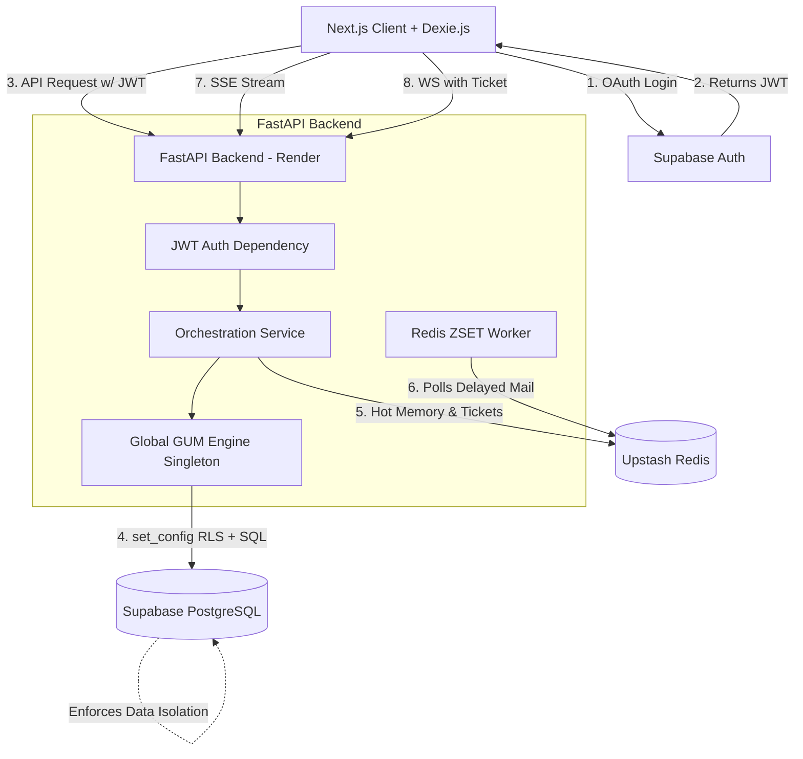

# AREQA: 身份驗證與 Render 部署遷移計畫 (Engineering Specification)

**[最高指導原則]：各階段均設有門控（Quality Gate），所有自動化測試與人工實測必須全部通過，方可推進至下一階段。**

## 1. 專案目標與架構
為 AREQA 系統引入多租戶 (Multi-tenant) 會員身分驗證，並解決 Render 平台因「短暫檔案系統」造成的本地資料遺失問題，實現雲端無狀態 (Stateless) 擴容架構。
*   **Auth**: Supabase Auth
*   **Database**: Supabase PostgreSQL (pgvector + GIN Index + RLS)
*   **Cache / Queue**: Redis (Upstash)

### 1.1 更新後之系統架構圖 (System Architecture)


### 1.2 預期目錄與檔案架構 (Expected Directory Structure)
以下為本次計畫將會新增或大幅修改的檔案：
```text
AREQA/
├── backend/
│   ├── main.py                     # 修改: 新增 JWT Dependency, SSE Header, WS Ticket 端點
│   ├── cold_memory.py              # 修改: 實作 pgvector, RLS Context (set_config), GIN Index
│   ├── gum_integration.py          # 修改: GUM Singleton 初始化, user_id 穿透傳遞
│   ├── memory_store.py             # 重寫: 移除 File I/O，全面改用 redis.asyncio
│   ├── mailbox_store.py            # 重寫: 移除 File I/O 與 sleep()，改用 Redis ZSET 延遲佇列
│   └── services/
│       ├── orchestration_service.py # 修改: 接收並傳遞 user_id context
│       └── compeer_scheduler.py     # 修改: 移除 dict 快取，改存取 Redis TTL
├── frontend/
│   ├── src/
│   │   ├── database/
│   │   │   └── db.ts               # 修改: Dexie schema 增加 userId, 實作 .upgrade() 資料遷移
│   │   ├── hooks/
│   │   │   └── useProactiveWebSocket.ts # 修改: 實作先打 API 換 Ticket 再帶入 WS 參數的邏輯
│   │   ├── components/
│   │   │   └── Auth/               # 新增: Supabase 登入 UI 組件 (側邊欄, Phase 3.5)
│   │   └── services/
│   │       └── syncService.ts      # 新增: 處理 Dexie 與 Supabase 之間的對話紀錄雙向同步 (Phase 3.5)
└── misc/
    └── gum/                        # 深度修改: 拔除 SQLite 硬綁定，確保語法相容 PostgreSQL
```

---

## 2. 🚨 絕對禁止的反模式 (Anti-Patterns)
實作時若出現以下模式，將無條件退回重構：
1. **❌ 每個 User 建立一個 Engine**：會瞬間耗盡連線池 (`pool_size=5`)，導致整個應用掛掉。
2. **❌ 使用 `asyncio.sleep(300)` 處理信件延遲**：Render 休眠重啟時 task 會直接蒸發。
3. **❌ 依賴 `service_role` 處理 RLS**：這會完全繞過 RLS 保護，產生嚴重的越權存取漏洞。
4. **❌ 使用 `python-jose` 自動驗證 JWT `aud`**：Supabase OAuth 的 `aud` 可能為陣列，會引發 500 錯誤。
5. **❌ 修改 Dexie schema 卻沒寫 `.upgrade()`**：舊使用者的 IndexedDB 資料會直接隱形消失。

---

## 3. 檔案影響範圍清單 (Touchpoint Map)

| 檔案路徑 | 負責階段 | 變更說明 |
|---------|---------|---------|
| `backend/memory_store.py` | 階段一 | 移除檔案 I/O，全面改用 Redis |
| `backend/mailbox_store.py` | 階段一 | 移除 `threading.Lock` 與 `sleep()`，改用 Redis ZSET 延遲佇列 |
| `backend/services/compeer_scheduler.py` | 階段一 | 移除 dict cache，改存 Redis TTL |
| `misc/gum/` | 階段一/二 | 解除 SQLite 綁定，實作單一 Engine 共用架構 |
| `backend/cold_memory.py` | 階段二 | 寫入時強制注入 RLS context，替換 `bm25()` 與 vector 操作 |
| `backend/main.py` | 階段二/三 | 增加 JWT 依賴，修正 SSE Header，新增 WS Ticket 端點 |
| `frontend/src/database/db.ts` | 階段三 | Schema 版本升級，加入 `userId` 欄位與資料遷移腳本 |
| `frontend/src/hooks/useProactiveWebSocket.ts` | 階段三 | 實作 Ticket 換取與連線重試機制 |

---

## 4. 分階段實作藍圖與程式碼範例

### 階段一：基礎設施與資料持久化重構 (Phase 1)
> **前置條件**：本地或雲端已備妥可用的 Redis 服務。

1.  **熱記憶與信箱遷移至 Redis**
    *   移除檔案讀寫與 `threading.Lock`。
    *   **延遲回信佇列 (Redis ZSET)**：將原本的 `sleep(300)` 改為把信件存入 Redis Sorted Set。
    *   **👨‍💻 Expected Code Pattern**:
        ```python
        # 加入延遲佇列 (Score = 目前時間 + 300秒)
        await redis.zadd(f"areqa:delayed_mail:{user_id}", {mail_data_json: time.time() + 300})
        
        # 背景 Worker 輪詢
        async def mailbox_worker():
            while True:
                now = time.time()
                # 取出所有已到期的信件
                tasks = await redis.zrangebyscore("areqa:delayed_mail:*", 0, now)
                for task in tasks:
                    await process_mail(task)
                    await redis.zrem("areqa:delayed_mail:*", task)
                await asyncio.sleep(1)
        ```
2.  **GUM 共用實例與 PostgreSQL 遷移準備**
    *   **核心規範**：全系統只能有一個 SQLAlchemy AsyncEngine。
    *   **👨‍💻 Expected Code Pattern**:
        ```python
        # 全域宣告，僅初始化一次 (防止 PgBouncer Prepared Statement 衝突)
        global_engine = create_async_engine(
            DATABASE_URL, 
            pool_size=5, 
            max_overflow=10,
            connect_args={"statement_cache_size": 0} 
        )
        
        # 不要為每個 user 建立 Engine，而是傳遞 context
        async def get_gum_session(user_id: str):
            async with AsyncSession(global_engine) as session:
                yield session # 具體 RLS 注入見階段二
        ```
3.  **排程器狀態 (Compeer Scheduler) 遷移**
    *   寫入冷卻狀態時，直接使用 Redis 的 `SETEX` (TTL)。

### 階段二：後端 API 認證防護與 PostgreSQL Schema (Phase 2)
> **前置條件**：Supabase 專案建立完畢，取得 JWT Secret。

1.  **JWT 手動驗證與 Dependency**
    *   **👨‍💻 Expected Code Pattern**:
        ```python
        from jose import jwt, JWTError
        def verify_supabase_jwt(token: str, secret: str) -> str:
            # 必須停用自動 aud 驗證，防止 array 格式導致 500 錯誤
            payload = jwt.decode(token, secret, algorithms=["HS256"], options={"verify_aud": False})
            aud = payload.get("aud")
            aud_set = set(aud) if isinstance(aud, list) else {aud} if aud else set()
            if "authenticated" not in aud_set:
                raise JWTError("Invalid audience")
            return payload.get("sub")
        ```
2.  **嚴格執行 RLS (Row Level Security)**
    *   **👨‍💻 Expected Code Pattern**:
        ```python
        async def execute_with_rls(session: AsyncSession, user_id: str):
            async with session.begin():
                # 每個 Transaction 開頭必須設定 RLS Context
                await session.execute(text(
                    "SELECT set_config('request.jwt.claims', "
                    "jsonb_build_object('role', 'authenticated', 'sub', :uid)::text, TRUE)"
                ), {"uid": user_id})
                await session.execute(text("SET LOCAL ROLE authenticated;"))
                # 接下來的查詢才會被 RLS 安全隔離
                # ...
        ```
3.  **FTS5 與 Vector 語法替換**
    *   將 SQLite 的 `MATCH` 改為 Postgres 的 `@@ to_tsquery()` 與 `ts_rank`。

### 階段三：前端驗證整合 (Phase 3)
> **前置條件**：Next.js 已套用 Supabase Auth UI，可取得有效 JWT。

1.  **WebSocket One-Time Ticket 驗證**
    *   **👨‍💻 Expected Code Pattern**:
        ```python
        # 後端驗證並原子消費 Ticket (防止 Race Condition)
        async def consume_ticket(redis, ticket: str) -> str:
            # GETDEL 保證票證只被讀取一次即銷毀
            user_id = await redis.getdel(f"ws_ticket:{ticket}")
            if not user_id:
                raise ValueError("Invalid or expired ticket")
            return user_id.decode("utf-8")
        
        @app.websocket("/ws")
        async def ws_endpoint(ws: WebSocket, ticket: str):
            # 防止跨站 WebSocket 劫持 (CSWSH)
            if ws.headers.get("origin") not in ALLOWED_ORIGINS:
                await ws.close(code=4001)
                return
        ```
2.  **SSE 串流防緩衝 (Cloudflare Bypass)**
    *   在 `/api/v1/stream` 的 Header 加上 `"X-Accel-Buffering": "no"`。
3.  **Dexie.js 資料蒸發防護**
    *   **👨‍💻 Expected Code Pattern**:
        ```typescript
        // 舊版本
        db.version(1).stores({ conversations: '++id, title' });
        // 新版本：必須補上 .upgrade() 遷移舊資料
        db.version(2).stores({ conversations: '++id, userId, title' })
          .upgrade(async tx => {
              const currentUserId = getCurrentUserId();
              await tx.table('conversations').toCollection().modify(conv => {
                  conv.userId = conv.userId ?? currentUserId;
              });
          });
        // 處理多 Tab 升級卡死
        db.on('versionchange', () => window.location.reload());
        ```

### 階段三點五：會員介面與雲端同步 (Phase 3.5 - 擴充需求)
> **前置條件**：Supabase 專案已就緒，且前端 `.env.local` 已配置 `NEXT_PUBLIC_SUPABASE_URL` 與 `NEXT_PUBLIC_SUPABASE_ANON_KEY`。

**執行步驟 (Execution Steps):**

1.  **基礎設施前置作業 & 效能優化 (Infrastructure & Optimization)**
    *   安裝套件：`npm install @supabase/supabase-js @supabase/auth-ui-react @supabase/auth-ui-shared`。
    *   建立 Supabase Client：於前端新增 `src/lib/supabase.ts` 用於全域連線與 Auth 管理。
    *   效能優化 (Bug Fix)：將 `conversationRepo.ts` 中 `getAll()` 的 `.filter(c => c.userId === userId)` (全表掃描) 改為 Dexie 原生的索引查詢 `.where('userId').equals(userId)`。

2.  **資料庫 Schema 設計與 RLS (Database Schema & RLS)**
    *   在 Supabase Dashboard 建立 `conversations` 與 `messages` 資料表，並強制啟用 RLS。
    *   **👨‍💻 SQL Schema 範例**:
        ```sql
        CREATE TABLE conversations (
          id UUID PRIMARY KEY,
          user_id UUID REFERENCES auth.users(id) NOT NULL,
          title TEXT,
          created_at TIMESTAMPTZ DEFAULT now(),
          updated_at TIMESTAMPTZ DEFAULT now()
        );
        ALTER TABLE conversations ENABLE ROW LEVEL SECURITY;
        CREATE POLICY "Users can only see their own conversations" ON conversations FOR ALL USING (auth.uid() = user_id);
        
        -- messages 表以此類推...
        ```

3.  **左下角會員登入介面 (Auth UI)**
    *   實作點擊左下角 (取代目前的 UserIcon/Name) 彈出 Supabase Auth 登入介面 (支援 Google, Email/Password)。
    *   整合進 `layout.tsx` 與 `ConversationList`。
    *   實作更改 Username 與登出功能。

4.  **跨裝置對話紀錄同步 (Cross-device Sync)**
    *   建立前端同步服務 (`syncService.ts`)，負責協調 Dexie 本地端與 Supabase 雲端之間的雙向同步。
    *   **同步策略 (Sync Strategy)**:
        *   **衝突解決**: 採 Last-Write-Wins，以 `updated_at` 最新者為準。
        *   **同步時機**: 每次有新訊息產生或對話狀態改變時，立即非同步推上雲端；App 啟動/登入時，先將雲端資料拉回覆蓋本地 (若較新)。
        *   **首次登入**: 若本地有未綁定帳號的舊歷史，登入後可提示使用者是否要將舊資料整併至雲端帳號下，或直接丟棄。

### 階段四：Render 部署拓樸 (Phase 4)
*   **Backend Start**: `uvicorn main:app --host 0.0.0.0 --port 10000`
*   **Connection Pool**: `pool_size=5, max_overflow=10`
*   **ENV Vars**: `DATABASE_URL`, `REDIS_URL`, `JWT_SECRET`, `NEXT_PUBLIC_SUPABASE_URL`.

---

## 5. 🚦 測試驗收總表 (Gate Checklists)

所有階段必須滿足以下驗收標準才能進入下一階段（包含自動化單元/整合測試與人工實測）。

| 測試 ID | 狀態 | 所屬 Gate | 測試類型 | 目標項目 / 驗證行為 | 具體驗收標準 (Acceptance Criteria) | 執行方 |
|---|---|---|---|---|---|---|
| **T1-01** | ✅ | Phase 1 | Unit | `test_memory_store.py` 多租戶 | user_A 寫入資料後，用 user_B 查詢回傳空值。 | 自動化 |
| **T1-02** | ✅ | Phase 1 | Unit | `test_mailbox_zset.py` 延遲 | 測試信件加入 Redis ZSET 後，能被 mock worker 正確拉出。 | 自動化 |
| **T1-03** | ✅ | Phase 1 | Unit | `test_gum_singleton.py` | 驗證全系統僅初始化一次 SQLAlchemy Engine，無多次呼叫。 | 自動化 |
| **T1-04** | ⏳ | Phase 1 | Manual | **重啟恢復測試 (Resilience)** | 送出信件後立刻砍掉 FastAPI 進程。等待 5 分鐘重啟，確認信箱 Worker 從 Redis 撈出信件並正確處理。 | 人工 |
| **T2-01** | ✅ | Phase 2 | Unit | `test_auth_jwt.py` 陣列驗證 | 傳入 `aud: ["authenticated", "other"]` 的假 Token，驗證不拋出 500。 | 自動化 |
| **T2-02** | ✅ | Phase 2 | Unit | `test_cold_memory_pg.py` | 驗證向量維度為 4096，且 `to_tsquery` SQL 語法執行不報錯。 | 自動化 |
| **T2-03** | ✅ | Phase 2 | Integration | `test_rls_isolation.py` | 透過 `set_config` 設定 A 帳號 context 後，無法查到 B 帳號資料。 | 自動化 |
| **T2-04** | ⏳ | Phase 2 | Manual | **Supabase RLS 攔截測試** | 在 Supabase Dashboard SQL Editor 中，不帶 `auth.uid()` 嘗試查詢 `propositions` 表，必須查無資料。 | 人工 |
| **T3-01** | ✅ | Phase 3 | Unit | `test_ws_ticket.py` 票證 | 驗證 Ticket 用 `GETDEL` 讀取，第二次讀取失敗。 | 自動化 |
| **T3-02** | ✅ | Phase 3 | Unit | `test_ws_origin.py` 安全 | 傳入非白名單的 `Origin` Header，驗證 WS 連線被 4001 拒絕。 | 自動化 |
| **T3-03** | ✅ | Phase 3 | Unit | `npm run test` (Frontend) | Dexie `.upgrade()` 執行後，舊資料的 `userId` 成功被補填。 | 自動化 |
| **T3-04** | ⏳ | Phase 3 | Manual | **無痕與多 Tab 登出入測試** | 1. 未登入無法發送對話。<br>2. 登出後 Dexie 本地歷史清空。<br>3. 切換帳號看不到前人歷史。<br>4. 開雙 Tab 測試 Dexie 自動 reload。 | 人工 |
| **T3.5-01** | ⏳ | Phase 3.5 | Manual | **登入 UI 與 Auth 驗證** | 1. 左下角能順利呼叫 Supabase Auth 完成 Google/Email 登入與登出。<br>2. 登出後用另一帳號登入，對話歷史應完全隔離。 | 人工 |
| **T3.5-02** | ⏳ | Phase 3.5 | Manual | **跨裝置同步驗證** | 同一帳號在 A 裝置登入並建立對話，切換至 B 裝置 (或清除快取) 登入，能自動拉回該筆對話紀錄。 | 人工 |
| **T3.5-03** | ✅ | Phase 3.5 | Unit | `test_sync_service.ts` 同步 | 驗證 `pullFromCloud` 處理空陣列不 reload、正確寫入 Dexie，與錯誤處理。 | 自動化 |
| **T3.5-04** | ✅ | Phase 3.5 | Unit | `test_conversation_repo_sync.ts` | 驗證 CRUD 動作正確觸發 `syncService` 的推播與刪除。 | 自動化 |
| **T3.5-05** | ✅ | Phase 3.5 | Integration | `test_auth_logout.ts` 隔離 | 驗證登出時呼叫 `clearAll()` 清除本地資料，且登入時觸發 `pullFromCloud()`。 (核心已驗證) | 自動化 |
| **T4-01** | ⏳ | Phase 4 | E2E | `test_api_auth.py` HTTP | 對 Render 打 API，帶無效 Token 必須回 401。 | 自動化 |
| **T4-02** | ⏳ | Phase 4 | E2E | `test_rls_api.py` 刪除防護 | 打 DELETE API 嘗試刪除他人記憶，必須回傳 403 或 404。 | 自動化 |
| **T4-03** | ⏳ | Phase 4 | Manual | **Production Smoke Test** | 1. 開啟 RAG 串流對話順暢無卡頓 (Cloudflare bypass)。<br>2. 信箱 Avatar 5 分鐘後正常推播通知。<br>3. 重啟頁面記憶依然存在。 | 人工 |
