# AREQA 系統重構計畫：Multi-Agent 架構遷移細節設計 (Implementation Plan)

## 0. 總覽 (Overview)

### 0.1 新版系統流程圖 (System Flow Diagram)
以下是未來 Multi-Agent 架構的運作流程：

```mermaid
sequenceDiagram
    actor User
    participant Main as main.py
    participant Tutor as Tutor Agent<br>(agents/tutor_agent.py)
    participant Tools as Tools Registry<br>(core/tools.py)
    participant Memory as Memory Agent<br>(GUM)
    participant Persona as Persona Agent<br>(Mailbox)

    User->>Main: 傳送訊息 (Input)
    Main->>Tutor: 啟動 run_conversation()
    
    rect rgb(40, 40, 60)
        Note over Tutor,Tools: 🔁 核心決策迴圈 (ReAct Loop)
        Tutor->>Tools: 判斷是否需要呼叫工具？
        alt 需要回顧過去
            Tools->>Memory: tool_query_memory(topic)
            Memory-->>Tutor: 回傳過去記憶摘要
        else 需要評估教育狀態
            Tools->>Tutor: tool_evaluate_learner_state()
            Note right of Tutor: 取得 EDF 狀態與建議策略
        else 需要補充新知
            Tools-->>Tutor: tool_web_search(query)
        end
    end
    
    Tutor-->>Main: Streaming 回覆串流
    Main-->>User: 顯示最終回答
    
    Note over Memory,Persona: ⚡ 背景非同步任務 (Background Tasks)
    Tutor-)Memory: 將對話推入 Queue (觸發記憶萃取)
    Memory-)Persona: 若觸發角色扮演，推入信件 Queue
    Persona-)Main: 在最佳時機將信件送達 Mailbox
```



### 0.2 檔案調整架構 (File Refactoring Architecture)
為了徹底解耦，我們將原本龐大且混雜的邏輯拆分至專屬的資料夾中：

```text
backend/
├── agents/                       # 【新增】存放所有具備自主邏輯的 Agent
│   ├── tutor_agent.py            # 前台教學導師 (取代 orchestration_service.py 核心)
│   ├── memory_agent.py           # 背景記憶總管 (抽離自 gum_integration.py 的記憶迴圈)
│   └── persona_agent.py          # 角色信件智能體 (抽離自 gum_integration.py 的寄信邏輯)
├── core/                         # 【新增】Agent 核心底層框架
│   ├── agent.py                  # ReAct 迴圈與呼叫 LLM 邏輯
│   ├── tools.py                  # ToolRegistry 註冊器與 Schema 轉換
│   └── memory.py                 # LLM 對話歷史 (Context) 狀態管理
├── tools/                        # 【新增】擴充技能庫 (Tools)
│   ├── web_search.py             # 聯網搜尋技能 (抽離自 orchestration_service.py)
│   └── edf_evaluator.py          # EDF 教育狀態評估 (抽離自 gum_integration.py)
├── gum_integration.py            # 【大幅精簡】未來僅保留 SQLite DB 連線與底層 CRUD
└── main.py                       # 【修改】捨棄原本 pipeline，改將 Request 轉交給 Tutor Agent
```

---

## 1. 系統現況盤點與痛點分析 (Current Backend Analysis)

目前 AREQA 的後端程式碼中，有許多與 LLM (OpenRouter / Perplexity) 互動的模組。在現有的「靜態管線 (Static Pipeline)」架構下，它們被寫死在特定的執行順序中：

1. **`backend/services/orchestration_service.py`**:
   - `_node_hyde_decomposition`: 強制對所有使用者輸入進行擴寫（HyDE），用於後續檢索。
   - `_node_web_search`: 使用 Perplexity API 進行聯網搜尋。
   - `_node_prompt_assembly`: 最終的 Prompt 組合與產出流 (Streaming)。
2. **`backend/gum_integration.py`**:
   - `async_extract_propositions`: 處理長期記憶萃取。
   - `async_evaluate_and_update_state` (EDF): 使用 LLM 評估學生的認知狀態（如 TINKERING, STRUGGLING）與教學策略。
3. **`backend/services/compeer_scheduler.py`**:
   - `_generate_proactive_message`: 透過 LLM 主動生成關懷或引導訊息。

**痛點**：這是一條單向的高速公路。無論使用者問什麼，系統都必須依照 `HyDE -> 搜尋 -> EDF 狀態評估 -> 回應` 的順序執行。它無法做到：「先進行狀態評估，發現使用者在閒聊，就直接中斷並回覆，跳過昂貴的檢索與搜尋程序。」

---

## 2. 目標架構：雙智能體協作 (Dual-Agent Architecture)

重構後，我們將廢棄 `orchestration_service.py` 中的靜態節點串接，改為 **ReAct (Reasoning and Acting) 迴圈**，並將系統一分為二：

### 2.1 前台導師智能體 (Tutor Agent)
* **核心機制**：採用 `while` 迴圈。當收到使用者訊息時，LLM 根據 System Prompt 自主決定是否要呼叫 Tools，或是直接產出最終回覆。
* **主要入口**：取代原本 `main.py` 中呼叫 `orchestration_service.execute()` 的邏輯，改為 `TutorAgent.run_conversation()`。

### 2.2 背景記憶與關懷總管 (Memory & Compeer Agent)
* **核心機制**：事件驅動 (Event-driven)。不參與使用者的即時對話迴圈。
* **主要任務**：接管原本 `gum_integration.py` 的長期記憶萃取，以及 `compeer_scheduler.py` 的主動關懷邏輯。
* **⚠️ 暫緩啟用註記**：雖然 ComPeer 系統的主動彈出關懷提示功能會被架構化與 Agent 化，但因目前該功能尚不穩定，實作完成後請將實際觸發點（前後端運作）暫時註解 (Comment out)，先不在環境中啟用。

### 2.3 獨立的角色信件智能體 (Epistolary Persona Agent)
目前的角色書信邏輯（`generate_epistolary_letter_via_llm` 與 `delayed_reply_writer`）被硬塞在 `gum_integration.py` 中，並使用 `asyncio.sleep(300)` 進行排程，一旦伺服器重啟或睡眠就會掉信。為避免未來功能擴充導致 `gum_integration.py` 過於肥大，我們將把它抽離為獨立模組，並解決持久化問題：
1. **建立獨立 Agent**：將寄信邏輯獨立抽出成 `agents/persona_agent.py`，專職負責「書信往來與角色扮演」。
2. **持久化寄信排程 (Outbox)**：為防範 Render 伺服器因空閒重啟或休眠導致記憶體佇列（In-Memory Queue）遺失任務，我們將不再使用純記憶體佇列。改在 `mailbox_store.py` 或 SQLite 中建立一個 `outbox` 門戶，將「預計發送時間、寄信狀態（Pending/Sent）」持久化寫入資料庫。
3. **智慧寄信時機**：這個 `PersonaAgent` 透過定時掃描 outbox 判定是否寄出。它會像真實筆友一樣，不只是死板地等 300 秒，而是可以根據使用者現在是不是在上線、是不是正在忙碌，來決定「最佳寄信時機」。前台是無情感的教學導師，後台卻有著不同時空背景的「角色智能體」透過 Mailbox 在跟使用者當筆友。

### 2.4 記憶調用策略 (Hybrid Memory Strategy)
**短期與長期記憶是每個對話都會調取嗎？**
在未來的 Agent 架構中，不會也「不應該」把所有記憶在每次對話都全部塞進去。我們將採用**「混合式 (Hybrid)」**策略：
* **短期記憶（隨時帶入）**：使用者的「近期對話歷史（最近 5-10 句）」以及「當前的教育狀態（如：STRUGGLING 挫折中）」，會當作基礎 Context，每次都附在 Prompt 裡面。因為 Agent 必須知道現在聊天的脈絡以及使用者的情緒。
* **長期記憶（主動調用 Tool）**：長期記憶（GUM 資料庫裡面的幾十條、幾百條命題摘要）如果每次都全塞，不僅會耗費大量 Token，還會讓 LLM 分心（幻覺）。在 Agent 架構下，只有當使用者說出：「你還記得我上次說我喜歡哪位作家嗎？」時，Agent 才會自主判斷並呼叫 `tool_query_memory(topic="喜歡的作家")`。也就是說，長期記憶從「被動填鴨」變成了 Agent 的「主動搜尋技能」。

---

## 3. 具體實作階段與模組改造計畫 (Detailed Implementation Steps)

> **注意**：根據需求，本地端教材庫檢索 (`search_rag` / FAISS / BM25) 暫緩實作，故在此計畫中將被排除。

### Phase 1: LLM 模組工具化 (Tool Encapsulation)
將現有的 LLM 非同步呼叫，包裝為具備標準 Type Hints 與 Docstrings 的 Python 函式，以便讓 `ToolRegistry` 解析給 Agent 使用。

* **開發規範：Context 注入機制**：為避免工具因缺乏狀態而無法處理特定使用者資料，所有 Tools 必須支援動態 Context 注入（例如當前請求的 `user_id`、資料庫連線等）。例如：`ToolRegistry.execute_tool(name, args, context={"user_id": current_user_id})`。
* **模組 1：即時聯網搜尋工具 (Web Search Tool)**
  * **來源代碼**：`orchestration_service.py` 的 `_node_web_search`。
  * **改造目標**：獨立為 `tool_web_search(query: str) -> str`。
  * **Agent 行為**：當使用者詢問最新時事或課本以外的補充知識時，Agent 會自動產出精準的 `query` 呼叫此工具。這也意指著**原本的 HyDE 擴寫模組可以被淘汰**，因為 Agent 本身就有能力判斷並生成適合的搜尋關鍵字。
* **模組 2：教育狀態評估工具 (EDF Evaluator Tool)**
  * **來源代碼**：`gum_integration.py` 的 `async_evaluate_and_update_state`。
  * **改造目標**：獨立為 `tool_evaluate_learner_state() -> dict`，回傳當前的 `learner_state` 與 `strategy`。
  * **Agent 行為**：當 Agent 感到困惑，或想確保自己的回應符合教育心理學時，它可以主動呼叫此工具。它也可以被設計為在每一次對話的開頭，Agent 被強制要求先呼叫此工具取得上下文。
* **模組 3：歷史記憶檢索工具 (Memory Query Tool)**
  * **來源代碼**：基於 `gum_integration.py` 內建的 SQLite 檢索邏輯。
  * **改造目標**：實作 `tool_query_memory(topic: str) -> str`。
  * **Agent 行為**：當對話中使用者提到「我上次說過...」或「你還記得...」，Agent 可以主動呼叫此工具，從 GUM 提取相關摘要，而不需要在每次 Prompt 中塞入大量的長期記憶。

### Phase 2: Agent 核心迴圈建置 (Agent Loop Integration)
1. 引入 `misc/agent_mvp/core/agent.py` 與 `tools.py` 的架構至 `backend/core/` 目錄。
2. 在 `orchestration_service.py` 建立 `TutorAgent` 實例，並註冊 Phase 1 的所有 Tools。
3. **串流與介面整合（防 JSON 洩漏）**：修改 `Agent` 的迴圈，在 SSE (Server-Sent Events) 串流中，必須分流發送。將 LLM 的 ReAct「思考/工具調用」過程包裝為 `event: think` 送往前端的 `<ThinkingPanel>` 進行渲染；而最終回覆內容則為 `event: message`，避免工具呼叫的 JSON 原始碼直接呈現在對話框中。
4. **防無窮迴圈控制**：限制 ReAct 迴圈的最大迭代次數 `max_iterations = 3`。若 LLM 產生幻覺連續呼叫工具超出限制，強制中斷迴圈並啟動 Fallback 策略直接回答，以防範 API 額度暴增與回應延遲。

### Phase 3: 狀態脫鉤與背景總管 (State Decoupling & Background Agent) [✅ 已完成]
1. [x] 將原本綁在 `main.py` API Request 生命週期內的記憶更新邏輯徹底移出。
2. [x] 讓 `gum_integration.py` 中的 `start_update_loop()` (背景迴圈) 成為真正的 Background Agent，獨立消化對話佇列，進行記憶壓縮，不再干擾 `TutorAgent` 的回應速度。
3. [x] **解決 JSON 併發衝突**：為避免前台 Agent 與背景 Agent 同時讀寫 `memory_store.py` 導致 `os.replace` 覆蓋彼此的寫入（併發衝突），已將 `MemoryStore` 的 JSON 讀寫加上鎖（`asyncio.Lock`）。
4. [x] **ComPeer Agent 化與暫緩啟用**：將 `compeer_scheduler.py` 內的主動關懷邏輯封裝至 `compeer_agent.py`，由於目前功能不穩定，實作完畢後已將其實際觸發點（包含前後端廣播連接處）先行註解 (Comment out)，避免在現階段環境中實際運作。

### Phase 4: 體驗增強與知識視覺化 (UX/UI Enhancements) [✅ 已完成]
1. [x] **學習鷹架計算過程視覺化 (Show, Don't just Tell)**：
   - 目的：解決 AI 語氣突然轉變帶來的「黑箱感」，讓使用者明白 AI 正在運用教育心理學進行引導。
   - 實作細節 (Code Details)：
     - **後端**：在 `TutorAgent` 的 ReAct 迴圈中，封裝成標準化的 JSON，例如 `{"step": "action_executing", "tool": "tool_web_search", "args": {...}}` 或 `{"step": "action_completed", "result": "..."}`，透過 SSE 的 `event: think` 傳遞。
     - **前端**：修改 `<ThinkingPanel>` 元件的 SSE Parser (`client.ts`)，接收 `event: think` 後根據 `step` 的種類，將其渲染成有層次的**詳細條列式步驟**（包含圖示與文字），如「⏳ 執行中...」、「✅ 工具執行完畢 評估結果：STARTING...」。
2. [x] **知識結構化的專屬信件 (From Consumer to Producer)**：
   - 目的：將零散的聊天記憶轉化為使用者的專屬知識資產，賦予累積感。
   - 實作細節 (Code Details)：
     - **後端 Tool 化**：實作 `tool_generate_synthesis_letter.py`，作為 `TutorAgent` 可以主動呼叫的工具。
     - **後端 LLM 撰寫**：給予 LLM 特定的 Prompt（知識總結信），要求其消化短期與長期記憶節點，撰寫一封邏輯清晰的「專屬知識總結信」。
     - **系統整合**：將產生的信件內文透過 `mailbox_store.add_mail()` 寫入 Inbox，並透過 websocket 廣播給前端，讓使用者直接閱讀這份與 AI 共同提煉的心血結晶。

---

## 4. 預期效益與架構改善 (Architectural Improvements)

1. **極致的延遲優化 (Latency Reduction)**：
   - 閒聊或簡單提問將直接繞過搜尋與評估，TTFT (Time To First Token) 將大幅下降。
2. **更高階的教學互動 (Advanced Pedagogy)**：
   - 傳統 Pipeline 滿足「查資料 -> 回答」。Agent 可以做到「評估狀態 (發現學生挫折) -> 搜尋資料 -> 回答並給予鼓勵」，甚至「搜尋資料 -> 發現資料太難 -> 再次搜尋兒童版資料 -> 簡化回答」。
3. **無痛的功能擴充 (High Extensibility)**：
   - 未來如果需要增加 `send_email_to_teacher`（寄信求救）功能，只需要寫好函式並加上 `@register_tool`，不需要改動任何核心對話邏輯，Agent 就能學會這項新技能。

---

## 5. 架構護欄與確定性設計 (Deterministic Wrappers & Guardrails)

在 Agentic 架構下，LLM 擁有極高的自主性（Agentic Core），但為了保障系統的核心商業邏輯、UI 體驗與教育本質不被破壞，必須在 Agent 周圍建立「確定性外殼 (Deterministic Wrappers)」。本專案必須嚴格遵守以下護欄設計：

### 5.1 系統剛需流程的剝離 (System Requirements Decoupling)
- **錯誤示範**：將「評估使用者認知狀態 (EDF)」、「生成推薦聯想問題 (Suggestions)」封裝成 Tool，期待 LLM 主動呼叫。
- **正確實作**：LLM 僅負責「對話與檢索」。對話產出後，後端程式碼必須**無條件、強制性地**在背景發起 EDF 狀態更新，並呼叫 SuggestionService 生成 UI 推薦問題。嚴禁將系統營運的剛需交由機率模型決策。

### 5.2 工具輸入輸出的結構化約束 (Structured I/O Constraints)
- **錯誤示範**：將 RAG 知識庫或網路搜尋的結果，以純文字字串 (`str`) 裸奔回傳給 LLM。
- **正確實作**：所有知識檢索類工具（如 `tool_web_search`, `tool_search_knowledge_base`）的回傳值，必須在程式碼層級被強制包裝於 `<context> ... </context>` 標籤中，並附帶 `[文獻N]` 標註。以此強制收斂 LLM 的注意力，使其能精確遵循 System Prompt 中的引用規範。

### 5.3 靈魂繼承與 Prompt 守衛 (Persona & Prompt Preservation)
- **錯誤示範**：為了教導 Agent 使用工具，開發者自行撰寫簡短的 System Prompt，覆寫掉原有的詳細人設。
- **正確實作**：Agent 的 System Prompt 必須透過程式碼繼承原有的 `BASE_PERSONA` 與 `SYSTEM_PROMPT_WITH_RAG`（包含學者語氣、條列式輸出、防閹割指令與嚴格引用規則）。「工具使用指南」只能作為附加段落 (Append) 存在，絕不可喧賓奪主。

---

## 6. 測試驗證計畫 (Testing & Verification Plan)

為了確保遷移後的穩定性，我們規劃了以下測試套件，詳細測試案例與預期結果如下表所示：

| 測試類型 | 測試檔案 | 測試案例名稱 | 測試場景與輸入 | 預期行為 / 驗證指標 |
| :--- | :--- | :--- | :--- | :--- |
| **單元測試** | `test_tool_registry.py` | 工具 Schema 解析 | 註冊普通 Python 函數 (含 Type hints & Docstring) | 產出的 JSON Schema 符合 OpenRouter/OpenAI 規格，參數解析精確 |
| **單元測試** | `test_tool_registry.py` | Context 動態注入 | 執行 `execute_tool` 帶入 `context={"user_id": "test_user"}` | `user_id` 成功傳遞至工具內部，能動態讀取該使用者 hot_memory |
| **單元測試** | `test_agent_loop.py` | ReAct 無窮迴圈防護 | Mock LLM 讓其不斷回傳工具呼叫要求 | 迭代達 `max_iterations = 3` 後強制中斷，降級回傳預設文字，不超額呼叫 |
| **單元測試** | `test_web_search.py` | 聯網搜尋容錯與降級 | 模擬 Perplexity API 逾時或連線失敗 | 正常降級回傳空字串，Agent 正常運作不拋出未處理異常 |
| **單元測試** | `test_edf_evaluator.py` | EDF 狀態分析評估 | 輸入聊天紀錄進行認知狀態與教學策略評估 | 正確將 `learner_state` 寫入儲存，無併發死鎖或衝突 |
| **邊緣測試** | `test_persona_agent.py` | 郵件時間過期 (伺服器休眠過後) | outbox 中存在 send_time 遠小於當前時間的待發送郵件 | 應立即觸發發送，狀態變更為 Sent，防止信件積壓或遺失 |
| **邊緣測試** | `test_agent_loop.py` | 工具回傳格式極度異常 | 模擬 `tool_web_search` 回傳非預期的 JSON 破裂字串或 null | Agent 能安全防護，將其視為空字串處理，不拋出 exception 崩潰 |
| **整合測試** | `test_tutor_agent.py` | 日常對話 (閒聊場景) | 輸入：「哈囉，早安！」 | Tutor Agent 判斷不需工具，直接回覆，LLM 呼叫次數為 1 |
| **整合測試** | `test_tutor_agent.py` | 知識提問 (工具調用) | 輸入：「蘇格拉底生死觀，幫我上網查查」 | 依序呼叫 `tool_web_search`、`tool_evaluate_learner_state` 後給出答案 |
| **整合測試** | `test_persona_agent.py` | 寄信排程持久化 (斷電) | 觸發 `active_avatar` 書信發送，寫入 outbox，接著重啟測試環境 | 任務未因記憶體抹除而遺失；調整時間至發信時間後，信件成功投遞，狀態變更為 Sent |
| **整合測試** | `test_main.py` (SSE) | 思考與回答分流測試 | 監聽 `/api/v1/stream` 串流 | 思考過程以 `event: think` 送出；最終回答以 `event: message` 送出且無 JSON 殘留 |
| **整合測試** | `test_main.py` (併發) | 併發讀寫衝突測試 | 協程 A 高速寫入狀態，協程 B 背景讀寫壓縮記憶 | 運行 10 秒無 `FileNotFoundError` 或資料覆蓋，維持數據最終一致性 |
| **回歸測試** | `test_redis_resilience.py` | Redis 快取連線中斷 | 在運作中模擬 Redis 服務中斷 (ConnectionError) | 系統應無縫降級為 Cache Miss 直接穿透，前端與對話完全不受影響，不出現 API 500 |
| **回歸測試** | `test_memory_store.py` | 記憶體檔案遭物理刪除 | 物理刪除整個 `data/gum_data` 資料夾後進行對話 | `MemoryStore` 在讀取失敗時自動重建資料夾與空白 JSON，不拋出 FileNotFoundError |
| **單元測試** | `test_persona_agent.py` | 知識總結信件生成 | Mock STITCH/GUM 記憶節點，觸發管家寫信邏輯 | 能正確消化記憶節點，呼叫 LLM，並成功將總結信件寫入 `mailbox_store`，狀態設為 Unread |
| **整合測試** | `test_main.py` (SSE) | 鷹架視覺化事件格式 | 讓 Agent 在對話中呼叫工具，監聽 `/api/v1/stream` | `event: think` 的資料必須是可解析的 JSON，且包含 `step` (thought/action) 與對應內容，以利前端條列化渲染 |

### 5.2 測試執行與回歸機制規範 (Test Execution & Regression Protocols)

為了確保任何新修復的 Bug 不會在未來版本中再次出現，本專案嚴格遵循 Google 的工程實踐（參考 `update-test-agent` 規範）：

1. **只增不改 (Add, Don't Mutate)**
   - 當發現新 Bug 時，優先**新增**獨立的邊緣測試案例來重現該 Bug，**絕不**直接改寫或刪除原本已通過的既有測試（綠燈測試），確保測試套件的防護網只增不減。
2. **精準重現 (Reproduce the Bug First)**
   - 新寫的測試案例必須能精準重現 Bug 的觸發條件。意即：**如果將 Bug 修復的程式碼還原 (Revert)，該測試案例必須失敗 (紅燈)**，以此證明測試具有實質的防護力。
3. **嚴格的型別與靜態檢查**
   - 在任何重構與測試新增完成後，必須在前端執行 `npm run check:report:strict` 進行 TypeScript 型別與 ESLint 檢查，在後端執行 Python 型別檢查，確保不會因為測試代碼的加入引入隱性編譯錯誤。
4. **驗證執行 (Verify via Execution)**
   - 每次修改後，必須確實執行 `pytest tests/backend/` 與 `npm run test`，驗證整體測試套件 100% 通過（全綠）方可進行 `git commit`。

### 5.3 API 實際測試 (API Practical Testing)

為確保重構後的後端 API 能夠正確與前端串接並回傳預期格式，必須使用工具（如 Postman、cURL 或 Swagger UI）進行實際端點測試：

1. **聊天端點串流測試 (`/api/v1/stream`)**
   - 驗證 `event: think` 能正確且即時送出思考過程。
   - 驗證 `event: message` 能接續輸出回答，且結尾帶有 `data: [DONE]`。
   - 驗證當 Agent 呼叫工具（如聯網搜尋或記憶寫入）時，不會在串流中外洩 JSON 格式的函式呼叫字串。
2. **Mailbox 端點測試 (`/api/v1/mailbox/*`)**
   - 驗證 `GET /api/v1/mailbox` 能夠正確拉取未讀與已讀信件。
   - 驗證 `POST /api/v1/mailbox/read/{mail_id}` 能夠成功變更信件狀態。
3. **主動關懷輪詢端點測試 (`/api/v1/proactive-check`)**
   - 驗證當 Memory Agent 排程觸發關心時，該端點能夠回傳 `has_alert: true` 與正確的關心字串。

### 5.4 人工系統實測 (Manual System Testing)

除了自動化測試與 API 測試外，還需由開發者或測試人員實際操作前端 UI 介面，模擬真實使用者的各種情境，確保系統的互動體驗流暢：

1. **閒聊與快速回應測試**
   - 輸入生活日常問候（如「早安，今天天氣不錯」）。
   - 預期：Tutor Agent 應判斷為閒聊，**跳過聯網搜尋與長篇思考**，快速回覆對應對話，體驗延遲極低。
2. **需要聯網搜尋的知識點測試**
   - 詢問超出模型初始知識或需要最新資訊的考題（如「幫我查最新的諾貝爾文學獎得主」）。
   - 預期：前端 Thinking Panel 中不再是一團文字，而是條列式顯示「🧠 思考中...」->「🛠️ 呼叫聯網搜尋工具」->「✅ 取得搜尋結果」等 Agent 真實運作步驟。
3. **主動關懷與角色信件接收實測**
   - 刻意在短時間內密集送出對話，並在介面上產生多次捲動（模擬思考卡住或困惑的行為）。
   - 預期：ComPeer 系統能正確辨識，並主動彈出關懷提示。（**注意：由於目前此主動關懷功能尚不穩定，在 Agent 化實作完畢後，已將實際觸發點包含前後端連接處先行註解 (Comment out)，避免在現階段環境中實際運作，待未來穩定後再行啟用。**）若觸發特定歷史人物，則應在信箱收到帶有延遲的一封信，且前端 UI 會正確顯示紅點通知。
4. **狀態持久化與斷線重連測試**
   - 在對話中途刷新頁面或關閉伺服器後重啟。
   - 預期：所有歷史紀錄、信件狀態與前台記憶均能正確從 IndexedDB 與 SQLite 載入，沒有掉信或對話遺失。

---

## 7. 進度追蹤 (Progress Tracking)

- [x] **Phase 1**: Agent 核心框架建立 (ReAct Agent, Tools Registry)
- [x] **Phase 2**: Tutor Agent 實作 (Streaming, Web Search)
- [x] **Phase 3**: 系統解耦與背景任務重構 (CompeerAgent, MemoryAgent)
- [x] **Phase 4**: 增強功能開發 (Visual Scaffolding, Knowledge Steward)
- [x] **Phase 5**: 架構護欄與確定性設計修復 (Deterministic Wrappers)
- [x] **Phase 6**: 測試驗證計畫 (Testing & Verification Plan) - **已由 `rewrite-test-engineer` 完成遷移，並完成所有單元及整合測試驗證。**
