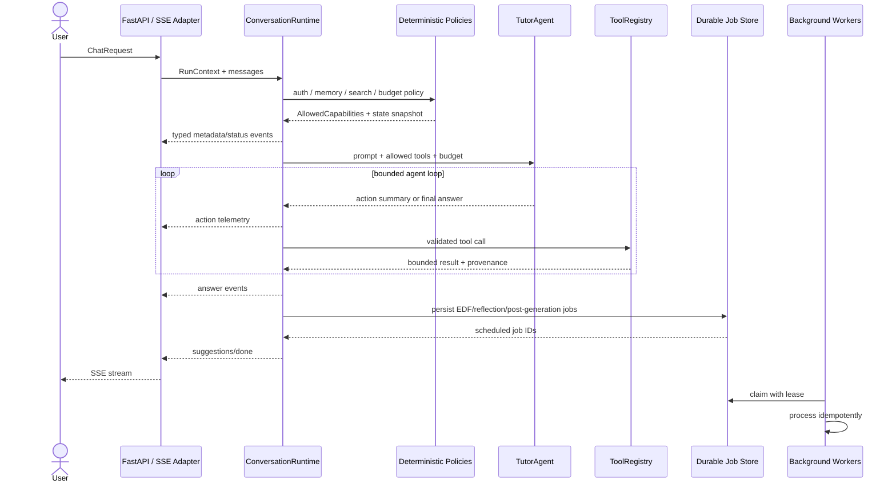

# AREQA 受控 Agentic 架構重構計畫

> Implementation Plan: Deterministic Conversation Runtime with Controlled Agency

本計畫旨在將 AREQA 由目前集中於 `OrchestrationService` 的靜態管線，逐步重構為「確定性對話執行環境（Conversation Runtime）＋受控 Tutor Agent＋可恢復背景 Worker」架構。

重構目標不是追求 Agent 數量，而是讓系統在維持記憶安全、教學策略、串流契約與副作用可靠性的前提下，具備受控的工具選擇能力。

核心哲學：

> 確定性規則負責授權、驗證與執行；Agent 只在允許的範圍內負責動態選擇與內容生成。

---

## 實作狀態（2026-07-12）

目前 Phase 0 至 Phase 5 的主要程式邊界已建立：typed event compatibility adapter、`RunContext`、`ConversationRuntime`、run-local state、Tutor shadow routing、tool budget/registry、三態搜尋 policy、`WebSearchTool`、deterministic memory policy、`MemoryQueryTool`、durable agent job store、EDF/reflection/compaction durable scheduling、mailbox lease/retry，以及不公開 CoT 的 action telemetry。`OrchestrationService` 仍保留為 compatibility facade，舊 OpenAI-compatible answer delta 仍由 adapter 輸出。

目前仍需部署環境驗證的項目：

- 套用 `20260711_mailbox_delayed_task_leases.sql` 與 `20260712_agent_background_jobs.sql` migration。
- 確認後端 worker 使用可跨使用者 claim job 的 DB role；**注意**：migration 包含 `agent_background_jobs_user_isolation` RLS policy，因此 `DATABASE_URL` 必須使用 service role 或 Postgres superuser 連線字串，否則 durable worker 將無法處理跨使用者的 background jobs。
- 以 production `BACKEND_API_URL` 與測試帳號執行 live latency benchmark。
- 先開啟 shadow flag，再依 routing、privacy、latency 與 cost 指標逐步提高 active rollout percentage。
- 以 multi-instance worker 實測 lease recovery、duplicate delivery 與 process restart。

（已完成修補項目：`backend/job_store.py` 已補齊 `memory_compaction` 測試覆蓋；`run_reflection_loop` 已改用 `schedule_session_reflection` 避免繞過 durable job；WebSearchTool 的 timeout 設定 8 秒與 UX 無衝突。）

Mock benchmark 與 unit/integration test 只能作為合併 gate，不視為 production rollout 完成證據。

---

## 0. 現況與重構邊界

目前系統已具備以下基礎，不應在重構時另建重複機制：

- `backend/services/orchestration_service.py` 已包含 EDF、RAG/Web Search、Prompt 組裝、LLM 串流與推薦問題流程。
- Hot、working、profile memory 已使用 Redis，且部分更新已採 WATCH/transaction。
- Cold memory 與 delayed mail task 已使用 PostgreSQL。
- Mailbox 已具備 Redis sorted set 排程、deterministic task ID、去重、distributed lock、重啟恢復與 delivered 狀態。
- 前端 SSE client 已處理 `metadata`、`status`、`sources`、`suggestions`、`done` 等事件。
- Memory gate 已針對 greeting、敏感資訊、明確記憶與跨對話 recall 建立行為邊界。

本計畫不得：

- 另建 JSON outbox 取代現有 PostgreSQL／Redis delayed-mail 機制。
- 使用 `asyncio.Lock` 解決跨 process 或跨 instance 的資料一致性。
- 將記憶授權、敏感資料範圍或必要副作用交由 LLM 自主判斷。
- 將模型原始 Chain-of-Thought 傳送至前端或寫入一般應用日誌。

---

## 1. 核心設計原則

### 1.1 確定性外殼優先

下列工作必須由程式碼層執行：

- 使用者與 tenant scope 驗證。
- Memory policy 與敏感資料存取授權。
- SSE event schema、順序、結束與錯誤格式。
- 工具參數驗證、timeout、結果大小與副作用控制。
- 建立 durable job、idempotency key 與狀態轉移。
- 推薦問題、usage metadata 與必要 audit event 的觸發。

Agent 僅能在 wrapper 授予的 capability 中選擇工具，不得擴張權限。

### 1.2 明確的一致性模型

「已排程」與「已完成」必須分開定義。不得以 `asyncio.create_task()` 代表工作已確定完成。

EDF 採 eventual consistency：

- 本輪 prompt 使用最近一次已確認的 learner-state snapshot。
- snapshot 必須包含 `state_version` 與 `evaluated_at`。
- 本輪訊息建立下一版本的 durable evaluation job。
- 若業務情境要求本輪強一致，才使用具 timeout 的 `await`，失敗時使用最後有效 snapshot。

背景副作用採 durable delivery：

- request path 只在 job 成功持久化後宣告 `scheduled`。
- worker 透過 lease/claim 處理 job。
- worker crash 後可重新領取，不因 process 結束遺失。

### 1.3 受控工具預算

初始 Tutor Agent 最多註冊 2 個工具，但主要限制應放在每次 run 的執行預算：

```text
max_tool_calls_per_run = 3
max_external_calls = 1
max_consecutive_failures = 2
max_tool_result_tokens = 4000
max_total_tool_latency_ms = 8000
```

若未來需要更多能力，先評估能否以 deterministic service 或單一工具 facade 解決；只有出現獨立規劃目標、上下文與評估標準時才拆分 Agent。

### 1.4 行動可見性，不公開 CoT

前端只接收結構化 action telemetry：

```json
{
  "schema_version": 1,
  "phase": "tool_selection",
  "action": "web_search",
  "reason_code": "CURRENT_INFORMATION_REQUIRED",
  "display_message": "正在查找最新資料",
  "attempt": 1
}
```

禁止傳送：

- 模型原始 reasoning tokens。
- 隱藏 system prompt。
- 完整工具參數中的個人資料。
- 開發用 debug JSON 或 provider-specific reasoning format。

內部 observability 應記錄 route、tool、latency、token、fallback 與錯誤代碼，不記錄未遮罩的 CoT。

### 1.5 Contract-driven 與 transport isolation

核心流程產生 typed domain events，不直接拼接 SSE 字串。最外層 adapter 才負責序列化：

```python
@dataclass(frozen=True)
class AgentEvent:
    type: EventType
    payload: dict[str, Any]
    run_id: str
    sequence: int
    schema_version: int = 1
```

這使 HTTP SSE、WebSocket、測試與未來 event replay 共用同一組契約。

### 1.6 隱私與使用者控制

Web Search 採三態：

- `auto`：Agent 可依 policy 決定是否搜尋。
- `always`：本輪強制搜尋，但仍受安全與 availability policy 限制。
- `never`：禁止將 query 傳至外部搜尋服務，Agent 不得覆寫。

Memory query 先通過 deterministic memory policy，再由 Agent 在允許 scope 內決定是否查詢。

---

## 2. 目標架構



### 2.1 預期目錄

```text
backend/
├── agents/
│   ├── tutor_agent.py
│   └── persona_composer.py
├── core/
│   ├── agent_runtime.py
│   ├── events.py
│   ├── run_context.py
│   ├── tool_registry.py
│   └── budgets.py
├── policies/
│   ├── memory_policy.py
│   ├── search_policy.py
│   └── capability_policy.py
├── tools/
│   ├── web_search.py
│   └── memory_query.py
├── workers/
│   ├── memory_worker.py
│   └── delayed_mail_worker.py
├── services/
│   ├── orchestration_service.py
│   ├── suggestion_service.py
│   ├── cache_service.py
│   └── connection_manager.py
├── gum_integration.py
├── memory_store.py
├── cold_memory.py
├── mailbox_store.py
└── config.py
```

`orchestration_service.py` 在遷移期間保留為 compatibility facade，逐步把內部職責轉交給 `ConversationRuntime`，避免一次重寫全部流程。

---

## 3. 模組契約

| 模組 | 輸入 | 輸出 | 允許副作用 |
|---|---|---|---|
| `ConversationRuntime.execute()` | `RunContext`, messages, mode | `AsyncIterator[AgentEvent]` | 建立 durable jobs、audit metadata |
| `TutorAgent.run()` | prompt, allowed tools, budget | typed agent actions/final chunks | 無直接資料寫入 |
| `MemoryPolicy.evaluate()` | user scope, query classification, consent | allowed memory scope | 無 |
| `SearchPolicy.evaluate()` | search mode, query classification | allow/deny/force | 無 |
| `ToolRegistry.execute()` | validated action, budget, run context | `ToolResult` | 僅各工具宣告的副作用 |
| `WebSearchTool` | query, user search policy | bounded result + citations | scoped Redis cache |
| `MemoryQueryTool` | query, allowed memory scope | bounded memory records | 無 |
| `MemoryWorker` | claimed durable job | completed/failed state | Redis/PostgreSQL memory stores |
| `PersonaComposer` | validated mail composition job | generated mail content | 無直接寄送 |
| `DelayedMailWorker` | existing delayed-mail job | delivered/failed state | PostgreSQL、Redis、WebSocket |
| `SSEAdapter` | `AgentEvent` | SSE bytes/string | 無 |

### 3.1 RunContext

每個 run 必須固定攜帶：

```text
run_id
user_id
conversation_id
request_id
search_mode
memory_scope
learner_state_version
tool_budget
started_at
```

禁止 Agent 直接從 global singleton 推斷 user 或 conversation scope。

### 3.2 ToolResult

XML 標籤只作為 prompt 邊界提示，不視為安全機制。工具結果還必須包含：

```text
tool_name
status
content
provenance
content_type
truncated
latency_ms
cache_status
```

所有外部工具結果視為 untrusted data，必須執行 schema validation、長度限制、內容清理與 prompt-injection boundary instruction。

### 3.3 Durable Job 狀態

共用狀態模型：

```text
scheduled -> claimed -> completed
                    -> retryable_failed -> scheduled
                    -> terminal_failed
```

每個 job 必須具有：

```text
job_id / idempotency_key
job_type
user_id
payload_version
status
attempt_count
available_at
lease_owner
lease_expires_at
last_error_code
created_at / updated_at
```

---

## 4. Agent 與 Worker 職責

### 4.1 Tutor Agent

Tutor Agent 負責：

- 判斷在已授權 capability 中是否需要工具。
- 選擇 web search 或 memory query。
- 根據工具結果產生教學回覆。
- 在預算耗盡或工具失敗時產生安全 fallback。

Tutor Agent 不得：

- 自行擴大 memory scope。
- 在 `search_mode=never` 時搜尋。
- 直接更新 profile、hot memory、mailbox 或資料庫。
- 自行宣告 durable job 已完成。
- 輸出原始 CoT。

### 4.2 Memory Worker

Memory processing 屬於 durable worker workflow，不因使用 LLM 就視為 Agent。它負責：

- claim reflection/EDF/compaction job。
- 使用 idempotency key 防止重複寫入。
- 依既有 memory gate 與 storage ownership 更新 Redis/PostgreSQL。
- 以 transaction、WATCH 或 atomic operation 處理競爭。
- 記錄 retryable 與 terminal failure。

### 4.3 Persona Composer 與 Delayed Mail Worker

角色信件拆成兩個責任：

- `PersonaComposer`：只負責受限內容生成。
- `DelayedMailWorker`：沿用現有 PostgreSQL + Redis sorted set，負責排程、claim、送達、去重與廣播。

不得新增第二套 JSON outbox。既有 `task_id` 應升級為正式 idempotency key，並補強 lease 與 failure state。

---

## 5. Event 契約

初始 event type：

| Event | 用途 |
|---|---|
| `metadata` | run、schema、usage metadata |
| `status` | deterministic pipeline 狀態 |
| `action` | 可公開的 Agent 行動摘要 |
| `tool_started` | 工具名稱與公開顯示訊息 |
| `tool_completed` | 結果數、來源數、latency，不含敏感內容 |
| `sources` | citation payload |
| `answer_delta` | 回答串流內容 |
| `suggestions` | 推薦問題 |
| `warning` | fallback、partial failure |
| `done` | 最終狀態與 suggestion snapshot |
| `error` | 結構化錯誤 |

必要規則：

- 每個 event 具有遞增 `sequence`。
- 每個 run 最多一個 terminal event。
- `done` 或 `error` 後不得再有業務事件。
- client disconnect 必須停止前台生成，已持久化 job 依 job policy 繼續。
- 遷移期間保留舊 OpenAI-compatible delta 格式，由 SSE adapter 做 compatibility mapping。

---

## 6. 實作階段與 Gate

### Phase 0：現況契約與回歸基線

目標：在重構前固定目前真實行為，先修復已知契約錯誤。

工作項目：

- 修正 `event: accumulator` producer/consumer 格式不一致。
- 建立完整 SSE event ordering 與 terminal-event baseline。
- 固定 greeting short-circuit、RAG、web search、memory gate、suggestions、mailbox 行為。
- 為 disconnect、LLM timeout、suggestion failure 與 Redis failure 建立基線。
- 記錄現有 p50/p95 TTFT、總延遲與外部呼叫次數。

Gate：

- Backend、frontend regression 全部通過。
- accumulator 能正確傳入 SuggestionService。
- SSE parser 契約測試覆蓋現有所有 event type。
- 產出可比較的 latency/cost baseline。

### Phase 0.5：Typed Events、RunContext 與一致性邊界

目標：先建立新舊架構共用的穩定邊界，不改變使用者行為。

工作項目：

- 新增 `core/events.py`、`core/run_context.py` 與 SSE adapter。
- `OrchestrationService` 內部改用 typed events，外部維持既有 SSE 契約。
- 定義 EDF state snapshot version。
- 定義 durable job、idempotency 與 storage ownership。
- 新增 event schema version 與 frontend compatibility tests。

Gate：

- 新舊 adapter golden tests 完全一致。
- event ordering、single-terminal 與 schema validation 測試通過。
- 多使用者與 conversation scope 測試通過。
- 不增加外部 LLM 呼叫次數。

### Phase 1：拆分 Conversation Runtime

目標：將現有大型 orchestration 拆成可測試元件，但保持靜態 routing 行為。

工作項目：

- 新增 `ConversationRuntime`。
- 抽出 prompt assembly、search policy、memory policy 與 post-generation hooks。
- 保留 `OrchestrationService` 為 facade。
- 移除透過 instance 暫存 `_temp_rag_obj`、`_temp_context_prompt` 的隱性共享狀態，改放入 run-local state。
- 將 fire-and-forget 副作用改為明確的 awaited operation 或 durable scheduling。

Gate：

- 每個 run 無跨 request mutable state。
- 併發執行 100 個不同 user/conversation 不互相污染。
- 現有功能與 baseline 一致。
- p95 TTFT 不得劣化超過 10%。

### Phase 2：Tutor Agent 與 Web Search Shadow Mode

目標：先驗證 Agent routing 品質，不立即改變使用者看到的結果。

工作項目：

- 新增 bounded agent loop、ToolRegistry 與 budgets。
- 第一階段只註冊 `WebSearchTool`。
- Agent 在 shadow mode 產生 search/no-search 決策，實際仍使用既有模式。
- 建立離線 routing dataset，涵蓋即時資訊、一般知識、明確禁止聯網與隱私案例。
- 記錄 decision、reason code、latency 與預估成本，不記錄 CoT。

Gate：

- `never` 模式外部呼叫數為 0。
- max iteration、timeout 與 consecutive failure 可被程式碼強制執行。
- routing precision/recall 達到預先設定門檻。
- shadow mode 不影響回答與 latency。

### Phase 2.5：Web Search 受控啟用

目標：在 `auto/always/never` policy 下讓 Agent 實際選擇 Web Search。

工作項目：

- 前後端加入三態 search mode。
- Web Search tool 加入 timeout、result-size limit、citation、cache scope 與 injection boundary。
- 工具失敗時回到一般回答或明確告知資料時效限制。
- 保留 feature flag 與 deterministic rollback path。

Gate：

- `never` 隱私規則不可被 Agent 覆寫。
- 工具錯誤不造成 SSE 中斷或重複 terminal event。
- 外部搜尋結果均有 provenance。
- p95 total latency 與成本在預算內。

### Phase 3：Memory Tool 與 Deterministic Memory Policy

目標：在不破壞現有記憶安全邊界的前提下，允許 Tutor Agent 選擇性查詢記憶。

工作項目：

- 建立 `DENY_MEMORY`、`ALLOW_EXPLICIT_RECALL`、`ALLOW_PROFILE_ONLY`、`ALLOW_SESSION_ONLY`、`ALLOW_AGENT_QUERY` policy。
- Agent 只取得 policy 核准的 memory scope。
- 對敏感健康、家庭、跨對話與明確 recall 建立 adversarial tests。
- 保留 greeting 與低資訊訊息不載入長期記憶的現有行為。
- ToolResult 加入來源類型、建立時間與截斷狀態。

Gate：

- 未授權 memory record 洩漏數為 0。
- multi-user isolation 測試 100% 通過。
- greeting 不觸發 memory query。
- explicit recall 與敏感 recall policy 測試通過。

### Phase 4：Durable Memory 與 Mailbox Worker 強化

目標：提高背景工作的可恢復性，不重造現有 storage。

工作項目：

- 將 EDF、reflection、compaction 表示為 durable jobs。已建立 `edf_evaluation`、`reflection_observation`、`session_reflection`、`memory_compaction`。
- 為 memory worker 加入 claim、lease、retry、terminal failure 與 idempotency。
- 沿用 mailbox PostgreSQL + Redis sorted set，補足 `claimed/retryable_failed/terminal_failed` 狀態與 owner-token lock release。
- Persona content generation 與 delivery worker 解耦。
- 對 worker crash、Redis unavailable、DB retry 與 duplicate delivery 建立測試。

Gate：

- process restart 後已排程 job 不遺失。
- duplicate memory write 與 duplicate mail delivery 為 0。
- 多 worker 競爭下每個 job 最多一個有效 owner。
- failure 可觀測，`retryable_failed` 可自動重試，`terminal_failed` 可人工重試或重新排程。

### Phase 5：Action Telemetry 與前端 UX

目標：讓使用者看到可理解的執行進度，同時避免揭露 CoT 與敏感資料。

工作項目：

- ThinkingPanel 改為解析 `action/tool_started/tool_completed/warning`。
- 顯示「分析問題」、「查找最新資料」、「檢索已授權記憶」、「整理來源」等 action summary。
- 不渲染 `<think>`、provider reasoning 或 debug JSON。
- ChatInput 將 Web Search 按鈕改為 `Auto/Always/Never`。
- 加入 keyboard、screen reader、mobile 與中斷生成測試。

Gate：

- 前端遇到未知 event type 可安全忽略。
- telemetry 不包含 query 原文、memory 內容或 tool credentials。
- stop/disconnect 後 UI state 正確復原。
- ESLint、TypeScript、unit 與 E2E 全部通過。

### Phase 6：是否需要更多 Agent 的評估門

只有同時符合以下條件才新增 Agent：

- 有獨立目標與成功標準。
- 需要不同模型、上下文或工具集合。
- 單一 Tutor Agent 已出現可量化的 routing/context 問題。
- 額外 handoff latency 與 token 成本可接受。
- 能定義清楚的 input/output contract 與停止條件。

否則應優先使用 deterministic service、worker 或 tool facade。

---

## 7. 全域品質指標

每個 Phase 除了測試全綠，還必須比較以下指標：

| 類別 | 指標 |
|---|---|
| 效能 | p50/p95 TTFT、p95 total latency |
| Agent | routing precision/recall、fallback rate、平均 iterations |
| 工具 | tool failure rate、timeout rate、cache hit rate |
| 成本 | 每輪 LLM calls、tokens、外部搜尋次數 |
| 可靠性 | duplicate side effects、lost jobs、terminal-event violations |
| 記憶安全 | unauthorized retrieval、cross-user leakage、incorrect persistence |
| UX | stop success rate、unknown-event tolerance、telemetry completion rate |

門檻值應在 Phase 0 baseline 完成後，以實測數據寫入 CI 或 deployment quality gate，不應只使用抽象的「100% 通過」。

---

## 8. Rollout 與回退策略

- 所有 Agent routing 以 feature flag 控制。
- 先 internal user，再小比例 conversation rollout。
- shadow mode 與 active mode 使用相同 telemetry schema。
- 發生 privacy violation、duplicate side effect 或 terminal-event corruption 時立即關閉 Agent routing。
- 回退只切換 routing，不回退 durable schema；database migration 必須 backward compatible。
- 每個 run 記錄 runtime version、policy version、prompt version 與 tool version，便於重現。

---

## 9. 完成定義

Agentic 遷移完成不以「建立三個 Agent」為標準，而以下列條件為準：

- Tutor Agent 能在明確 policy 與預算下可靠選擇工具。
- 使用者保有外部搜尋與敏感記憶的控制權。
- 所有副作用可追蹤、可去重、可恢復。
- SSE 契約 typed、versioned 且前後端相容。
- UI 顯示可理解的行動進度，但不公開 CoT。
- 單一 instance、multi-worker 與重啟情境均通過測試。
- Agent 帶來的品質提升可由 routing、latency、cost 與 user outcome 指標證明。

這使 AREQA 的目標架構成為「具受控自主性的可靠教學系統」，而不是僅在既有 pipeline 上增加多個 LLM 角色。
