# AREQA 系統架構重構計畫：Multi-Agent 遷移細節設計 (Implementation Plan)

本計畫旨在將 AREQA 系統從傳統的靜態管線（Static Pipeline）遷移至基於「確定性外殼（Deterministic Wrapper）」與「智能體核心（Agentic Core）」混合的 Multi-Agent 架構。核心設計哲學為：「**確定性先行，Agent 只負責動態填空**」。

---

## 0. 總覽 (Overview)

### 0.1 核心設計原則

> 這是本計畫最重要的部分，所有實作細節必須以此為優先，構成系統的防禦護欄。

**原則一：確定性外殼優先（Deterministic Wrapper First）**
- 凡是「每次對話都必須 100% 發生」的系統剛需（EDF 狀態評估、推薦問題生成、記憶寫入觸發、SSE 事件格式），**一律由程式碼層強制執行**，永遠不得交由 LLM 機率模型決策。
- Agent 只在「選擇最佳回應方式」的動態推論環節介入，不得觸碰系統業務邏輯的底線。

**原則二：工具預算制（Tool Budget Rule）**
- 單一 Agent 的工具數量上限硬性規定為 **3 個**以內。
- 若需要更多功能，必須拆分為職責單一的 Micro-Agent，嚴禁將功能堆積在同一個 Agent 上導致工具過載 (Tool Overload)。

**原則三：Phase 閘門制（Phase Gate Protocol）**
- 每個 Phase 結束必須通過**回歸測試閘門（Regression Gate）**，確認所有現有功能通過後才能進入下一 Phase。
- 絕對禁止在前一個 Phase 的回歸測試未通過時，強行推進到下一個 Phase。

**原則四：強制推論可見性（Mandatory Reasoning Visibility）**
- Agent 在呼叫任何工具前，必須先輸出結構化的推理過程（JSON 格式），供開發者審核與除錯。
- 此推論 JSON 透過 `event: think` SSE 事件送至前端 ThinkingPanel 渲染，讓使用者理解系統的思考脈絡。

---

### 0.2 系統架構圖

```mermaid
sequenceDiagram
    actor User
    participant Main as main.py<br>(Deterministic Wrapper 層)
    participant EDF as EDF 狀態評估<br>(程式碼強制執行)
    participant Tutor as Tutor Agent<br>(agents/tutor_agent.py)<br>工具預算：≤ 2個
    participant Tools as Tools Registry<br>(core/tools.py)
    participant BG as 背景 Agent 層<br>(非同步 / 不干擾前台)

    User->>Main: 傳送訊息 (Input)

    rect rgb(30, 60, 30)
        Note over Main,EDF: ✅ 確定性層 - 每次強制執行，不依賴 Agent
        Main->>EDF: ① 強制 EDF 評估 async_evaluate_and_update_state()
        EDF-->>Main: learner_state + strategy (寫入 hot_memory)
        Main->>Main: ② 強制組裝 System Prompt<br>(注入 learner_state / working_memory / context)
    end

    rect rgb(40, 40, 60)
        Note over Main,Tools: 🔁 Agent 決策迴圈 (ReAct Loop, max_iter=3)
        Main->>Tutor: ③ 啟動 run_conversation(system_prompt, messages)
        
        loop ReAct 迴圈 (max 3 次)
            Tutor->>Tutor: 強制 CoT 輸出推理 JSON<br>{"reasoning": "...", "action": "..."}
            alt 需要聯網補充知識 (tool_web_search)
                Tutor->>Tools: tool_web_search(query)
                Tools-->>Tutor: <context>...</context> (強制包裝標籤)
            else 需要回溯個人記憶 (tool_query_memory)
                Tutor->>Tools: tool_query_memory(topic)
                Tools-->>Tutor: <retrieved_memory>...</retrieved_memory>
            else 直接回答 (no tool)
                Tutor->>Tutor: 直接產出最終回覆
            end
        end
        
        Tutor-->>Main: Streaming 串流回覆
    end

    rect rgb(60, 30, 30)
        Note over Main,BG: ✅ 確定性層 - Post-generation 強制執行
        Main->>Main: ④ 強制生成推薦問題 (SuggestionService)
        Main->>Main: ⑤ 強制觸發記憶寫入 Queue (push_observation)
        Main-->>User: 回傳 SSE 串流
    end

    Note over BG: ⚡ 背景 Agent（完全異步，不阻塞前台）
    Main-)BG: 對話入 Queue → Memory Agent 處理
    BG-)BG: Persona Agent 定時掃描 outbox 發信
```



---

### 0.3 預期目錄架構

```text
backend/
├── agents/
│   ├── tutor_agent.py        # 前台對話 Agent（工具預算：≤ 2 個）
│   ├── memory_agent.py       # 背景記憶總管（非同步，不干擾前台）
│   └── persona_agent.py      # 角色信件智能體（定時掃描 outbox）
│
├── core/
│   ├── agent.py              # ReAct 迴圈 + 強制 CoT + max_iterations 護欄
│   ├── tools.py              # ToolRegistry（數量限制在 Agent 構建時強制檢查）
│   └── memory.py             # LLM Context 狀態管理
│
├── tools/
│   ├── web_search.py         # tool_web_search（唯一的對外檢索工具）
│   └── memory_query.py       # tool_query_memory（唯一的個人記憶工具）
│
├── services/
│   ├── orchestration_service.py  # 🔑 Deterministic Wrapper 層
│   │                              #    負責強制執行 EDF / Prompt 組裝 / Post-generation
│   ├── cache_service.py
│   ├── connection_manager.py
│   └── compeer_scheduler.py     # （架構保留，按需啟用）
│
├── gum_integration.py        # 保留底層 DB 連線與 CRUD，移出 Agent 邏輯
├── memory_store.py           # 加 asyncio.Lock 防併發覆蓋
├── cold_memory.py
├── compaction.py
├── mailbox_store.py          # 新增 outbox 欄位（pending/sent 持久化）
└── config.py
```

---

## 1. 架構模組設計細節

### 1.1 確定性 Wrapper 層 (Deterministic Wrapper)

`orchestration_service.py` 負責作為一個明確的**確定性外殼**，包覆內部的 Tutor Agent，確保業務邏輯的剛需被執行。

```python
# services/orchestration_service.py

async def execute_with_deterministic_wrapper(request, messages, ...):
    
    # ═══════════════════════════════════════════
    # 確定性前置層（Pre-Agent, 強制執行，不可跳過）
    # ═══════════════════════════════════════════
    
    # 1. 強制 EDF 評估（程式碼直接呼叫，不依賴 Agent）
    asyncio.create_task(async_evaluate_and_update_state(...))
    
    # 2. 強制讀取熱記憶並組裝 System Prompt
    system_prompt = build_deterministic_system_prompt(...)
    
    # ═══════════════════════════════════
    # Agent 動態層（可選，LLM 自主推論）
    # ═══════════════════════════════════
    
    tutor = TutorAgent(system_prompt=system_prompt, client=client)
    async for event in tutor.run_conversation(messages, ...):
        yield event
    
    # ═══════════════════════════════════════════
    # 確定性後置層（Post-Agent, 強制執行，不可跳過）
    # ═══════════════════════════════════════════
    
    # 3. 強制生成推薦問題
    suggestions = await suggestion_service.generate_suggestions(...)
    yield f"event: suggestions\ndata: {json.dumps(suggestions)}\n\n"
    
    # 4. 強制記憶寫入觸發
    asyncio.create_task(push_observation(f"User asked: {last_msg}"))
    
    yield "data: [DONE]\n\n"
```

### 1.2 前台導師智能體 (Tutor Agent)

負責與使用者進行動態對話，根據問題難度自主決定是否呼叫外部工具。

**受限的工具清單：**

| 工具 | 名稱 | 觸發時機 |
|---|---|---|
| 1 | `tool_web_search(query)` | 使用者需要最新資訊或課本以外的知識 |
| 2 | `tool_query_memory(topic)` | 使用者明確提到「你還記得...」或需要個人偏好回溯 |

**核心迴圈與護欄設計 (`core/agent.py`)：**
- **MAX_ITERATIONS = 3**：設定硬性推論輪次上限，超過 3 輪強制結束工具調用，進入直接回覆模式。
- **強制 CoT 輸出**：在呼叫任何工具之前，必須先以 JSON 格式輸出推理過程。
- **工具結果包裝**：工具的回傳值在注入 context 時，必須被 XML 標籤（如 `<context>` 或 `<retrieved_memory>`）包裹，禁止裸字串。

### 1.3 後台記憶智能體 (Memory Agent)

- **完全非同步**，在獨立的背景 Task 中運行，絕不阻塞前台 SSE 串流。
- 專職負責：處理 `ObservationQueue`（記憶萃取） → 觸發 STITCH 歸檔 → 執行 compaction 衰減計算。
- 透過 `asyncio.Lock` 存取 SQLite，防止併發覆蓋。

### 1.4 後台角色信件智能體 (Persona Agent)

- **持久化 Outbox**：寄信任務存入 `mailbox_store.py` 的 `outbox` 欄位（記錄 `mail_id, send_time, status: "pending"`）。
- 定時掃描：Persona Agent 每 60 秒掃描 outbox，若時間到達且狀態為 `pending`，則觸發 LLM 生成回信並透過 WebSocket 廣播。
- **伺服器重啟安全**：啟動時自動掃描並補發所有 `pending` 且已過期的任務，防止信件遺失。

---

## 2. I/O 契約與副作用聲明

每個模組必須明確宣告其邊界，實踐契約驅動設計（Contract-Driven Design）。

| 模組 | 輸入契約 | 輸出契約 | 副作用（允許的） |
|---|---|---|---|
| `TutorAgent.run_conversation()` | `messages: list`, `system_prompt: str` | `AsyncGenerator[SSE event str]` | 無，純串流輸出 |
| `tool_web_search()` | `query: str` | `<context>...</context> str` | Redis 快取寫入 |
| `tool_query_memory()` | `topic: str` | `<retrieved_memory>...</retrieved_memory> str` | 無 |
| `EDF (確定性層)` | `client`, `model`, `messages` | 寫入 `hot_memory["current_learner_state"]` | hot_memory.json 寫入 |
| `MemoryAgent` | `ObservationQueue` 字串 | 寫入 `gum.db` | 僅 gum.db，不觸碰 hot_memory |
| `PersonaAgent` | 掃描 `outbox (status=pending)` | 寫入 `mailbox.json`，WS 廣播 | mailbox.json + WebSocket |
| `SuggestionService (確定性層)` | `query: str, answer: str` | `list[str]` 推薦問題 | 無 |

---

## 3. 實作與測試階段 (Phase Gate Protocol)

> **核心準則**：採用嚴格的「門控把關 (Gate Protocol)」。每個 Phase 必須獨立完成其**單元測試**與**整合測試**，並通過全域的**回歸測試 (Regression Gate)** 後，才允許進入下一個 Phase。

### Phase 0：回歸基線建立（Regression Baseline）

**實作目標**：在動任何一行重構程式碼前，先鎖定現有系統的正確行為，確保後續修改皆有安全回退點。

**新增與修改事項 (Code Modifications)**：
- 無業務邏輯修改。
- 於 `backend/tests/` 目錄下新增方針式的基線測試套件，針對現存架構建立保護網。

**實作範例 (Implementation Snippet)**：
```python
# backend/tests/test_baseline_chat.py
@pytest.mark.asyncio
async def test_baseline_chat_sse_format(mock_client):
    pipeline = OrchestrationPipeline(mock_client)
    events = []
    async for event in pipeline.execute(test_messages, ...):
        events.append(event)
    
    # 斷言 SSE 串流具備標準結束符，且中途不外洩內部資料
    assert events[-1] == "data: [DONE]\n\n"
```

**測試計畫與門控 (Gate Condition)**：
| 測試類別 | 測試檔案 | 目標模組 | 測試情境與斷言 (Assertion) | 回歸與靜態檢查 | 門控要求 |
|---|---|---|---|---|---|
| 整合測試 | `test_baseline_chat.py` | `OrchestrationPipeline` | 驗證 `execute` 回傳的 SSE 串流包含 `data: [DONE]`，且最終回覆內容不包含除錯 JSON。 | 遵循 `update-test-agent`：只增不改 | 100% 通過 |
| 單元測試 | `test_baseline_memory.py` | `gum_integration.py` | 直接呼叫 `async_evaluate_and_update_state`，斷言 `MemoryStore` 更新了 `learner_state`。 | 確保 Type Check 通過 | 100% 通過 |
| 整合測試 | `test_baseline_mailbox.py` | `mailbox_store.py` | 驗證 `get_pending_emails` 讀取，及 `ConnectionManager.broadcast` 行為。 | 遵循 `update-test-agent` 準則 | 100% 通過 |
| 單元測試 | `test_baseline_rag.py` | `RAGService` | 呼叫 `search_hybrid`，斷言回傳包含來源文獻的 `event: sources` 事件。 | 確保 Type Check 通過 | 100% 通過 |

---

### Phase 1：確定性外殼改造

**實作目標**：明確確定性層的職責邊界，將系統剛需從 Agent 內部剝離。

**新增與修改事項 (Code Modifications)**：
- **修改** `services/orchestration_service.py`：廢棄舊 Node 架構，重寫 `execute()` 為三階段：Pre-Agent (強制 EDF)、Agent (透傳)、Post-Agent (強制推薦問題與日誌)。
- **新增** `core/tools.py`：建立 `ToolRegistry`，設定最大工具數量硬限制 `MAX_TOOLS = 3`。

**實作範例 (Implementation Snippet)**：
```python
# backend/services/orchestration_service.py
async def execute_with_deterministic_wrapper(messages, client, ...):
    # 【剛需：Pre-Agent 強制執行 EDF】
    asyncio.create_task(async_evaluate_and_update_state(client, model, messages))
    system_prompt = build_deterministic_system_prompt()
    
    # ... 中間交由 Phase 2 Tutor Agent 處理 ...
    
    # 【剛需：Post-Agent 強制執行寫入與後置作業】
    suggestions = await suggestion_service.generate_suggestions(...)
    yield f"event: suggestions\ndata: {json.dumps(suggestions)}\n\n"
    asyncio.create_task(push_observation(f"User: {messages[-1]['content']}"))
    yield "data: [DONE]\n\n"
```

**測試計畫與門控 (Gate Condition)**：
| 測試類別 | 測試檔案 | 目標模組 | 測試情境與斷言 (Assertion) | 回歸與靜態檢查 | 門控要求 |
|---|---|---|---|---|---|
| 單元測試 | `test_deterministic_wrapper.py` | `orchestration_service` | `mock.patch` 攔截 `async_evaluate_and_update_state` 與 `push_observation`，斷言 `assert_called_once`。 | 遵循 `update-test-agent`：遇錯新增獨立測試 | 100% 通過 |
| 單元測試 | `test_tool_budget.py` | `ToolRegistry` | 連續呼叫 `register()` 4 次，斷言第 4 次拋出 `ValueError`。 | 確保 Type Check 通過 | 100% 通過 |
| 整合測試 | 既有基線 | Phase 0 全套 | 驗證重構 `execute` 後，原有的對話串流與記憶機制未遭破壞。 | Verify via Execution 執行驗證 | 全域綠燈 |

---

### Phase 2：Agent 核心與工具化

**實作目標**：構建具備自主決策能力的 Tutor Agent，並注入規範內的工具。

**新增與修改事項 (Code Modifications)**：
- **移除** `orchestration_service.py` 內的 `_node_perplexity_search`。
- **新增** `tools/web_search.py` 與 `tools/memory_query.py`，並強制回傳值進行 XML 標籤包裝 (`<context>`, `<retrieved_memory>`)。
- **新增** `core/agent.py`：實作 ReAct 迴圈，加入 `MAX_ITERATIONS = 3` 與強制 CoT 的 `FORCE_REASONING_PROMPT`。

**實作範例 (Implementation Snippet)**：
```python
# backend/core/agent.py
for iteration in range(3):  # MAX_ITERATIONS
    response = await llm.think(FORCE_REASONING_PROMPT, context)
    yield f"event: think\ndata: {response.json()}\n\n"
    
    if response.action == "answer":
        break  # Agent 決定回答，退出迴圈
        
    tool_result = await registry.execute(response.action, response.args)
    # 強制 XML 包裝工具結果，禁止裸字串
    context.append(f"<{response.action}>\n{tool_result}\n</{response.action}>")
```

**測試計畫與門控 (Gate Condition)**：
| 測試類別 | 測試檔案 | 目標模組 | 測試情境與斷言 (Assertion) | 回歸與靜態檢查 | 門控要求 |
|---|---|---|---|---|---|
| 單元測試 | `test_tools.py` | 工具函式群 | 單獨執行工具，斷言回傳字串的頭尾包含正確的 XML 標籤。 | 遵循 `update-test-agent`：精確重現邊界條件 | 100% 通過 |
| 單元測試 | `test_agent_reasoning.py` | `TutorAgent` | Mock LLM 返回包含 JSON 的字串，斷言 Agent 會先 `yield "event: think"`。 | 確保 Type Check 通過 | 100% 通過 |
| 整合測試 | `test_agent_loop.py` | `TutorAgent.run_conversation` | 模擬 LLM 陷入無限工具死迴圈，斷言 Agent 3 次後強行中斷並產出 Fallback。 | Verify via Execution 執行驗證 | 100% 通過 |
| 回歸測試 | 既有基線 | Phase 0~1 全套 | 確認 Agent 導入後的基本對話行為與系統日誌一致。 | 若發現 Bug 必須新增獨立回歸測試 | 全域綠燈 |

---

### Phase 3：後台 Agent 獨立化與狀態解耦

**實作目標**：將記憶處理與非同步信件發送邏輯獨立為背景智能體，消除狀態競爭。

**新增與修改事項 (Code Modifications)**：
- **修改** `gum_integration.py`：抽離 `ObservationQueueWorker` 至新檔。
- **新增** `agents/memory_agent.py`，建立 `MemoryBus` 介面，使用 `asyncio.Lock` 保護 SQLite 寫入。
- **修改** `mailbox_store.py`：新增持久化 `outbox` 欄位。
- **新增** `agents/persona_agent.py`：實作 `asyncio.sleep` 定時輪詢與重啟補發。

**實作範例 (Implementation Snippet)**：
```python
# backend/agents/memory_agent.py
class MemoryBus:
    def __init__(self, db_path: str):
        self._lock = asyncio.Lock()
        
    async def push_observation(self, obs: str):
        async with self._lock:
            # 嚴格約束：僅能操作 db，不可修改 hot_memory.json
            await execute_db_query("INSERT INTO observations ...", (obs,))
```

**測試計畫與門控 (Gate Condition)**：
| 測試類別 | 測試檔案 | 目標模組 | 測試情境與斷言 (Assertion) | 回歸與靜態檢查 | 門控要求 |
|---|---|---|---|---|---|
| 單元測試 | `test_memory_bus.py` | `MemoryBus` | 模擬呼叫，斷言僅操作了 SQLite 連線，未改動 `hot_memory.json`。 | 遵循 `update-test-agent`：原子化 | 100% 通過 |
| 整合測試 | `test_persona_outbox.py` | `PersonaAgent` | 在 `outbox` 寫入過去的 `pending` 信件，斷言啟動後轉為 `sent` 並廣播 WS。 | 確保 Type Check 通過 | 100% 通過 |
| 併發測試 | `test_concurrent_rw.py` | `MemoryBus` | `asyncio.gather` 100 個寫入，斷言 `asyncio.Lock` 能防禦 `database is locked` 錯誤。 | Verify via Execution 執行驗證 | 100% 通過 |
| 回歸測試 | 既有基線 | Phase 0~2 全套 | 確保背景化後前台 SSE 與狀態未受干擾。 | 若發現 Bug 必須新增獨立回歸測試 | 全域綠燈 |

---

### Phase 4：使用者體驗增強與 UI 簡化

**實作目標**：利用 Agent 架構帶來的自主性，簡化前端 UI 並提升對話的透明度。

**新增與修改事項 (Code Modifications)**：
- **修改** `frontend/src/components/ThinkingPanel.tsx`：解析 `event: think` 中傳遞的 JSON 字串，渲染為友善提示。
- **修改** `frontend/src/components/ChatInput.tsx`：徹底移除「Web Search」手動切換按鈕與對應的 React State。

**實作範例 (Implementation Snippet)**：
```tsx
// frontend/src/components/ChatInput.tsx
// 【刪除】const [useWebSearch, setUseWebSearch] = useState(false);
// 【刪除】<Toggle label="Web Search" checked={useWebSearch} />

const handleSubmit = (e) => {
    // 送出對話時，不再傳遞使用者的檢索決策，交由後端 Tutor Agent 處理
    sendMessage({ content: input }); 
}
```

**測試計畫與門控 (Gate Condition)**：
| 測試類別 | 測試檔案 | 目標模組 | 測試情境與斷言 (Assertion) | 回歸與靜態檢查 | 門控要求 |
|---|---|---|---|---|---|
| 單元測試 | `ThinkingPanel.test.tsx` | `ThinkingPanel` | 注入 Mock JSON，驗證「推論中...」與「呼叫工具」等 UI 節點渲染。 | 遵循 `update-test-agent`：精確重現邊界 | 100% 通過 |
| 單元測試 | `ChatInput.test.tsx` | `ChatInput` | 斷言聯網按鈕 DOM 已不存在，且 `onSubmit` 不挾帶 `useWebSearch` 參數。 | 強制執行 `npm run check:report:strict` | 100% 通過 |
| E2E 測試 | `cypress/e2e/chat.cy.ts` | 對話管線 | 驗證極簡 UI 下，從使用者輸入到接收完整 Streaming 回覆的管線順暢。 | 驗證 ESLint / TS 檢查全過 | 100% 通過 |
| 回歸測試 | 既有基線 | Phase 0~3 全套 | 達成全域回歸測試。 | Verify via Execution 執行驗證 | 全域綠燈 |
