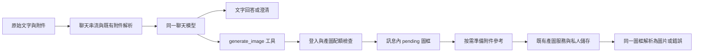

# 聊天與產圖共用模型工具流程

## Research Question

如何避免獨立產圖意圖分類失敗阻擋一般文字／附件，同時讓未加產圖標籤的請求能使用產圖工具？

## Observations and Evidence Map

| 證據 | 來源 | 意義 | 確定程度 |
|---|---|---|---|
| 已登入、未加標籤的送出先等待 `/images/intent` | 修改前 ChatContainer、messageIntent | 分類是所有聊天的必要依賴 | Confirmed |
| 包含「圖」的分析請求遇分類 503 會拒絕送出 | 修改前程式與四個失敗的回歸重現 | 視覺關鍵字不能代表產圖操作 | Confirmed |
| 附件可以只送空白文字，而分類 schema 要求非空字串 | ChatInput、MessageIntentRequest | 附件分析不應受分類文字契約阻擋 | Confirmed |
| 狀態段落與 MessageList 是水平 flex 的相鄰元素 | ChatContainer 與 styles | Understanding your request 會佔用左方寬度 | Confirmed |
| 上傳檔案已由 stream route 解析 | stream endpoint | 可供聊天與模型選擇的產圖工具共用 | Confirmed |
| 現有模型串流已支援寄信 function call | conversation/stream.py | 可沿用同一個聊天模型的工具選擇 | Confirmed |
| 最新線上分類服務的供應商回應、部署版本不可得 | 現有日誌 | 不能斷言所有線上 503 的供應商根因 | Unverified |

## Hypotheses and Experiments

| 假設 | 實驗 | 結果 |
|---|---|---|
| 額外分類關卡是聊天受阻的機制 | 讓未加標籤的文字、空白附件、分析與產圖請求執行同一個真實 send handler | 不呼叫分類服務，保留原文與附件 |
| 操作可由既有主模型選工具 | 同一份輸入，模擬主模型輸出普通內容／分段 generate_image tool call | 普通內容不呼叫產圖或附件摘要；工具輸出 pending 與圖片 |
| 產圖結果可能被後續搜尋圖片覆蓋 | 執行 orchestration，傳入生成圖 private accumulator | 保留生成圖，略過 visual search block builder |
| 取消可能接受遲到結果 | 前端停止後模擬回傳 resolved／DONE；後端等待時模擬斷線 | loading 結束，晚到結果不被接受，後端任務取消 |
| 長篇原文可能截掉模型整理的必要內容 | 長篇來源搭配完整但有界的工具繪圖規格 | 使用工具規格，而非把原文前段塞滿繪圖上限 |

供應商、模型選擇及圖片內容使用替身；這些實驗驗證流程與安全邊界，未量測真實模型的語意選擇準確率。

## Root Cause and Solution

Confirmed：把獨立意圖分類服務作為所有送出的必要前置條件，使其故障影響一般聊天。用圖片關鍵字決定是否可退回文字，又把分析與生成混為同一操作。新增固定詞彙只會擴大這個分類補丁。

改為既有聊天主模型的 `generate_image` function tool。前端未加標籤的輸入直接走聊天串流；主模型看到同一回合與歷史上下文，選擇普通回答、澄清或產圖工具。明確產圖標籤仍使用原有產圖生命週期。

產圖工具按串流 index 組合 function call，每回合最多產一張圖。它沿用專用產圖／附件參考配額；不套用為短時檢索設計的工具延遲預算。識別碼與工具參數先驗證，匿名使用者不產生付費圖片。

前端接收 generated image answer blocks 時清除附帶的文字完成宣告、結束 thinking，使用既有 loading 圖框。取消與連線錯誤會終止 pending，並拒絕晚到的圖框與完成事件。完成的圖片沿用既有私人 URL、下載、重新生成與持久化契約；首回合只有圖片也可產生標題。後續聊天保留圖片的文字摘要，不轉送私人 URL。私人儲存失敗時保留當下圖片供下載，歷史僅保存可重試的錯誤圖框，不保存 inline 圖片資料。

`Understanding your request` 與其版面狀態已移除。前端意圖分類服務與其舊測試已刪除。後端舊 intent API 暫保留以相容舊版客戶端，新版聊天不依賴它。

## Validation and Rollout

- 後端主模型工具、orchestration、圖片服務、stream endpoint、配額：108 passed，3 skipped。
- 前端六組聊天／產圖／輸入框／圖片呈現／語音測試：203 passed；補上晚到結果與暫存圖片持久化測試後，相關兩組：54 passed。
- `npm run check:report:strict`：ESLint、TypeScript 通過。
- 未執行真實供應商付費產圖或正式環境瀏覽器驗證。

需同時部署前端與後端。部署後，以一般文字、單獨附件、附件分析、自然語句產圖、長篇教學內容產圖、取消與首回合圖片標題驗收。網路面板不應再出現聊天送出前的 `/api/images/intent`；真正產圖可觀察安全的 `chat.image_tool_started/completed/failed/cancelled` 日誌。確認語音／視訊仍由原有語音流程處理，不經此分類關卡。
