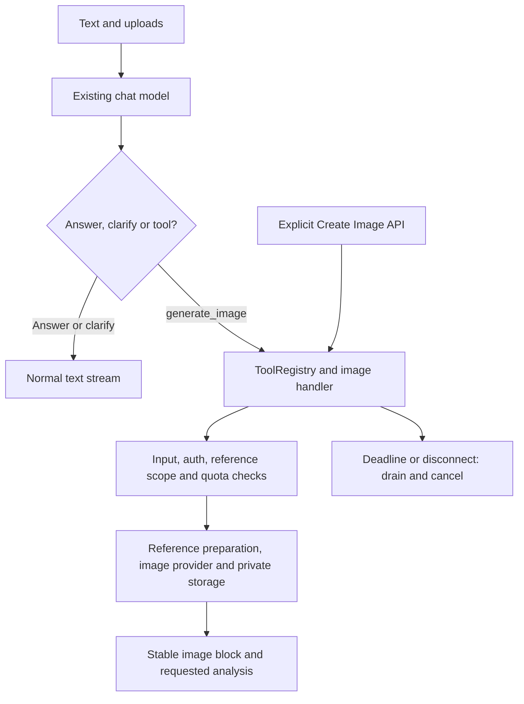
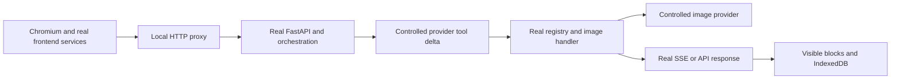

# 2026-09-29 Shared Image Tool Execution Walkthrough

Summary:

Image generation now uses the existing tool registry for both model-selected chat tools and explicit Create Image requests. The server owns authorization, bounded inputs, quotas, image identities, deadlines and cancellation. Mixed analysis/image turns retain their requested text. Validation covers deterministic contracts and Chromium browser journeys; live model selection and production deployment remain unverified.

## 1. Problem

After the mandatory image-intent preflight was removed in `ae8298b`, image tools still executed outside the common registry. Retrieval budgets were unsuitable for long image work, the system prompt required text before every tool, and generated blocks cleared requested analysis. Attachment greetings could exit orchestration before reaching the model.

Expected behavior is one contextual model decision for ordinary chat, clarification or image generation, followed by a server-owned execution gate. Explicit Create Image should share that gate. A failed or cancelled image must end loading without discarding completed analysis or accepting late results.

## 2. Root Cause

Source inspection confirmed three independent ownership issues: direct image execution duplicated the explicit API path; image-only presentation rules were applied to mixed tasks; and memory eligibility could short-circuit an upload task. The prompt's unconditional instruction to answer fully before calling tools also contradicted image-only behavior.

A browser disconnect exposed another confirmed defect during implementation: closing an async generator while its pending `__anext__` was still running raised a cleanup error. An AnyIO cancellation regression now protects the drain-before-close order. Review also found that explicit API disconnects were not forwarded to the handler; they now are.

## 3. Design Decision

The chat model proposes `generate_image` through its existing tool interface. No new keyword or regex operation classifier is introduced. Identifier patterns validate storage inputs only.

`ImageToolInput` supplies both runtime validation and the model-facing JSON schema. Authorization context is passed separately by trusted code. The registry checks the overall run call cap and a dedicated image scope, so retrieval's short latency/external-call budget does not prevent a valid drawing. One image call is allowed per run. A configurable 180-second total deadline includes reference preparation and storage.

The tool emits factual states: accepted, preparing_reference, generating, storing and a terminal result. Heartbeats do not advance progress. There is no elapsed-time percentage. `text_and_image` preserves analysis; `image_only` suppresses the preamble. Image regeneration replaces only generated-image blocks, retaining analysis during loading, success and repeated failure. Provider call IDs correlate SSE events; server-generated image IDs own storage paths and remain stable throughout each image's lifecycle.

Historical image references are downloaded using the authenticated user and current conversation. The model can nominate an image ID, but cannot provide an owner, filesystem path or private URL. Quota checks occur before paid provider calls.

### Expected Data Flow



## 4. Implementation

| Files | Responsibility |
|---|---|
| `backend/tools/registry.py`, `backend/core/budgets.py` | Streaming execution, capability budgets, deadlines and shielded cleanup |
| `backend/services/conversation/image_generation.py` | Shared input contract, authenticated references, quotas and lifecycle |
| `backend/app/routes/generated_images.py` | Explicit API delegates to the same handler and forwards disconnects |
| `backend/services/conversation/stream.py`, `context.py` | Model tool calls, mixed presentation and consistent prompt instructions |
| `backend/services/orchestration_service.py`, `orchestration/execution.py` | Tool registration and attachment-aware greeting exit |
| `backend/services/generated_image_service.py`, `backend/config.py` | Actual storage-phase callback and configurable total deadline |
| `frontend/src/services/chat/index.ts`, `chat-stream/client.ts` | Preserve analysis, carry safe historical IDs and keep lifecycle events out of text |
| `frontend/src/services/generatedImages.ts` | Retain non-generated blocks and analysis when retrying mixed replies |
| `frontend/src/database/schema.ts`, `components/MessageList/MessageItem.tsx` | Persist optional phase metadata and show factual loading captions |
| `tests/backend`, `tests/frontend`, `tests/e2e/image-tools` | Contract, integration, regression and browser coverage |
| `scripts/evaluate_image_tools.py`, `tests/evaluations/image_tools.json` | Authored real-model selection evaluation without executing image tools |

Flare quality/model settings, image layout/download behavior and the voice-owned STT/LLM/TTS pipeline are outside this change. The compatibility intent endpoint remains available to older clients.

## 5. Observability Added

The registry emits `tool.state_changed`, `tool.failed` and `tool.cancelled`. Image execution emits `chat.image_tool_started`, `chat.image_tool_completed` and `chat.image_tool_failed`. Logs contain capability names, controlled states, correlation identifiers, attachment counts and exception classes. They do not contain raw messages, prompts, provider responses, credentials or private URLs.

## 6. Validation Evidence

### Automated Tests

- Backend: **123 passed, 3 skipped**. The skips are existing tests for the bypassed router feature; eight existing FastAPI lifecycle deprecation warnings remain.
- Frontend: **223 passed** across nine chat/image/UI/voice regression files; **15 passed** across two production Next.js proxy contract files. After adding two mixed-retry regressions, the affected three service/integration files passed **72 tests**. This covers **240 distinct frontend tests** across these runs. The generation proxy test checks that the incoming abort signal is forwarded unchanged.
- `npm run check:report:strict`: **ESLint and TypeScript passed**.
- Browser: **7 passed**, including image failure/retry/reload and both cancellation entry paths.

Backend command, from the repository root:

```bash
backend/.venv/bin/python -m pytest tests/backend/test_streaming_tool_registry.py tests/backend/test_chat_image_tool.py tests/backend/test_orchestration_service.py tests/backend/test_generated_image_service.py tests/backend/test_stream_endpoint.py tests/backend/test_generated_image_quota.py -q
```

Frontend: nine focused Vitest files cover chat persistence, stream events, generated-image services/integration, input, image presentation and Live Tutor behavior. Run `npm run check:report:strict` in `frontend/` for ESLint and TypeScript.

Browser setup requires the existing backend virtualenv, frontend dependencies, and Playwright Chromium (`npx playwright install --with-deps chromium` in `frontend/`). Run `npm run test:e2e:image-tools` in `frontend/`.

### Browser Scenario Evidence

The harness runs real ChatInput, MessageItem, chat/image services, Zustand stores, IndexedDB, HTTP/SSE, FastAPI routes, orchestration and registry. External auth, model/image providers, cloud storage services used by providers, memory and sync are test boundaries. The Vite HTTP proxy is real; its JSON upstream connection is destroyed on browser disconnect to match the production BFF's forwarded abort signal. This is not a full Next.js application or production Next.js runtime test. No browser request interception supplies the responses. The harness uses the existing image-request store and cancellation callback, matching ChatContainer's separate text/image state ownership.

| Act | Expected | Evidence |
|---|---|---|
| Text and attachment-only; greeting with upload | No image classifier or paid image work; model receives upload | Browser requests, server counters and visible analysis |
| Mixed analysis and image; browser reload | Analysis survives loading, image completion, persistence and restoration | UI assertions, IndexedDB and real history loader |
| New conversation during generation | Cancel server work; new conversation contains no old messages | Server cancellation counter and displayed store |
| Stop natural-language image tool | End loading and reject late image | Server cancellation counter and UI |
| Image provider failure, retry and reload | Retain completed analysis, finish loading and persist the replacement | Controlled provider failure, real retry API, UI and history loader |
| Explicit Create Image | Shared handler, image ratio, title and lightbox controls | Provider count, image bounds, persisted title and UI |
| Stop explicit Create Image | Disconnect reaches common handler and cancels work | Real request abort, server counter and UI |

### Real-Model and Production Scenario

```bash
backend/.venv/bin/python scripts/evaluate_image_tools.py
```

The attempted run returned `not_run` because `OPENROUTER_API_KEY` is unavailable. The eight authored cases cover generation, analysis, negation, prompt editing, mixed tasks, ambiguity, context follow-up and quoted instruction injection. This evaluation measures the public tool contract, not full production context routing. It never executes the image provider, though model calls require configured credentials and may incur text-model cost.

Real provider image quality, tool-choice accuracy, production Next.js routing, cloud restoration and real voice/avatar sessions are **Not verified**. Deployment acceptance should cover those boundaries, including Chinese labels, reference edits and stopping both entry paths.

### Actual Data Flow



## 7. Result

The execution gate resides in the backend registry and image handler; the model owns the semantic proposal. Deterministic tests protect rejection, quotas, reference ownership, mixed responses and cancellation. Browser evidence covers the local integration boundary. Deploy frontend and backend together, then perform the unverified production/provider acceptance scenarios before treating live behavior as validated.
