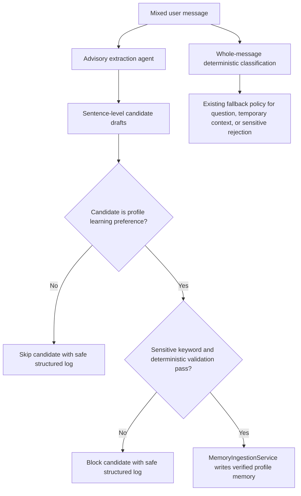
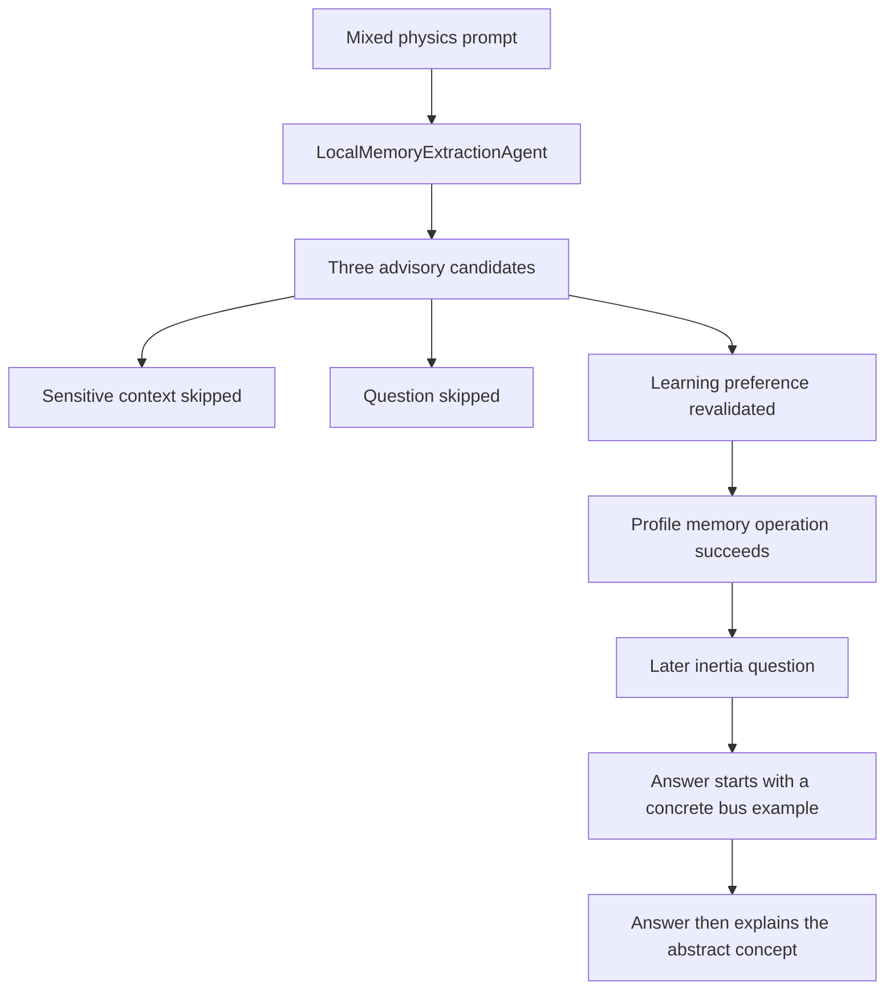

# 2026-07-22 Mixed-Message Memory Extraction Walkthrough

Summary:

This walkthrough records the memory-ingestion issue fixed on 2026-07-22: a user could express a durable learning preference inside a mixed message that also contained temporary context, sensitive learner-state statements, and a question, but the preference was not promoted unless the user explicitly said to remember it. The implemented fix adds an advisory memory extraction agent that separates sentence-level candidates while keeping persistence authority inside `MemoryIngestionService` and the deterministic memory gate. The real-device validation passed for the target behavior. Existing GUM reflection logging was intentionally left unchanged.

---

## 1. Problem

The failing user scenario was a single chat turn containing:

- Temporary learning context: the user was preparing for a high-school physics exam.
- Sensitive learner-state context: prior science difficulty and anxiety.
- A physics question about Newton's first law.
- A durable teaching-style preference: the user prefers a concrete example before abstract explanation.

Before the fix, the whole message was classified primarily as a question because of the interrogative sentence. That meant the preference sentence did not reach the passive-preference profile-memory path. The user only saw the preference persist when they added an explicit memory command such as "remember this."

The product expectation was narrower than general memory extraction. AREQA should persist the explicit low-risk learning preference from the mixed message, should not persist the sensitive learner-state sentence as profile memory, and should still answer the physics question normally.

## 2. Root Cause

The root cause was a whole-message classification boundary. `classify_user_message(...)` operated on the entire user message before the message was separated into independent speech acts. Because the message contained a direct question, the deterministic gate returned a current-focus or question-oriented decision for the whole message, and the passive preference embedded later in the message was not considered for profile promotion.

The earlier system did have deterministic memory policy, but it did not have a bounded extraction stage that could safely say: "This segment is a question, this segment is sensitive context, and this segment is a profile-eligible learning preference."

## 3. Design Decision

The fix uses an agentized extraction boundary, but the agent is advisory only.

The extraction agent may propose `MemoryCandidateDraft` objects, but it cannot write memory. `MemoryIngestionService` remains the only persistence owner for this path. Every learning-preference draft is checked again by deterministic policy before profile memory is updated.

Two implementations were added:

- `LocalMemoryExtractionAgent`: the default path. It runs locally, splits sentence-like segments, and uses deterministic classification. It does not send user text to an external model.
- `OpenRouterMemoryExtractionAgent`: an optional external structured JSON extraction path. It is only selected when external processing is explicitly acknowledged and a client is available.

The default local mode was chosen so the bug is fixed in the normal Codespace path without silently changing the privacy boundary.

### Expected Data Flow



## 4. Implementation

The implementation was committed as `b1b337a Add memory extraction agent observability`.

Key files:

- [backend/services/memory_extraction_agent.py](/workspaces/AREQA/backend/services/memory_extraction_agent.py:1) defines the advisory extraction models and local/external extraction agents.
- [backend/services/memory_ingestion_service.py](/workspaces/AREQA/backend/services/memory_ingestion_service.py:167) calls extraction before the old whole-message sensitive/question fallback and promotes only revalidated learning-preference drafts.
- [backend/config.py](/workspaces/AREQA/backend/config.py:52) adds extraction configuration flags.
- [tests/backend/test_memory_extraction_agent.py](/workspaces/AREQA/tests/backend/test_memory_extraction_agent.py:37) covers local and external extraction behavior.
- [tests/backend/test_memory_ingestion_service.py](/workspaces/AREQA/tests/backend/test_memory_ingestion_service.py:53) covers promotion from the mixed prompt and safe logging behavior.

The main safety boundary is that extracted candidates are not storage commands. A profile-memory write only happens after:

1. The draft type is `learning_preference`.
2. The draft durability is `profile_memory`.
3. The draft confidence is at least `memory_extraction_min_confidence`.
4. The draft text does not contain sensitive-context keywords.
5. The deterministic classifier still returns `passive_preference`.
6. Canonical preference validation succeeds.

## 5. Observability Added

The implementation also added terminal logs for the critical decision points:

- `memory.extraction_agent_configured`
- `memory.extraction_started`
- `memory.local_extraction_completed`
- `memory.extraction_completed`
- `memory.extraction_received`
- `memory.extraction_candidate_skipped`
- `memory.extraction_candidate_blocked`
- `memory.extraction_candidate_promoted`
- `memory.extraction_no_promotion`

These logs intentionally include correlation IDs, agent mode, candidate counts, candidate types, durability, and policy reasons. They do not log raw user text, extracted preference text, prompts, model output, credentials, or tokens.

GUM reflection output was observed during validation and still prints generated insight text. That behavior predates this fix and was intentionally not changed in this walkthrough.

## 6. Validation Evidence

### Automated Tests

The following test gates passed after implementation:

```bash
./backend/.venv/bin/python -m pytest tests/backend/test_memory_extraction_agent.py tests/backend/test_memory_ingestion_service.py
npm run test:backend
./backend/.venv/bin/python -m compileall -q backend/services/memory_extraction_agent.py backend/services/memory_ingestion_service.py backend/config.py
git diff --check
```

The full backend suite result was:

```text
455 passed, 3 skipped, 9 warnings
```

### Real-Device Scenario

The real-device run used the saved artifacts:

- [temp/areqa-chat-2026-07-22.md](/workspaces/AREQA/temp/areqa-chat-2026-07-22.md:1)
- [temp/areqa-chat-2026-07-22_2.md](/workspaces/AREQA/temp/areqa-chat-2026-07-22_2.md:1)
- [temp/log_terminal.md](/workspaces/AREQA/temp/log_terminal.md:108)

| Act | Expected | Observed | Verdict | Evidence |
|---|---|---|---|---|
| Submit the original mixed physics prompt | The system separates question, sensitive context, and learning preference | The extraction log reports `learning_preference:1,question:1,sensitive_context:1` | Pass | [temp/log_terminal.md](/workspaces/AREQA/temp/log_terminal.md:112) |
| Promote only the durable learning preference | The learning preference is promoted without requiring an explicit "remember" command | `memory.extraction_candidate_promoted` is emitted for `candidate_type=learning_preference`, followed by `state=promotion_eligible` | Pass | [temp/log_terminal.md](/workspaces/AREQA/temp/log_terminal.md:117), [temp/log_terminal.md](/workspaces/AREQA/temp/log_terminal.md:118) |
| Skip non-profile candidates | Sensitive context and the question do not enter profile-memory validation | Candidate index 0 and 1 are skipped with `reason=non_learning_preference` | Pass | [temp/log_terminal.md](/workspaces/AREQA/temp/log_terminal.md:114), [temp/log_terminal.md](/workspaces/AREQA/temp/log_terminal.md:115) |
| Ask a later physics question | The answer should follow the remembered preference: concrete example first, then abstract concept | The later answer starts with a bus braking example and then defines inertia | Pass | [temp/areqa-chat-2026-07-22_2.md](/workspaces/AREQA/temp/areqa-chat-2026-07-22_2.md:8), [temp/areqa-chat-2026-07-22_2.md](/workspaces/AREQA/temp/areqa-chat-2026-07-22_2.md:11) |
| Keep extraction logs safe | Extraction logs should not print raw user text or extracted preference text | The extraction events show counts, types, IDs, and reasons only | Pass | [temp/log_terminal.md](/workspaces/AREQA/temp/log_terminal.md:110) |
| Remove all raw-memory logging from the system | Not in scope for this fix | Existing GUM reflection still prints generated insight text | Not verified for this fix | [temp/log_terminal.md](/workspaces/AREQA/temp/log_terminal.md:216) |

### Actual Data Flow



## 7. Result

The target issue is fixed.

The system now captures the durable learning preference from a mixed message without requiring the user to explicitly say "remember this." The same turn can still contain a question and sensitive learner-state context without promoting those non-profile candidates. The subsequent real-device answer followed the remembered teaching-style preference by starting with a concrete example before explaining the abstract concept.

The remaining privacy observation is outside this fix: GUM reflection still prints generated insight text to the terminal. That behavior was intentionally preserved for now so the existing reflection record remains faithful to prior logging behavior.
