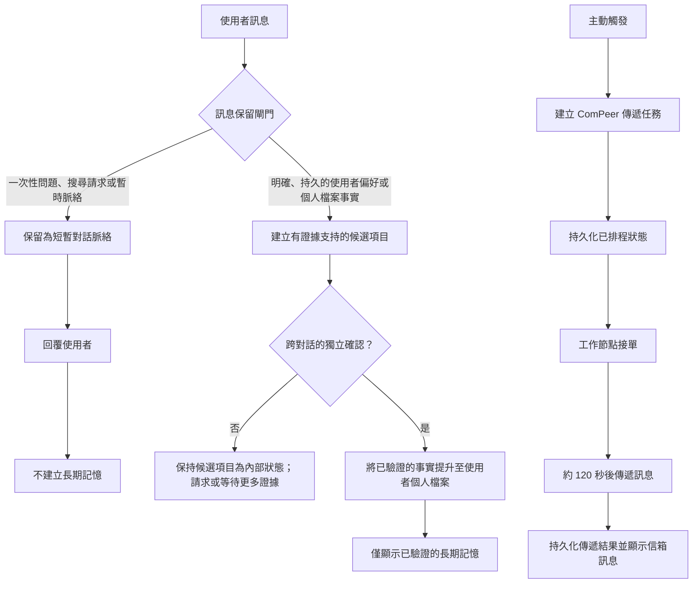
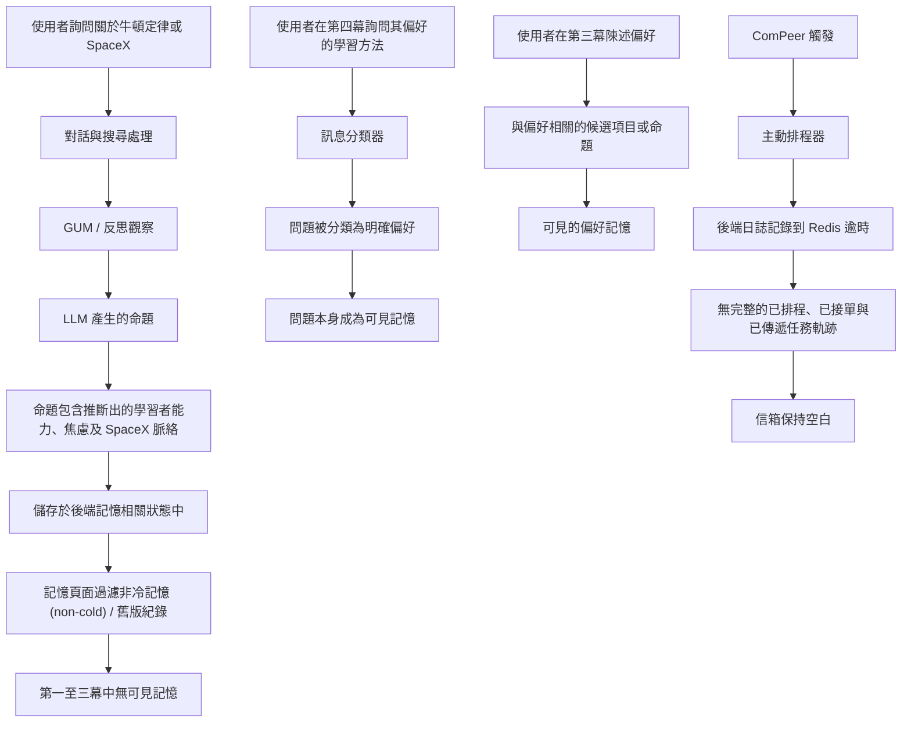

# 2026/07/16 記憶機制實驗報告

摘要：

本次實驗評估了記憶系統針對一次性學習問題、網路搜尋以及在跨對話中表達的學習偏好的行為。同時也檢查了 ComPeer 訊息是否能成功傳遞。與 7 月 13 日的實驗相比，記憶頁面展現了明顯的改進：第一和第二幕不再向使用者暴露學習狀態、記憶候選項目或一次性問題，使用者也不再需要透過打勾或畫叉來逐一核准一般的記憶。然而，後端日誌仍顯示模型根據一次性對話，產生了包含考試焦慮、物理能力以及使用者對 SpaceX 學習情境的命題 (propositions)。此外，第四幕錯誤地將使用者的「問題」本身儲存為長期記憶。ComPeer 未能產生訊息，且沒有排程、工作節點接單 (worker pickup) 或傳遞的完整紀錄。

因此，本次實驗應歸類為記憶頁面和前端體驗有部分改善，但在核心記憶策略或 ComPeer 工作流程上，並未達到及格標準。

---

## 1. 預期結果與相較前次實驗的改善

與 7 月 13 日的測試腳本相比，本次實驗的目標從「讓使用者核准個別記憶候選項目」改為「讓記憶頁面僅顯示真正的長期記憶與個人檔案資訊」。一般的候選項目、學習狀態、暫時的對話脈絡、捲動活動以及舊版未經驗證的資料應保留在系統內部，不應作為時間軸呈現並要求使用者審查。關於 SpaceX 的一次性問題應被視為當前的對話脈絡，而非長期興趣或人格特質。

針對學習偏好，預期的行為是：只有當使用者在多個對話中明確表達，且有重複的支持證據時，偏好才能成為長期記憶。相反地，模型從單一問題、助理回覆或學習狀態評估中所做出的推論，不應被提升為使用者的事實 (user fact)。在 ComPeer 方面，預期行為是在觸發後約 120 秒進行傳遞，若在 150 秒內未出現訊息則記錄為失敗。後端也應清楚區分任務的排程、由工作節點接單以及成功傳遞等狀態。

與 7 月 13 日相比，最顯著的改善是記憶頁面的呈現範圍變窄了。在 7 月 13 日，該頁面將學習狀態、待處理的候選項目與已確認的記憶混雜顯示，甚至包含「使用者對 SpaceX 具有持續且強烈興趣」的錯誤陳述。在本次實驗中，第一、第二及第三幕都沒有記錄到可見的記憶。這顯示前端不再直接暴露這些內部紀錄，且先前的核准負擔已被移除。這是一個有意義的產品改善，但它僅證明了資料未顯示在介面上，並不能證明後端沒有保留這些底層的推論。

### 預期資料流(mermaid)

## 2. 實際結果

第一幕的回覆基本上遵循了針對牛頓第一運動定律的基礎且漸進的教學風格。它解釋了靜止、等速直線運動、慣性以及淨力，並使用公車煞車的例子使概念具象化。此部分符合預期的教學行為。然而，在使用者回答任何理解確認問題之前，回覆中卻出現了「既然你已經了解慣性」的說法。這隱含地斷言使用者已理解該概念，並未完全滿足「系統不得直接斷言使用者已精通牛頓第一定律」的要求。

第二幕的網路搜尋流程如預期般運作。後端日誌顯示 Perplexity 重寫並執行了關於最新的 SpaceX 星艦 (Starship) 發射的查詢，並回傳了引用的來源。對話回覆中也包含了引用標記。因此，搜尋狀態、搜尋服務與引用檢索似乎皆能正常運作。JWT 驗證、Supabase 使用者驗證以及 WebSocket ticket 與通知連線也都有成功的紀錄。

可見的記憶結果如下：

| 幕 (Act) | 可見記憶結果 | 評估 |
|---|---|---|
| 第一幕 | 無記憶 | 表面上符合預期 |
| 第二幕 | 無記憶 | 表面上符合預期 |
| 第三幕 | 無記憶 | 證據不足，無法驗證跨對話提升 (cross-conversation promotion) |
| 第四幕 | 「透過具體例子理解抽象概念」以及「我偏好什麼學習方法？」 | 第一項部分合理；第二項錯誤 |
| 第五幕 | 信箱無訊息 | 失敗 |

儘管第一和第二幕未顯示錯誤的記憶，但後端並未完全避免產生它們。在 SpaceX 對話期間，GUM Evolution 產生了包含「使用者是高中生、物理基礎薄弱、對考試感到焦慮、並使用 SpaceX 例子來理解牛頓定律」等陳述的命題。命題的更新與應用步驟也出現在日誌中。不能僅因為這些紀錄未出現在記憶頁面上，就認定它們符合規範。

第三和第四幕也需要謹慎解讀。在第三幕中，使用者明確表示：「我偏好使用具體的例子來理解抽象概念。」這是有效的使用者證據。然而，第四幕的輸入是「我偏好什麼學習方法？」這是一個問題，而非第二次對相同偏好的明確陳述。因此，該測試實際上並未建立起「在兩個獨立對話中重複、明確表達偏好」的必要條件。更重要的是，記憶頁面將「問題」本身儲存為一項記憶，顯示系統錯誤地將使用者的查詢分類為持久的偏好。

後端日誌顯示，STITCH 為相關訊息分配了學習偏好、學習風格及認知偏好等標籤。其中一個命題被正規化為「使用者偏好使用具體案例和直觀應用來理解抽象概念」。該正規化結果接近一個合理的偏好，但現有證據無法證明它得到了來自兩個不同對話的明確使用者證據支持。它也無法證明系統在計算證據數量時，已排除了單一對話內的重複內容或由助理產生的內容。

第五幕並未產生 ComPeer 訊息。沒有完整的序列顯示任務已被排程、被工作節點接單及傳遞，也沒有記錄等待期的開始時間。因此，證據無法證明訊息在 120 到 150 秒內送達。根據測試腳本，此幕應被歸類為失敗，而非未解決的結果。

### 實際資料流(mermaid)

## 3. 關於原因的假設

主要的假設是，7 月 16 日的結果並非由單一的不良提示詞或單獨的前端問題所引起。雖然記憶頁面的顯示變乾淨了，但後端記憶處理流程仍然允許推論出來的、證據力薄弱的、甚至是問句形式的內容過於輕易地進入長期記憶。換句話說，產品的表層體驗改善了，但底層的記憶治理依然過於寬鬆。

第一個可疑的區域是 `backend/memory_gate.py`。`MemoryRetentionDecision` 仍然存在，這表明舊版的保留機制實際上並未從即時執行的路徑中被移除。即使這個功能有意被棄用，目前的程式碼仍然將它視為決策過程的一部分。這造成了模糊地帶：系統擁有基於證據的新版記憶行為，卻同時保留了可能影響候選記憶晉升的舊版策略物件。這種重疊使得我們難以判斷到底哪一條規則才是權威的。

第二個問題是 `extract_user_memory_candidates` 的設計。在概念上，系統不應該需要去抓取一大段廣泛的對話視窗，然後再請模型從中「提取」出候選記憶。對於持久的使用者記憶而言，最安全的來源應該是使用者打出的「確切文字」，並附帶訊息 ID、對話 ID、時間戳記與來源類型。儘管提取器看起來在提取前有先過濾出使用者訊息，但邊界依然太寬：它要求模型從對話脈絡中「重建」類似記憶的事實，而不是先儲存確切的使用者證據，之後再進行分群或摘要。這樣的設計增加了將疑問句、暫時性的學習脈絡，或受助理引導的框架誤認為記憶證據的風險。

第四幕清楚地展示了這個弱點。使用者問：「我偏好什麼學習方法？」這是一個查詢，而非新的偏好宣告。然而，系統卻將問題本身儲存為記憶。可能的原因是，明確記憶的偵測邏輯將「我偏好...」這類詞彙視為強烈訊號，卻沒有先檢查整句話是否為疑問句。因此，分類器看到了句型特徵，卻忽略了發言的意圖（speech act）。這解釋了為什麼一個問句會被當作穩定的使用者偏好而晉升。

目前硬編碼的記憶規則，對於系統所需的語義區分能力而言，也顯得太過脆弱。部分決定性的規則仍然是必要的：只有使用者產生的文字有資格成為使用者記憶、問句不應被晉升為事實、敏感或具高影響力的聲明應要求更嚴格的證據，且跨對話的記憶晉升應需要獨立的證據支持。然而，過度依賴手寫的關鍵字規則來決定什麼是穩定、個人、暫時或不安全的資訊是不夠的。基於模型的分類器或基於嵌入向量的分群層（例如 BERT 風格的分類器或向量空間相似度機制），會更適合用來偵測語義相似度、重複的偏好以及候選記憶叢集。但必須劃清界線：這類模型應該用來「輔助」分類與分群，它們不應該成為記憶晉升的最終權威。

這也是為什麼 `backend/memory_gate.py` 讓人感覺很簡陋。它目前的行為就像一個混雜各種用途的修補層：一部分是訊息分類器、一部分是明確記憶提取器、一部分是保留策略、一部分是反思守門員，還有一部分是 LLM 候選記憶提取器。這些職責不應該全都塞在同一個模組裡。實驗結果也印證了這個架構上的壞味道 (architectural smell)：系統有好幾個局部的過濾器，卻缺乏單一且清晰的記憶攝取邊界來明確宣告「這是確切的使用者證據」、「這只是推論出的候選記憶」，以及「這個允許成為持久的個人檔案記憶」。

第二個架構層面的假設與 `backend/services/orchestration_service.py` 有關。這支服務現在已經超過 1,000 行，且似乎包含了太多的職責。它協調了串流、路由、記憶體副作用、工具呼叫、提示詞組裝、搜尋、建議生成以及生成後的後續任務。這讓它同時身兼「總控」與執行實際領域邏輯的「工人」。在這次實驗中，這種高耦合度產生了問題，因為記憶觀察、反思排程和回覆生成都是從同一個龐大的編排路徑中被觸發的。當記憶行為發生錯誤時，我們很難隔離並判斷錯誤到底是出在訊息攝取、GUM 觀察、候選記憶提取、晉升策略，還是回覆後的反思階段。

編排層應該純粹扮演「總控」的角色。它應該負責決定執行的順序並維護 SSE 的契約，但實際的處理工作應該移轉到職責更明確的微型服務中。更乾淨的職責分離，能讓我們在獨立於回覆生成之外測試記憶攝取，以及獨立於聊天串流之外測試 ComPeer 排程。

第三個假設與 `backend/services/compeer_scheduler.py` 有關。ComPeer 的功能設計未必是核心問題，系統有能力生成關懷信件並透過信箱發送。本次實驗的失敗更有可能是出在「遞送可靠性路徑」上：排程器沒有產生完整的追蹤紀錄來證明「已偵測到觸發條件」、「任務已寫入持久層」、「工作節點已接手」且「信件已送達」。後端日誌顯示在主動排程器迴圈中發生了 Redis 逾時，而且沒有對應的成功排程任務或信箱遞送軌跡。

這表明目前的 ComPeer 在工作流程的錯誤階段過度依賴脆弱的背景迴圈和 Redis 的可用性。如果在遞送意圖被寫入持久層之前發生了短暫的 Redis 逾時，系統就會失去發送信件的機會。在第五幕觀察到的結果——空蕩蕩的信箱且沒有完整的遞送軌跡——正好吻合了這種失敗模式。

整體而言，最有可能的根本原因是一個「邊界問題」。系統在使用者證據、模型推論、候選記憶、已晉升記憶與背景遞送狀態之間，尚未建立夠嚴謹的隔離。7 月 16 日的實驗改善了使用者所看到的介面，但程式碼仍然允許後端推論和分類寬鬆的輸入滲透到記憶行為中。這解釋了為什麼記憶頁面在前幾幕看起來變好了、為什麼第四幕的問句仍然變成了記憶，以及為什麼 ComPeer 會在沒有留下清晰運作軌跡的情況下失敗。

## 4. 解決方案

第一個修復項目應該是建立一個更嚴格的記憶攝取邊界 (memory-ingestion boundary)。使用者記憶應該源自「確切的使用者訊息」，而不是從整段對話重建出來的摘要。每一個候選記憶都應該攜帶明確的證據：訊息 ID、對話 ID、時間戳記、來源類型，以及原始引用的文字。必須阻止問句、暫時性的學習脈絡，以及助理生成的推論被晉升為個人檔案記憶。

`backend/memory_gate.py` 應該被簡化或淘汰。目前的職責應該被拆分為更小的部分：訊息意圖偵測、證據捕捉、候選記憶分群，以及晉升策略。`MemoryRetentionDecision` 應該被完全移除，或是被單一且清晰的策略結果型別所取代。硬編碼規則應該只保留用於嚴格的安全約束，而語義分群與重複偵測則可以使用嵌入向量 (embeddings) 或基於模型的分類器。

`backend/services/orchestration_service.py` 應該在不改變外部串流契約 (streaming contract) 的前提下進行模組化。該服務應該維持「總控 (controller)」的角色，而記憶攝取、上下文組裝、工具執行、回覆後的後續任務，以及建議生成等功能，則應該移轉到專屬的服務模組中。這將使記憶處理流程可以在不執行完整聊天編排路徑的情況下獨立進行測試。

針對 ComPeer，必須在清除任何觸發標記之前，先將「遞送意圖」寫入持久層。排程器應該針對每位使用者獨立處理錯誤，而不是在整個迴圈層級進行處理，且應該將信箱任務資料庫視為單一真實來源 (source of truth)。Redis 可以繼續作為加速佇列，但遺失或過期的 Redis 紀錄應該能夠從持久化的延遲任務紀錄中被恢復。

最後，應該針對本次實驗中觀察到的確切失敗案例加入回歸測試 (regression tests)：問句絕不能變成記憶、一次性的學習脈絡絕不能變成穩定的使用者個人檔案事實、在沒有使用者證據的情況下絕不能晉升 GUM 推斷出的命題，且 ComPeer 在發生短暫的 Redis 逾時後仍必須能成功遞送或重試。

## 5. 結論

7 月 16 日的實驗展現了部分的改善，但並未完全及格。與 7 月 13 日的實驗相比，記憶頁面變得更乾淨，不再將大部分的內部候選記憶、暫時的學習狀態或一次性的脈絡作為可見的使用者記憶暴露出來。這是一個有意義的產品層級改善，特別是因為使用者不再需要手動核准或拒絕一般的候選記憶。

然而，核心的後端行為仍然不夠可靠。系統仍然允許來源薄弱的推論存在於記憶處理流程中，而且第四幕證明了使用者的問句仍然可能被錯誤分類為持久的偏好。這意味著系統雖然改善了顯示的內容，但尚未完全修復記憶是如何被建立、驗證與晉升的底層機制。

ComPeer 的問題也尚未解決。信箱依然是空的，且日誌並未提供從觸發偵測、任務排程、工作節點接單到最終遞送的完整軌跡。因此，在本次實驗中，ComPeer 的工作流程不能被視為已成功驗證。

整體而言，本次實驗應被記錄為「前端與可見性的改善」，但同時也是「後端記憶治理的失敗」與「ComPeer 遞送的失敗」。下一次的迭代應專注於建立嚴格的使用者證據邊界、更安全的記憶晉升規則、將編排器職責模組化，並使 ComPeer 的遞送具備持久性與可觀測性。
