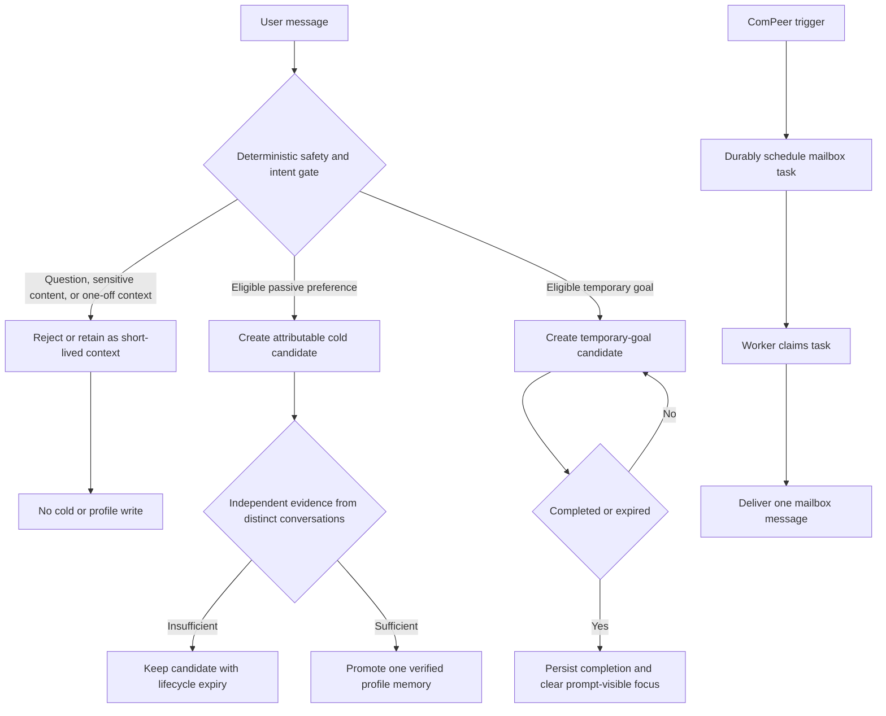
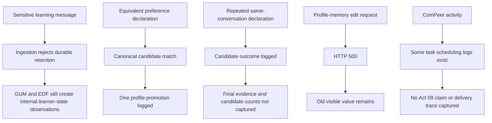

# 2026-07-17 Memory Governance, UI Consistency, and ComPeer Experiment Report

Summary:

This experiment exercised ten manual Acts covering durable-memory governance, temporary-goal lifecycle handling, memory-page editing, and ComPeer delivery. The run demonstrated several intended controls: interrogative preference wording was classified as non-durable, a temporary goal was created and later completed, and an explicit low-risk remember command used the direct-promotion route. However, the experiment did not pass as a whole. Act 08 exposed a confirmed `500` error in the profile-memory edit endpoint, Act 02 did not provide verifiable sources for its visible citations, and the evidence for several data-layer and ComPeer acceptance criteria was incomplete. In particular, an empty or clean-looking memory page was not accompanied by the required cold-candidate/profile-store inspection.

---

## 1. Expected Results and Improvements over the Previous Experiment

The 17 July script is a stricter successor to the previous memory experiment. It is not sufficient for the memory page to hide incorrect information. Durable memory must be based on attributable user evidence, passive preferences must require independent cross-conversation corroboration, temporary goals must expire or complete without becoming profile facts, and internal GUM or learner-state inferences must remain outside cold and verified profile memory.

The expected user experience is correspondingly narrower. A one-off question, a search request, sensitive personal content, model inference, and a question that merely contains preference wording must remain temporary or be rejected. A low-risk explicit remember command may follow a separate direct-promotion route, but it still requires validated user provenance. For ComPeer, the acceptance boundary is an end-to-end task trace: durable scheduling, worker claim, delivery, and one user-visible message within the defined timing window.

### Expected Data Flow (Mermaid)

## 2. Actual Results

The experiment produced direct evidence for several ingestion decisions. The initial sensitive learning message was rejected as `sensitive_content_not_durable`; the later SpaceX question was classified as non-durable interrogative/current-focus context. The response itself was educational, but it also used a claim that the learner had already understood inertia. More importantly, GUM and EDF logs still generated learner-state and strategy inferences from the conversation. The artifacts do not include the required cold-candidate and verified-profile queries needed to prove those inferences never crossed into durable storage.

Act 03 behaved as intended at the message-classification boundary: the preference question received `interrogative_not_memory_evidence`. Act 04 created a passive-preference candidate and recorded a promotion block for insufficient independent evidence. Act 05 then logged canonical matching and promotion for the equivalent preference phrasing. However, the run did not record candidate counts, the final evidence set, or distinct message/conversation counts after the repeated message in the same conversation; therefore it does not prove that the repeated declaration neither created a new candidate nor affected corroboration.

Act 06 is the strongest end-to-end lifecycle result. A temporary-goal candidate was created with expiry enabled, and the later completion command resulted in `memory.temporary_goal_completed` and a working-context-only ingestion outcome. Act 07 also recorded the explicit-command promotion path. Both Acts still lack a direct postcondition query of the cold/profile store, so their lifecycle and provenance properties are only partially observable in this manual run.

Act 08 failed. The request to edit the explicit profile memory returned HTTP 500. The stack trace identifies an `UnboundLocalError` for `json`, and the memory-page capture continued to show the original value. The delete step cannot establish its own acceptance criterion because the script combines it with the failed edit flow.

For ComPeer, durable scheduling was logged elsewhere in the run, including a task with a 120-second delay, but the Act 09 artifacts do not contain its own `T0`, trigger-state preflight, task ID, mailbox record, or a `scheduled -> claimed -> delivered` sequence. The named Act 09 outcome indicates that no ComPeer message appeared. Under the script's 150-second rule, the user-visible delivery criterion failed; the evidence is insufficient to localize the fault to eligibility, scheduling, queueing, worker execution, or mailbox persistence. Act 10 was not run because its prerequisite Act 09 was not completed.

| Act | Expected result | Observed result | Verdict | Evidence |
|---|---|---|---|---|
| 01 | Sensitive content and inferred learner attributes never reach durable memory | Sensitive user evidence was rejected; downstream GUM inferences existed, but durable-store state was not queried | Not verified | [Act 01/02 log](/workspaces/AREQA/docs/worklog/202607/2026_07_17_experiment/act01_02/backend_log_act01_02.md:94) |
| 02 | Verifiable sources and no SpaceX-derived durable interest/ability memory | Response used numeric citation markers without a source list or URL; no durable-store inspection | Fail | [Act 01/02 transcript](/workspaces/AREQA/docs/worklog/202607/2026_07_17_experiment/act01_02/areqa-chat-2026-07-17_act01_act02.md:49) |
| 03 | Preference question remains a query/current-focus message | `interrogative_not_memory_evidence` recorded | Pass | [Act 03 log](/workspaces/AREQA/docs/worklog/202607/2026_07_17_experiment/act03/backend_log_act03.md:12) |
| 04 | First passive preference remains a 90-day candidate | Candidate and promotion block recorded; exact expiry and profile absence not inspected | Not verified | [Act 04 log](/workspaces/AREQA/docs/worklog/202607/2026_07_17_experiment/act04/backend_log_act04.md:10) |
| 05 | Equivalent declarations promote once; same-conversation repetition is not corroboration | Canonical match and one promotion recorded; final candidate/evidence/profile counts missing | Not verified | [Act 05 log](/workspaces/AREQA/docs/worklog/202607/2026_07_17_experiment/act05/backend_log_act05.md:8) |
| 06 | Temporary goal completes and no longer drives personalization | Candidate creation and completion event recorded | Pass | [Act 06 log](/workspaces/AREQA/docs/worklog/202607/2026_07_17_experiment/act06/backend_log_act06.md:67) |
| 07 | Explicit low-risk remember command follows a distinct safe route | `explicit_command_promoted` recorded | Pass | [Act 07 log](/workspaces/AREQA/docs/worklog/202607/2026_07_17_experiment/act07/backend_log_act07.md:13) |
| 08 | Edit persists after refresh; delete then removes the memory | Edit request returned HTTP 500 and page retained old value | Fail | [Act 08 log](/workspaces/AREQA/docs/worklog/202607/2026_07_17_experiment/act08/backend_log_act08.md:76) |
| 09 | One ComPeer message arrives with a full task trace by 150 seconds | No message was recorded; no Act-specific end-to-end task trace | Fail | [Act 09 artifacts](/workspaces/AREQA/docs/worklog/202607/2026_07_17_experiment/act09) |
| 10 | Redis interruption recovers to exactly one delivery | Not run after Act 09 failed | Blocked | [Act 10 note](/workspaces/AREQA/docs/worklog/202607/2026_07_17_experiment/act10_no_progress_dueTo_act09_failed.md:1) |

### Actual Data Flow (Mermaid)

## 3. Hypotheses About the Causes

The Act 08 edit failure has a confirmed code-level cause. `edit_memory_endpoint()` uses `json.dumps()` in the `profile:explicit:` branch, but the same function contains later local `import json` statements. In Python, those local imports make `json` local throughout the function, so the earlier branch accesses it before assignment. The runtime stack trace points to that exact line. The existing endpoint test covers only the generic GUM-memory path and therefore does not exercise the failing explicit-profile branch.

The broader memory-governance concern is an observability gap rather than evidence of a confirmed unsafe write. The runtime correctly emitted a rejection for the sensitive input, but GUM and EDF generated inferential learner-state content after the same conversations. Without querying cold candidates and verified profile records by category and status, the experiment cannot prove that those model-derived observations stayed confined to hot or non-profile state. The same issue affects the 90-day expiry assertion in Act 04 and the unique-evidence assertions in Act 05.

For Act 05, the canonical-match and promotion events support the intended equivalent-preference path. The later same-conversation ingestion outcome may be harmless deduplication, or it may represent a new candidate path; the current log fields do not let the reader distinguish these alternatives. This is not a demonstrated promotion bug, but it is an insufficiently instrumented acceptance check. The missing post-run evidence set also prevents validation of duplicate message handling and independent conversation counting.

The citation issue in Act 02 is visible at the response boundary. Markers such as `Reference 4` do not identify a source to the user when the response contains neither URLs nor a source list. The search backend may have obtained sources, but the experiment's acceptance criterion concerns verifiable output, and the transcript cannot establish that mapping.

The ComPeer failure cannot yet be assigned to a single subsystem. The logs show that scheduling can occur in the wider run, but Act 09 does not record whether `trigger_proactive` was true, whether cooldown was active, whether inactivity and importance conditions were met, whether the scheduler tick ran, or whether a task reached the mailbox worker. Missing `claimed` and `delivered` events therefore establish an unmet end-to-end criterion but not the root mechanism. Act 10 was coupled to this failed predecessor, making resilience validation impossible in the same sequence.

## 4. Solutions

Immediate fixes:

- Remove the local `import json` statements from `edit_memory_endpoint()` and use the module-level import consistently. Add a regression test for `PUT /api/v1/memory/profile:explicit:<id>` that asserts HTTP 2xx, persisted data after reload, and a structured correction event.
- Split Act 08 into Act 08A (edit, reload, verify changed value) and Act 08B (delete, reload, verify absence). Act 08B must run only when Act 08A passes. Record endpoint, HTTP status, memory ID, and safe error metadata.
- Render a source list, source name, or clickable URL for every visible Act 02 citation marker. A marker without an observable mapping must fail the Act.

Data and lifecycle verification:

- At the end of Acts 01, 02, 04, 05, 06, and 07, query and record cold-candidate count, verified-profile count, candidate category, status, expiry/completion state, and attributable message/conversation IDs. Explicitly check for forbidden sensitive, inferred ability, anxiety, interest, and search-context entries.
- For Act 05, assert one canonical candidate, one promoted profile memory, exactly two distinct conversation IDs, exactly two independent message IDs, and no evidence increment or new candidate for a same-conversation or duplicate-message replay.
- Preserve safe structured logs for canonical matching, promotion blocking, candidate expiration, completion, and correction. These events should contain IDs and reason codes, never raw user text or evidence quotes.

ComPeer verification:

- Before the Act 09 waiting window, record `trigger_proactive`, `user_cooldown_until`, inactivity timing, scheduler execution, importance-gate result, existing pending task IDs, and the newly created task ID.
- Require one correlated task record and `scheduled`, `claimed`, and `delivered` events before passing the Act. If delivery misses the deadline, record `retryable_failed` or `terminal_failed` with the same task ID.
- Make Act 10 independent of normal proactive eligibility: seed one deterministic durable delayed-mail task, simulate the Redis enqueue failure, restore Redis, run reconciliation and the worker, and assert exactly one mailbox message.
- Initialize and clean test state around every Act, including hot memory, candidates, verified profile, mailbox tasks, cooldown state, and test labels. This removes cross-Act scheduling and memory contamination.

## 5. Conclusion

The experiment was partially successful at exercising the new memory boundaries, but it did not pass the manual acceptance script. Acts 03, 06, and 07 have direct positive evidence. Act 02 failed its source-verifiability requirement, Act 08 failed due to a confirmed backend exception, Act 09 failed its end-to-end delivery criterion, and Act 10 was blocked. Acts 01, 04, and 05 remain not verified because the experiment did not capture the required durable-store state.

The next validation should first repair and regress-test the profile-memory edit endpoint, then rerun the revised Act 08A and Act 08B. After that, rerun the memory Acts with database-backed assertions and execute ComPeer using the explicit preflight trace and independent recovery entry. The overall result remains **not accepted** until every Act meets its stated criterion.
