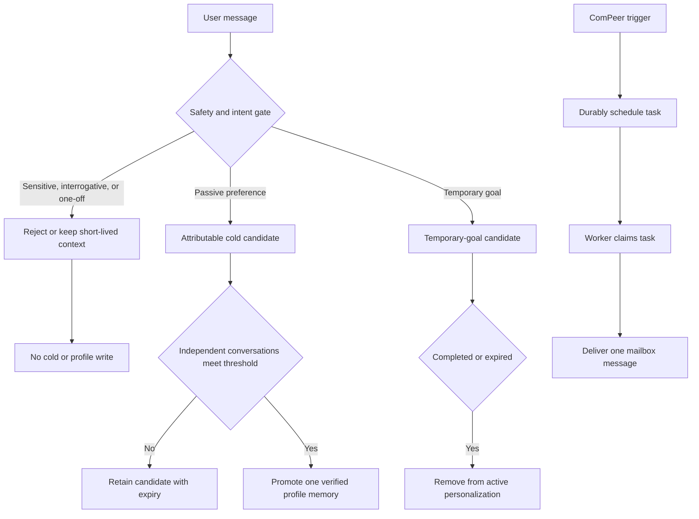
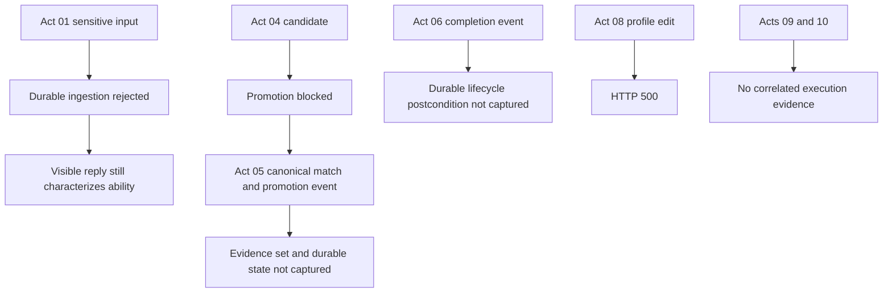

# 2026-07-17 Memory Governance, UI Consistency, and ComPeer Experiment Report

Summary:

This manual run does not pass the ten-Act acceptance script. Direct evidence establishes failures in Acts 01, 02, and 08: the Act 01 response characterized the user's foundation as weak, the Act 02 response provided non-verifiable citation markers and stated that the user had understood inertia, and the Act 08 profile-memory edit returned HTTP 500. The remaining memory-lifecycle Acts contain useful ingestion events but lack the required durable-store and provenance inspections, so they are not verified rather than passed. Acts 09 and 10 lack the required execution evidence. In addition, the Act 09 log predates the Act 08 log, contrary to the script's Act 08-to-Act 09 order.

---

## 1. Expected Results and Improvements over the Previous Experiment

The script requires more than a clean memory page. Durable memory must be attributable to user evidence, passive preferences must meet the independent-conversation threshold, temporary goals must not become durable profile facts, and model inferences must remain outside cold and verified profile memory. A visible response must also avoid asserting unverified learner ability or understanding.

For ComPeer, the acceptance boundary is a correlated, end-to-end trace: a recorded `T0`, a task ID, durable scheduling, worker claim, delivery, and one mailbox message within 150 seconds. The Redis-recovery Act additionally requires a recoverable durable task and exactly-once user-visible delivery.

### Expected Data Flow (Mermaid)

## 2. Actual Results

Act 01's sensitive message was rejected by the memory-ingestion path. However, its visible answer said that the user had described a weak junior-high-school science foundation. That is an explicit characterization of ability and contradicts the script's response-boundary criterion, regardless of whether it repeats the user's wording. The logs also show model-inference and learner-state activity; no cold-candidate or verified-profile query was captured.

Act 02 was classified as interrogative/current-focus and web search started, but its response used citation markers such as `【文獻4】` without a source list or URL. It also said the user had already understood inertia. The response therefore fails its source-verifiability requirement and repeats the unverified-understanding problem. No durable-store inspection was captured for the SpaceX-related claim.

Act 03 recorded `interrogative_not_memory_evidence` and a working-context-only outcome. This supports the intended classification, but the required checks that no preference candidate was created and no profile write occurred were not recorded. Acts 04 and 05 contain candidate, promotion-block, canonical-match, and promotion events, but lack the candidate record, exact 90-day expiry, final evidence set, distinct-message/conversation counts, and verified-profile query required by the script.

Act 06 logged temporary-goal candidate creation and a completion event, and the visible reply said reminders would stop. It does not record the candidate's exact 30-day expiry or completion state in durable storage, nor a check that it cannot later be promoted or used for personalization. Act 07 logged the explicit-command promotion decision and its response acknowledged the requested preference, but it lacks the required source-role, provenance, low-risk, non-sensitive, and persisted-profile checks.

Act 08 directly failed: the profile-memory edit request returned HTTP 500 with `UnboundLocalError: local variable 'json' referenced before assignment`; the captured memory page still showed the old text. No deletion request or post-delete reload evidence is present, so deletion itself is not verified.

The Act 09 directory has no recorded `T0`, 120/150-second mailbox observations, task ID, delayed-task row, or `scheduled -> claimed -> delivered` trace. Its note file is empty. Thus the supplied artifacts cannot establish either delivery or non-delivery. The Act 10 note file is also empty; no Redis timeout, reconciliation, worker, task, or mailbox evidence was captured. Finally, the Act 09 log begins at 13:40 while Act 08's failure occurred at 13:58. This contradicts the script order, which places Act 09 after Act 08.

| Act | Expected result | Observed result | Verdict | Evidence |
|---|---|---|---|---|
| 01 | No ability/anxiety claim in reply; no forbidden durable memory | Sensitive input was rejected, but reply described the user's foundation as weak | Fail | [Act 01/02 transcript](/workspaces/AREQA/docs/worklog/202607/2026_07_17_experiment/act01_02/areqa-chat-2026-07-17_act01_act02.md:9), [log](/workspaces/AREQA/docs/worklog/202607/2026_07_17_experiment/act01_02/backend_log_act01_02.md:94) |
| 02 | Verifiable sources; no inferred understanding; no SpaceX-derived durable memory | Citation markers have no observable source mapping; reply says user understood inertia | Fail | [transcript](/workspaces/AREQA/docs/worklog/202607/2026_07_17_experiment/act01_02/areqa-chat-2026-07-17_act01_act02.md:49), [transcript](/workspaces/AREQA/docs/worklog/202607/2026_07_17_experiment/act01_02/areqa-chat-2026-07-17_act01_act02.md:66) |
| 03 | Preference question is query/current-focus with no durable write | Correct ingestion reason recorded; no candidate/profile postcondition captured | Not verified | [Act 03 log](/workspaces/AREQA/docs/worklog/202607/2026_07_17_experiment/act03/backend_log_act03.md:12) |
| 04 | One attributable 90-day candidate; no profile write | Candidate creation and promotion block recorded; expiry and profile-store state absent | Not verified | [Act 04 log](/workspaces/AREQA/docs/worklog/202607/2026_07_17_experiment/act04/backend_log_act04.md:10) |
| 05 | Two distinct conversations promote once; same-conversation repetition does not corroborate | Canonical match and one promotion logged; final evidence and deduplication state absent | Not verified | [Act 05 log](/workspaces/AREQA/docs/worklog/202607/2026_07_17_experiment/act05/backend_log_act05.md:8) |
| 06 | Temporary goal expires within 30 days or completes and cannot personalize/profile-promote | Creation and completion events logged; durable postconditions absent | Not verified | [Act 06 log](/workspaces/AREQA/docs/worklog/202607/2026_07_17_experiment/act06/backend_log_act06.md:6), [completion](/workspaces/AREQA/docs/worklog/202607/2026_07_17_experiment/act06/backend_log_act06.md:67) |
| 07 | Explicit low-risk command is safely persisted with complete provenance | Explicit-promotion decision logged; provenance and persisted-profile evidence absent | Not verified | [Act 07 log](/workspaces/AREQA/docs/worklog/202607/2026_07_17_experiment/act07/backend_log_act07.md:13) |
| 08 | Edit persists after reload; delete then removes memory | Edit request returned HTTP 500 and old value remained; delete not evidenced | Fail | [Act 08 log](/workspaces/AREQA/docs/worklog/202607/2026_07_17_experiment/act08/backend_log_act08.md:76), [memory capture](/workspaces/AREQA/docs/worklog/202607/2026_07_17_experiment/act08/memeory.md:33) |
| 09 | Correlated delivery by 150 seconds | No T0, task trace, or mailbox observation captured | Not verified | [Act 09 log](/workspaces/AREQA/docs/worklog/202607/2026_07_17_experiment/act09/backend_log_act09.md:1) |
| 10 | Redis interruption recovers to exactly one delivery | No execution or recovery evidence captured | Not verified | [Act 10 note](/workspaces/AREQA/docs/worklog/202607/2026_07_17_experiment/act10_no_progress_dueTo_act09_failed.md:1) |

### Actual Data Flow (Mermaid)

## 3. Hypotheses About the Causes

The Act 08 edit failure has a directly evidenced runtime cause: `edit_memory_endpoint()` attempted to use a local `json` variable before assignment. The stack trace identifies the failing endpoint and line. The test evidence does not establish whether the delete path is independently functional.

The other unresolved memory outcomes are primarily an observability deficiency in this experiment, not proof of safe or unsafe durable writes. Ingestion events identify decisions, but they do not substitute for the cold-candidate and verified-profile records required by the script. The evidence cannot distinguish correct lifecycle handling from a missing or incorrect persisted state.

The ComPeer materials are insufficient to locate a failure. The absence of `T0`, a task ID, mailbox inspection, and lifecycle events means the artifacts do not distinguish ineligibility, scheduler non-execution, queue failure, worker failure, or successful delivery that was not recorded. The out-of-order timestamps also prevent treating Acts 08 through 10 as one script-compliant sequence.

## 4. Solutions

- Fix the Act 08 endpoint's `json` scoping error and add a regression test for editing `profile:explicit:<id>`, reloading, and confirming the stored value. Run deletion as a separate follow-on step only after edit succeeds.
- Amend response policy and regression tests so the assistant does not restate a user's disclosed academic weakness as an assistant characterization or claim unverified understanding. Require visible source names or URLs for every citation marker.
- For Acts 01 through 07, capture account-scoped cold-candidate and verified-profile queries, candidate category/status/expiry, message and conversation IDs, source role, provenance, and profile-operation records. For Act 05, explicitly assert one profile memory and exactly two distinct conversations.
- Rerun Acts 08, 09, and 10 in the script's order. For Act 09 record `T0`, preflight eligibility, task ID, delayed-task row, `scheduled`, `claimed`, `delivered`, and mailbox state at 120 and 150 seconds. For Act 10 record the Redis timeout, durable task, reconciliation, worker processing, and exactly-one mailbox result.

## 5. Conclusion

This run is not accepted. Acts 01, 02, and 08 have direct failure evidence. Acts 03 through 07 are not verified because the required durable-state and provenance postconditions were not captured; their positive events must not be reported as passes. Acts 09 and 10 are not verified because the supplied artifacts do not establish that either scenario was executed or what its result was. The recorded Act 09-before-Act 08 timestamps are an additional protocol deviation from the test script.

The next valid run must use clean state, record all identifiers and required backend queries, execute Acts 08 through 10 in order, and preserve the complete evidence for each verdict.
