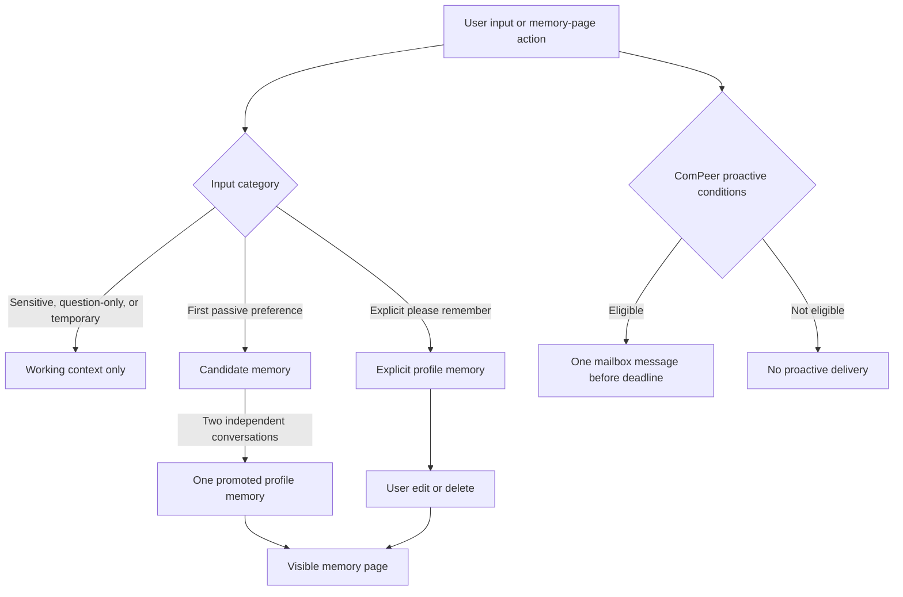
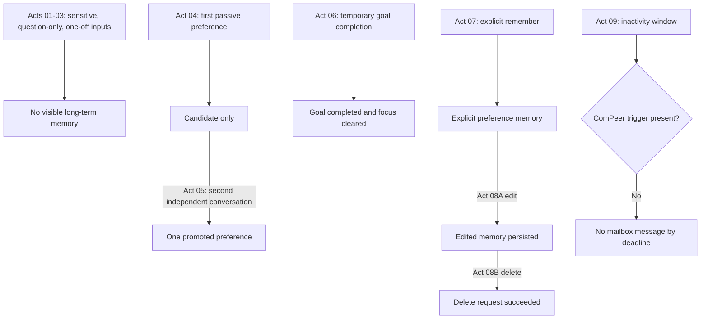

# 2026-07-18 AREQA Memory, Response, and ComPeer User Journey Experiment Report

Summary:

This experiment manually validated AREQA's user-facing response behavior, memory promotion lifecycle, memory edit/delete controls, and ComPeer mailbox delivery across Acts 01 through 09. Acts 01 through 08B passed their user-facing acceptance criteria. The memory system correctly avoided sensitive long-term labels, kept question-only preference prompts out of visible memory, held first-time passive preferences as candidates, promoted repeated cross-conversation preference evidence once, supported explicit remembered preferences, and persisted edit/delete operations. The overall journey did not pass, because Act 09 failed: no ComPeer mailbox message arrived by the `T0 + 150` second deadline, and backend preflight logs show the test user was blocked by `reason=absent_trigger`. A subsequent code review narrows the ComPeer failure to a scheduler trigger-path mismatch: current frontend scroll telemetry is persisted as `behavior_signals`, while the proactive scheduler fallback still counts legacy `hot_memory` entries named `obs_*`.

---

## 1. Expected Results and Improvements over the Previous Experiment

The test script defines a manual user journey rather than a strict fault-injection or database-level verification suite. Its main boundary is user-visible behavior: chat output, memory page state, mailbox state, and only targeted backend evidence when the visible result is missing or ambiguous.

The expected memory behavior was conservative. Sensitive learning anxiety and prior poor grades should not become durable user labels. A one-off SpaceX question should not become aerospace interest or ability memory. A question asking about learning preference should not create a new preference. A first explicit passive preference should remain a candidate until it has enough independent evidence, with `memory_candidate_auto_promote_conversations=2`. A repeated semantic preference in a different conversation should promote exactly one visible memory, while a same-conversation duplicate should not create another visible memory. Explicit "please remember" input should create only the specified preference, without expanding it into ability, personality, or unspoken traits. Memory edit and delete should persist through refreshes.

The expected ComPeer behavior was also user-facing: after normal reading and scrolling, ComPeer should not interrupt the chat directly. If proactive-message conditions are met, exactly one new mailbox message should arrive by `T0 + 150` seconds, with unread UI state synchronized and with content that does not turn anxiety, ability inference, a one-off SpaceX question, or candidate memory into confirmed user facts.

### Expected Data Flow

---

## 2. Actual Results

Eight of the nine user-journey areas passed. The major functional success was the memory lifecycle: candidate creation, evidence-count gating, promotion, deduplication, explicit memory handling, edit persistence, and delete persistence all matched the manual criteria. The major failure was ComPeer delivery: at the expected deadline, no mailbox message was delivered.

| Act | Expected | Observed | Verdict | Evidence |
|---|---|---|---|---|
| 01 | Teach Newton's first law without turning anxiety, grades, ability, or understanding into a durable label. | The reply was instructional and did not claim weak ability or mastery; Redis startup status was open. | Pass | [check lines 1-9](/workspaces/AREQA/docs/worklog/202607/2026_07_18_experiment/test_script_2026_07_18_check.md:1) |
| 02 | Answer the one-off SpaceX question with recognizable sources and no mastery claim. | The reply connected Starship to Newton's first law and listed eight clickable sources; search completed with result count 8. | Pass | [check lines 11-24](/workspaces/AREQA/docs/worklog/202607/2026_07_18_experiment/test_script_2026_07_18_check.md:11) |
| 03 | A preference question must not create a preference memory. | Visible memory stayed empty per manual observation; ingestion was `working_context_only`. | Pass | [check lines 26-37](/workspaces/AREQA/docs/worklog/202607/2026_07_18_experiment/test_script_2026_07_18_check.md:26) |
| 04 | First explicit passive preference must not immediately become visible long-term memory. | A candidate was created, promotion was blocked for insufficient independent evidence, and the memory page showed no new memory. | Pass | [check lines 39-51](/workspaces/AREQA/docs/worklog/202607/2026_07_18_experiment/test_script_2026_07_18_check.md:39) |
| 05 | Cross-conversation repeated preference should promote one memory; same-conversation duplicate should not add another. | The candidate matched, reached two distinct conversations, promoted once, and the memory page showed only one equivalent preference. | Pass | [check lines 53-66](/workspaces/AREQA/docs/worklog/202607/2026_07_18_experiment/test_script_2026_07_18_check.md:53) |
| 06 | Completing a temporary review goal should stop reminders and not become a long-term trait or preference. | The assistant confirmed stopping; backend marked the temporary goal completed and cleared focus; the memory page did not expose the temporary goal. | Pass | [check lines 68-82](/workspaces/AREQA/docs/worklog/202607/2026_07_18_experiment/test_script_2026_07_18_check.md:68) |
| 07 | Explicit "please remember" should record only the specified preference. | The assistant confirmed the preference; the visible memory stayed within the specified learning-method preference and did not add ability/personality inference. | Pass | [check lines 84-94](/workspaces/AREQA/docs/worklog/202607/2026_07_18_experiment/test_script_2026_07_18_check.md:84) |
| 08A | Editing a memory should persist after refresh with no 4xx or 5xx. | The edited text appeared in the memory record; backend logged `operation=edit result=persisted` and `PUT ... 200 OK`. | Pass | [check lines 96-104](/workspaces/AREQA/docs/worklog/202607/2026_07_18_experiment/test_script_2026_07_18_check.md:96) |
| 08B | Deleting the edited memory should persist after refresh with no old-value resurrection. | The user's manual note confirms the edited memory was deleted; backend batch-delete returned `200 OK`. | Pass | [check lines 106-117](/workspaces/AREQA/docs/worklog/202607/2026_07_18_experiment/test_script_2026_07_18_check.md:106) |
| 09 | Exactly one ComPeer mailbox message should arrive by `T0 + 150` seconds. | No message arrived; preflight at about `T0 + 120` and `T0 + 150` had `trigger_present=False` and `reason=absent_trigger`. | Fail | [check lines 119-130](/workspaces/AREQA/docs/worklog/202607/2026_07_18_experiment/test_script_2026_07_18_check.md:119), [backend lines 156-157](/workspaces/AREQA/docs/worklog/202607/2026_07_18_experiment/act09/backend_log_act09.md:156), [backend lines 201-202](/workspaces/AREQA/docs/worklog/202607/2026_07_18_experiment/act09/backend_log_act09.md:201) |

Additional evidence limitations:

- Act 03 included a backend GUM Evolution inference about learning preference and ability, but the tester observed the memory page was still empty. Therefore it is a risk observation, not a failure for this manual script.
- Act 08B relies on the tester's clarification that `(edited, deleted)` in `memory.md` is a manual process note, not a deleted memory still visible in the UI.
- Act 09 produced no mailbox message, so message content safety could not be evaluated.

### Actual Data Flow

---

## 3. Hypotheses About the Causes

The strongest confirmed symptom is Act 09 non-delivery. The backend evaluated the test user around the expected timing window but reported `trigger_present=False`, `scheduling_succeeded=None`, and `task_id=none`, then blocked the run with `reason=absent_trigger` at about 121.7 seconds and again at about 149.2 seconds of inactivity. This means the scheduler did run, but its preflight conditions did not find a valid proactive trigger. The failure is therefore not explained by mailbox worker delivery, because no ComPeer task was scheduled for the target user.

Code review provides a stronger root-cause hypothesis: the telemetry write path and scheduler read path no longer match. The frontend sends scroll actions to `/api/v1/log_action`; the backend applies `apply_action_gate()`, and `apply_action_gate()` writes those actions through `MemoryStore.append_behavior_signal()` into Redis key `areqa:behavior_signals:{user_id}`. However, the ComPeer proactive scheduler fallback calculates `scroll_count` by scanning `hot_mem.items()` for keys starting with `obs_` and containing `Type: scroll`. Current scroll telemetry is therefore invisible to that fallback. This directly matches the Act 09 log state: the target user reached the inactivity window, but `scroll_count=0`, `trigger_present=False`, and `reason=absent_trigger`.

The relevant code boundaries are:

- `/api/v1/log_action` receives frontend telemetry and starts `apply_action_gate()` asynchronously in [backend/main.py](/workspaces/AREQA/backend/main.py:1202).
- Scroll telemetry is explicitly kept out of prompt memory and assigned to behavior signals in [backend/main.py](/workspaces/AREQA/backend/main.py:1216).
- `classify_action()` classifies scroll, focus, and blur as `behavior_signal` in [backend/memory_gate.py](/workspaces/AREQA/backend/memory_gate.py:320).
- `apply_action_gate()` persists behavior signals via `append_behavior_signal()` in [backend/memory_gate.py](/workspaces/AREQA/backend/memory_gate.py:403).
- `MemoryStore.append_behavior_signal()` writes Redis key `areqa:behavior_signals:{user_id}` in [backend/memory_store.py](/workspaces/AREQA/backend/memory_store.py:135).
- `_process_proactive_user()` still counts fallback scroll evidence from `hot_memory` keys named `obs_*` in [backend/services/compeer_scheduler.py](/workspaces/AREQA/backend/services/compeer_scheduler.py:792).

This makes the most plausible cause a telemetry persistence/read-path mismatch before scheduling, not a mailbox persistence, notification, or UI unread-count problem.

A second contributing issue is a mismatch between the manual test's timing expectation and the implementation's delivery delay. Even if fallback scheduling became eligible at around `T0 + 120`, `compeer_delivery_delay_seconds` is configured to 120 seconds, so the mailbox message would normally become visible closer to `T0 + 240`, unless an explicit trigger was created earlier. In this run, no task was scheduled at all, so the timing issue is secondary; it still needs to be clarified before the manual script is used as a strict pass/fail gate.

A third plausible cause is a mismatch between the manual test's "normal reading and scrolling" condition and the system's actual trigger criteria. The script expects that normal usage can lead to a ComPeer message when proactive conditions are met, but the observed scheduler state shows the conditions were not met for the test user. This may be correct behavior according to stricter internal policy, but it still fails the manual script because the script requires one mailbox message by `T0 + 150`.

A fourth possibility is state ownership mismatch. Some ComPeer scheduler log lines use other users or `u1`, while the relevant authenticated test user is `41f635cc-ca99-40dc-a0c8-4e065954739c`. For the target user, the logs clearly show `absent_trigger`, but the surrounding mixed-user scheduler noise makes it harder to verify whether the expected trigger was ever created, expired, stored under a different identity, or never generated.

Several non-failing risk observations remain:

- The response boundary guard blocked an unsupported-understanding phrase in Act 02 before the final visible answer, showing the guard is useful but also that the model attempted a risky inference.
- GUM Evolution generated invisible stronger preference or ability propositions in Acts 03, 05, and 06. These did not fail the manual visible-memory criteria, but they should be audited to ensure they cannot later leak into visible memory or personalization.
- Some assistant responses used stronger long-term commitment or mastery language than necessary, for example implying the user had internalized Newton's laws in Act 06. This was not persisted as visible memory but should be cleaned up at the response policy layer.

---

## 4. Solutions

Immediate fixes:

1. Update the ComPeer proactive scheduler fallback to read recent scroll evidence from `MemoryStore.get_behavior_signals(user_id)`, not from legacy `hot_memory` `obs_*` keys. The scheduler should count recent `type == "scroll"` entries within the intended time window and preserve the current minimum-evidence threshold.
2. After a behavior-derived ComPeer schedule is accepted, consume or mark the used behavior signals so the same scroll batch cannot repeatedly schedule duplicate mailbox messages.
3. Keep scroll telemetry out of prompt memory. The fix should connect the scheduler to `behavior_signals`; it should not revert scroll events back into hot memory or prompt-visible memory.
4. Add explicit observability for ComPeer trigger lifecycle: behavior-signal count, signal source, trigger created, trigger stored, trigger consumed, trigger expired, preflight eligible, task scheduled, mailbox persisted, notification sent, and duplicate suppressed. Act 09 failed because the logs explain the preflight block but not the complete upstream trigger lifecycle.
5. Align the manual script and implementation contract for ComPeer. If normal read/scroll is supposed to create an eligible trigger, the scheduler must consume `behavior_signals`. If explicit trigger creation is required instead, the script must include that exact user action.
6. Clarify the timing contract. With `compeer_delivery_delay_seconds=120`, a fallback schedule created at approximately `T0 + 120` should not be expected in the mailbox by `T0 + 150`. Either shorten the delay in the test environment, start the timer at schedule creation, or change the manual deadline to reflect the configured delay.

Regression tests:

1. Add an integration test for the successful behavior-signal ComPeer path: append at least six recent scroll behavior signals, advance or control inactivity beyond the eligibility threshold, run the scheduler, assert exactly one delayed mailbox task or mailbox record is created, assert unread count changes after delivery, and assert no direct chat insertion.
2. Add a negative-path test with fewer than six recent scroll behavior signals and assert the scheduler blocks with `insufficient_scroll_evidence` or equivalent telemetry rather than scheduling a mailbox message.
3. Add a negative-path test for `absent_trigger` so the system intentionally proves that no mailbox task is scheduled when neither explicit trigger nor sufficient behavior evidence exists.
4. Add a regression test that verifies scroll actions submitted through `/api/v1/log_action` reach the same storage path used by the ComPeer scheduler. This test should prevent the current write/read mismatch from returning.

Memory and response hardening:

1. Keep the existing candidate gating behavior for passive preferences; Acts 04 and 05 show the promotion threshold is working.
2. Add regression tests around question-only preference prompts so GUM Evolution cannot promote or expose inferred preferences from an interrogative message.
3. Add a response-policy test for unsupported mastery statements, especially phrases equivalent to "you have internalized the concept" unless the user explicitly demonstrated that outcome.
4. Add a visibility boundary test for GUM Evolution outputs: invisible evolved propositions must not be treated as confirmed user-facing memory unless they pass the same evidence, consent, and promotion rules as the visible memory system.

---

## 5. Conclusion

The experiment is partially successful but the overall manual user journey fails.

Acts 01 through 08B passed. The core memory behavior is substantially improved: sensitive information stayed out of visible long-term memory, one-off questions did not become visible profile facts, passive preference promotion respected the two-conversation threshold, duplicate semantic preferences did not create duplicate visible memories, explicit memory was scoped to the specified preference, and edit/delete APIs persisted successfully.

Act 09 failed. No ComPeer mailbox message arrived by `T0 + 150` seconds. The backend scheduler evaluated the relevant user at approximately 121.7 and 149.2 seconds of inactivity, but both evaluations had `trigger_present=False` and were blocked with `reason=absent_trigger`. Code review indicates the likely implementation cause: scroll actions are currently written to `behavior_signals`, while the scheduler fallback still looks for scroll evidence in legacy `hot_memory` `obs_*` entries. Because no ComPeer task was scheduled, the experiment also could not verify mailbox delivery, unread synchronization, or content-safety requirements for ComPeer mailbox text.

The next required validation is a focused ComPeer trigger-to-mailbox test with explicit behavior-signal lifecycle logs. Until the scheduler consumes the same telemetry path that `/api/v1/log_action` writes, this user journey cannot be considered fully validated.
