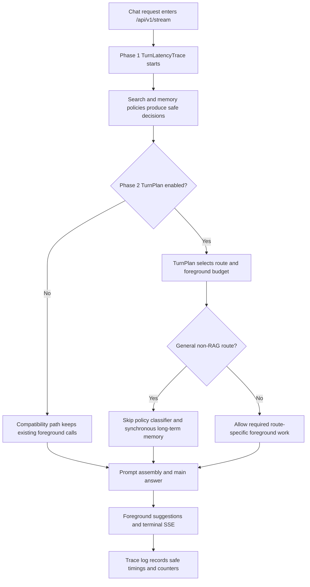
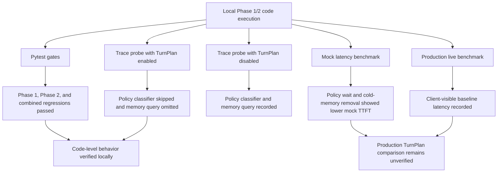

# 2026-07-19 AREQA Pipeline Phase 1/2 Experiment Report

Summary:

This experiment executed the Phase 1 latency-tracing code and the Phase 2 deterministic TurnPlan code for the AREQA non-RAG chat pipeline. The code-level gates passed, the local trace probe confirmed that TurnPlan-enabled general chat skipped the foreground policy classifier and synchronous long-term memory query, and the mocked latency benchmark continued to show that policy waiting and cold/long-term memory are high-value optimization targets. A production live benchmark was also executed after deployment credentials became available. The overall verdict is partially successful: Phase 1/2 behavior is verified in local controlled execution, and one production baseline latency sample set is recorded, but production baseline-versus-TurnPlan comparison is not yet verified because this benchmark measured only the currently deployed backend configuration.

---

## 1. Expected Results and Improvements over the Previous Experiment

The expected result for Phase 1 was observability without behavior changes. Each chat turn should produce privacy-safe timing and counter data for routing, turn intake, policy classification, RAG skip/start, hot memory, long-term memory, prompt assembly, main model start, first answer delta, suggestions, and terminal completion. The trace must not contain raw user text, prompts, memory contents, model output, credentials, or sensitive labels.

The expected result for Phase 2 was a deterministic control layer, not a full agent rewrite. With `enable_turn_plan_runtime=False`, the existing compatibility path should remain intact. With `enable_turn_plan_runtime=True`, ordinary non-RAG general chat should be allowed to skip the foreground policy classifier and synchronous long-term memory query, while explicit memory recall, search privacy modes, Web-required turns, attachment handling, and terminal SSE behavior remain protected by deterministic policies and existing runtime contracts.

Compared with the implementation plan baseline, the intended improvement is not yet a production latency reduction. The intended improvement is that the system can now measure where time is spent and can reduce unnecessary foreground model/tool calls for general non-RAG turns before Phase 3 introduces data-driven parallelization.

### Expected Data Flow (Mermaid)

## 2. Actual Results

The Phase 1 gate passed with `28 passed, 2 skipped`; the count is higher than the first manual Phase 1 run because Phase 2 added tests to files included by the Phase 1 gate command. The only warnings were existing FastAPI `on_event` deprecation warnings, not assertion failures. Evidence: [phase1_gate_output.txt](/workspaces/AREQA/docs/worklog/202607/2026_07_19_experiment/phase1_gate_output.txt:32).

The Phase 2 gate passed with `50 passed, 2 skipped`, again with only FastAPI `on_event` deprecation warnings. Evidence: [phase2_gate_output.txt](/workspaces/AREQA/docs/worklog/202607/2026_07_19_experiment/phase2_gate_output.txt:32).

The combined Phase 1/2 focused regression passed with `47 passed, 2 skipped`, confirming that the tracing, TurnPlan, context-service, post-turn, benchmark, and runtime-contract tests passed together. Evidence: [combined_regression_output.txt](/workspaces/AREQA/docs/worklog/202607/2026_07_19_experiment/combined_regression_output.txt:32).

The mocked benchmark measured 40 runs. It reported baseline first-content median `176.94 ms`, `no_policy_wait` `115.70 ms`, `no_cold_memory` `85.59 ms`, and optimized mock `25.36 ms`. The benchmark itself explicitly states that these are mock results and not production latency measurements. Evidence: [phase2_mock_latency.md](/workspaces/AREQA/docs/worklog/202607/2026_07_19_experiment/phase2_mock_latency.md:8) and [phase2_mock_latency.md](/workspaces/AREQA/docs/worklog/202607/2026_07_19_experiment/phase2_mock_latency.md:13).

The local trace probe ran the real `OrchestrationService.execute()` path twice with external provider, memory, and suggestion dependencies controlled by mocks. With TurnPlan disabled, the probe reached terminal completion, emitted 13 events, called `client.chat.completions.create` twice, and recorded `model_calls` for `main_answer`, `policy_classifier`, and `suggestions`. It also recorded one `memory_query` tool call. Evidence: [turn_plan_trace_probe.json](/workspaces/AREQA/docs/worklog/202607/2026_07_19_experiment/turn_plan_trace_probe.json:3), [turn_plan_trace_probe.json](/workspaces/AREQA/docs/worklog/202607/2026_07_19_experiment/turn_plan_trace_probe.json:6), and [turn_plan_trace_probe.json](/workspaces/AREQA/docs/worklog/202607/2026_07_19_experiment/turn_plan_trace_probe.json:118).

With TurnPlan enabled for the same general non-RAG route, the probe reached terminal completion, emitted the same 13 events, called `client.chat.completions.create` once, recorded `policy_classifier_skipped`, and recorded no memory tool calls. The model-call counter contained only `main_answer` and `suggestions`. Evidence: [turn_plan_trace_probe.json](/workspaces/AREQA/docs/worklog/202607/2026_07_19_experiment/turn_plan_trace_probe.json:132), [turn_plan_trace_probe.json](/workspaces/AREQA/docs/worklog/202607/2026_07_19_experiment/turn_plan_trace_probe.json:135), [turn_plan_trace_probe.json](/workspaces/AREQA/docs/worklog/202607/2026_07_19_experiment/turn_plan_trace_probe.json:172), and [turn_plan_trace_probe.json](/workspaces/AREQA/docs/worklog/202607/2026_07_19_experiment/turn_plan_trace_probe.json:232).

The raw probe logs also show the route decision and memory skip reason: `route=GENERAL_CHAT enabled=True reason=GENERAL_CHAT` and `orchestration.long_term_memory_skipped reason=GENERAL_CHAT memory_reason=SUBSTANTIVE_QUERY`. Evidence: [turn_plan_trace_probe_output.txt](/workspaces/AREQA/docs/worklog/202607/2026_07_19_experiment/turn_plan_trace_probe_output.txt:7) and [turn_plan_trace_probe_output.txt](/workspaces/AREQA/docs/worklog/202607/2026_07_19_experiment/turn_plan_trace_probe_output.txt:8).

| Act | Expected | Observed | Verdict | Evidence |
|---|---|---|---|---|
| Act 01: Phase 1 gate | Trace and compatibility tests pass | `28 passed, 2 skipped` | Pass | [phase1_gate_output.txt](/workspaces/AREQA/docs/worklog/202607/2026_07_19_experiment/phase1_gate_output.txt:32) |
| Act 02: Phase 2 gate | TurnPlan, context, orchestration, policy, agent, and config tests pass | `50 passed, 2 skipped` | Pass | [phase2_gate_output.txt](/workspaces/AREQA/docs/worklog/202607/2026_07_19_experiment/phase2_gate_output.txt:32) |
| Act 03: Combined regression | Phase 1/2 focused regression passes together | `47 passed, 2 skipped` | Pass | [combined_regression_output.txt](/workspaces/AREQA/docs/worklog/202607/2026_07_19_experiment/combined_regression_output.txt:32) |
| Act 04: Mock latency benchmark | Experiment model identifies policy and memory as likely latency targets | `no_policy_wait` improved TTFT by `34.61%`; `no_cold_memory` by `51.63%` | Pass for mock mechanics; Not verified for production latency | [phase2_mock_latency.md](/workspaces/AREQA/docs/worklog/202607/2026_07_19_experiment/phase2_mock_latency.md:9), [phase2_mock_latency.md](/workspaces/AREQA/docs/worklog/202607/2026_07_19_experiment/phase2_mock_latency.md:10), [phase2_mock_latency.md](/workspaces/AREQA/docs/worklog/202607/2026_07_19_experiment/phase2_mock_latency.md:13) |
| Act 05: TurnPlan trace probe | General non-RAG route skips unnecessary foreground policy and memory work when enabled | Completion calls dropped from `2` to `1`; policy classifier skipped; memory tool calls dropped from `1` to `0` | Pass for controlled local runtime path | [turn_plan_trace_probe.json](/workspaces/AREQA/docs/worklog/202607/2026_07_19_experiment/turn_plan_trace_probe.json:6), [turn_plan_trace_probe.json](/workspaces/AREQA/docs/worklog/202607/2026_07_19_experiment/turn_plan_trace_probe.json:135), [turn_plan_trace_probe.json](/workspaces/AREQA/docs/worklog/202607/2026_07_19_experiment/turn_plan_trace_probe.json:232), [turn_plan_trace_probe.json](/workspaces/AREQA/docs/worklog/202607/2026_07_19_experiment/turn_plan_trace_probe.json:236) |
| Act 06: Live production latency baseline | Client-visible production SSE latency is measured | 5 live runs: first-content median `7102.62 ms`, first-content p95 `7948.35 ms`, completed median `8814.57 ms`, visible status median `910.08 ms` | Pass for single-configuration production baseline; Not verified for TurnPlan comparison | [production_latency.md](/workspaces/AREQA/docs/worklog/202607/2026_07_19_experiment/production_latency.md:8), [production_latency.md](/workspaces/AREQA/docs/worklog/202607/2026_07_19_experiment/production_latency.md:10) |

### Actual Data Flow (Mermaid)

## 3. Hypotheses About the Causes

The strongest supported hypothesis is that Phase 2 successfully reduces unnecessary foreground work for general non-RAG chat by centralizing the execution decision in `TurnPlanService`. In the disabled probe, the route still ran the policy classifier and long-term memory query. In the enabled probe, the same general route logged `policy_classifier_skipped`, had no memory tool calls, and reduced completion create calls from two to one. This is directly supported by the trace probe artifacts.

The second hypothesis is that policy classification and long-term memory are likely meaningful preflight bottlenecks in realistic turns. The mocked benchmark supports this direction because removing policy wait reduced mocked TTFT by `34.61%`, and removing cold memory reduced mocked TTFT by `51.63%`. However, this is not proof of production latency behavior because the benchmark is explicitly a controlled mock experiment, not a live backend measurement.

The third hypothesis is that Phase 3 should target preflight execution order only after a live or higher-fidelity trace confirms which phase dominates. The enabled trace probe showed `main_model_started` at `2 ms`, but the mocked main stream finished at `334 ms`. Because that probe used controlled external dependencies and a mocked streaming response, the total elapsed time should not be interpreted as provider latency. The reliable result from that probe is the route/counter difference, not absolute end-to-end speed. The production live benchmark now gives a client-visible baseline, but it does not expose internal phase attribution; therefore it cannot yet tell whether production time is dominated by preflight, provider streaming, suggestions, or deployment/runtime overhead.

The fourth hypothesis is that the observability boundary is now sufficient for the next experiment. The trace records phase names and counters, and the tests assert safe metadata behavior. This is supported by the passing Phase 1 gate, but production log safety remains not verified until trace logs are reviewed in the deployment environment.

## 4. Solutions

The immediate next step is to preserve the Phase 1/2 code and run a higher-fidelity baseline-versus-TurnPlan benchmark before broad Phase 3 parallelization. The trace probe already shows that TurnPlan changes foreground model/tool counters for a general non-RAG route, and the production benchmark recorded the currently deployed client-visible baseline. The next experiment should run the same route set twice against staging or production: once with `ENABLE_TURN_PLAN_RUNTIME=false`, once with `ENABLE_TURN_PLAN_RUNTIME=true`.

Phase 3 should cite this experiment's evidence but should not overgeneralize it. Based on current data, the first Phase 3 candidates are policy-classifier waiting and synchronous long-term memory work, because both are verified as removable from the general route and are supported by the mock benchmark. If production traces instead show suggestions or provider streaming dominate latency, Phase 3 should narrow parallelization and move attention to bounded suggestions or provider behavior.

The benchmark script should be extended or paired with a small trace parser so live runs can compare `main_model_started`, `first_answer_delta`, `suggestions_finished`, foreground model calls, memory-query count, and terminal completion under TurnPlan disabled and enabled. The current live benchmark measured first event, first visible status, first content, and completed time, but not internal server phase timings.

The report also recommends keeping the compatibility flag default off until a live or staging run verifies the same safety properties with real Redis/GUM, OpenRouter, and suggestion service behavior. The tests prove code-level behavior, not production operational behavior.

## 5. Conclusion

The experiment is partially successful. Phase 1 is verified locally: the trace and compatibility tests passed, and the runtime emitted safe phase/counter data in the trace probe. Phase 2 is verified locally: deterministic TurnPlan routing passed tests and changed the general non-RAG runtime path as intended, skipping foreground policy classification and synchronous long-term memory while preserving terminal completion.

The most important measured local result is the trace probe: TurnPlan disabled produced two completion create calls and one memory query; TurnPlan enabled produced one completion create call and zero memory tool calls for the same general non-RAG route. The most important measured production result is the live client-visible baseline: first-content median `7102.62 ms` and completed median `8814.57 ms` across 5 measured runs. The most important limitation is that production baseline-versus-TurnPlan comparison was not measured. The mock benchmark is useful for experiment mechanics and prioritization, but it is not a live performance result.

The next required validation before broad Phase 3 work is a live or staging trace run with real provider and storage dependencies, using the same baseline-versus-TurnPlan comparison described in the implementation plan.
