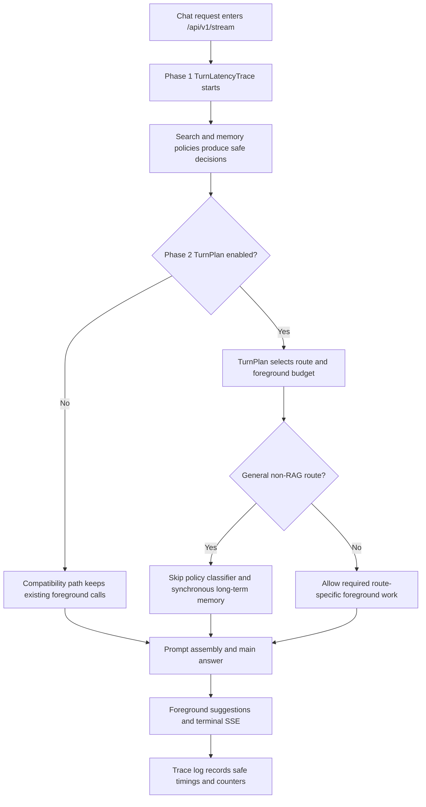
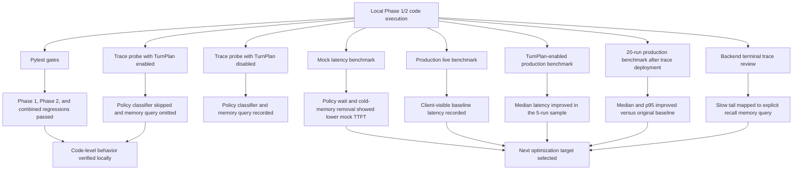

# 2026-07-19 AREQA Pipeline Phase 1/2 Experiment Report

Summary:

This experiment executed the Phase 1 latency-tracing code, the Phase 2 deterministic TurnPlan code, and a production trace-summary follow-up for the AREQA non-RAG chat pipeline. The code-level gates passed, the local trace probe confirmed that TurnPlan-enabled general chat skipped the foreground policy classifier and synchronous long-term memory query, and production live benchmarks showed lower median client-visible latency after TurnPlan rollout. A later 20-run production benchmark also improved p95 compared with the original baseline, and copied backend terminal logs identified the remaining slow tail as explicit memory recall waiting on synchronous long-term memory during prompt assembly. The overall verdict is partially successful: TurnPlan is effective for non-recall paths, but explicit recall still needs bounded memory-query timeout or caching before Phase 3 should broaden concurrency changes.

---

## 1. Expected Results and Improvements over the Previous Experiment

The expected result for Phase 1 was observability without behavior changes. Each chat turn should produce privacy-safe timing and counter data for routing, turn intake, policy classification, RAG skip/start, hot memory, long-term memory, prompt assembly, main model start, first answer delta, suggestions, and terminal completion. The trace must not contain raw user text, prompts, memory contents, model output, credentials, or sensitive labels.

The expected result for Phase 2 was a deterministic control layer, not a full agent rewrite. With `enable_turn_plan_runtime=False`, the existing compatibility path should remain intact. With `enable_turn_plan_runtime=True`, ordinary non-RAG general chat should be allowed to skip the foreground policy classifier and synchronous long-term memory query, while explicit memory recall, search privacy modes, Web-required turns, attachment handling, and terminal SSE behavior remain protected by deterministic policies and existing runtime contracts.

Compared with the implementation plan baseline, the intended improvement is not yet a production latency reduction. The intended improvement is that the system can now measure where time is spent and can reduce unnecessary foreground model/tool calls for general non-RAG turns before Phase 3 introduces data-driven parallelization.

### Expected Data Flow (Mermaid)

## 2. Actual Results

The Phase 1 gate passed with `28 passed, 2 skipped`; the count is higher than the first manual Phase 1 run because Phase 2 added tests to files included by the Phase 1 gate command. The only warnings were existing FastAPI `on_event` deprecation warnings, not assertion failures. Evidence: [phase1_gate_output.txt](/workspaces/AREQA/docs/worklog/202607/2026_07_19_experiment/phase1_gate_output.txt:32).

The Phase 2 gate passed with `50 passed, 2 skipped`, again with only FastAPI `on_event` deprecation warnings. Evidence: [phase2_gate_output.txt](/workspaces/AREQA/docs/worklog/202607/2026_07_19_experiment/phase2_gate_output.txt:32).

The combined Phase 1/2 focused regression passed with `47 passed, 2 skipped`, confirming that the tracing, TurnPlan, context-service, post-turn, benchmark, and runtime-contract tests passed together. Evidence: [combined_regression_output.txt](/workspaces/AREQA/docs/worklog/202607/2026_07_19_experiment/combined_regression_output.txt:32).

The mocked benchmark measured 40 runs. It reported baseline first-content median `176.94 ms`, `no_policy_wait` `115.70 ms`, `no_cold_memory` `85.59 ms`, and optimized mock `25.36 ms`. The benchmark itself explicitly states that these are mock results and not production latency measurements. Evidence: [phase2_mock_latency.md](/workspaces/AREQA/docs/worklog/202607/2026_07_19_experiment/phase2_mock_latency.md:8) and [phase2_mock_latency.md](/workspaces/AREQA/docs/worklog/202607/2026_07_19_experiment/phase2_mock_latency.md:13).

The local trace probe ran the real `OrchestrationService.execute()` path twice with external provider, memory, and suggestion dependencies controlled by mocks. With TurnPlan disabled, the probe reached terminal completion, emitted 13 events, called `client.chat.completions.create` twice, and recorded `model_calls` for `main_answer`, `policy_classifier`, and `suggestions`. It also recorded one `memory_query` tool call. Evidence: [turn_plan_trace_probe.json](/workspaces/AREQA/docs/worklog/202607/2026_07_19_experiment/turn_plan_trace_probe.json:3), [turn_plan_trace_probe.json](/workspaces/AREQA/docs/worklog/202607/2026_07_19_experiment/turn_plan_trace_probe.json:6), and [turn_plan_trace_probe.json](/workspaces/AREQA/docs/worklog/202607/2026_07_19_experiment/turn_plan_trace_probe.json:118).

With TurnPlan enabled for the same general non-RAG route, the probe reached terminal completion, emitted the same 13 events, called `client.chat.completions.create` once, recorded `policy_classifier_skipped`, and recorded no memory tool calls. The model-call counter contained only `main_answer` and `suggestions`. Evidence: [turn_plan_trace_probe.json](/workspaces/AREQA/docs/worklog/202607/2026_07_19_experiment/turn_plan_trace_probe.json:132), [turn_plan_trace_probe.json](/workspaces/AREQA/docs/worklog/202607/2026_07_19_experiment/turn_plan_trace_probe.json:135), [turn_plan_trace_probe.json](/workspaces/AREQA/docs/worklog/202607/2026_07_19_experiment/turn_plan_trace_probe.json:172), and [turn_plan_trace_probe.json](/workspaces/AREQA/docs/worklog/202607/2026_07_19_experiment/turn_plan_trace_probe.json:232).

The raw probe logs also show the route decision and memory skip reason: `route=GENERAL_CHAT enabled=True reason=GENERAL_CHAT` and `orchestration.long_term_memory_skipped reason=GENERAL_CHAT memory_reason=SUBSTANTIVE_QUERY`. Evidence: [turn_plan_trace_probe_output.txt](/workspaces/AREQA/docs/worklog/202607/2026_07_19_experiment/turn_plan_trace_probe_output.txt:7) and [turn_plan_trace_probe_output.txt](/workspaces/AREQA/docs/worklog/202607/2026_07_19_experiment/turn_plan_trace_probe_output.txt:8).

After the production trace-summary code was deployed, a 20-run live benchmark measured first-content median `3289.88 ms`, first-content p95 `7237.36 ms`, completed median `5421.39 ms`, and completed p95 `8808.76 ms`. Compared with the original 5-run baseline, this improved first-content median, completed median, first-content p95, and completed p95. Evidence: [production_latency_trace_enabled_20260719_060620.md](/workspaces/AREQA/docs/worklog/202607/2026_07_19_experiment/production_latency_trace_enabled_20260719_060620.md:8) and [production_latency_comparison.md](/workspaces/AREQA/docs/worklog/202607/2026_07_19_experiment/production_latency_comparison.md:22).

The copied backend terminal log then provided server-side phase attribution for the slow tail. The slow examples were `EXPLICIT_MEMORY_RECALL` routes. One slow trace had `elapsed_ms=7399`, `time_to_first_answer_ms=6054`, `provider_first_token_ms=497`, `prompt_assembly=4439 ms`, and `long_term_memory=3914 ms`. A second slow trace had `elapsed_ms=7808`, `time_to_first_answer_ms=6537`, `provider_first_token_ms=395`, `prompt_assembly=4647 ms`, and `long_term_memory=4127 ms`. Evidence: [production_trace_root_cause.md](/workspaces/AREQA/docs/worklog/202607/2026_07_19_experiment/production_trace_root_cause.md:9), [temp/log.md](/workspaces/AREQA/temp/log.md:99), and [temp/log.md](/workspaces/AREQA/temp/log.md:200).

| Act | Expected | Observed | Verdict | Evidence |
|---|---|---|---|---|
| Act 01: Phase 1 gate | Trace and compatibility tests pass | `28 passed, 2 skipped` | Pass | [phase1_gate_output.txt](/workspaces/AREQA/docs/worklog/202607/2026_07_19_experiment/phase1_gate_output.txt:32) |
| Act 02: Phase 2 gate | TurnPlan, context, orchestration, policy, agent, and config tests pass | `50 passed, 2 skipped` | Pass | [phase2_gate_output.txt](/workspaces/AREQA/docs/worklog/202607/2026_07_19_experiment/phase2_gate_output.txt:32) |
| Act 03: Combined regression | Phase 1/2 focused regression passes together | `47 passed, 2 skipped` | Pass | [combined_regression_output.txt](/workspaces/AREQA/docs/worklog/202607/2026_07_19_experiment/combined_regression_output.txt:32) |
| Act 04: Mock latency benchmark | Experiment model identifies policy and memory as likely latency targets | `no_policy_wait` improved TTFT by `34.61%`; `no_cold_memory` by `51.63%` | Pass for mock mechanics; Not verified for production latency | [phase2_mock_latency.md](/workspaces/AREQA/docs/worklog/202607/2026_07_19_experiment/phase2_mock_latency.md:9), [phase2_mock_latency.md](/workspaces/AREQA/docs/worklog/202607/2026_07_19_experiment/phase2_mock_latency.md:10), [phase2_mock_latency.md](/workspaces/AREQA/docs/worklog/202607/2026_07_19_experiment/phase2_mock_latency.md:13) |
| Act 05: TurnPlan trace probe | General non-RAG route skips unnecessary foreground policy and memory work when enabled | Completion calls dropped from `2` to `1`; policy classifier skipped; memory tool calls dropped from `1` to `0` | Pass for controlled local runtime path | [turn_plan_trace_probe.json](/workspaces/AREQA/docs/worklog/202607/2026_07_19_experiment/turn_plan_trace_probe.json:6), [turn_plan_trace_probe.json](/workspaces/AREQA/docs/worklog/202607/2026_07_19_experiment/turn_plan_trace_probe.json:135), [turn_plan_trace_probe.json](/workspaces/AREQA/docs/worklog/202607/2026_07_19_experiment/turn_plan_trace_probe.json:232), [turn_plan_trace_probe.json](/workspaces/AREQA/docs/worklog/202607/2026_07_19_experiment/turn_plan_trace_probe.json:236) |
| Act 06: Live production latency baseline | Client-visible production SSE latency is measured | 5 live runs: first-content median `7102.62 ms`, first-content p95 `7948.35 ms`, completed median `8814.57 ms`, visible status median `910.08 ms` | Pass for single-configuration production baseline; Not verified for TurnPlan comparison | [production_latency.md](/workspaces/AREQA/docs/worklog/202607/2026_07_19_experiment/production_latency.md:8), [production_latency.md](/workspaces/AREQA/docs/worklog/202607/2026_07_19_experiment/production_latency.md:10) |
| Act 07: Live production TurnPlan comparison | TurnPlan-enabled deployment improves client-visible latency compared with baseline | First-content median improved by `52.06%`; completed median improved by `39.19%`; first-content p95 worsened by `49.44%`; completed p95 worsened by `40.67%` | Partial pass: median improved, tail latency regressed in small sample | [production_latency_comparison.md](/workspaces/AREQA/docs/worklog/202607/2026_07_19_experiment/production_latency_comparison.md:5), [production_latency_comparison.md](/workspaces/AREQA/docs/worklog/202607/2026_07_19_experiment/production_latency_comparison.md:13) |
| Act 08: 20-run production benchmark after trace deployment | Higher-sample TurnPlan production run should confirm whether p95 regression persists | First-content median `3289.88 ms`, first-content p95 `7237.36 ms`, completed median `5421.39 ms`, completed p95 `8808.76 ms` | Pass for client-visible improvement versus original baseline; benchmark alone does not provide internal phase attribution | [production_latency_trace_enabled_20260719_060620.md](/workspaces/AREQA/docs/worklog/202607/2026_07_19_experiment/production_latency_trace_enabled_20260719_060620.md:8), [production_latency_comparison.md](/workspaces/AREQA/docs/worklog/202607/2026_07_19_experiment/production_latency_comparison.md:22) |
| Act 09: Production trace root-cause review | Server trace should identify which internal phase dominates slow requests | Slow explicit-recall traces were dominated by `prompt_assembly`, with `long_term_memory` taking `3914 ms` to `4127 ms`; provider first token stayed below `500 ms` | Pass for copied log window; broader production distribution remains not verified | [production_trace_root_cause.md](/workspaces/AREQA/docs/worklog/202607/2026_07_19_experiment/production_trace_root_cause.md:9), [production_trace_root_cause.md](/workspaces/AREQA/docs/worklog/202607/2026_07_19_experiment/production_trace_root_cause.md:30) |

### Actual Data Flow (Mermaid)

## 3. Hypotheses About the Causes

The strongest supported hypothesis is that Phase 2 successfully reduces unnecessary foreground work for general non-RAG chat by centralizing the execution decision in `TurnPlanService`. In the disabled probe, the route still ran the policy classifier and long-term memory query. In the enabled probe, the same general route logged `policy_classifier_skipped`, had no memory tool calls, and reduced completion create calls from two to one. This is directly supported by the trace probe artifacts.

The second hypothesis is that policy classification and long-term memory are likely meaningful preflight bottlenecks in realistic turns. The mocked benchmark supports this direction because removing policy wait reduced mocked TTFT by `34.61%`, and removing cold memory reduced mocked TTFT by `51.63%`. However, this is not proof of production latency behavior because the benchmark is explicitly a controlled mock experiment, not a live backend measurement.

The third hypothesis is that the remaining slow tail is route-specific rather than a general provider-streaming problem. The production trace review supports this for the copied log window. Slow traces were `EXPLICIT_MEMORY_RECALL` routes, their `provider_first_token_ms` values were only `395 ms` to `497 ms`, and their `main_model_started_ms` values were late because `prompt_assembly` waited on `long_term_memory`. This is direct evidence that the observed slow tail in this window was caused primarily by synchronous memory retrieval before the main model started.

The fourth hypothesis is that suggestions are a secondary completion-latency cost but not the main time-to-first-answer problem. Several traces recorded suggestions around `766 ms` to `1198 ms`. This delays terminal completion after the answer stream but does not explain the slow first answer in explicit recall, because the first answer delay happened before `main_model_started`.

The fifth hypothesis is that the observability boundary is now sufficient for the next experiment. The trace records phase names and counters, tests assert safe metadata behavior, and production logs now expose `orchestration.turn_trace_summary` and `orchestration.turn_trace_slow` with phase durations. The copied terminal log still contains unrelated raw application logs outside the trace event, so broader log hygiene remains outside this experiment's verified scope.

## 4. Solutions

The immediate next step is to add a bounded timeout for explicit-recall long-term memory. A reasonable first experiment is a `1500 ms` to `2000 ms` timeout around synchronous `MemoryQueryTool.execute()` when the route is `EXPLICIT_MEMORY_RECALL`, with a safe fallback that starts the answer from current conversation and hot-memory context if long-term memory is unavailable in time. The timeout must be visible in `turn_trace_summary` through a safe fallback reason.

The second next step is short-lived memory-query caching for repeated recall-like questions from the same user/session. The copied trace shows repeated explicit-memory benchmark routes paying the full long-term memory cost. A cache should be keyed by safe user/session and memory-query fingerprint, should not store raw prompts in logs, and should have conservative TTL semantics.

The third next step is bounded or strategy-driven suggestions. Suggestions remain part of the current turn, but the trace shows they commonly add about one second to terminal completion. A timeout or lightweight suggestion strategy should preserve `event: suggestions` compatibility while preventing suggestions from dominating completed latency.

The fourth next step is to re-evaluate `policy_classifier` for `LEARNING_HELP`. It costs roughly `594 ms` to `877 ms` in the reviewed traces. This is lower priority than explicit memory recall because it was not the top slow-tail phase, but it remains a measurable foreground model call.

Phase 3 should cite this experiment's evidence and avoid broad parallelization until the memory timeout/cache experiment is complete. If later traces show provider first-token or suggestions dominating, the optimization target should change accordingly.

## 5. Conclusion

The experiment is partially successful. Phase 1 is verified locally: the trace and compatibility tests passed, and the runtime emitted safe phase/counter data in the trace probe. Phase 2 is verified locally: deterministic TurnPlan routing passed tests and changed the general non-RAG runtime path as intended, skipping foreground policy classification and synchronous long-term memory while preserving terminal completion.

The most important measured local result is the trace probe: TurnPlan disabled produced two completion create calls and one memory query; TurnPlan enabled produced one completion create call and zero memory tool calls for the same general non-RAG route. The most important measured production result is now stronger than the initial 5-run comparison: after trace deployment, the 20-run TurnPlan production benchmark measured first-content median `3289.88 ms`, first-content p95 `7237.36 ms`, completed median `5421.39 ms`, and completed p95 `8808.76 ms`. Compared with the original 5-run baseline, this improved both median and p95 client-visible latency.

The most important root-cause result is the production trace review: the remaining slow tail in the copied log window was not provider first-token latency. It was explicit memory recall waiting on synchronous long-term memory inside prompt assembly. The next required validation before broad Phase 3 work is a targeted explicit-recall memory timeout/cache experiment with production trace review after deployment.
