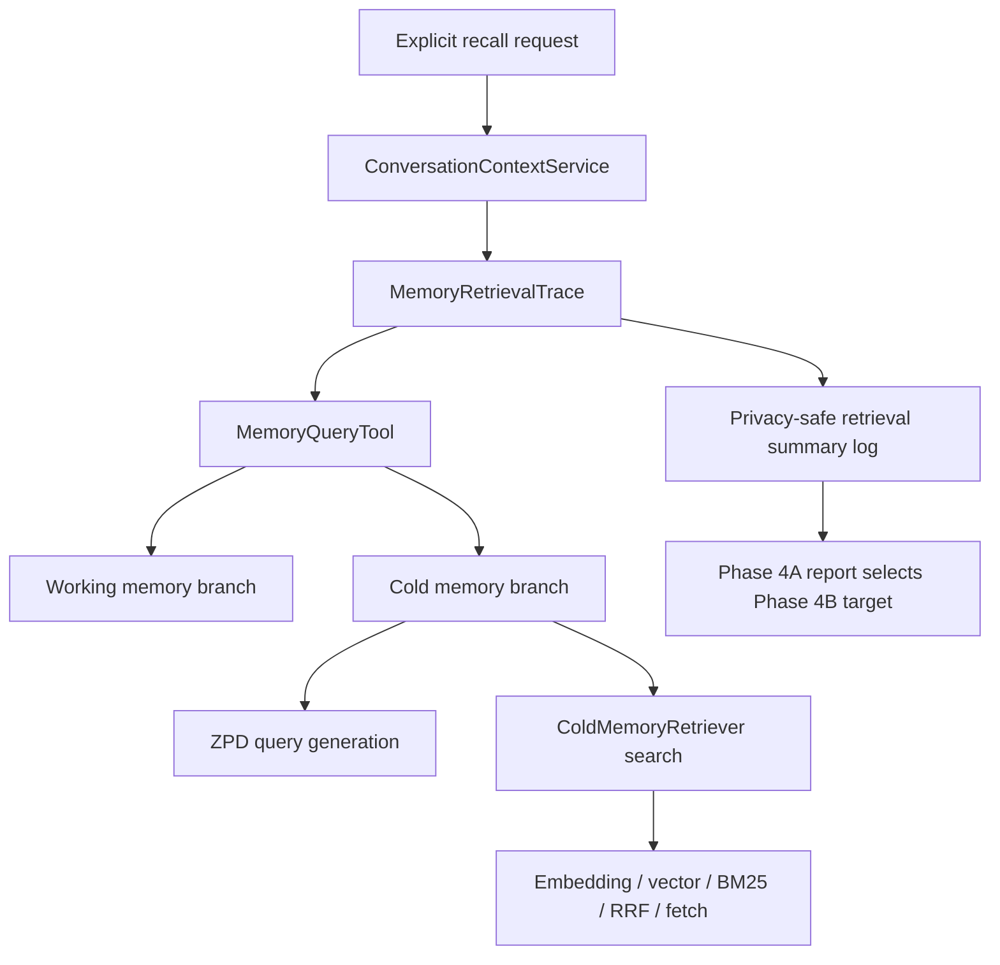
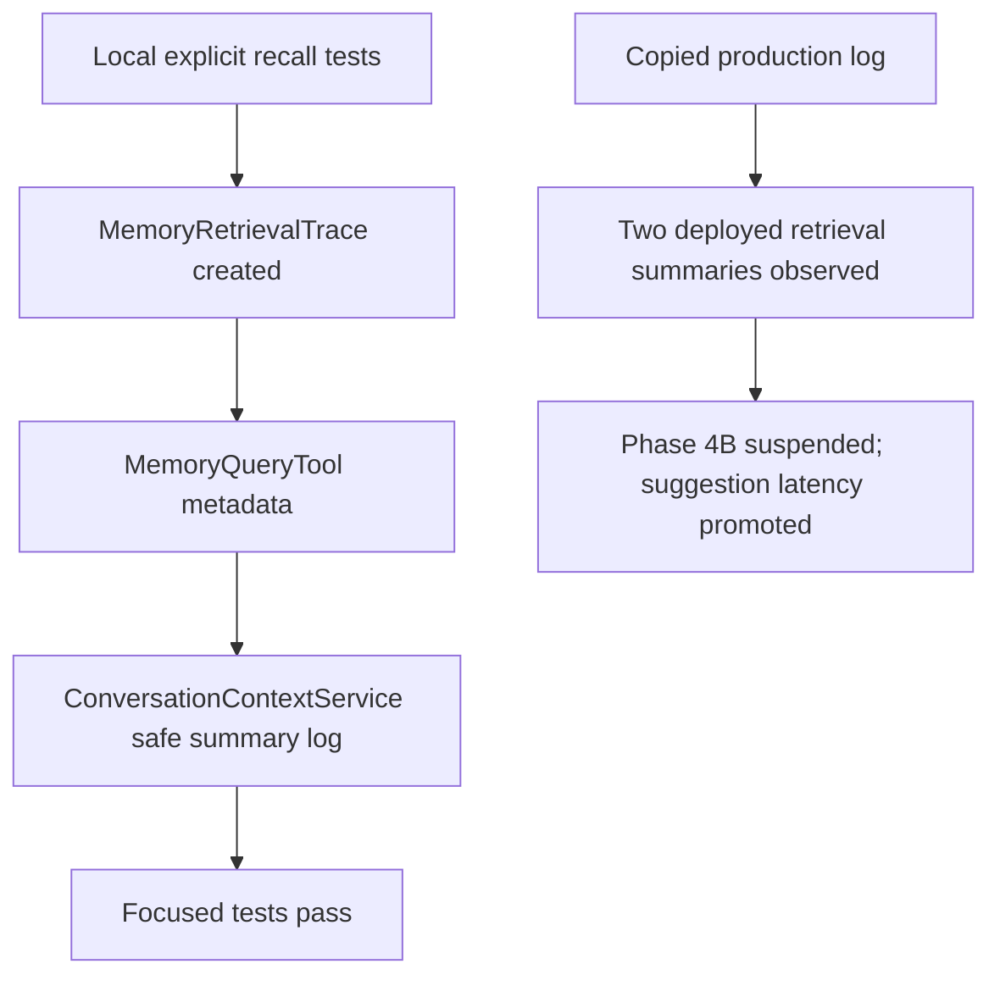

# 2026-07-19 Memory Retrieval Efficiency Report

Summary:

Phase 4A implemented privacy-safe sub-step instrumentation for long-term memory retrieval and added a log parser for benchmark-window analysis. Local validation passed with `16 passed, 4 warnings`, `17 passed`, and an additional memory regression run of `43 passed`. Production profiling is now partially verified: the copied complete backend log contains `2` deployed `orchestration.long_term_memory_retrieval_summary` events, both timing out around the `2000 ms` foreground memory budget. The sample size is still too small to select a Phase 4B optimization target confidently. Phase 4B is therefore suspended for now, and the next active latency work should target synchronous suggestion generation.

---

## 1. Expected Results and Improvements over the Previous Experiment

Phase 3 proved that explicit-recall long-term memory is now bounded by the foreground timeout: deployed traces showed `memory_query:timeout` and `long_term_memory` around `2000 ms`. That protected first-answer latency, but it did not prove memory retrieval itself can usually complete successfully inside the timeout.

Phase 4A is expected to expose safe sub-step attribution for memory retrieval without changing retrieval strategy. The required evidence is sub-step timing for working memory, cold memory, ZPD query generation, embedding, vector search, BM25 search, RRF fusion, document fetch, timeout outcome, cache status, result-count bucket, and retrieval outcome.

### Expected Data Flow (Mermaid)



## 2. Actual Results

| Act | Expected | Observed | Verdict | Evidence |
|---|---|---|---|---|
| Act 01: Add memory sub-step trace | Retrieval trace records safe sub-step durations and excludes raw query/memory content | Added `MemoryRetrievalTrace` and tests for safe keys, result-count buckets, and absence of raw text | Pass | [memory_retrieval_trace.py](/workspaces/AREQA/backend/services/memory_retrieval_trace.py:1), [test_memory_retrieval_trace.py](/workspaces/AREQA/tests/backend/test_memory_retrieval_trace.py:1) |
| Act 02: Attach trace to memory query | `MemoryQueryTool` reports cold/working branch timings without changing content shape | `ToolResult.metadata["memory_retrieval"]` now carries the safe summary; existing content/provenance tests still pass | Pass | [memory_query.py](/workspaces/AREQA/backend/tools/memory_query.py:1), [test_memory_query_tool.py](/workspaces/AREQA/tests/backend/test_memory_query_tool.py:1) |
| Act 03: Preserve Phase 3 timeout fallback | Timeout fallback remains honest and records summary | Timeout test passes and checks `orchestration.long_term_memory_retrieval_summary` with `outcome=timeout` | Pass | [test_conversation_context_service.py](/workspaces/AREQA/tests/backend/test_conversation_context_service.py:112), [phase4a_gate_output.txt](/workspaces/AREQA/docs/worklog/202607/2026_07_19_experiment/phase4a_gate_output.txt:1) |
| Act 04: Production sub-step profiling | Production logs contain new retrieval summary events and sub-step distribution | The copied complete backend log contains `2` retrieval summaries. Both timed out around `2000 ms`; completed sub-step medians were approximately `working_memory=1143 ms`, `cold_memory_zpd_query=751 ms`, and `cold_memory_learner_state=175 ms`. Sample size is insufficient for Phase 4B target selection. | Partially verified | [memory_retrieval_phase4a_production_20260719_082530.md](/workspaces/AREQA/docs/worklog/202607/2026_07_19_experiment/memory_retrieval_phase4a_production_20260719_082530.md:1), [temp/log.md](/workspaces/AREQA/temp/log.md:71) |
| Act 05: Memory regression coverage | Existing memory behavior remains compatible | Memory injection, GUM integration, and real memory pipeline tests passed | Pass | [phase4a_memory_regression_output.txt](/workspaces/AREQA/docs/worklog/202607/2026_07_19_experiment/phase4a_memory_regression_output.txt:1) |

### Actual Data Flow (Mermaid)



## 3. Hypotheses About the Causes

The first hypothesis is that long-term memory optimization is no longer the next highest-priority user-visible latency problem. The latest user feedback says the answer feels fast enough, while the final generation phase pauses for roughly `1s` to `2s`. This matches the production trace shape where `suggestions` runs after the main answer and before terminal completion.

The second hypothesis is that working memory lookup may be a meaningful contributor if Phase 4B is resumed later. The two copied deployed samples recorded `working_memory=1056 ms` and `1230 ms`, making it the largest completed sub-step in both samples. This remains weak evidence because there are only two samples and the timed-out cold search did not finish enough downstream steps to compare embedding/vector/BM25/fetch costs.

The third hypothesis is that ZPD query generation may also contribute to explicit recall latency if this track resumes. The copied deployed samples recorded `cold_memory_zpd_query=610 ms` and `892 ms`. Embedding, vector search, BM25 search, RRF fusion, and document fetch were not observed before timeout, so they remain unverified rather than cleared.

Drift quality gate reported one pattern-compliance violation for `backend/cold_memory.py` line 45 because the existing embedding API uses HTTP POST for a read-like operation. This appears to be an external API contract constraint rather than a new Phase 4A behavior change; changing it to GET would break the OpenRouter embeddings call. The issue should be treated as a tool false positive unless a project-specific exception mechanism is added.

## 4. Solutions

Immediate next step for the main latency plan: suspend Phase 4B and work on suggestion completion latency. The implementation plan should bound `PostTurnService.suggestion_events()` so slow suggestion generation cannot hold terminal completion for multiple seconds.

If long-term memory optimization is resumed later, collect more explicit-recall production samples. Either copy the complete backend log for the whole benchmark window or run an explicit-recall-heavy benchmark, then run:

```bash
python scripts/performance/benchmark_memory_retrieval.py --log-file temp/log.md --output docs/worklog/202607/2026_07_19_experiment/memory_retrieval_phase4a_production.json
```

Phase 4B should not resume until the production report contains enough `orchestration.long_term_memory_retrieval_summary` samples to identify a stable top p95 sub-step. The Phase 4B target should be selected from the top p95 sub-step, with timeout rate and retrieved/empty rate used as quality guardrails.

## 5. Conclusion

Phase 4A is locally implemented and test-verified, and production instrumentation is partially verified with two copied production samples. The phase is not complete enough to enter Phase 4B because the evidence is under-sampled and the timed-out cold path did not expose embedding/vector/BM25/RRF/document-fetch timings. Product feedback now indicates the next user-visible issue is the final post-answer wait, so Phase 4B is suspended and suggestion latency should be prioritized.
