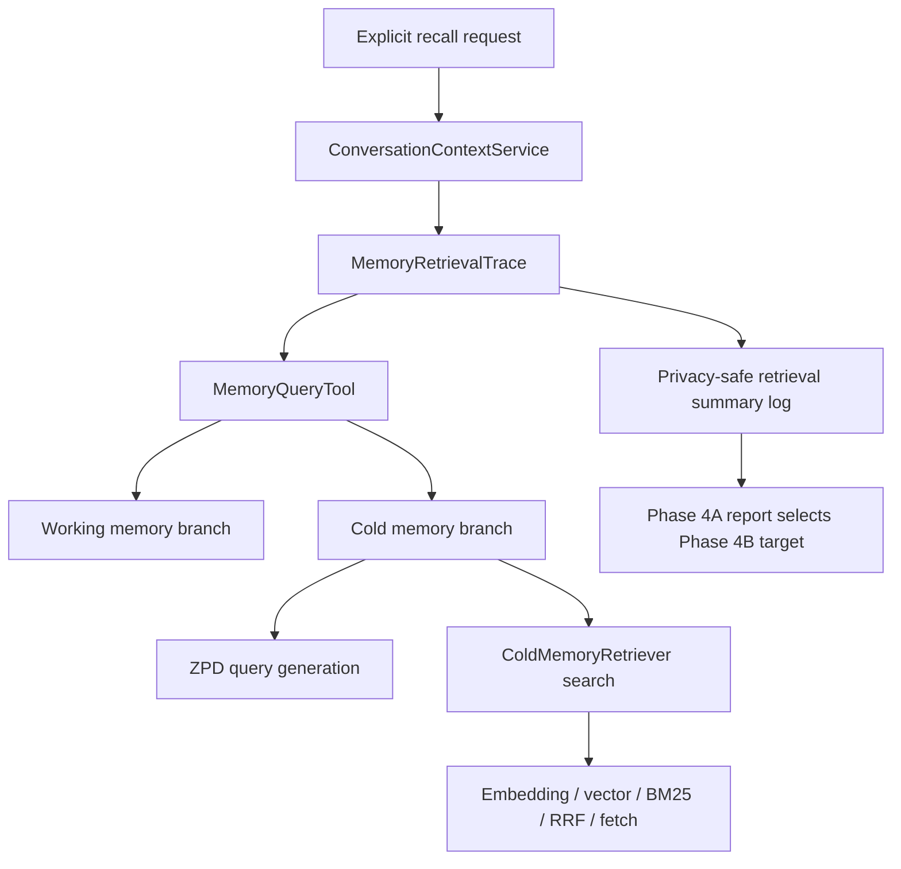
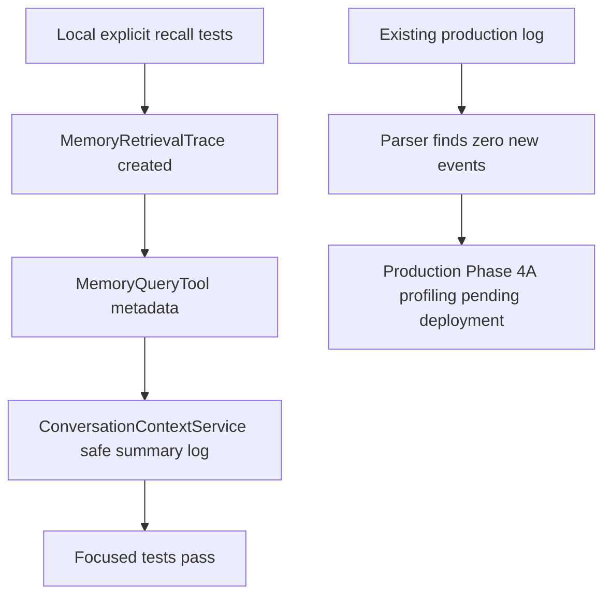

# 2026-07-19 Memory Retrieval Efficiency Report

Summary:

Phase 4A implemented privacy-safe sub-step instrumentation for long-term memory retrieval and added a log parser for benchmark-window analysis. Local validation passed with `16 passed, 4 warnings`, `17 passed`, and an additional memory regression run of `43 passed`, but production sub-step profiling is not yet verified because the newly added `orchestration.long_term_memory_retrieval_summary` event has not been deployed and observed in production logs. The current Phase 4B target is therefore not selected yet.

---

## 1. Expected Results and Improvements over the Previous Experiment

Phase 3 proved that explicit-recall long-term memory is now bounded by the foreground timeout: deployed traces showed `memory_query:timeout` and `long_term_memory` around `2000 ms`. That protected first-answer latency, but it did not prove memory retrieval itself can usually complete successfully inside the timeout.

Phase 4A is expected to expose safe sub-step attribution for memory retrieval without changing retrieval strategy. The required evidence is sub-step timing for working memory, cold memory, ZPD query generation, embedding, vector search, BM25 search, RRF fusion, document fetch, timeout outcome, cache status, result-count bucket, and retrieval outcome.

### Expected Data Flow (Mermaid)



## 2. Actual Results

| Act | Expected | Observed | Verdict | Evidence |
|---|---|---|---|---|
| Act 01: Add memory sub-step trace | Retrieval trace records safe sub-step durations and excludes raw query/memory content | Added `MemoryRetrievalTrace` and tests for safe keys, result-count buckets, and absence of raw text | Pass | [memory_retrieval_trace.py](/workspaces/AREQA/backend/services/memory_retrieval_trace.py:1), [test_memory_retrieval_trace.py](/workspaces/AREQA/tests/backend/test_memory_retrieval_trace.py:1) |
| Act 02: Attach trace to memory query | `MemoryQueryTool` reports cold/working branch timings without changing content shape | `ToolResult.metadata["memory_retrieval"]` now carries the safe summary; existing content/provenance tests still pass | Pass | [memory_query.py](/workspaces/AREQA/backend/tools/memory_query.py:1), [test_memory_query_tool.py](/workspaces/AREQA/tests/backend/test_memory_query_tool.py:1) |
| Act 03: Preserve Phase 3 timeout fallback | Timeout fallback remains honest and records summary | Timeout test passes and checks `orchestration.long_term_memory_retrieval_summary` with `outcome=timeout` | Pass | [test_conversation_context_service.py](/workspaces/AREQA/tests/backend/test_conversation_context_service.py:112), [phase4a_gate_output.txt](/workspaces/AREQA/docs/worklog/202607/2026_07_19_experiment/phase4a_gate_output.txt:1) |
| Act 04: Production sub-step profiling | Production logs contain new retrieval summary events and sub-step distribution | Existing `temp/log.md` predates Phase 4A instrumentation; parser found `0` samples | Not verified | [memory_retrieval_phase4a_log_parse_20260719.md](/workspaces/AREQA/docs/worklog/202607/2026_07_19_experiment/memory_retrieval_phase4a_log_parse_20260719.md:1) |
| Act 05: Memory regression coverage | Existing memory behavior remains compatible | Memory injection, GUM integration, and real memory pipeline tests passed | Pass | [phase4a_memory_regression_output.txt](/workspaces/AREQA/docs/worklog/202607/2026_07_19_experiment/phase4a_memory_regression_output.txt:1) |

### Actual Data Flow (Mermaid)



## 3. Hypotheses About the Causes

The first hypothesis is that the previous production log cannot validate Phase 4A because the new event did not exist when that log was captured. This is directly supported by the log parser returning `0` samples against `temp/log.md`.

The second hypothesis is that the slow memory path may be inside cold memory rather than working memory. This is not yet verified, but the code path supports it as a plausible mechanism: cold memory performs learner-state lookup, ZPD query generation through an LLM, embedding, vector search, BM25 search, RRF fusion, and document fetch.

The third hypothesis is that ZPD query generation or embedding may dominate explicit recall latency. This is not yet verified. Phase 4A instrumentation now separates those steps so the next deployed trace can confirm or reject it.

Drift quality gate reported one pattern-compliance violation for `backend/cold_memory.py` line 45 because the existing embedding API uses HTTP POST for a read-like operation. This appears to be an external API contract constraint rather than a new Phase 4A behavior change; changing it to GET would break the OpenRouter embeddings call. The issue should be treated as a tool false positive unless a project-specific exception mechanism is added.

## 4. Solutions

Immediate next step: deploy the Phase 4A instrumentation, rerun the explicit-recall benchmark, copy backend logs into `temp/log.md`, and run:

```bash
python scripts/performance/benchmark_memory_retrieval.py --log-file temp/log.md --output docs/worklog/202607/2026_07_19_experiment/memory_retrieval_phase4a_production.json
```

Phase 4B should not start until the production report contains at least one non-empty set of `orchestration.long_term_memory_retrieval_summary` events. The Phase 4B target should be selected from the top p95 sub-step, with timeout rate and retrieved/empty rate used as quality guardrails.

## 5. Conclusion

Phase 4A is locally implemented and test-verified, but production profiling is not yet complete. The phase is partially complete: instrumentation and tooling passed local gates, while the production evidence required to select a Phase 4B optimization target remains pending deployment and log collection.
