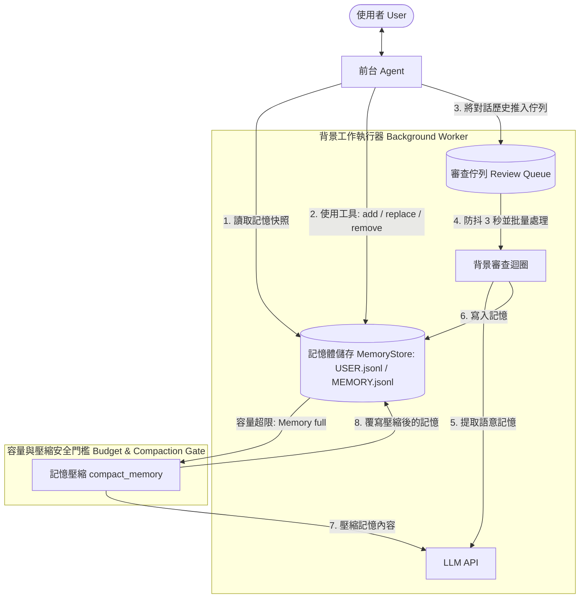
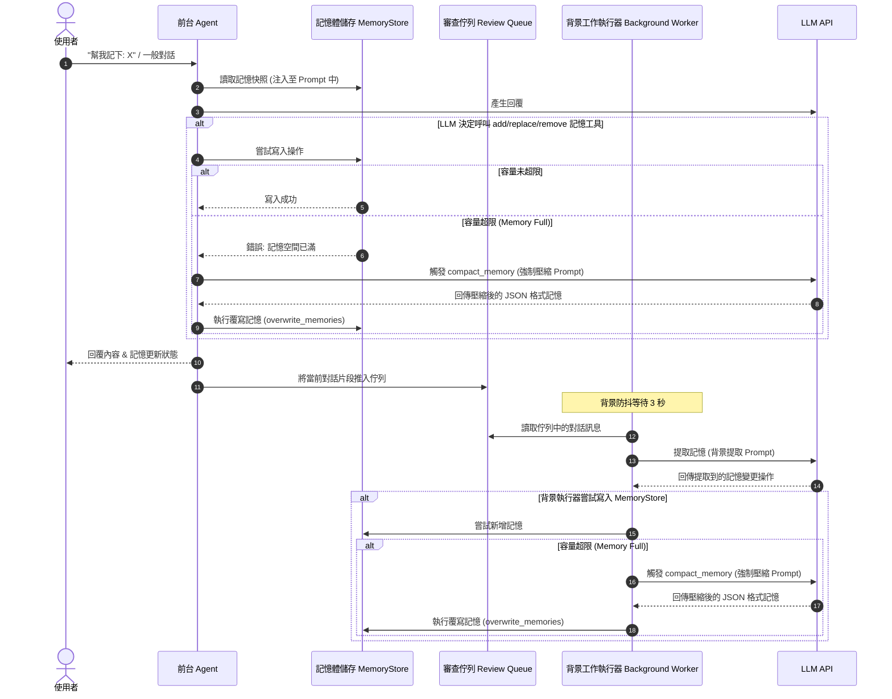

# Hermes 記憶機制 PoC (AREQA) - 核心應用

本資料夾包含 **Hermes 風格記憶機制概念驗證 (PoC)** 的核心邏輯，旨在為 AREQA 智能體 (Agent) 提供健壯的記憶管理模組。其特色包含主動式使用者輪廓分析 (User Profiling)、背景語意記憶提取、嚴格的 Python 層級容量門檻 (Budget Gate) 以及自動記憶壓縮機制 (Auto-Compaction)。

---

## 🚀 快速開始與使用指南 (Quick Start & Usage Guide)

在使用本專案進行測試或開發之前，請詳閱以下指南：

### 1. 環境設定 (Environment Setup)

1. **安裝依賴套件**：
   確保您的環境中已安裝 Python 3.8+，並在專案根目錄下執行：
   ```bash
   pip install -r app/requirements.txt
   ```
2. **設定環境變數**：
   在 `app/` 目錄下建立 `.env` 檔案（或直接複製現有的 `.env`），並填入您的 OpenRouter API 金鑰：
   ```env
   OPENROUTER_API_KEY=your_openrouter_api_key_here
   ```

---

### 2. 執行與測試 (Running & Testing)

* **啟動互動式對話視窗 (CLI)**：
  在專案根目錄執行以下指令，即可與 Memory Agent 進行即時對話：
  ```bash
  python -m app.main
  ```
  *(輸入 `exit` 或 `quit` 即可結束對話)*

* **執行自動化端到端情境測試 (E2E Test)**：
  執行內建的雙層記憶整合測試情境（包含事實寫入、雜訊過濾、記憶壓縮 Compaction 與冷熱記憶交叉檢索）：
  ```bash
  python -m app.tests.e2e_tester
  ```

* **執行單元測試**：
  若要驗證記憶體儲存與併發佇列的功能，請執行：
  ```bash
  pytest app/tests/test_memory_store.py
  pytest app/tests/test_concurrency.py
  ```

---

### 3. 雙層記憶架構測試指南 (Bilevel Memory Testing Guide)

在測試本專案的冷熱雙層記憶時，請特別注意以下機制以獲得正確的預期結果：

#### 💡 Q1: 為什麼每次檢索冷記憶時，終端機總是顯示「喚醒 3 筆長期記憶」？
> [!NOTE]
> 這是因為程式碼中設定了固定的 `top_k=3` 參數。
* **原因**：冷記憶採用向量資料庫（SQLite + `sqlite-vec` 擴充套件）進行語意相似度檢索。
* **機制**：查詢使用的是 $k$ 最近鄰 (k-NN) 演算法。不論您的提問與資料庫中的記憶是否真的相關，只要冷資料庫中存有超過 3 筆資料，向量庫都會強行回傳**數學上最接近的 3 筆資料**。
* **開發提示**：若要在未來限制只回傳高度相關的記憶，需要引入 L2 距離（如 `vec_distance_l2`）並加上一個相似度閾值（Threshold）進行過濾。

#### 🔍 Q2: 我要怎麼知道 Agent 有沒有使用「熱記憶」？
> [!IMPORTANT]
> 熱記憶（Hot Memory）並不像冷記憶需要每次連線資料庫檢索，它是**直接被拼接進 LLM 的 System Prompt** 當中。
* **機制**：每次對話開始時，Agent 會自動讀取 `USER.jsonl` 與 `MEMORY.jsonl` 並整合成快照，作為 LLM 思考的「基礎背景人格/工作記憶」。因此它不會產生 `[Cold Memory Retrieval]` 的檢索日誌。
* **觀測方式**：我們已在 `agent.py` 每一輪的開頭加入了 `[Hot Memory Status]` 打印資訊。您在對話時會直接看見目前 LLM 大腦中載入了哪些個人特徵與筆記，如下所示：
  ```text
  [Hot Memory Status] 目前載入的熱記憶快照：
    - USER PROFILE: 45 字元
      - 使用者國小三年級的導師是張美麗，她非常喜歡吃香蕉。
  ```

#### 🗣️ Q3: 為什麼我問「老師叫什麼名字？」，Agent 卻回答不知道指導教授的名字（而不是我國小導師張美麗）？
> [!WARNING]
> 這是由於大語言模型的 **上下文近因效應 (Context Recency Bias)** 與 **指代消解 (Coreference Resolution)** 導致。
* **原因**：如果上一輪對話剛提到「明天下午三點要跟**指導教授**開會」，當您下一句立刻追問「哦對對 我老師叫什麼名字？」時，LLM 在語意邏輯上會將這個模糊的「老師」自動關聯到前文提及的「指導教授」。此時，即便冷記憶檢索找出了「國小導師張美麗」，LLM 也會因為上下文矛盾而忽略。
* **正確測試方法**：在向冷記憶提問時，請**提供具體的主題指代**，例如問：
  * ❌ *「我老師叫什麼名字？」*（太模糊，會被近期的指導教授對話覆蓋）
  * ✅ *「我**國小三年級的老師**叫什麼名字？」*（指涉明確，LLM 能完美將檢索到的冷記憶張美麗與問題匹配）

---

## 一、 前言 (Introduction)

傳統的大型語言模型 (LLM) 記憶體實作通常存在兩個主要弊端：
1. **被動性 (Passivity)**：純粹依賴 LLM 的 System Prompt 來決定何時壓縮或更新記憶，往往會導致遺忘或上下文爆炸。
2. **缺乏容量控制 (Lack of Budget Control)**：沒有嚴格的程式層級限制，記憶檔案會無限增長，最終撐爆 LLM 的上下文視窗 (Context Window)。

本 PoC 藉由實現以下機制解決了這些問題：
- **前台工具 (Foreground Tools)**：由前台 Agent 直接呼叫的快速、即時記憶變更工具（`add_memory`、`replace_memory`、`remove_memory`）。
- **背景工作執行器 (Background Worker)**：一個非同步的背景精靈程序 (Daemon)，負責監控對話紀錄，並透過防抖批量處理 (Debounced Batching) 在背景提取語意記憶並儲存至磁碟。
- **Python 層級容量門檻 (Python-level Budget Gate)**：在寫入任何資料前，先進行程式碼層級的字元限制檢查（例如：`MEMORY` 限制為 500 字元，`USER` 限制為 300 字元）。
- **安全自動壓縮 (Fail-safe Auto-Compaction)**：當超出字元限制時，Python 會攔截寫入並觸發專用的壓縮請求，強制 LLM 壓縮記憶列表，確保記憶檔案永遠不會超出其實體限制。

---

## 二、 系統架構 (System Architecture)

下圖說明了前台 Agent、記憶體儲存 (MemoryStore) 與背景工作執行器之間的互動關係，以及程式碼層級的容量與壓縮安全門檻。



---

## 三、 使用者流程圖 (User Flow Chart)

下方的時序圖展示了使用者查詢的詳細生命週期，說明前台執行與背景防抖如何管理狀態，並解決記憶容量超限的問題。



---

## 四、 檔案目錄架構 (File Architecture)

專案的程式碼配置與目錄架構如下：

```text
app/
├── memories/                # 作用中的記憶檔案儲存區
│   ├── MEMORY.jsonl         # 整合後的一般知識/對話事件記憶
│   └── USER.jsonl           # 使用者特徵與個人輪廓檔案
├── tests/                   # 測試套件
│   ├── test_concurrency.py  # 模擬併發佇列操作的測試
│   └── test_memory_store.py # 驗證容量檢查與記憶壓縮的單元測試
├── .env                     # API 金鑰與環境變數設定
├── agent.py                 # 對話介面與前台工具實作
├── background_review.py     # 背景防抖佇列與壓縮邏輯
├── main.py                  # 啟動互動式 PoC 的進入點腳本
├── memory_store.py          # 核心 JSONL 讀寫器，包含容量安全限制
├── prompt_builder.py        # 用於生成 system_prompt 快照的格式化工具
└── requirements.txt         # 專案相依套件 (openai, pytest, python-dotenv)
```

---

## 五、 核心功能模組說明 (Major Functions)

### 1. `MemoryStore` (`memory_store.py`)
- **基於 JSONL 的原子化儲存**：將使用者特徵與核心記憶儲存於 `USER.jsonl` 與 `MEMORY.jsonl` 中。寫入時採用暫存檔與原子化替換 (Atomic Replacement)，以防止寫入中斷導致檔案毀損。
- **`_check_budget`**：嚴格的字元數安全防禦。限制記憶檔案長度不得超過 `memory_char_limit` 與 `user_char_limit`。
- **`load_from_disk`**：將記憶轉換為乾淨的 Markdown 格式，並附帶容量百分比指示器（例如：`# MEMORY (your personal notes) [80% — 400/500 chars]`），以維護 Prefix Cache 效率。

### 2. `Agent` (`agent.py`)
- 管理主對話循環。
- 提供前台記憶更新工具 (`add_memory`、`replace_memory`、`remove_memory`)，供 LLM 在使用者明確要求記錄資訊時進行即時更新。
- 提供使用者體驗優化，當背景自動觸發壓縮時會向使用者發出狀態提醒。

### 3. `Background Review` (`background_review.py`)
- **`background_worker`**：非阻塞的精靈程序 (Daemon) 迴圈。實作 3 秒的防抖時間視窗 (Debounce Window)，將多條使用者對話合併後再送交記憶提取，最大程度節省 API 使用量。
- **`process_memories`**：引導背景 LLM 審查對話歷史，過濾掉閒聊或暫時性狀態（例如「我好累」），僅提取核心、長期的使用者特徵與語意知識。
- **`compact_memory`**：安全壓縮機制。觸發時會載入當前記憶列表與寫入失敗的新資訊，將實體容量限制帶入 Prompt 中，強制 LLM 進行強力壓縮，並以壓縮結果覆寫記憶庫。
