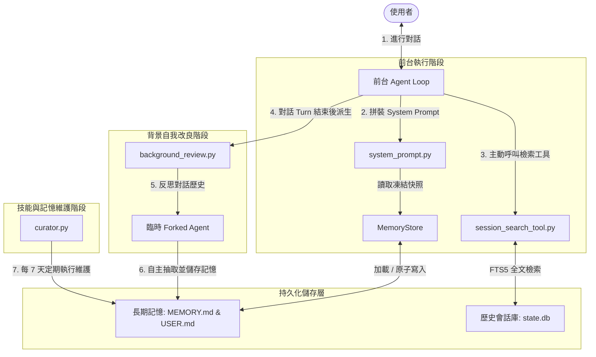

# Hermes Agent 記憶機制與分層注入運作原理

## 一、前言

在開發 AI Agent 時，如何讓 Agent 擁有**持久、低噪音、且不破壞快取效率（Prefix Cache）**的記憶系統是核心挑戰。開源專案 `hermes-agent` 實現了一套非常精緻的**分層記憶注入與自我改良機制**。

這套記憶架構的主要設計哲學為：
1. **前台高效率與快取最佳化**：前台與 LLM 對話時，記憶以「凍結快照」的形式注入 System Prompt。對話中記憶的更新會即時寫入磁碟，但不會動態修改當前對話的前置 Prompt，從而最大化前綴快取（Prefix Cache）命中率，節省 Token 並降低延遲。
2. **前台執行與背景改良解耦**：Agent 在前台對話時專注於任務執行。一旦回合結束，系統會在背景執行緒自動 Fork 一個輕量級的臨時 Agent，自主反思並抽取剛才對話中的個人偏好或技術事实，寫入長期記憶檔案。
3. **區分精煉事實與原始歷史**：短期工作記憶透過 context 壓縮管理；長期記憶則分為高信號、設有字元上限的 Markdown 記憶（`MEMORY.md`、`USER.md`）和海量的原始會話 FTS5 歷史庫（`state.db`），前者自動注入 System Prompt，後者作為 Tool 由 LLM 按需呼叫。

---

## 二、Mermaid 架構圖 (Hermes Agent 記憶運作方式)



---

## 三、詳細說明記憶架構與運作方式

### 1. 長期持久記憶層 (Layer 1 - Markdown 記憶)

Hermes 使用本地 Markdown 檔案作為儲存「精煉長期記憶」的載體。
*   **檔案路徑**：`~/.hermes/memories/MEMORY.md`（Agent 記下的環境與工具怪癖事實）與 `USER.md`（使用者偏好與溝通風格）。
*   **核心原始碼位置**：
    *   類別定義與寫入控制：[tools/memory_tool.py](file:///d:/AboutUniversity/Master_ntnu/Project/AREQA_HarmesAgent_memory_poc/hermes-agent/tools/memory_tool.py) 中的 `MemoryStore`
    *   Agent 初始化與加載：[agent/agent_init.py](file:///d:/AboutUniversity/Master_ntnu/Project/AREQA_HarmesAgent_memory_poc/hermes-agent/agent/agent_init.py#L1127-L1148)

#### **運作細節**：
*   **記憶切分**：檔案中每條記憶使用 `ENTRY_DELIMITER = "\n§\n"` 作為分隔符號。
*   **讀取與凍結快照（Frozen Snapshot）**：
    在 Agent 初始化時，`MemoryStore.load_from_disk()` 會被呼叫，讀取 `MEMORY.md` 與 `USER.md`。讀取出的 entries 會保存在 `self._system_prompt_snapshot` 字典中。此快照在**整個對話 session 期間是凍結的**，不因對話中途發生的 `memory` 工具寫入而改變，這保證了 System Prompt 的長度與內容完全一致，使得 API 服務器（如 Anthropic）的 Prefix Cache 能夠持續命中。
*   **字元預算限制（Character Limit）**：
    為了防範 Prompt 膨脹，Hermes 使用**字元數限制**（而非 Token 限制）：
    *   `memory_char_limit`：預設上限 2200 字元。
    *   `user_char_limit`：預設上限 1375 字元。
    當呼叫 `MemoryStore.add()`, `replace()`, `apply_batch()` 時，會計算變更後的總字數：
    ```python
    new_total = len(ENTRY_DELIMITER.join(new_entries))
    if new_total > limit:
        return {"success": False, "error": "Exceed limit...", "current_entries": entries}
    ```
    一旦溢出，工具會拒絕寫入並回傳目前所有的 entries，提示 LLM 必須在當次對話中呼叫 `apply_batch` 來刪除/簡化舊記憶，以挪出空間寫入新記憶。
*   **安全檢測**：
    在 `load_from_disk()` 時，會使用 `scan_for_threats(scope="strict")` 檢測記憶是否含有潛在的惡意注入指令，一旦匹配則在快照中替換為 `[BLOCKED: ...]` 佔位符號，但在磁碟上保留原始文字以便使用者人工審查。
*   **原子寫入安全**：
    在 `_write_file()` 寫入 Markdown 時，Hermes 會先寫入臨時檔案，再使用 `atomic_replace` 進行原子 rename，防止併發讀寫時讀取到空檔案。

---

### 2. 長期歷史回溯層 (Layer 2 - 全文檢索歷史)

相較於 Markdown 記憶存放的是「精煉事實」，所有的「歷史對話原始資料」都會存檔在 SQLite 數據庫中。
*   **核心原始碼位置**：
    *   對話工具入口：[tools/session_search_tool.py](file:///d:/AboutUniversity/Master_ntnu/Project/AREQA_HarmesAgent_memory_poc/hermes-agent/tools/session_search_tool.py) 中的 `session_search()` 函數
    *   數據庫操作封裝：[hermes_state.py](file:///d:/AboutUniversity/Master_ntnu/Project/AREQA_HarmesAgent_memory_poc/hermes-agent/hermes_state.py) 中的 `SessionDB` 類別

#### **運作細節**：
*   **主動式呼叫**：背景對話循環**不會**主動為每回合查詢歷史。`session_search` 是註冊在 `SESSION_SEARCH_SCHEMA` 中的 LLM 工具，只有當 LLM 發現當前問題涉及過去對話、或使用者指代了歷史事件時，LLM 才會自主決定產生 `tool_call` 呼叫此工具。
*   **SQLite FTS5 全文檢索**：
    `SessionDB.search_messages()` 基於 SQLite 的 FTS5 引擎在 `messages` 表進行高效的全文搜尋。
*   **四大檢索模式**：
    1.  **Discovery (發現模式)**：依據 query 進行檢索，回傳最匹配的會話 ID、匹配語句的片段（Snippet），以及匹配處周圍的前後 context 視圖。此外，為避免無關訊息干擾，也會回傳該會話最初 3 條 (`bookend_start`) 和最後 3 條 (`bookend_end`) 的關鍵摘要。
    2.  **Scroll (捲動模式)**：傳入 `session_id` 和 `around_message_id`，獲取該 Message ID 周圍指定 window（預設 5）的上下對話切片。
    3.  **Read (會話讀取)**：傳入 `session_id` 以直接讀取整個會話的轉錄文字（長會話僅返回前 20 和後 10 條消息）。
    4.  **Browse (歷史瀏覽)**：無參數時，按時間倒序列出最近的會話列表及其摘要。

---

### 3. 背景自我改良循環 (Background Self-Improvement Loop)

為了解決「前台寫入記憶會打斷執行邏輯、拖慢回應」的問題，Hermes 引入了非同步的背景自我檢視線程。
*   **核心原始碼位置**：
    *   [agent/background_review.py](file:///d:/AboutUniversity/Master_ntnu/Project/AREQA_HarmesAgent_memory_poc/hermes-agent/agent/background_review.py) 中的 `_run_review_in_thread()` 與 `spawn_background_review_thread()`
    *   前台觸發：[agent/turn_finalizer.py](file:///d:/AboutUniversity/Master_ntnu/Project/AREQA_HarmesAgent_memory_poc/hermes-agent/agent/turn_finalizer.py#L395)

#### **運作細節**：
*   **Daemon 執行緒**：
    在前台的 `run_conversation` 完成一個 Turn 後，`turn_finalizer` 會非同步調用 `spawn_background_review` 拋出一個背景 daemon 線程。
*   **Fork 代理與 Parity（快取一致性）**：
    背景線程會實例化一個臨時的 `AIAgent` 副本：
    *   **快取對齊**：臨時 Agent 會繼承前台主對話的快取 Prompt (`review_agent._cached_system_prompt = agent._cached_system_prompt`)，使得背景 LLM 呼叫可以無縫命中相同的 Prefix Cache，從而省去重建 Prompt 的時間與高額 token 成本。
    *   **限制安全**：此 Forked Agent 會被設置一個 `review_whitelist` 的 Thread 工具白名單，**只允許使用 `memory` 和 `skill_manage` 工具**。如果它企圖執行危險指令（如 `terminal`），線程級別的 callback 攔截器會自動強制回傳 `deny`，保證背景運行的安全性。
*   **反思 Prompt**：
    系統會向背景 Agent 發送 `_COMBINED_REVIEW_PROMPT`（或單獨的記憶/技能審查提示詞），引導它以客觀角度檢視剛剛完成的對話：「剛剛用戶說了什麼偏好？有什麼環境事實或決策值得保留？如果有，請呼叫 memory 工具將其儲存。」
*   **落地寫入**：
    因為臨時 Agent 與主 Agent 共享同一個硬碟的 `MemoryStore` 對象，背景 Agent 調用 `memory` 時會直接修改 `MEMORY.md` 或 `USER.md`，並在完成後列印提示資訊告知使用者。

---

### 4. System Prompt 拼裝工廠 (Prompt Assembly Factory)

這套系統負責將所有靜態規則、環境、技能和加載的長短記憶，在 LLM 呼叫前完美排版拼裝。
*   **核心原始碼位置**：
    *   [agent/system_prompt.py](file:///d:/AboutUniversity/Master_ntnu/Project/AREQA_HarmesAgent_memory_poc/hermes-agent/agent/system_prompt.py) 中的 `build_system_prompt_parts` 與 `build_system_prompt`
    *   [agent/conversation_loop.py](file:///d:/AboutUniversity/Master_ntnu/Project/AREQA_HarmesAgent_memory_poc/hermes-agent/agent/conversation_loop.py#L712-L800)

#### **三層拼裝架構**：
在 `build_system_prompt_parts` 中，Prompt 被依序劃分成以下三個 Tier 並用 `\n\n` 串接：

| 階層 (Tier) | 包含內容 | 快取最佳化考量 |
| :--- | :--- | :--- |
| **`stable`** (穩定層) | 1. 代理身份 (`SOUL.md` 或 `DEFAULT_AGENT_IDENTITY`)；<br>2. 工具引導（`MEMORY_GUIDANCE`、`SESSION_SEARCH_GUIDANCE`、`SKILLS_GUIDANCE`）；<br>3. 行為約束（`TASK_COMPLETION_GUIDANCE`、並行調用引導）；<br>4. 技能索引（`build_skills_system_prompt`）；<br>5. 環境與平台 Hints（WSL 檢測、bash 提示、渠道特性提示）。 | **完全不變。** 作為前綴快取的最核心區段，排在最前面，有利於在整個 Session 對話中大幅降低 Token 開銷。 |
| **`context`** (上下文層) | 1. `system_message`（呼叫端自訂的系統訊息）；<br>2. 專案特定上下文檔案（檢索 CWD 下的 `.hermes.md` / `AGENTS.md` / `.cursorrules`，限制上限為 20K 字元，多餘則採取頭尾截斷）。 | **對話開始後即固定。** 雖然依據執行目錄而異，但在會話中途不改變。 |
| **`volatile`** (易變層) | 1. 記憶快照：`MemoryStore.format_for_system_prompt("memory")` 輸出自 `MEMORY.md`；<br>2. 用戶畫像快照：`format_for_system_prompt("user")` 輸出自 `USER.md`；<br>3. 外部記憶區塊；<br>4. 包含日期、Session ID、Model、Provider 的 Timestamp 行。 | **隨時間微變。** 為了維持 Prefix Cache 的高命中，時間戳刻意只保留**日期精度**（不寫入分鐘級時間）。置於 System Prompt 的最尾端，即使變更也僅會使最後幾個 token 的快取失效。 |

*   **API 訊息注入**：
    組裝完 System Prompt 後，在 `conversation_loop.py` 中：
    *   System Prompt 被作為 `role: "system"` (或 `role: "developer"`) 放入 `api_messages` 的最前頭。
    *   如果配置了外部記憶（如 Honcho），在 Turn 開始前，`MemoryManager.prefetch_all()` 查詢到的上下文，會被包裝在 `<memory-context>` 中**追加在 User 訊息的 content 尾端**，避免動態查詢的記憶影響 System Prompt 結構。

---

### 5. 短期記憶管理與上下文壓縮 (Context Compression)

當對話長度接近模型的極限時，Hermes 的短期記憶會通過壓縮引擎進行修剪。
*   **核心原始碼位置**：
    *   [agent/context_compressor.py](file:///d:/AboutUniversity/Master_ntnu/Project/AREQA_HarmesAgent_memory_poc/hermes-agent/agent/context_compressor.py) 中的 `ContextCompressor`
    *   [agent/conversation_compression.py](file:///d:/AboutUniversity/Master_ntnu/Project/AREQA_HarmesAgent_memory_poc/hermes-agent/agent/conversation_compression.py)

#### **運作細節**：
*   **壓縮閥值**：配置中的 `compression.threshold`（預設為 50% 的 Context 窗口）被觸發時，系統啟動壓縮。
*   **保護原則**：
    *   System Prompt 是絕對被保護的。
    *   會話開頭的 $N$ 次對話（`protect_first_n` 預設 3）被保留，確保對話主旨不丟失。
    *   最近的 $M$ 次對話（`protect_last_n` 預設 20）被完整保留，確保最新的上下文語境順暢。
*   **摘要壓縮**：
    夾在中間的對話歷史會被送至輔助 LLM 進行 **Summarization**，將細節合併為一段精簡大綱，再替換回歷史 Message 列表中。壓縮成功後，會呼叫 `invalidate_system_prompt(agent)`，這會**重置 cached_system_prompt 並從磁碟重新加載最新的 `MEMORY.md`/`USER.md`**，以此將最新的事實固化回 System Prompt，並重新累積前綴快取。

---

### 6. 長期記憶保養與策展 (Curator Mechanism)

隨時間推移，大量的技能和事實可能會過期或雜亂，需要定期進行整合與清理。
*   **核心原始碼位置**：
    *   [agent/curator.py](file:///d:/AboutUniversity/Master_ntnu/Project/AREQA_HarmesAgent_memory_poc/hermes-agent/agent/curator.py)

#### **運作細節**：
*   **7 天維護週期**：
    在 `curator.py` 中，`DEFAULT_INTERVAL_HOURS = 24 * 7`。當檢測到系統閒置時間足夠且上次維護已過去 7 天以上，系統會呼叫 `apply_automatic_transitions()` 進行無 LLM 的自動狀態轉換。
*   **自動轉換 (State Transitions)**：
    *   **Active ➡️ Stale**：在 `stale_after_days` (預設 30 天) 內無任何活動的技能會被改為 `stale`。
    *   **Active/Stale ➡️ Archived**：超過 `archive_after_days` (預設 90 天) 未使用的技能會被自動移入 `.archive/` 目錄中，並將其在數據庫中的狀態改為 `archived`。
    *   **Reactivation (重新啟用)**：已被歸檔或過期的技能若重新被調用，會自動轉回 `active` 狀態。
*   **傘狀合併 (LLM Consolidation)**：
    若啟用了 `curator.consolidate: true`，Curator 會 Fork 一個審核 Agent，執行 `CURATOR_REVIEW_PROMPT`。它會將語義相近、零碎的技能（例如多個獨立的微型 Bug fix 技能）進行**傘狀整合 (Umbrella Consolidation)**。它會呼叫 `skill_manage(action='patch')` 將其寫入一個大類別技能（如 `python-debugging`）的 labeled subsection 中，或者將細節降級為 `references/` 目錄下的輔助文件，最後自動呼叫 `skill_manage(action='delete')` 將舊的冗餘微型技能歸檔，使整個長期記憶與技能樹保持簡潔、高效。
