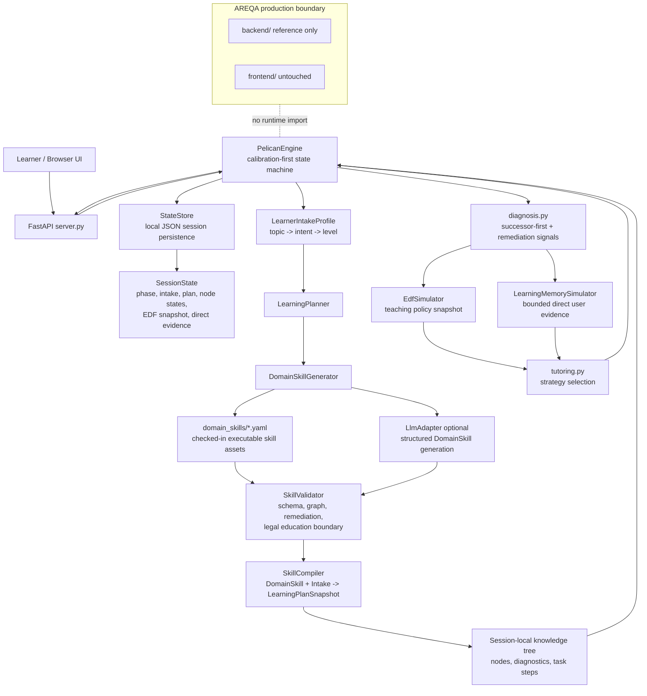
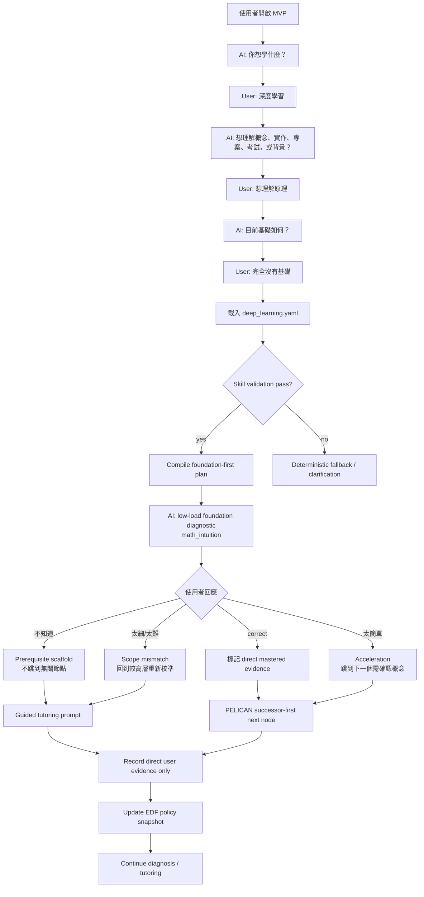

# PELICAN Learning Engine MVP

## 1. 介紹

`misc/PELICAN_mvp` 是 AREQA 主系統外的一個獨立學習引擎實驗場。它用來驗證 PELICAN-style 知識樹診斷、AREQA-style EDF 教學決策、GUM-style 學習記憶邊界，以及新加入的 Domain Skill Runtime。

目前真實狀況：

- 預設新 session 不會直接問診斷題，而是走 calibration-first onboarding：先問主題，再問學習方向，再問程度與先備經驗。
- 內建可執行 skill asset：`domain_skills/deep_learning.yaml`。
- `深度學習` 會先載入並驗證 `deep_learning.yaml`，再由 skill compiler 產生 session-local knowledge tree。
- 未校準或 beginner 的 conceptual deep-learning route 會 foundation-first，不會一開始問 MLP 權重參數這類過細問題。
- 使用者說 `太細了` / `太難` 會觸發 scope mismatch，停在目前概念重新校準，不會跳到無關節點。
- 使用者說 `不知道` 會觸發 prerequisite scaffold，不會繼續追問下一個隨機診斷題。
- 使用者說 `太簡單了` 會觸發 acceleration。
- LLM 只可用來產生 structured `DomainSkill` 或輔助診斷/教學；模型輸出必須通過 validator，不能直接進 diagnosis。
- EDF learner state 與 model inference 不會被寫成 user-authored memory。local memory 只保存 bounded direct user evidence。
- production AREQA `backend/` / `frontend/` 不被此 MVP runtime import 或修改；這裡是獨立 sandbox。

支援邊界：

- STEM / humanities / business / language 的 category routing contract 已存在。
- 目前 checked-in approved-like asset 只有 `deep_learning.yaml`，其他領域會走 validated generated skill 或 deterministic fallback。
- 法律知識只做教育用途；runtime 會避免把回應呈現為個案法律諮詢。

## 2. 開啟方式

從 repo root 執行：

```bash
cd /workspaces/AREQA/misc/PELICAN_mvp
pip install -r requirements.txt
python -m pelican_mvp
```

瀏覽器開啟：

```text
http://127.0.0.1:8000
```

常用檢查：

```bash
python -m pelican_mvp --help
python -m pytest -q
```

預設可完全離線執行。若要啟用 OpenRouter-compatible LLM：

```bash
export OPENROUTER_API_KEY=your_key
export PELICAN_STEM_MODEL=openai/gpt-5.5
export PELICAN_HUMANITIES_MODEL=~google/gemini-pro-latest
export PELICAN_BUSINESS_MODEL=~google/gemini-pro-latest
export PELICAN_LANGUAGE_MODEL=~google/gemini-pro-latest
python -m pelican_mvp
```

`PELICAN_LLM_MODEL` 仍可作為全域相容 override。沒有 API key 時，existing catalog skill 仍可離線 compile。

## 3. Mermaid 系統架構圖



## 4. Mermaid 用戶流程圖



## 5. 檔案架構圖

```text
misc/PELICAN_mvp/
├── README.md
├── requirements.txt
├── data/
│   └── .gitkeep
├── docs/
│   ├── 11211_PELICAN_Personalized_Edu.md
│   ├── 11211_PELICAN_Personalized_Edu.pdf
│   ├── PELICAN_Graph.jpg
│   ├── Qwen_Qwen3_235B_A22B_Instruct_2507_–_API_Quickstart_OpenRouter.md
│   ├── 2026_07_18_experiment/
│   │   └── PELICAN_Knowledge_Tracing_MVP.md
│   └── implemenation_plan/
│       └── PELICAN_Domain_Skill_Runtime_plan.md
├── domain_skills/
│   └── deep_learning.yaml
├── pelican_mvp/
│   ├── __init__.py
│   ├── __main__.py
│   ├── curriculum.py
│   ├── diagnosis.py
│   ├── domain_catalog.py
│   ├── domain_skill.py
│   ├── edf_simulator.py
│   ├── engine.py
│   ├── learning_memory.py
│   ├── llm.py
│   ├── models.py
│   ├── observability.py
│   ├── planner.py
│   ├── server.py
│   ├── skill_compiler.py
│   ├── skill_generator.py
│   ├── skill_loader.py
│   ├── skill_validator.py
│   ├── state_store.py
│   └── tutoring.py
├── static/
│   ├── app.js
│   ├── index.html
│   └── styles.css
└── tests/
    ├── test_chinese_history.py
    ├── test_curriculum.py
    ├── test_diagnosis.py
    ├── test_domain_skill.py
    ├── test_e2e.py
    ├── test_edf_simulator.py
    ├── test_engine.py
    ├── test_learning_memory.py
    ├── test_llm.py
    ├── test_models.py
    ├── test_pedagogical_flow.py
    ├── test_planner.py
    ├── test_server.py
    ├── test_skill_compiler.py
    ├── test_skill_generator.py
    ├── test_skill_loader.py
    ├── test_skill_validator.py
    ├── test_state_store.py
    └── test_tutoring.py
```
