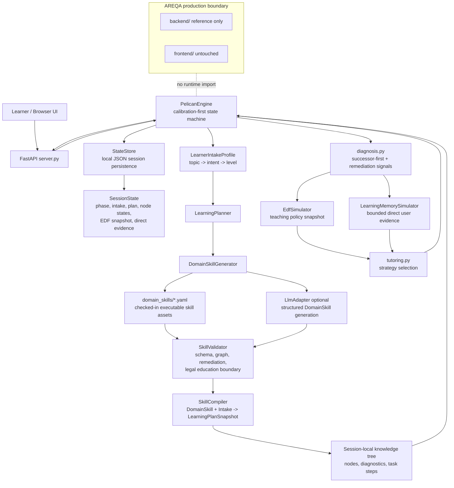
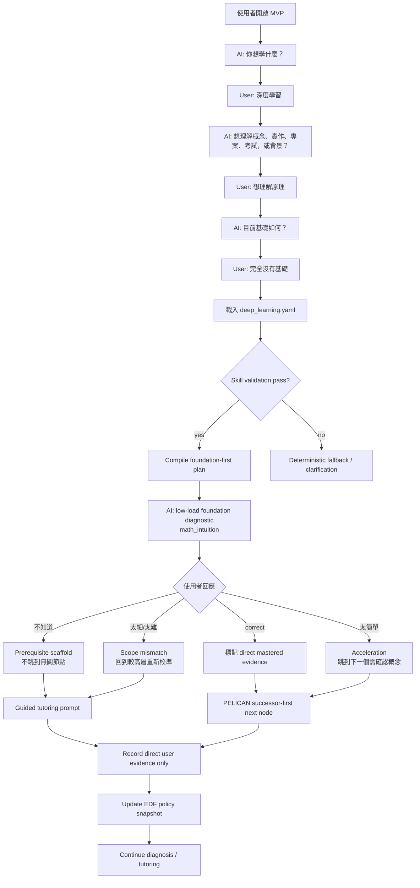

# PELICAN Learning Engine MVP

## 1. 介紹

這是一個用來探索「AI 要如何真的教人」的學習引擎 MVP。它不是一般問答聊天，也不是把題目丟給語言模型直接回答；它會先了解使用者想學什麼、想怎麼學、目前大概在哪個程度，再安排合適的起點。

目前最完整的展示主題是「深度學習」。當使用者輸入 `深度學習`，系統不會立刻丟出 MLP 權重數量、SGD 細節這類過細的前測題，而是先確認學習方向與基礎程度，再從更容易進入的概念開始。

這個 MVP 特別想解決幾個教學痛點：

- 避免一開始就問太細、太硬、太像考試的問題。
- 讓學習路徑有固定骨架，而不是每次都隨機生成一棵知識樹。
- 使用者說 `不知道` 時，系統會補前置概念，而不是繼續追問下一題。
- 使用者說 `太細了` 或 `太難了` 時，系統會退回較高層重新校準。
- 使用者說 `太簡單了` 時，系統可以加快節奏。
- 學習過程會保留直接來自使用者的學習證據，但不會把模型推測當成使用者事實。

這裡仍是獨立實驗場，不會改動 AREQA 主系統。它的目標是先把「學習模式的 engine」驗證清楚，再決定是否導入主系統。

## 2. 開啟方式

從 repo root 執行：

```bash
cd /workspaces/AREQA/misc/PELICAN_mvp
pip install -r requirements.txt
python -m pelican_mvp
```

瀏覽器開啟：

```text
http://127.0.0.1:8000
```

常用檢查：

```bash
python -m pelican_mvp --help
python -m pytest -q
```

預設可完全離線執行。若要啟用 OpenRouter-compatible LLM：

```bash
export OPENROUTER_API_KEY=your_key
export PELICAN_STEM_MODEL=openai/gpt-5.5
export PELICAN_HUMANITIES_MODEL=~google/gemini-pro-latest
export PELICAN_BUSINESS_MODEL=~google/gemini-pro-latest
export PELICAN_LANGUAGE_MODEL=~google/gemini-pro-latest
python -m pelican_mvp
```

`PELICAN_LLM_MODEL` 仍可作為全域相容 override。沒有 API key 時，existing catalog skill 仍可離線 compile。

## 3. Mermaid 系統架構圖



## 4. Mermaid 用戶流程圖



## 5. 檔案架構圖

```text
misc/PELICAN_mvp/
├── README.md
├── requirements.txt
├── data/
│   └── .gitkeep
├── docs/
│   ├── 11211_PELICAN_Personalized_Edu.md
│   ├── 11211_PELICAN_Personalized_Edu.pdf
│   ├── PELICAN_Graph.jpg
│   ├── Qwen_Qwen3_235B_A22B_Instruct_2507_–_API_Quickstart_OpenRouter.md
│   ├── 2026_07_18_experiment/
│   │   └── PELICAN_Knowledge_Tracing_MVP.md
│   └── implemenation_plan/
│       └── PELICAN_Domain_Skill_Runtime_plan.md
├── domain_skills/
│   └── deep_learning.yaml
├── pelican_mvp/
│   ├── __init__.py
│   ├── __main__.py
│   ├── curriculum.py
│   ├── diagnosis.py
│   ├── domain_catalog.py
│   ├── domain_skill.py
│   ├── edf_simulator.py
│   ├── engine.py
│   ├── learning_memory.py
│   ├── llm.py
│   ├── models.py
│   ├── observability.py
│   ├── planner.py
│   ├── server.py
│   ├── skill_compiler.py
│   ├── skill_generator.py
│   ├── skill_loader.py
│   ├── skill_validator.py
│   ├── state_store.py
│   └── tutoring.py
├── static/
│   ├── app.js
│   ├── index.html
│   └── styles.css
└── tests/
    ├── test_chinese_history.py
    ├── test_curriculum.py
    ├── test_diagnosis.py
    ├── test_domain_skill.py
    ├── test_e2e.py
    ├── test_edf_simulator.py
    ├── test_engine.py
    ├── test_learning_memory.py
    ├── test_llm.py
    ├── test_models.py
    ├── test_pedagogical_flow.py
    ├── test_planner.py
    ├── test_server.py
    ├── test_skill_compiler.py
    ├── test_skill_generator.py
    ├── test_skill_loader.py
    ├── test_skill_validator.py
    ├── test_state_store.py
    └── test_tutoring.py
```
