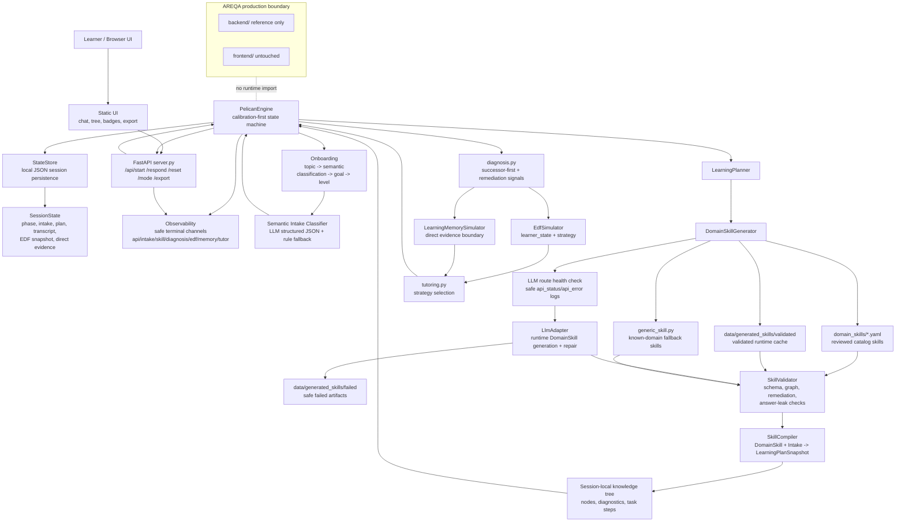
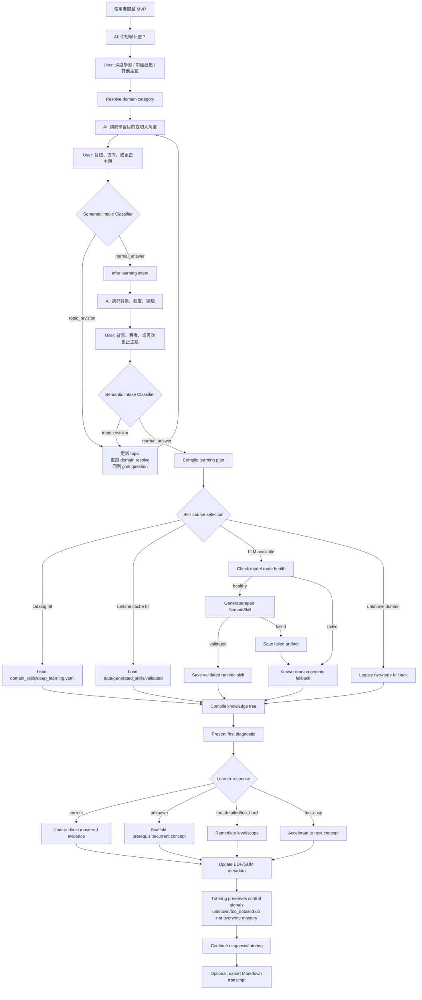

# PELICAN Learning Engine MVP

## 1. 介紹

PELICAN MVP 是 AREQA 主系統外的一個學習引擎實驗場。它的目的不是做一般聊天問答，而是驗證一套更像「教學策略 engine」的流程：先理解學習者想學什麼、想用什麼角度學、目前背景在哪裡，再把主題轉成可診斷、可補架、可追蹤的知識狀態樹。

目前最穩定的展示主題是 `深度學習`。這個主題有 checked-in catalog skill：`domain_skills/deep_learning.yaml`，可以離線載入、驗證、編譯成 foundation-first 的學習路徑。系統會避免一開始就問 MLP 權重數量、SGD 細節這類過細題目，而是先做 goal/level onboarding，再從較低負荷的概念開始診斷。

目前系統已具備：

- Calibration-first onboarding：先收集 topic、goal/intent、level/background。
- Semantic Intake Classifier：在 LLM 模式下判斷 onboarding 回答是否是 topic revision、一般回答或其他語意訊號；狀態轉移仍由 engine 控制。
- DomainSkill runtime：先找 catalog skill，再找 `data/generated_skills/validated` cache，再做 runtime skill generation/repair，最後才 fallback。
- Skill validation：未通過 schema、graph、remediation、diagnostic safety 檢查的 skill 不會進入診斷。
- Generic domain fallback：已知 domain 但 runtime skill 失敗時，會使用 generic STEM/humanities/business/language skill，而不是直接使用隨機 LLM plan。
- EDF/GUM 模擬層：保留教學策略狀態、direct user evidence、working context count。
- Agentic methodology runtime：以 turn/cycle ID 串接六個核心 stage、GUM subsystem event、learner interaction event、typed agent proposals。
- Agent executor runtime：Intake、Skill、Diagnosis、State、Policy、Fast Tutor、Slow Simulator 都有具體 executor wrapper；每個 executor 先產生 bounded proposal，`PelicanEngine` 再採納並更新 session state。
- Causal tutoring transaction：目前 learner evidence 會先更新 knowledge state、GUM 與 EDF，再由更新後的 context 選 tutor strategy。
- Bounded tutor proposal path：LLM mode 會先產生受 EDF/GUM 約束的 tutor proposal，通過 validator 後才成為 final tutor response；LLM 不可用或 proposal 不合格時會明確標示 fallback，而不是假裝 agentic generation 成功。
- Remediation-first tutoring：進入 tutoring 後仍會優先處理 `我不知道`、`太細了`、`太難`、`太簡單` 這類 learner control signals，不會把已掌握的概念誤降級。
- Learner progress snapshot：前端/API 顯示 direct/inferred progress、status 與 confidence，而不是只顯示 raw mastery tree。
- 前端即時狀態顯示：會顯示目前 phase、EDF policy、activity badges、methodology graph、skill artifact summary、agent executor trace、agent proposals、tutor proposal trace 與 learner progress。
- Markdown 匯出：可從 UI 匯出目前對話、session metadata、skill artifact summary、knowledge tree、recent activity、methodology events、agent executor trace、agent proposals、evidence-to-response trace、tutor proposal trace、progress snapshot。
- 安全 structured logs：terminal 會顯示 safe metadata，例如 `channel`、`endpoint`、learner token、skill source、semantic intent、confidence、API health、reason code；不記錄 raw learner answer、raw prompt、raw model output 或 API key。

目前仍需注意的限制：

- `domain_skills/` 目前只有 `deep_learning.yaml` 是正式 catalog skill。
- 中國歷史/思想史等主題目前主要依賴 runtime skill generation 或 fallback；若 OpenRouter/Gemini route 失敗，仍會掉回 generic humanities 或 legacy two-node fallback。
- Semantic Intake Classifier 已能處理明確 topic revision，但目前仍可能把 topic refinement/background answer 判成 revision，造成 onboarding 反覆重問 goal/level。
- Domain routing 對中國思想史仍不完整，例如 `諸子百家`、`思想史`、`春秋`、`戰國` 等 alias 尚需補齊，否則可能被判成 `unknown_domain`。
- Runtime-generated skill 成功後會存在 `data/generated_skills/validated/`，不會自動寫入 `domain_skills/`；人工審核後才適合 promote 成 catalog skill。

## 2. 開啟方式

從 repo root 執行：

```bash
cd /workspaces/AREQA/misc/PELICAN_mvp

python -m venv .venv
source .venv/bin/activate

pip install -r requirements.txt
python -m pelican_mvp

# dev mode
python -m pelican_mvp --pelican-log debug --pelican-log-channels api,intake,skill,diagnosis,state,edf,memory,tutor,methodology
```

瀏覽器開啟：

```text
http://127.0.0.1:8000
```

如果要執行人工測試劇本，建議使用獨立 learner id，避免沿用 `demo_student` 的舊 session：

```text
http://127.0.0.1:8000/?learner_id=manual_agentic_pelican_20260723
```

`python -m pelican_mvp` 啟動時會嘗試清掉仍占用同一 host/port 的舊 PELICAN MVP server process。如果不想自動清理，可以使用：

```bash
python -m pelican_mvp --no-cleanup-stale-server
```

### Terminal debug logger

PELICAN terminal logger 預設會輸出安全 structured metadata，方便追蹤 API、onboarding、skill、diagnosis、EDF/GUM、tutoring 與 methodology runtime。它只印 allow-listed fields，不印 raw learner answer、prompt、model response、API key 或完整 exception body。

CLI 開關：

```bash
python -m pelican_mvp --pelican-log info --pelican-log-channels all
python -m pelican_mvp --pelican-log debug --pelican-log-channels api,intake,diagnosis,tutor
python -m pelican_mvp --pelican-log off
```

等價環境變數：

```bash
export PELICAN_LOG_MODE=debug
export PELICAN_LOG_CHANNELS=api,intake,skill,diagnosis,edf,memory,tutor,methodology
python -m pelican_mvp
```

可用 channels：

```text
api, intake, skill, diagnosis, state, edf, memory, tutor, methodology, activity
```

Terminal log 範例：

```text
PELICAN INFO channel=tutor event=pelican_scaffold_selected endpoint=- learner=9f86d081884c phase=tutoring activity=- status=- reason=unknown detail=- domain=- route=- api_status=- api_error=- skill=- skill_source=- intake_source=- semantic=- confidence=- diagnostic_source=- node=- edf=- strategy=- edf_transition=- memory=- remediation=unknown
```

Paper-aligned tutoring debug events include:

```text
pelican_tutor_proposal_generated
pelican_tutor_proposal_validated
pelican_agent_proposal_recorded
pelican_methodology_event_recorded
```

Provider-native skill schema debug:

```bash
export PELICAN_LOG_MODE=debug
export PELICAN_LOG_CHANNELS=skill
python -m pelican_mvp
```

Key events:

```text
pelican_skill_schema_mode_selected       # selected auto/strict/json_object and response_format mode
pelican_skill_schema_provider_fallback   # auto mode fell back because provider/route rejected json_schema
```

These events print safe metadata only: `route`, `domain_category`, `schema_mode`, `schema_format`, `schema_strict`, `schema_fallback`, `api_status_code`, `api_error_type`, and `reason_code`.

These events expose only safe metadata such as node id, strategy, proposal source, validation status, reason code, and pedagogical move. They do not expose raw learner answers, prompts, provider responses, or model reasoning.

常用檢查：

```bash
python -m pelican_mvp --help
python -m pytest -q
python -m compileall -q pelican_mvp
node --check static/app.js
```

如果從 repo root 做完整品質檢查：

```bash
npm run check:report:strict
```

人工驗收劇本：

```text
docs/2026_07_23_experiment/Agentic_PELICAN_frontend_io_manual_test_script.md
```

該劇本要求 agentic/LLM run 顯示 skill artifact、agent executor trace、tutor proposal trace、evidence-to-response trace，並明確拒絕只靠固定 template 通過的結果。若 LLM 不可用，run 應標示為 fallback run，不應宣稱符合 paper-aligned agentic tutoring 驗收。

預設可離線執行。離線時仍可使用 checked-in catalog skill 與 deterministic fallback。若要啟用 OpenRouter-compatible LLM：

```bash
export OPENROUTER_API_KEY=your_key
export PELICAN_STEM_MODEL=openai/gpt-5.5
export PELICAN_HUMANITIES_MODEL=~google/gemini-pro-latest
export PELICAN_BUSINESS_MODEL=~google/gemini-pro-latest
export PELICAN_LANGUAGE_MODEL=~google/gemini-pro-latest
export PELICAN_TUTOR_MODEL=google/gemini-3.1-flash-lite
python -m pelican_mvp
```

相關 model route 行為：

- `PELICAN_TUTOR_MODEL`：onboarding question、tutoring 等 learner-facing turns。
- `PELICAN_SKILL_MODEL`：所有 domain skill generation 的全域 override。
- `PELICAN_STEM_MODEL` / `PELICAN_HUMANITIES_MODEL` / `PELICAN_BUSINESS_MODEL` / `PELICAN_LANGUAGE_MODEL`：各 domain 的 skill generation route。
- `PELICAN_LLM_MODEL`：舊版相容用的全域 override。
- `PELICAN_SKILL_SCHEMA_MODE`：skill generation structured-output mode。
  - `auto`：預設。OpenAI route 會嘗試 provider-native `json_schema` strict output；Gemini/OpenRouter route 除非 allowlist，否則維持 `json_object` + local validation/repair。
  - `strict`：強制所有 route 使用 `response_format.type=json_schema`。用於驗證某個 OpenRouter/Gemini route 是否真的支援 strict schema；若 provider 不支援，會直接失敗。
  - `json_object`：完全停用 provider-native strict schema，只用 JSON object mode。
- `PELICAN_SKILL_SCHEMA_MODELS`：逗號分隔 allowlist，例如 `~google/gemini-pro-latest,google/gemini-3.1-flash-lite`。只在 `auto` mode 下讓指定 route 嘗試 strict schema。

Runtime artifacts：

```text
data/generated_skills/validated/   # 已通過 validator 的 runtime-generated skill cache
data/generated_skills/failed/      # 失敗 metadata；只保存 safe reason/status/hash
```

## 3. Mermaid 系統架構圖



## 4. Mermaid 用戶流程圖



## 5. Manual regression path

目前 `deep_learning.yaml` 的 beginner conceptual path 會從 `math_intuition` 開始，並保留前三個 foundation concepts 讓前端能展示實際學習路徑。人工驗收建議使用 rule mode，並依序輸入：

```text
深度學習
想理解原理
完全沒有基礎
用來衡量預測與目標之間的差距
我不知道
這太細了，我完全沒有基礎
```

預期重點：

- 前三步完成 onboarding，phase 進入 `diagnosis`。
- 正確回答後 `math_intuition` 變成 `mastered`，下一題推進到 `vectors_tensors`，避免整段體驗停在單一 foundation node。
- 後續輸入 `我不知道` 時，系統應 scaffold `vectors_tensors`，`latest_signal` 為 `unknown`，不得把已掌握的 `math_intuition` 降成 `not_mastered`。
- 後續輸入 `這太細了，我完全沒有基礎` 時，系統應重新校準到更粗的資料表示直覺，`latest_signal` 為 `too_detailed`，不得回到重複的 `math_intuition` 停留模板。
- 390x844 mobile viewport 下，Reset、chat input、send button 必須在 viewport 內且可點擊。

## 6. 檔案架構圖

```text
misc/PELICAN_mvp/
├── README.md
├── requirements.txt
├── data/
│   ├── generated_skills/
│   │   ├── validated/                  # runtime-generated skill cache
│   │   └── failed/                     # safe failure metadata
│   └── *.json                          # local learner session state
├── docs/
│   ├── 11211_PELICAN_Personalized_Edu.md
│   ├── 11211_PELICAN_Personalized_Edu.pdf
│   ├── PELICAN_Graph.jpg
│   ├── Qwen_Qwen3_235B_A22B_Instruct_2507_–_API_Quickstart_OpenRouter.md
│   ├── Gemini_3.1_Flash_Lite_-_API_Pricing_&_Providers_OpenRouter.md
│   ├── 2026_07_18_experiment/
│   │   └── PELICAN_Knowledge_Tracing_MVP.md
│   ├── implemenation_plan/
│   │   └── PELICAN_Domain_Skill_Runtime_plan.md
│   └── worklog/
│       └── 2026_07_20/
│           ├── 2026_07_20.md
│           ├── 2026_07_21.md
│           ├── conversation.md
│           └── terminal.md
├── domain_skills/
│   └── deep_learning.yaml              # current reviewed catalog skill
├── pelican_mvp/
│   ├── __init__.py
│   ├── __main__.py                     # CLI entry, stale-server cleanup, safe formatter
│   ├── curriculum.py                   # reviewed fixture curricula
│   ├── diagnosis.py                    # successor-first diagnosis
│   ├── domain_catalog.py               # topic -> domain route
│   ├── domain_skill.py                 # executable skill contract
│   ├── edf_simulator.py                # EDF learner-state simulation
│   ├── engine.py                       # main onboarding/diagnosis/tutoring state machine
│   ├── generic_skill.py                # known-domain fallback skills
│   ├── learning_memory.py              # bounded direct-evidence memory simulator
│   ├── llm.py                          # OpenRouter-compatible LLM adapter
│   ├── models.py                       # serializable state/domain models
│   ├── observability.py                # safe structured logging allow-list + debug channels
│   ├── planner.py                      # profile-aware plan creation
│   ├── server.py                       # FastAPI API + Markdown export
│   ├── skill_artifacts.py              # validated/failed runtime skill artifacts
│   ├── skill_compiler.py               # DomainSkill -> LearningPlanSnapshot
│   ├── skill_generator.py              # catalog/cache/runtime/generic skill pipeline
│   ├── skill_loader.py                 # catalog skill loader
│   ├── skill_validator.py              # skill safety/shape validator
│   ├── state_store.py                  # local JSON persistence
│   └── tutoring.py                     # tutoring strategy templates
├── static/
│   ├── app.js                          # chat UI, status badges, export action
│   ├── index.html
│   └── styles.css
└── tests/
    ├── test_chinese_history.py
    ├── test_curriculum.py
    ├── test_diagnosis.py
    ├── test_domain_skill.py
    ├── test_e2e.py
    ├── test_edf_simulator.py
    ├── test_engine.py
    ├── test_learning_memory.py
    ├── test_llm.py
    ├── test_main.py
    ├── test_models.py
    ├── test_pedagogical_flow.py
    ├── test_planner.py
    ├── test_server.py
    ├── test_skill_compiler.py
    ├── test_skill_generator.py
    ├── test_skill_loader.py
    ├── test_skill_validator.py
    ├── test_state_store.py
    └── test_tutoring.py
```
