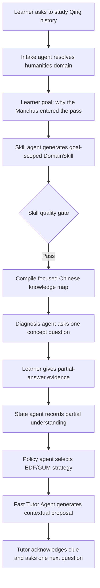
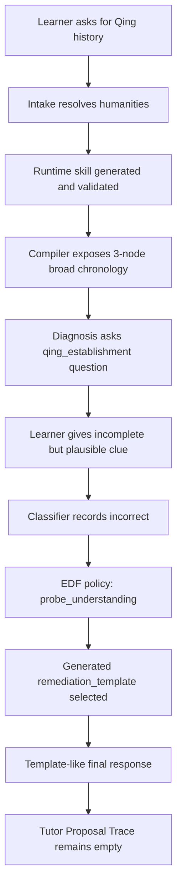

# 2026-07-25 Agentic PELICAN Qing History Tutor Experience Report

Summary:

This experiment shows a partially successful post-fix run. Runtime skill generation and transport were no longer the primary failure: the system produced and validated `qing_dynasty_history_skill` through the `~google/gemini-pro-latest` route, then compiled a learning plan. However, the learner-facing tutoring experience still failed important tutor-quality expectations. The first remediation response felt template-like because the system surfaced a generated `remediation_template` directly, classified a partially correct learner answer as `incorrect`, did not record a tutor proposal, compiled only three visible knowledge nodes, and exposed English learner-facing concept labels. The main evidence limitation is that the artifacts contain one manual conversation run, so the report can identify concrete failure paths for this run but cannot quantify frequency across topics or model routes.

---

## 1. Expected Results and Improvements over the Previous Experiment

The expected improvement over the previous experiment was that generated skill transport should work reliably enough for the frontend to receive a validated runtime skill instead of falling back to `generic_humanities`. This condition was met in this run: the exported session reports `qing_dynasty_history_skill`, lifecycle `validated_generated`, domain `humanities`, and model route `~google/gemini-pro-latest`. The terminal log also records `pelican_skill_generated` and `pelican_skill_generation_summary` with reason `validated`.

The expected tutor experience was stronger than schema validity. For a good agentic tutor, the system should use the learner's stated goal and current understanding to build a focused knowledge map, diagnose partial understanding, select an EDF/GUM-informed teaching strategy, and produce a contextual tutor response through the tutor proposal path. The learner's goal was not general Qing dynasty history; it was why the Manchus entered China proper. The learner also provided useful prior knowledge about late Ming disorder, Li Zicheng, and an unnamed Ming official involved in the entry. A high-quality tutor response should have acknowledged the partially correct clue, identified the likely missing actor as Wu Sangui, and connected Li Zicheng, Shanhai Pass, Dorgon, and Qing entry into a single causal chain.

The acceptance boundary for this experiment is therefore:

- The skill is generated, validated, and compiled without generic fallback.
- The knowledge map is relevant to the learner goal and is deep enough for the chosen topic.
- Learner-facing labels and summaries are presented in the session language, here Traditional Chinese.
- A missed diagnostic answer triggers a tutor proposal or an explicitly marked fallback, not an opaque template response.
- The evidence-to-response trace links learner evidence, EDF policy, tutor proposal, and final message.
- The response should reflect partial understanding instead of treating a plausible but incomplete answer as wholly wrong.

### Expected Data Flow (Mermaid)

## 2. Actual Results

The run improved materially over the previous failed skill-generation path. The export shows the active skill as `qing_dynasty_history_skill`, lifecycle `validated_generated`, domain `humanities`, and model route `~google/gemini-pro-latest`. The log confirms a successful runtime skill generation attempt and validated summary.

The user-visible conversation still failed the tutor-quality bar. After the learner answered that the Manchus entered through collaboration with an unnamed Ming official, the system replied only: "讓我們回到明末清初，先了解滿洲人是如何崛起的。" The exported trace shows the answer was classified as `incorrect`, the state was updated as direct incorrect evidence, EDF selected `probe_understanding`, and remediation selected `qing_establishment`. However, the evidence-to-response trace has no proposal entry, and the tutor proposal trace is empty.

The generated skill artifact explains why the response felt hardcoded. The exact response appears in `remediation_templates.qing_establishment`. This is not evidence of a Python hardcoded string; it is evidence that the system treated a generated remediation template as the final learner-facing message. The current engine code supports this interpretation: `_remediate_current_skill_diagnostic()` sets `current_prompt` from `_remediation_prompt()` and returns directly, instead of calling `_tutor_message()`.

The knowledge map was also too shallow and not sufficiently localized. The generated skill artifact contains four canonical Qing history nodes, but the export and log show only three compiled nodes. The visible labels are English, including "Establishment of the Qing Dynasty", "High Qing Era", and "Late Qing Decline". The generated artifact also contains English descriptions, expected answers, and teaching methodology. This means the schema was valid, but the skill was not strong enough as a Traditional Chinese learner-facing teaching artifact.

| Act | Expected | Observed | Verdict | Evidence |
|---|---|---|---|---|
| A1: Domain intake | Resolve the learner's topic as humanities and continue onboarding. | Topic `中國清朝歷史` was resolved into the humanities route. | Pass | [conversation export](/workspaces/AREQA/misc/PELICAN_mvp/docs/2026_07_25_experiment/03/pelican_demo_student_2026_07_25_03.md:7), [agent trace](/workspaces/AREQA/misc/PELICAN_mvp/docs/2026_07_25_experiment/03/pelican_demo_student_2026_07_25_03.md:123) |
| A2: Goal capture | Preserve the learner's goal: understanding why the Manchus entered the pass. | The export records the goal, but the generated skill remains broad Qing-dynasty history. | Fail | [goal](/workspaces/AREQA/misc/PELICAN_mvp/docs/2026_07_25_experiment/03/pelican_demo_student_2026_07_25_03.md:32), [skill goal summary](/workspaces/AREQA/misc/PELICAN_mvp/docs/2026_07_25_experiment/03/pelican_demo_student_2026_07_25_03.md:63), [broad canonical path](/workspaces/AREQA/misc/PELICAN_mvp/data/generated_skills/validated/中國清朝歷史.validated.json:28) |
| A3: Runtime skill generation | Generate and validate a domain skill instead of falling back to a generic skill. | `qing_dynasty_history_skill` was generated and validated. | Pass | [session skill](/workspaces/AREQA/misc/PELICAN_mvp/docs/2026_07_25_experiment/03/pelican_demo_student_2026_07_25_03.md:9), [skill generated log](/workspaces/AREQA/misc/PELICAN_mvp/docs/2026_07_25_experiment/03/log.md:51), [validated summary log](/workspaces/AREQA/misc/PELICAN_mvp/docs/2026_07_25_experiment/03/log.md:52) |
| A4: Knowledge map depth and relevance | Display a focused enough map for the learner's causal question. | The plan compiled only three visible nodes, and the map is broad Qing chronology rather than focused Manchu-entry causality. | Fail | [concept path](/workspaces/AREQA/misc/PELICAN_mvp/docs/2026_07_25_experiment/03/pelican_demo_student_2026_07_25_03.md:65), [plan compiled 3 nodes](/workspaces/AREQA/misc/PELICAN_mvp/docs/2026_07_25_experiment/03/log.md:60), [compiler slice](/workspaces/AREQA/misc/PELICAN_mvp/pelican_mvp/skill_compiler.py:132) |
| A5: Learner-facing language | Present learner-facing skill labels and methodology in Traditional Chinese. | Concept labels and methodology are mostly English. | Fail | [visible concept path](/workspaces/AREQA/misc/PELICAN_mvp/docs/2026_07_25_experiment/03/pelican_demo_student_2026_07_25_03.md:67), [artifact labels](/workspaces/AREQA/misc/PELICAN_mvp/data/generated_skills/validated/中國清朝歷史.validated.json:85), [methodology](/workspaces/AREQA/misc/PELICAN_mvp/data/generated_skills/validated/中國清朝歷史.validated.json:160) |
| A6: Diagnostic classification | Recognize partial understanding when the learner gives a plausible incomplete answer. | The answer was classified as `incorrect`. | Fail | [learner answer](/workspaces/AREQA/misc/PELICAN_mvp/docs/2026_07_25_experiment/03/pelican_demo_student_2026_07_25_03.md:51), [activity classification](/workspaces/AREQA/misc/PELICAN_mvp/docs/2026_07_25_experiment/03/pelican_demo_student_2026_07_25_03.md:90), [log classification](/workspaces/AREQA/misc/PELICAN_mvp/docs/2026_07_25_experiment/03/log.md:71) |
| A7: Tutor response generation | Route remediation through the Fast Tutor Agent or record an explicit proposal/fallback. | The final response matches a generated remediation template, and no tutor proposal trace was recorded. | Fail | [final response](/workspaces/AREQA/misc/PELICAN_mvp/docs/2026_07_25_experiment/03/pelican_demo_student_2026_07_25_03.md:55), [template artifact](/workspaces/AREQA/misc/PELICAN_mvp/data/generated_skills/validated/中國清朝歷史.validated.json:144), [empty tutor trace](/workspaces/AREQA/misc/PELICAN_mvp/docs/2026_07_25_experiment/03/pelican_demo_student_2026_07_25_03.md:135), [engine direct return path](/workspaces/AREQA/misc/PELICAN_mvp/pelican_mvp/engine.py:853) |
| A8: Evidence-to-response trace | Show evidence, EDF decision, tutor proposal, and final response lineage. | Evidence and EDF were recorded, but proposal fields are missing. | Fail | [evidence-to-response trace](/workspaces/AREQA/misc/PELICAN_mvp/docs/2026_07_25_experiment/03/pelican_demo_student_2026_07_25_03.md:131), [EDF log](/workspaces/AREQA/misc/PELICAN_mvp/docs/2026_07_25_experiment/03/log.md:79), [tutor selected log](/workspaces/AREQA/misc/PELICAN_mvp/docs/2026_07_25_experiment/03/log.md:85) |

### Actual Data Flow (Mermaid)

## 3. Hypotheses About the Causes

Hypothesis 1: The generated-skill remediation path bypasses the tutor proposal layer. The strongest evidence is the empty tutor proposal trace and the engine code path in `_remediate_current_skill_diagnostic()`, which directly assigns `current_prompt` from `_remediation_prompt()` and returns a `TurnOutcome`. This is a code-grounded inference, not merely a log interpretation.

Hypothesis 2: The diagnostic state model is too coarse for tutoring quality. The learner answer contained a recognizable causal clue about Ming-side collaboration, but the system classified it as `incorrect` and stored direct incorrect evidence. The artifacts do not prove whether an LLM classifier or rule classifier made that decision, but they do show that the stored state lacks an intermediate category such as `partial_correct`, `missing_key_actor`, or `incomplete_causal_chain`. This limits the policy and tutor layers even when EDF selects `probe_understanding`.

Hypothesis 3: Skill generation currently validates structure more strongly than pedagogy. The runtime skill passed validation, but the artifact contains broad Qing chronology, English concept labels, English descriptions, and English methodology. The validator appears to allow structurally valid but pedagogically weak output. This explains why the system can report `validated_generated` while still producing a poor learner-facing knowledge map.

Hypothesis 4: The compiler intentionally shortens humanities conceptual paths. The generated skill contains four canonical path nodes, but the compiled plan has three nodes. The source shows a foundation-first slice returning `path[:3]`, and the condition includes humanities. This likely causes the frontend knowledge map to look too small even when the generated skill has more nodes. The observed run cannot prove whether removing the slice alone would make the map pedagogically better, but it would remove one confirmed truncation mechanism.

Hypothesis 5: Learner goal is not strongly enough bound into skill construction. The visible skill focuses on broad Qing dynasty chronology, not the specific causal problem "why Manchus could enter the pass." The artifacts show the goal was recorded, but they do not prove exactly which fields were sent to the model during skill generation. Therefore, this is a strong product-level inference and should be verified by inspecting or instrumenting the skill-generation prompt context for `goal_summary`.

## 4. Solutions

Immediate fixes:

1. Route generated-skill remediation through the tutor proposal pipeline. `_remediate_current_skill_diagnostic()` should call `_tutor_message()` with the selected strategy and a safe evidence summary, then record the returned `AgentExecutionResult`. The deterministic remediation template can remain as fallback context, but it should not be the final response when LLM tutoring is available.

2. Add a partial-understanding diagnostic signal. The response model should distinguish `incorrect` from `partial_correct`, `missing_key_actor`, and `incomplete_causal_chain`. For this specific run, the tutor should be able to acknowledge the learner's clue and then ask a focused follow-up about Wu Sangui, Shanhai Pass, Li Zicheng, or Dorgon.

3. Add generated-skill quality validation gates. At minimum, runtime-generated skills for a Traditional Chinese session should require Traditional Chinese learner-facing labels, a non-English title, a minimum concept count for broad humanities topics, and a goal-alignment check against the learner's stated goal.

Architectural improvements:

1. Separate `remediation_template` from `tutor_response`. The template should be a planning hint or fallback seed, not a complete final response.

2. Pass goal and level evidence into skill construction as first-class inputs. The generated skill should be scoped to the learner's concrete objective, not only the broad topic.

3. Replace fixed humanities `path[:3]` slicing with adaptive map presentation. The UI can highlight a current focus while still showing the broader generated map. If the system needs a short diagnostic window, it should label that as "current diagnostic slice" rather than hiding the rest of the knowledge graph.

Regression tests:

1. Add a manual frontend golden log for Qing history where the learner gives the partial Wu-Sangui clue. Expected output should acknowledge partial correctness and produce a tutor proposal trace.

2. Add a backend test asserting that generated-skill missed diagnostics record a `tutor_proposal` artifact or an explicit fallback artifact.

3. Add a skill quality test that rejects English learner-facing labels for Traditional Chinese runs.

4. Add a compiler test ensuring a generated skill with more than three relevant humanities concepts is not silently presented as only three total knowledge-map nodes.

Observability improvements:

1. Add a distinct event for `pelican_remediation_template_used` when a template is used as final response. This makes template fallback visible in logs.

2. Include safe tutor source metadata in export: `llm_proposal`, `rule_fallback`, `template_fallback`, or `not_generated`.

3. Extend the evidence-to-response trace so missing proposal data is explicit: for example, `proposal=skipped:template_fallback`.

## 5. Conclusion

The experiment is partially successful. The previous skill transport/generation problem was improved: this run produced and validated `qing_dynasty_history_skill` instead of falling back to `generic_humanities`. However, the tutor experience failed the expected agentic teaching behavior.

The main failures are user-visible and evidence-backed: the remediation response was template-like, the learner's partial understanding was classified as `incorrect`, the tutor proposal trace was empty, the knowledge map contained only three visible broad concepts, and learner-facing labels were English. The system is therefore not yet aligned with the desired "good tutor" behavior. The next required validation should focus on the generated-skill remediation path: after a partially correct Qing-history answer, the export should show a tutor proposal trace and a contextual response that acknowledges the learner's clue before asking one targeted follow-up question.
