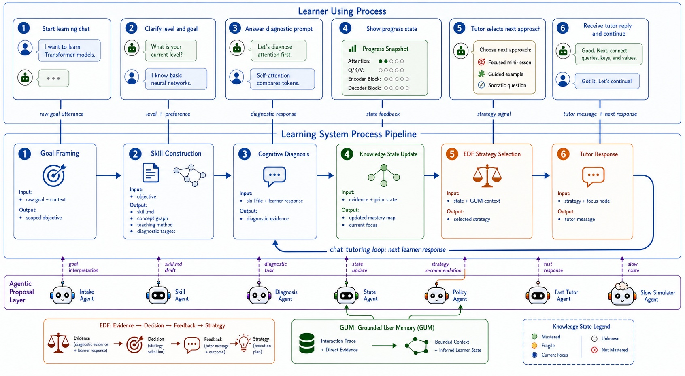

Paper Title : 
Keywords: 

Abstract : 

(#COMMENTS: Actually I'm wondering with this new agentic architecture, is this my creation? or the innovation is owned by the related work author? Am I have the right to publish this paper or research ?)

I. Introduction

II. Related Work
(#COMMENTS: - reference use APA 6 : misc/PELICAN_mvp/docs/references/11211_PELICAN_Personalized_Edu.pdf, misc/PELICAN_mvp/docs/references/Evidence-Decision-Feedback_EDF.pdf, misc/PELICAN_mvp/docs/references/Creating General User Models from Computer Use.pdf)

III. Methods

**Figure 1. Agentic PELICAN learning engine methodology.**

The proposed method treats PELICAN as the pedagogical skeleton of the learning engine and uses agentic roles only at points where pedagogical judgment is ambiguous. As illustrated by the Transformer-model learning example in Figure 1, the learner interacts with the system through a chat-based learning process rather than through autonomous agents directly. A stated learning goal enters goal framing as a raw goal utterance, intake answers provide level and preference signals, diagnostic or practice replies enter cognitive diagnosis, tutor messages are returned through the chat UI, and progress feedback is derived from the current learner state. This creates a closed tutoring loop: after each tutor response, the learner continues replying in chat, and the next learner response re-enters the diagnosis and tutoring cycle.

The method is organized as a data-flow process with explicit inputs and outputs at each stage. Goal framing consumes the raw learner goal and context, then outputs a scoped learning objective. Skill construction consumes this objective, then outputs a validated skill file, concept graph, teaching method, and diagnostic targets. Cognitive diagnosis consumes the skill file and learner response, then outputs diagnostic evidence. Knowledge-state update consumes evidence and the prior state, then outputs an updated mastery map and current focus. EDF strategy selection uses the updated state and GUM context to select a teaching strategy. Tutor response generation then converts the selected strategy and focus node into either a fast tutor response or a slow tutor response. The resulting tutor message is returned to the learner through chat and loops back into cognitive diagnosis when the learner replies.

The learner knowledge state is the central state object of the method. The system distinguishes direct evidence from inferred mastery, so a learner's answer can update both the current focus node and related prerequisite nodes. The generated skill file provides the domain teaching map for a target topic, including concept structure, prerequisite relations, diagnostic targets, and teaching method. Cognitive diagnosis validates whether the learner has mastered, partially mastered, or failed to demonstrate a concept. This design follows the PELICAN principle that diagnosis and tutoring should be coupled: the tutor does not merely answer questions, but continuously revises its estimate of what the learner knows.

The agentic layer is designed as a proposal layer rather than an autonomous controller. Functional roles such as the Intake Agent, Skill Agent, Diagnosis Agent, State Agent, Policy Agent, Fast Tutor Agent, and Slow Simulator Agent produce concrete artifacts for their corresponding pipeline stages. These artifacts include goal interpretations, skill file drafts, diagnostic task drafts, state update proposals, strategy recommendations, fast tutor responses, and slow tutor responses or alternative teaching routes. The pipeline remains the system process that coordinates these artifacts, which prevents free-form model output from replacing the pedagogical flow while still allowing language models to contribute flexible pedagogical reasoning.

EDF and GUM provide the adaptive decision and memory mechanisms under the PELICAN cycle. EDF converts evidence into a teaching decision, feedback form, and strategy selection. GUM maintains grounded learner memory, including observed learner evidence, inferred knowledge state, and bounded context memory. Together, these components allow each tutoring turn to be selected from the learner's current evidence rather than from a static script.

The main methodological responsibilities are:

- PELICAN defines the sequence of goal framing, cognitive diagnosis, knowledge-state update, and adaptive tutoring.
- Skill construction defines the teachable concept structure, prerequisite relations, diagnostic targets, teaching method, and validated skill file for a topic.
- EDF selects the next pedagogical action, such as explanation, decomposition, analogy, hinting, confirmation, or prerequisite review.
- GUM stores the learner's direct evidence, inferred state, and recent learning context.
- The Learning System Process Pipeline coordinates learner inputs, agent artifacts, EDF decisions, and GUM memory updates.

IV. Experiments
