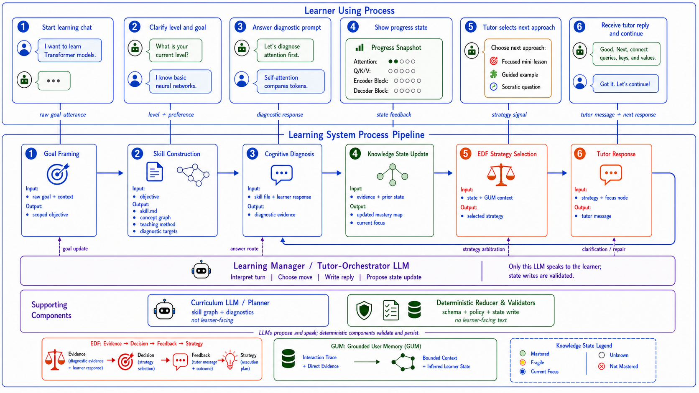

# Paper Title : Agentic PELICAN: A Skill-Grounded Learning Engine for Cognitive Diagnosis, Adaptive Tutoring, and Learner-State Memory

Keywords: Personalized education; large language models; cognitive diagnosis; adaptive tutoring; agentic learning systems; Evidence-Decision-Feedback; general user models; knowledge tracing; scaffolding

## Abstract : 

Large language models (LLMs) have created new opportunities for personalized education, but directly using an LLM as a tutor often produces generic explanations that are not grounded in a learner's evolving cognitive state. This paper proposes Agentic PELICAN, a prototype learning-engine architecture that treats PELICAN as the pedagogical control process while concentrating learner-facing flexibility in a Learning Manager / Tutor-Orchestrator LLM. The system organizes learning into a closed loop of goal framing, skill construction, cognitive diagnosis, knowledge-state update, Evidence-Decision-Feedback (EDF) strategy selection, learner-memory update, and tutor response generation. Instead of distributing dialogue across many speaking agents, the architecture uses one learner-facing orchestrator LLM to interpret the current turn, choose whether to continue, clarify, remediate, or advance, write the tutor reply, and propose state updates. Deterministic reducers and validators then check schema, policy, node references, and legal state transitions before any durable learner state is persisted. A local MVP implementation demonstrates this architecture through a FastAPI-based chat tutor, a skill-backed knowledge tree, deterministic fallback behavior, EDF-style teaching-policy simulation, bounded learner evidence memory, and a browser interface that exposes phase, knowledge state, EDF policy, and activity metadata.
  
(## The contribution of this work is not a replacement for PELICAN, EDF, or general user modeling, but an integration architecture that operationalizes these ideas into a constrained, inspectable learning engine for agentic tutoring. This paper presents the system design, implementation rationale, and planned evaluation directions for measuring whether skill-grounded agentic tutoring improves personalization, interpretability, and pedagogical stability compared with direct LLM tutoring.)

### I. Introduction

Personalized education aims to adapt instruction to the learner's current goals, prior knowledge, misconceptions, and pace of progress. Recent large language models (LLMs) are capable of generating fluent explanations, examples, hints, and problem-solving steps, which makes them attractive as tutoring interfaces. However, a chat-based LLM tutor does not automatically become a personalized learning system. Without an explicit learner model and a pedagogical control process, the model may answer correctly while still failing to diagnose what the learner understands, when to scaffold, when to ask a question, or when to change instructional strategy.

This limitation is especially important in multi-turn tutoring. A learner's answer is not only a message to respond to; it is evidence about the learner's current cognitive state. If the system treats every turn as an isolated prompt-response task, it may provide a useful explanation in the moment but fail to build a stable estimate of mastery over time. Effective tutoring therefore requires a closed loop: the system must diagnose the learner's current state, update that state from evidence, choose an appropriate pedagogical move, and generate feedback that matches both the concept being taught and the learner's demonstrated understanding.

PELICAN provides a useful foundation for this problem because it couples collaborative cognitive diagnosis with adaptive tutoring. In PELICAN, knowledge points are organized as a knowledge-state tree, diagnostic questions are used to estimate mastery, and tutoring strategies are selected according to the learner's observed responses. This makes PELICAN more structured than direct LLM tutoring because the tutor does not simply generate an answer; it first reasons through the learner's position in a concept graph and then adapts instruction accordingly.

At the same time, PELICAN alone does not fully specify how a general-purpose learning engine should handle arbitrary learner goals, runtime skill construction, persistent learner evidence, or agentic LLM components. A learner may enter the system with a broad goal such as "I want to learn deep learning" or "I want to understand Ming dynasty history," rather than a fixed textbook problem. The system must transform that raw goal into a teachable concept structure, choose diagnostic targets, and maintain a memory of direct learner evidence without allowing unvalidated model output to overwrite the pedagogical process.

This paper proposes Agentic PELICAN, a skill-grounded learning-engine architecture that extends the PELICAN tutoring loop with a bounded learner-facing orchestrator. In the proposed method, the Learning Manager / Tutor-Orchestrator LLM is the primary interactive role: it interprets the current turn, handles dialogue-act ambiguity, selects the next tutoring move, writes the reply shown to the learner, and proposes state updates. Other LLM use is limited to support roles such as curriculum planning and skill construction. The learning engine remains responsible for validating proposed artifacts, updating the learner state, selecting the next phase, and preserving the tutoring loop.

The prototype implementation demonstrates this architecture in a local web-based MVP. The system collects a learner topic, learning goal, and background level; resolves the domain category; loads or generates a validated domain skill; compiles it into a session-local knowledge tree; presents successor-first diagnostic questions; updates direct and inferred mastery states; evaluates an EDF-style learner state; records bounded GUM-style evidence memory; and returns adaptive tutor messages through a chat interface. The user interface exposes the current phase, knowledge-state tree, EDF policy, evidence count, and recent engine activity so that the adaptation process remains inspectable.

The main contribution of this work is an integration architecture for agentic personalized tutoring. Rather than claiming to invent cognitive diagnosis, EDF, or general user modeling, this work investigates how these ideas can be composed into a practical learning-engine pipeline where LLMs contribute flexible pedagogical reasoning while deterministic validators and state boundaries preserve instructional control.

### II. Related Work

PELICAN and LLM-powered personalized tutoring. PELICAN proposes a framework for personalized education through LLM-powered cognitive diagnosis and adaptive tutoring (Anonymous, 2026). Its central motivation is that ordinary LLM responses often remain one-size-fits-all: they may provide correct explanations, but they do not necessarily adapt to the learner's cognitive state. PELICAN addresses this problem through two stages. First, collaborative cognitive diagnosis builds and updates a knowledge-state tree, using successor-first diagnosis and an expert-assistant-verifier pipeline to generate and validate diagnostic questions. Second, adaptive tutoring selects teaching strategies based on the estimated learner state and monitors student responses during problem solving. This work adopts PELICAN as the pedagogical skeleton, especially its coupling of diagnosis and tutoring. However, the present system differs by focusing on runtime learning-goal intake, skill-file construction, validated artifact boundaries, EDF-style decision metadata, and learner-memory integration in a local agentic learning engine.

Evidence-Decision-Feedback for adaptive scaffolding. Cohn et al. (2026) introduce Evidence-Decision-Feedback (EDF) as a theory-driven framework for adaptive scaffolding with LLM agents. EDF organizes pedagogical agent behavior around three linked responsibilities: collecting evidence about learner understanding, making pedagogical decisions from that evidence, and generating adaptive feedback. This is closely aligned with the requirements of a learning engine because it prevents feedback generation from being separated from evidence and instructional intent. In Agentic PELICAN, EDF is used as the adaptive decision layer. Learner answers are first treated as evidence, the system updates a learner-state snapshot, and the tutor response is selected from a constrained strategy policy rather than produced as an unconstrained chat completion.

General User Models and learner memory. Shaikh et al. (2025) propose General User Models (GUMs), which transform unstructured computer-use observations into structured, confidence-weighted propositions about a user's behavior, knowledge, beliefs, and preferences. Although GUMs are broader than education, their core idea is relevant to personalized tutoring: user-facing systems need memory structures that preserve useful context while remaining explicit about what is observed, inferred, and revisable. Agentic PELICAN adapts this idea in a narrower educational setting. The system stores direct learner evidence separately from inferred mastery or EDF policy state, so that a learner's answer can be used as grounded evidence without allowing the system to confuse inference with observed fact.

Agentic architecture in education. Recent work on LLM-based educational agents shows that agentic workflows can improve flexibility, but they also introduce risks when models are allowed to plan, decide, and act without clear pedagogical constraints. In tutoring, a system may generate plausible but poorly sequenced instruction, skip diagnosis, over-help the learner, or treat a learner's vague goal as proof of mastery. The architecture proposed here therefore avoids a crowded multi-agent dialogue design. It uses a single learner-facing Learning Manager / Tutor-Orchestrator LLM for turn-level flexibility, while deterministic reducers and validators remain responsible for schema checks, policy boundaries, state persistence, and mastery updates.

Position of this work. The present work builds on PELICAN for cognitive diagnosis and adaptive tutoring, EDF for evidence-grounded scaffolding decisions, and GUM for structured user-memory principles. Its novelty lies in the composition of these ideas into a skill-grounded learning engine where conversational flexibility and durable state ownership are separated. The system introduces a validated domain-skill layer between learner goals and diagnosis, separates direct evidence from inferred learner state, and constrains LLM outputs to proposals inside a transparent tutoring pipeline.

### III. Methods

**Figure 1. Agentic PELICAN learning engine methodology.**

The proposed method treats PELICAN as the pedagogical skeleton of the learning engine and uses a Learning Manager / Tutor-Orchestrator LLM as the main learner-facing role. As illustrated by the Transformer-model learning example in Figure 1, the learner interacts with a single chat tutor rather than with multiple visible agents. A stated learning goal enters goal framing as a raw goal utterance, intake answers provide level and preference signals, diagnostic or practice replies enter cognitive diagnosis, tutor messages are returned through the chat UI, and progress feedback is derived from the current learner state. This creates a closed tutoring loop: after each tutor response, the learner continues replying in chat, and the next learner response re-enters the diagnosis and tutoring cycle.

The method is organized as a data-flow process with explicit inputs and outputs at each stage. Goal framing consumes the raw learner goal and context, then outputs a scoped learning objective. Skill construction consumes this objective, then outputs a validated skill file, concept graph, teaching method, and diagnostic targets. Cognitive diagnosis consumes the skill file and learner response, then outputs diagnostic evidence. Knowledge-state update consumes evidence and the prior state, then outputs an updated mastery map and current focus. EDF strategy selection uses the updated state and GUM context to select a teaching signal. Tutor response generation is then handled by the Learning Manager / Tutor-Orchestrator LLM, which uses the focus node, teaching signal, recent dialogue, and learner memory to write the complete reply shown to the learner. In parallel, the LLM may propose a state update, but deterministic reducers and validators must approve that proposal before it can change persistent learner state.

The learner knowledge state is the central state object of the method. The system distinguishes direct evidence from inferred mastery, so a learner's answer can update both the current focus node and related prerequisite nodes. The generated skill file provides the domain teaching map for a target topic, including concept structure, prerequisite relations, diagnostic targets, and teaching method. Cognitive diagnosis validates whether the learner has mastered, partially mastered, or failed to demonstrate a concept. This design follows the PELICAN principle that diagnosis and tutoring should be coupled: the tutor does not merely answer questions, but continuously revises its estimate of what the learner knows.

The agentic layer is simplified into a supporting proposal and validation layer. A Curriculum LLM / Planner may assist skill construction by drafting a skill graph and diagnostic targets, but it is not learner-facing. The Learning Manager / Tutor-Orchestrator LLM is the only model role that speaks to the learner. It interprets the current turn and dialogue act, decides whether the system should continue, clarify, remediate, or advance, writes the learner-facing reply, and proposes state updates. Deterministic reducers and validators are not agents and do not generate learner-facing text; they validate schemas, enforce policy constraints, check node identifiers and legal state transitions, and persist the mastery map and memory updates. This separation allows the system to keep conversational flexibility without allowing free-form model output to replace the pedagogical state machine.

EDF and GUM provide the adaptive decision and memory mechanisms under the PELICAN cycle. EDF converts evidence into a teaching decision, feedback form, and strategy selection. GUM maintains grounded learner memory, including observed learner evidence, inferred knowledge state, and bounded context memory. Together, these components allow each tutoring turn to be selected from the learner's current evidence rather than from a static script.

The main methodological responsibilities are:

- PELICAN defines the sequence of goal framing, cognitive diagnosis, knowledge-state update, and adaptive tutoring.
- Skill construction defines the teachable concept structure, prerequisite relations, diagnostic targets, teaching method, and validated skill file for a topic.
- EDF selects the next pedagogical action, such as explanation, decomposition, analogy, hinting, confirmation, or prerequisite review.
- GUM stores the learner's direct evidence, inferred state, and recent learning context.
- The Learning Manager / Tutor-Orchestrator LLM provides the single learner-facing reply and proposes turn-level actions.
- Deterministic reducers and validators apply only verified state transitions, policy checks, and memory updates.
- The Learning System Process Pipeline coordinates learner inputs, LLM proposals, EDF decisions, and GUM memory updates.

### IV. Experiments

### References

Anonymous. (2026). PELICAN: Personalized education via LLM-powered cognitive diagnosis and adaptive tutoring. Paper under review at ICLR 2026.

Cohn, C., Guo, S., Rayala, S., Wang, H. D., Mohammed, N., Timalsina, U., Jain, S., Eeds, A., Deweese, M., Popp, P. J. O., Stanton, R., Walker, S., Ma, M., & Biswas, G. (2026). Evidence-Decision-Feedback: Theory-driven adaptive scaffolding for LLM agents. arXiv. https://doi.org/10.48550/arXiv.2602.01415

Shaikh, O., Sapkota, S., Rizvi, S., Horvitz, E., Park, J. S., Yang, D., & Bernstein, M. S. (2025). Creating general user models from computer use. In Proceedings of the 38th Annual ACM Symposium on User Interface Software and Technology. https://doi.org/10.1145/3746059.3747722
