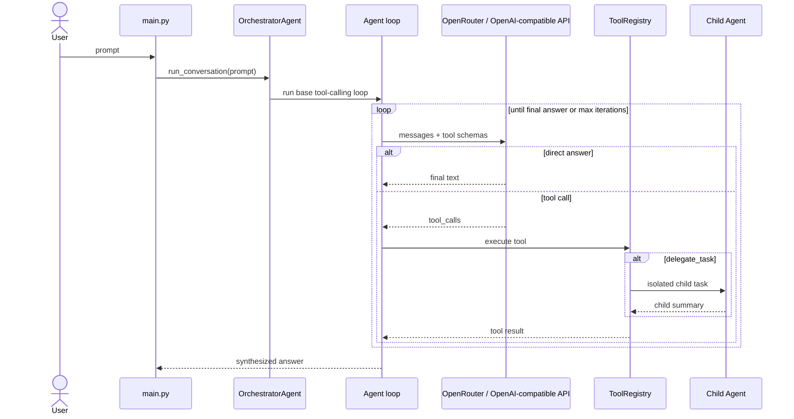

# Orchestration Agent MVP

This MVP demonstrates a Hermes-style orchestration agent in a small Python
codebase. The model owns the control loop, tools are capabilities, and
`delegate_task` lets the top-level agent spawn isolated child agents when a task
is worth decomposing.

## Architecture



## Core Concepts

- `core/agent.py`: the reusable OpenAI-compatible tool-calling loop.
- `core/tools.py`: converts Python functions into JSON tool schemas and executes them.
- `core/delegation.py`: owns `delegate_task`, child-agent creation, role/depth checks, and delegation traces.
- `core/orchestrator.py`: builds the top-level orchestration agent and exposes `delegate_task`.

## Delegation Roles

- `leaf`: focused worker. It receives normal tools only and cannot delegate.
- `orchestrator`: coordinator worker. It can receive `delegate_task` when
  `max_spawn_depth` allows nested delegation.

## Tool Policies

`delegate_task` accepts a `tool_policy` argument so child agents do not misuse
tools while doing conceptual analysis.

- `none`: no tools are exposed to the child. Use this for explanations,
  architecture analysis, summaries, and other conceptual tasks.
- `base`: expose normal tools such as calculator or weather. Use this only when
  the child genuinely needs computation or external data.
- `delegate`: expose normal tools and `delegate_task` to an orchestrator child
  when nested delegation is useful and depth allows it.

Example:

```json
{
  "goal": "Explain tool calling architecture without running example tools.",
  "context": "Focus on design, not live data.",
  "role": "leaf",
  "tool_policy": "none"
}
```

The MVP is intentionally synchronous: the parent waits for each delegated child
summary before continuing its own model loop. This keeps the architecture easy
to inspect before adding parallel or durable queue behavior.

## Running

```bash
cd misc\agent_mvp
python -m venv .venv
.venv\Scripts\activate
pip install -r requirements.txt
set OPENROUTER_API_KEY=your_openrouter_key
python main.py
```

Ask a simple question to see direct answering, or ask for a decomposable task to
let the model choose whether to call `delegate_task`.

## Testing

```bash
python -m pytest misc/agent_mvp/tests/test_orchestration.py
```
