# Agent MVP Framework

這是一個基於 Python 的輕量級、可擴展的 AI Agent 框架最小可行性產品 (MVP)。本專案的設計理念深受大型框架 (如 `hermes-agent`) 的啟發，旨在以最簡潔的程式碼展示 **「代理核心迴圈 (Agent Loop)」**、**「工具呼叫 (Function Calling/Tool Use)」** 與 **「上下文記憶管理 (Memory)」** 的運作原理。

---

## 🏗️ 系統架構圖 (Architecture Diagram)

以下使用 Mermaid 繪製了本 Agent 框架的核心決策與資料流動架構：

```mermaid
sequenceDiagram
    actor User
    participant Main as main.py (CLI)
    participant Agent as core/agent.py (Agent)
    participant Memory as core/memory.py
    participant LLM as OpenRouter / OpenAI API
    participant Tools as core/tools.py (Registry)

    User->>Main: 輸入文字 (e.g., "算 1+1")
    Main->>Agent: run_conversation(user_input)
    Agent->>Memory: add_message("user", user_input)
    
    rect rgb(40, 40, 60)
        Note right of Agent: 🔁 Agent Loop (直到達成目標或超出 max_iterations)
        loop While iterations < max_iterations
            Agent->>Memory: get_messages()
            Agent->>Tools: get_schemas()
            Agent->>LLM: 傳送 Messages + Tools Schemas
            LLM-->>Agent: 回傳 Response (Tool Call 或純文字)
            
            alt 需要呼叫工具 (Tool Calls)
                Agent->>Memory: add_message("assistant", tool_calls)
                Agent->>Tools: execute_tool(name, args)
                Tools-->>Agent: 回傳執行結果 (JSON string)
                Agent->>Memory: add_message("tool", result)
                Note right of Agent: 進入下一圈迴圈，讓 LLM 看見工具結果
            else 任務完成 (純文字回覆)
                Agent->>Memory: add_message("assistant", final_answer)
            end
        end
    end
    
    Agent-->>Main: 回傳 Final Answer
    Main-->>User: 顯示結果
```



---

## 🛠️ 核心元件與程式碼解析

本框架將關注點嚴格分離（Separation of Concerns），維持了 **「核心極簡，能力向邊緣擴展」** 的設計哲學。

### 1. 核心大腦與自動化迴圈 (`core/agent.py`)
`Agent` 類別是整個系統的狀態機。它負責與語言模型溝通，並決定是否要繼續執行工具。傳統的 API 呼叫只會執行一次，而這裡實作了 **主動決策迴圈**。

**關鍵程式碼設計：**
```python
def run_conversation(self, user_message: str) -> str:
    self.memory.add_message("user", user_message)
    iterations = 0
    
    # 這是 Agent 能夠「自主解決問題」的秘密所在：While 迴圈
    while iterations < self.max_iterations:
        messages = self.memory.get_messages()
        tools = self.tool_registry.get_schemas()
        
        # 呼叫 LLM
        response = self.client.chat.completions.create(
            model=self.model, 
            messages=messages, 
            tools=tools
        )
        response_message = response.choices[0].message
        
        # 【條件 1】：LLM 決定不需要工具，直接回答 -> 終止迴圈
        if not response_message.tool_calls:
            self.memory.add_message("assistant", response_message.content)
            return response_message.content

        # 【條件 2】：LLM 決定呼叫工具
        # 1. 將 LLM 的「呼叫請求」存入記憶
        self.memory.add_message("assistant", response_message.content, tool_calls=[...])

        # 2. 實際在本地端執行 Python 函式
        for tool_call in response_message.tool_calls:
            result = self.tool_registry.execute_tool(tool_call.function.name, tool_call.function.arguments)
            # 3. 將「執行結果」存入記憶，並標註角色為 "tool"
            self.memory.add_message("tool", result, tool_call_id=tool_call.id)
            
        iterations += 1 # 進入下一圈，LLM 會基於剛才的工具結果進行下一步判斷
```

### 2. 工具動態註冊器 (`core/tools.py`)
要讓 LLM 能夠使用本地端的功能，我們必須將 Python 函式轉換為 LLM 懂的 JSON Schema 格式。`ToolRegistry` 透過 Python 內建的 `inspect` 模組，**自動解析** 函式的 Type Hints 與 Docstrings，實現了極佳的開發者體驗 (Developer Experience)。

**關鍵程式碼設計：**
```python
def register_tool(self, func: Callable, description: str = None):
    name = func.__name__
    self.tools[name] = func
    
    # 動態讀取函式的 Signature (參數與型別)
    sig = inspect.signature(func)
    
    # 映射為 OpenAI 格式的 JSON Schema
    schema = {
        "type": "function",
        "function": {
            "name": name,
            "description": description or func.__doc__, # 自動讀取 Docstring
            "parameters": { "type": "object", "properties": {}, "required": [] }
        }
    }
    
    # 遍歷參數並轉換型別，開發者只需寫標準 Python 程式碼，不需手寫複雜的 Schema JSON
    for param_name, param in sig.parameters.items():
        # ... (自動轉換 int -> integer, str -> string 等)
```

### 3. 嚴格的上下文狀態管理 (`core/memory.py`)
在 Agent 迴圈中，維護對話歷史（Context）是極為重要的。現代 API (如 OpenAI / OpenRouter) 對於角色的順序有嚴格要求（例如 `tool_calls` 之後必須緊接 `tool` 角色的回覆）。

`Memory` 類別隱藏了這些複雜度，並確保我們符合 Prompt Caching 的最佳實踐——只在列表尾端附加新訊息，不隨意竄改過往歷史。

```python
def add_message(self, role: str, content: str, **kwargs):
    """
    支援標準的 text content，也支援 **kwargs 傳入 tool_calls 或 tool_call_id
    """
    msg = {"role": role, "content": content}
    msg.update(kwargs)
    self.messages.append(msg)
```

### 4. 進入點組裝 (`main.py`)
這是將所有元件像樂高一樣組合起來的地方。它展示了如何定義工具、註冊工具、並啟動 Agent。

```python
# 1. 定義普通 Python 函式
def calculator(a: float, b: float, operator: str) -> float:
    """Perform basic arithmetic operations: '+', '-', '*', '/'"""
    # ...

# 2. 實例化記憶體與工具註冊器
memory = Memory(system_prompt="You are a helpful AI assistant. Use tools when necessary.")
registry = ToolRegistry()

# 3. 註冊工具
registry.register_tool(calculator)
registry.register_tool(get_weather)

# 4. 啟動 Agent (預設連接至 OpenRouter)
agent = Agent(memory=memory, tool_registry=registry)
```

---

## 🚀 如何啟動

1. **環境配置**
   請在專案根目錄下建立 `.env` 檔案，並設定您的 API Key：
   ```env
   OPENROUTER_API_KEY=your_openrouter_api_key_here
   ```

2. **安裝套件**
   ```bash
   pip install -r requirements.txt
   ```

3. **執行終端機互動**
   ```bash
   python main.py
   ```
